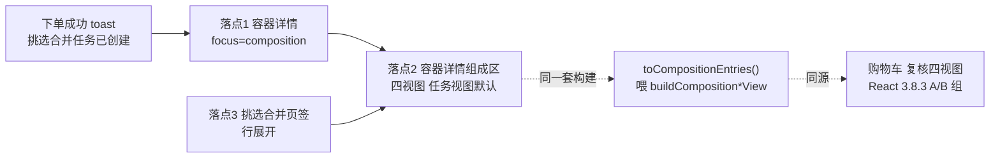
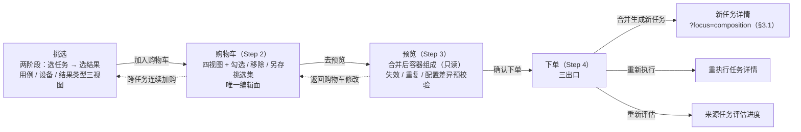

# 18 · 挑选合并 —— 合并后任务（挑选合并容器）呈现（Vue 规范）

> 卡 **INT-1718** ｜ UX设计师C ｜ 2026-10-24 ｜ 性质：**UX设计-VUE 实施卡的输入**（只写规范，不写前端代码）
> 口径来源：React 版 `doc/UX设计规范/18_挑选合并功能交互重设计.md` **§5.5**（INT-1699，`design/ux-redesign` @ `1b4b9fff3`）+ `18_合并后任务呈现_可视稿.html`
> 执行口径（devloop §3.4）：**功能口径照 React 版**（视图层级 / 纯函数语义 / 只读性 / 降级规则），**风格与组件照原 Vue**（`theme.css` / `theme-presets.css` / `components/common/**` / Font Awesome / Inter），**不引入 React-newAPI 样式**；圆角一律用 `--radius-*` 语义令牌，CSS 冻结期内不硬编码颜色 / 圆角 / 阴影 / 间距（INT-757）。
> 落位：新 Vue 前端 `frontend/`（本项目 `design/ux-vue`），与 `00_导航与功能对齐总表.md` **D03 行**（任务结果挑选合并）配套使用。

---

## 0. 文档性质与边界

### 0.1 为什么单独成文

React §5.5 定义的是**合并完成之后**容器任务长什么样、在哪三处看到它、部分失败怎么标。Vue 侧此前只同步到 React §3.8（三视图 / 两阶段挑选，实施卡 INT-1110：`frontend/src/components/task/pick/{PickTree.vue,pickTree.ts}`），**没有任何容器呈现章节**；本文件把 §5.5 完整同步为 Vue 口径，供 UX规划师拆实施卡。

### 0.2 与既有文档的关系

| 文档 | 关系 |
| --- | --- |
| React `18_挑选合并功能交互重设计.md` §5.5 / §9 文案 | **口径唯一来源**（功能、层级、纯函数、六态、文案） |
| React `18_挑选合并功能交互重设计.md` §5.1 / §5.2 / §5.3（INT-1988） | **向导第 3 步「预览」口径来源**；Vue 同步见本文 **§16**（INT-2005） |
| 本目录 `00_导航与功能对齐总表.md` **D03 行** | 已登记「§5.5 合并后任务呈现已同步（INT-1718）」；导航 / 权限 / 路由以总表为准 |
| 本目录 `00` §1（风格基准）/ §5（版式要点） | 组件拼装与 token 口径；本文件不重复 |
| 前端实现 `frontend/src/components/task/pick/**` | **现状事实源**（§1.4 差距清单）；实施卡只做增量 |

> 编号说明：本文 `§11-8`、`§3.8.3`、`§4.2` 等均指 **React 版 18_挑选合并** 的同号章节；`§x.y` 无前缀时指本文件章节。

### 0.3 不变量（实施卡不得突破）

1. **同源四视图**：组成区不另造一套树——与购物车 / 复核抽屉共用同一套视图构建（§4）。任务视图任务在**首级**；用例 / 设备 / 结果类型三视图任务在**末级**（叶的前一级），与 React §3.8.3 A/B 两组逐字一致。
2. **只读**：容器是既成事实，组成区**不渲染复选框、无「移除该组」**。
3. **不新增端点**：只复用 `GET /tasks/cherry-picks/{id}/source` + 既有 `GET /tasks/{id}`（详情补拉）。
4. **不新增后端字段**：§11-8 契约落地前按 §4.6 降级口径展示，字段落地后自动切回真实口径，树结构不变。
5. **非容器静默**：详情页判定为非容器时**不留痕**（不渲染组成区、不渲染合并徽章、不进错态）。

---

## 1. 事实基线（2026-10-24 真实库实测）

### 1.1 数据来源与只读声明

- 连接方式：docker 网关 `http://localhost:15000`，`/health` 返回 `database=intelligent_audio_test`（主库，非 `_test`）。
- 本卡**未写入任何数据**：以下取值来自主库只读查询（容器 580 / 503 均为**已软删**的历史容器，关系行未级联，属真实生产副本数据）；本卡未新建容器、未改任何真实记录。
- React §5.5 的事实基线（容器 580，2026-10-24 01:07:59Z 创建）与本卡复核的取值一致。

| 项 | 实测取值（真实数据） | 出处 |
| --- | --- | --- |
| 容器 580 | `name=小艺拒识挑选合并_2026/10/24 09:12:31`、`description=挑选合并自 2 个来源任务`、`status=completed`、`total_cases=5`、`completed_cases=2`、`failed_cases=3`、`deleted=t`（`deleted_at=2026-10-24 01:15:49Z`） | `test_tasks` 只读查询 |
| 关系行 | 580 共 5 行：源任务 **384**（`E2E测试任务_2026/9/21 14:09:29`）→ 结果 3792 / 3796；源任务 **419**（`小艺拒识E2E测试任务_2026/10/13 17:32:59`）→ 结果 5714 / 5715 / 5716；`source_device_id=9` 全部一致 | `task_cherry_pick_relations` |
| 用例行 | 580 有 5 条用例关系：`0dc13869…` / `88a1d74d…` / `a03cc920…` 为 `execution_status=failed`，`14a13fa8…` / `77ca28bc…` 为 `completed`；5 条 `evaluation_status` 均 `completed` | `task_case_relations` |
| 源结果状态 | 3792 `failed`、3796 `failed`、5714 `completed`、5715 `completed`、5716 `completed`；`result_type` 均为空 | `test_results` |
| 用例名 | 6 个 `source_case_id`（580 五条 + 503 一条）中 **3 个在 `test_cases` 已不存在**（`a03cc920…` / `88a1d74d…` / `1e98e5e6…`）→ 叶行与用例卡必须降级「未知用例」；现存 3 条为长中文用例名（JS161 / JS062 / JS177） | `test_cases` |
| 设备 | `id=9` → `pura90小艺` | `devices` |
| 单来源容器 503 | `description=挑选合并自 1 个来源任务`、1 条用例、`completed_cases=0`、`failed_cases=1`、关系行 1 行（源任务 401 → 结果 3837 `failed`）、容器已软删 | 同上 |
| 当前存活容器 | `test_tasks` 中无未删除的挑选合并容器（关系行 230 行多为历史孤儿） | 只读查询 |
| 详情接口 | `GET /tasks/{id}` 返回体**无 `is_cherry_pick` / `merge_type`**；前端只能靠 `source` 端点识别容器 | `api_gateway/schemas/task.py`、前端实现 |
| 溯源端点 | `GET /api/v1/tasks/cherry-picks/{task_id}/source`（`api_gateway/routes/cherry_pick_bp.py:96`，权限 `task:read`）返回 `{task_id,is_cherry_pick,total,groups[{source_task_id,source_task_name,results[{id,result_id,source_case_id,source_device_id,source_api_id,created_at,missing}]}]}`；**只到 id 级，无用例名 / 设备名 / result_type / 结果级状态 / 源任务状态** | `cherry_pick_service.py:868` `source_trace` |
| 非容器返回 | 关系表无行 → `source_trace` 返回 `data.code=404` → gRPC `_resp` 弹出丢弃（`task_service/interfaces/grpc/cherry_pick.py:23`）→ 网关 `_CODE_HTTP_MAP.get(None, 400)` 兜底 → **HTTP 400 + `code:203`**，不是 404 | 代码链实读 |
| 容器描述默认值 | `挑选合并自 {n} 个来源任务`（下单「说明」留空时后端生成） | `cherry_pick_service.py:752` |

### 1.2 两个实测结论（决定本节设计）

1. **部分失败混在状态里**：5 条用例 3 条失败，容器 `execution_status` 直接是 `failed`，列表与详情只显示「已失败」，用户看不出「5 条里失败 3 条」。
2. **状态口径打架**：容器用例行状态继承**源 TaskCase**，而所选结果自身的执行状态可能不同——实测结果 **5715 为 `completed`，对应用例行 `0dc13869…` 却是 `failed`**。因此「组成」区叶行状态**必须取源结果状态**（§11-8 落地前按 §4.6 降级），且用例卡必须标注继承来源，否则用户看到「叶成功、父失败」的矛盾。

### 1.3 容器是合法终态

- 容器创建即终态：`status=completed`，无执行过程、无日志、无 `test_results`（结果经关系表引用源结果）。
- `started_at=min(源结果创建时间)`、`completed_at=max(源结果创建时间)` → 实测跨度「2026-09-21 → 2026-10-14」，**不具业务含义**，不得展示为耗时。
- 单来源容器是合法形态（`checkout_merge` 不限制来源数，实测 503 / 472 各 1 源 1 结果）→ **任务视图恒渲染任务层**，即使只有 1 个来源任务。

### 1.4 Vue 侧现状差距（实施卡必须知道）

| # | 现状（文件:行） | 影响 | 本规范要求 |
| --- | --- | --- | --- |
| G1 | 购物车只有「任务 → 用例 → 设备/API → result_type」单视图（`components/task/pick/cartTree.ts:33` `buildCartTree`），**无用例 / 设备 / 结果类型三视图、无任务视图子模式**（React §3.8.3 A/B、§4.2 尚未同步） | 组成区四视图没有可复用的同源构建 | 拆卡时把「购物车 / 复核四视图」列为**前置卡**（§13 P0）；组成区调同一套纯函数，不另写树 |
| G2 | 挑选树三视图（`pickTree.ts:117/163/204`）**没有任务层**（阶段 1 已选任务，故不需要） | 不能直接拿来当组成区三视图（多来源任务会丢失归属） | 组成区三视图**必须在叶前加任务层**（§4.2） |
| G3 | `CartTree.vue:37-46` / `CartTreeNodeRow.vue` / `PickCaseCard.vue:67-81` 无只读态（复选框恒渲染） | 组成区会出现可勾选复选框 = 误导 | 增加 `readonly` 透传：隐藏三态复选框与移除钮，保留展开/收起 |
| G4 | 详情页无组成区；`TestExecutionComponent.vue` 恒渲染「任务信息 + 进度概览」两列网格（`:13`）、关联用例页签（`:190`）、实时日志（`:469`） | 容器上进度 / 日志恒空、`used_time` 误导 | 增加容器形态（§2.4） |
| G5 | `PickSource` 类型未声明 `sourceDeviceId` / `sourceApiId` / `resultCreatedAt`（`infrastructure/api/cherryPickApi.ts:121-137`；后端实际返回 `source_device_id` / `source_api_id`，`result_created_at` 属 §11-8 待补） | 前端拿不到设备 / API 归属 | 类型补齐（纯类型改动，无端点变化）；**`resultCreatedAt` 只映射 §11-8 的 `result_created_at`，禁止映射 `results[].created_at`（关系行时间）**（§4.6） |
| G6 | Vue 用 **hash 路由**（`router/index.ts:125` `createWebHashHistory`） | React 的 `/tasks/{id}#composition` 在 Vue 里会把 `#composition` 当路由片段 | Vue 落点改用 **`/tasks/{id}?focus=composition`**（§3.1） |

---

## 2. 标识与信息头

### 2.1 列表行（挑选合并页签，Vue 为 `TaskCard` 卡片行）

- 现状：`views/Tasks/CherryPickPanel.vue:74-84` 用 `TaskCard` 渲染容器行（`:mapContainerTask`），次行有 meta 胶囊与双状态徽章（`components/task/TaskCard.vue:22-28`）。
- 容器行增加：
  - 名称右侧 **合并方式徽章**：`picked` → 「结果挑选」（`--secondary` 系 outline）；`whole` → 「整任务合并」（历史形态）。
  - 次行文本：**「来源 {n} 个任务 · 结果 {m} 条」**（`Task.sourceTaskCount` / `Task.sourceResultCount`，`domain/model/task.ts:161`）。
  - 「执行状态」徽章：容器 `executionStatus === 'failed'` 且 **0 < `failedCases` < `caseCount`** → 显示 **「部分失败」**（`--warning` + 小圆点）；`failedCases === caseCount` 才显示「已失败」（沿用现映射）；其余照现逻辑。
  - 该映射是**纯前端展示映射**，后端字符串仍是 `failed`，不改契约。

### 2.2 容器详情信息头（新增 `ContainerHeaderBadges.vue`）

插入位置：`TestExecutionComponent` 任务信息卡头行、任务名之后（`components/layout/TestExecutionComponent.vue:15` `.task-info-panel` 内）。

| 元素 | 取值 / 规则 | 数据源（不新增端点） |
| --- | --- | --- |
| 合并方式徽章 | 恒为「结果挑选」（outline）；判定条件 = `source` 端点 **200 且 `groups` 非空** | `PickSource.isCherryPick` |
| 来源任务数 | 「来源 {n} 个任务」；点击弹 **Popover**：每个来源任务名 + `groups[].results.length` 条；**源任务状态位在 §11-8 的 `source_task_status` 落地前不渲染、不占位、不显示「—」** | `source.groups[]` |
| 结果数 | 「结果 {m} 条」 | `source.total` |
| 用例数 | 「用例 {c} 个」 | 详情 `caseCount`（`domain/model/task.ts:141`） |
| 创建时间 | mono 小字 `YYYY-MM-DD HH:mm` | 详情 `createdAt` |
| 混合态徽章 | `0 < failedCases < caseCount` → 「部分失败 {f}/{c}」（`--warning`）；`failedCases === caseCount` → 「全部失败」（`--destructive`）；`= 0` → 不显示 | 详情 `failedCases` / `caseCount` |

**「挑选合并自 {n} 个来源任务」文案裁定**：保留为**描述字段默认值**（可编辑），但**不在信息头重复堆叠**；信息头改用「来源 / 结果 / 用例」三段结构化摘要（可扫读、可溯源）。

### 2.3 容器识别（Vue 判定写死）

新增一个 composable（§12 落位）：`useContainerComposition(taskId)` 内先调 `cherryPickApi.getSource(taskId)`，**任意异常一律归一 `null`**（`cherryPickApi.ts:286` 走 `request` 会抛 `ApiError`，需 `try/catch` 包裹，**不改 `request` 既有语义**）。

| 端点返回 | 判定 | 呈现 |
| --- | --- | --- |
| 200 且 `groups` 非空 | 挑选合并容器 | 渲染 §2.2 信息头 + §3.2 组成区 |
| 200 且 `groups=[]` | 容器（关系行缺失异常态） | 渲染信息头；组成区走 §7「无来源记录」空态 |
| 任何 4xx（实测 **400 / `code:203`**） | **非挑选合并容器**（普通任务 / 整任务合并容器） | **静默**：不渲染组成区、不渲染合并徽章、不进错态，详情保持现状 |
| 5xx / 网络中断 | 同 4xx（一并归一 `null`） | 同静默；详情页绝不因可选增强区变成错误页 |

> 4xx 是常态（站内绝大多数任务不是容器），**不做重试、不弹「加载失败」**。
> 200 不等于「容器存活」：`source` 只查关系表、不校验容器 Task 是否存活（容器软删后关系行不级联）——详情页正确性由 `GET /tasks/{id}` 本身兜底。

### 2.4 容器详情版面调整（相对现「两列卡片 + 页签 + 日志」）

| 区域（现 Vue 结构） | 容器上如何处理 | 理由 |
| --- | --- | --- |
| 任务信息卡（`TestExecutionComponent.vue:15`） | **保留**，头行追加 §2.2 徽章组；容器形态下**占满整行**（原 1fr/1fr 网格改单列） | 基本信息仍需要 |
| 进度概览（`:106`） | **隐藏** | 容器无执行过程，进度恒 100%；`used_time` 是跨月跨度，展示即误导 |
| **「组成」区（新增）** | **首屏主区**，紧跟任务信息卡，位于关联页签之前 | 这是「合并后的任务长什么样」的答案 |
| 「关联用例」页签（`:190`） | **降级为「用例清单」折叠区**，置于组成区之后，默认收起 | 组成区已按用例组织；平铺清单只作批量查看入口 |
| 「关联设备 / API」页签（`:194`，标题随 `testType` 渲染「关联设备」/「关联API」） | **保留**，从页签组独立为「关联资源」折叠区，默认收起、位于「用例清单」之后；原设备 / API 列表渲染不变 | 与组成区互补：组成区回答「结果怎么来的」，资源区回答「跑在什么上」。设备 / API 从源任务继承，是容器唯一可核对的环境信息，**不随用例清单一起降级**（对齐 React §5.5.2 ④「API 资源 / 关联资源：保留」） |
| 实时日志（`:469`） | **隐藏**（`show-logs=false` 或容器形态自动关闭） | 容器无执行记录，日志区恒空 |
| 报告区 | **保留**，空态改为引导手动生成（§7） | 容器不自动生成报告 |

> **页签去向写死**：容器形态下原「关联用例 / 关联设备（API）」页签组**不再以页签形式出现**，改为「用例清单（{c}）」+「关联资源（{d}）」两个**独立折叠区**（均在组成区之后、默认收起）；两个折叠区互不依赖，可分别展开。非容器任务保持现页签形态不变。
>
> 整任务合并容器（`task_merge_relations`，无逐结果引用）**不适用**本节：`source` 解析不到 → 走「非容器」分支 → 保持现状四区。列表侧仍按 `mergeType='whole'` 显示「整任务合并」徽章与来源计数。

---

## 3. 三处落点：同一套视图构建、同一套层级



| 落点 | Vue 位置 | 默认视图 | 关键要求 |
| --- | --- | --- | --- |
| **① 下单成功落点** | `CherryPickWizard.vue` merge 成功 toast 后 → `Tasks.vue:758 handlePickCheckedOut` → `router.push('/tasks/{id}?focus=composition')` | 组成区 · 任务视图 | **默认落到「组成」区并把该区滚到可视区顶部**，进入时组成区外描边高亮 1.2s 后消退（`motion-safe`）；**不得**落在空的进度 / 日志 / 关联用例上。Vue 用 query 参数而非 `#hash`（hash 路由，见 G6）；详情为模态窗（`TaskDetailModal`），滚动容器是模态窗内容区而非 window |
| **② 容器详情「组成」区** | `TaskDetailModal.vue` → `TestExecutionComponent` 任务信息卡之后 | 组成区 · 任务视图 | 四视图切换器（任务视图默认｜用例｜设备｜结果类型）+ 工具行（执行状态 / 评估状态筛选 + 全部展开 / 全部收起）；**任务视图恒渲染任务层**（含单来源容器） |
| **③ 挑选合并页签行展开** | 替换 `CherryPickPanel.vue:86-129` 的「源结果溯源」分支（`whole` 分支保持源任务列表不变） | 组成区 · 任务视图 | 保留「来源 {n} 个任务 · 结果 {m} 条」计数行；展开区高度上限 `420px` 内滚动；行不跳页即可看完整结构；**首次展开按需补 1 次 `GET /tasks/{id}`**（§4.3） |

### 3.1 落点 ① 的 Vue 化细节

- 下单成功现有 toast：`挑选合并任务已创建（ID {id}），可手动生成报告`（`CherryPickWizard.vue:1049`）；不改文案，只改跳转目标。
- `handlePickCheckedOut` 现为 `router.push('/tasks/{id}')`（`Tasks.vue:761`）→ 改为带 `?focus=composition`；非 merge 出口（reexecute / reevaluate）**不加**该参数。
- `TaskDetailModal` 挂载完成且 `source` 解析为容器后：`nextTick` → 取组成区 DOM → `scrollIntoView({block:'start', behavior:'smooth'})` → 加高亮类 1.2s 后移除；非容器（静默判定）时忽略该参数，不报错。

### 3.2 四视图层级（与 React §3.8.3 / §5.5.3 逐字一致）

| 视图 | 层级（自上而下） | 复用（Vue） |
| --- | --- | --- |
| **任务视图**（默认） | 任务 → 用例层组织（分组 / 标签 + 平铺 / 交叉）→ 用例卡 → 设备/API → result_type → 叶（源结果行） | `buildCompositionTaskView`（树基座同 `buildCartTree`）+ `PickCaseOrgList` |
| **用例视图** | 用例层组织 → 用例卡 → 设备/API → result_type → **任务** → 叶 | `buildCompositionCaseView` |
| **设备视图** | 设备/API → result_type → 用例层组织 → 用例卡 → **任务** → 叶 | `buildCompositionDeviceView` |
| **结果类型视图** | result_type → 设备/API → 用例层组织 → 用例卡 → **任务** → 叶 | `buildCompositionResultTypeView` |

- **任务层恒渲染**（含单来源容器），叶行**去掉来源任务名**（归属由任务层表达）。
- 组织层位置（INT-1725 口径）：设备 / 结果类型视图在 `result_type` 之下、用例卡之上；任务视图在其设备 / 结果类型子模式内同样带这一层。
- 组织控件（`PickCaseOrgList.vue`）在四视图**共享同一份会话态**（分组视图 / 标签视图、平铺 / 交叉）。
- **下单前的同源形态**（向导第 3 步「预览」）复用同一套四视图，但**整层跳过用例层组织**、数据源换成购物车快照 —— 见 **§16**（INT-2005）。

---

## 4. 数据装配与纯函数（Vue 落位）

### 4.1 组成条目模型（与购物车条目 `PickCartItem` 同形，不新造字段口径）

```ts
// domain/model/containerComposition.ts（新）
export interface CompositionEntry {
  resultId: number
  sourceTaskId: number
  sourceTaskName: string
  sourceCaseId: string | null
  sourceCaseName: string | null      // 缺名 → null（展示降级「未知用例」）
  sourceDeviceId: number | null
  sourceDeviceName: string | null
  sourceApiId: number | null
  sourceApiName: string | null
  resultType: string | null          // 缺值 → null（展示「结果类型待补充」）
  executionStatus: string | null     // 源结果状态；降级期取容器用例行
  evaluated: boolean | null          // null = 未知（不显示徽章）
  missing: boolean
  /** 源结果自身创建时间（§11-8 的 result_created_at）；未落地 → null，叶行时间位不渲染 */
  resultCreatedAt: string | null
  /** 用例分组名（详情 cases[].group_name；用例层组织数据源；缺值 → null 落「未分组」） */
  groupName: string | null
  /** 用例标签（详情 cases[].tags；缺值 → [] 落「未设置标签」） */
  tags: string[]
}
```

### 4.2 纯函数（`components/task/pick/cartTree.ts` 或新 `compositionTree.ts`，二者只留一处）

| 函数 | 职责 |
| --- | --- |
| `toCompositionEntries(source, detailCases, detailDevices, detailApis)` | `source.groups[].results[]` → `CompositionEntry[]`；用 `source_case_id = case_id` join 用例名 + **`group_name` → `groupName`** + **`tags`**，用 `source_device_id = device.id`、`source_api_id = api.id` join 设备 / API 名；**`resultCreatedAt` 只取 `results[].result_created_at`，禁止取 `results[].created_at`（关系行时间）** |
| `summarizeComposition(entries, filters)` | `{total, failed, unevaluated, missing, taskCount, caseCount, deviceCount}`，按**过滤后**叶统计 |
| `buildCompositionTaskView(entries)` | 任务 → 组织层 → 用例卡 → 设备/API → result_type → 叶 |
| `buildCompositionCaseView(entries)` | 组织层 → 用例卡 → 设备/API → result_type → 任务 → 叶 |
| `buildCompositionDeviceView(entries)` | 设备/API → result_type → 组织层 → 用例卡 → 任务 → 叶 |
| `buildCompositionResultTypeView(entries)` | result_type → 设备/API → 组织层 → 用例卡 → 任务 → 叶 |
| `organizeCompositionCases(entries, org, subView)` | 用例层组织（分组视图 / 标签视图 × 平铺 / 交叉）→ 组织分组；**与 React `domain/lib/container-composition.ts` 的 `organizeCompositionCases` 同口径**：先按 `groupName` / `tags` 聚合用例单元，交叉子视图改按另一维度再分子组，空组不下发 |
| `filterCompositionTree(roots, execStatus, evalStatus)` | 命中叶保留 + 保留全部祖先 + 分支计数按命中集重算；**不改变层级结构与展开态** |

> **组织字段不得走兜底提示**：`CompositionEntry` 的 `groupName` / `tags` 有值时，组织控件**必须不显示**「候选未返分组/标签字段…」提示（该提示由 `PickCaseOrgList.vue:18` 的 `showFallbackHint`（`:155`）在「全落单兜底桶」时自动出现）。组成区需给 `PickCaseOrgList` 增 `hint` 入参（`hint?: string | null`，缺省沿用现提示），**组成区显式传 `hint=null`**；只有详情 `cases[]` 确实没有组织字段时，才允许保留兜底提示。禁止让组成区在真实分组数据在场时显示与事实相反的文案。

> 与购物车同源的落地方式：购物车四视图前置卡（§13 P0）产出的 view builder 若已存在，组成区**直接调**；不存在时先按上表签名实现于同一模块，购物车卡落地时**复用同一函数**（禁止复制第二份）。

### 4.3 落点数据来源（不新增端点）

| 落点 | 请求 | 说明 |
| --- | --- | --- |
| ② 容器详情 | 详情 `GET /tasks/{id}`（本就在）+ `source` | 详情侧零额外请求 |
| ③ 页签行展开 | 列表 DTO 只有任务名与计数、**无 `cases[]`** → **首次展开补 1 次 `GET /tasks/{id}`** | 结果按 `taskId` 缓存在 composable 的 `Map<number, CompositionModel>`；再次展开复用、收起不释放、不重复请求 |
| 落点 ③ 补拉失败 | `GET /tasks/{id}` 报错 | 展开区 `Empty` + 「重试」；行本体与计数照常 |

> 列表首屏仍是「1 次列表 + 1 次 source 批量」，**只有被展开的行**多 1 次详情查询。§11-8 落地后 `source` 一次到位，落点 ③ 的补拉可去掉。

### 4.4 只读语义

组成区**不渲染复选框**、无「移除该组」；需要改动的用户走 §6「复用本次结果重新挑选」。

### 4.5 叶行内容

`源结果 #{result_id}`（mono）+ 用例名（缺名降级「未知用例」，**不裸显 UUID**）+ 设备/API 名 + result_type Badge（缺省「结果类型待补充」）+ 执行状态徽章 + 评估状态徽章 + 源结果时间（mono；**仅当 §11-8 的 `result_created_at` 有值时渲染，未落地不占位、不显示「—」**）+ 「溯源」按钮（跳源任务详情）。

### 4.6 降级口径（§11-8 字段落地前）

| 字段 | 降级取值 | 落地后 |
| --- | --- | --- |
| `executionStatus` | 取同 `source_case_id` 的**容器用例行**状态 | `source.results[].execution_status` |
| `evaluated` | 取容器用例行 `evaluation_status === 'completed'` | `source.results[].evaluated` |
| `resultType` | 全部折叠为「结果类型待补充」 | `source.results[].result_type` |
| `caseName` / `deviceName` / `apiName` | 由详情 `cases[]` / `devices[]` / `apis[]` join（不受契约阻塞） | `source.results[]` 直接给 |
| `groupName` / `tags` | 由详情 `cases[]` 的 `group_name` / `tags` join（**实测容器用例行已带**，不受契约阻塞：`api_gateway/application/services/task/task_query_service.py:222-223`、`schemas/task.py:119`） | 仍由详情 join（§11-8 不补这两个字段） |
| **`resultCreatedAt`** | **不渲染时间位**（不占位、不显示「—」）；**禁止把 `source.results[].created_at` 当源结果时间**——它是 `task_cherry_pick_relations` **关系行**的创建时间（并入容器的时间，实测 5 条同值且与容器 `created_at` 逐微秒相同） | `source.results[].result_created_at` |
| 源任务状态 | 不显示（不占位） | `groups[].source_task_status` |

工具行右端在降级期显示一次性提示：**「结果级执行 / 评估状态待后端补字段，当前按用例状态显示」**（会话内可关闭）。**执行、评估任一降级即显示**——判定 = 存在条目的 `executionStatus` 取自用例行 **或** `evaluated` 取自用例行；字段落地后两个来源都消失，提示自动不再出现（否则「未评估」筛选恒空没有解释）。

---

## 5. 部分失败 / 未评估条目的呈现

| 位置 | 呈现 | 口径 |
| --- | --- | --- |
| **叶行** | 执行状态徽章（已完成 `success` / 已失败 `destructive` / 已停止 `muted`）+ 评估状态徽章（已评估 `secondary` / **未评估** `outline` muted） | 取源结果状态（降级见 §4.6） |
| **分支节点计数** | 全部成功 →「{n} 条」；有失败 →「{n} 条 · 失败 {f}」（失败部分用 `--destructive` 文本色）；有失效 → 追加「· 失效 {k}」 | 按该节点下**过滤后**叶统计，随筛选实时重算 |
| **用例卡** | 若用例继承状态与叶不一致 → 卡右上 info 图标 + Tooltip「用例状态继承自来源任务；结果状态以叶行为准」 | 实测真实冲突（5715） |
| **容器信息头** | 「部分失败 {f}/{c}」/「全部失败」/ 不显示 | 见 §2.2 |
| **列表执行状态** | 混态「部分失败」（`--warning` + 小圆点）；全失败「已失败」 | 纯前端展示映射 |
| **筛选联动** | 工具行「执行状态」（全部 / 已完成 / 已失败 / 已停止）+「评估状态」（全部 / 已评估 / 未评估）；**纯客户端过滤**，命中叶保留祖先、计数重算，不改层级与展开态 | 与挑选树同一套 facet 语义，不写 URL |

**「部分失败任务可被挑选」解释文案**：容器内出现失败条目是**正常业务态**（实测 117 个可挑选任务中 33 个 `failed`、5 个 `stopped` 均可被挑选），文案不得出现「异常」「失败任务不可合并」等误导表述。

---

## 6. 再次挑选入口

| 入口 | 位置 | 行为 | 权限 |
| --- | --- | --- | --- |
| **复用本次结果重新挑选** | 容器详情操作组（`TaskDetailModal.vue:14-23` 现有动作区，与「生成 AI 报告」并列） | 取该容器全部 `result_id`（`source`）→ `POST /tasks/cherry-picks/cart/items` 批量加购（后端幂等跳过已加购）→ toast → 打开购物车抽屉（可「去复核」） | `task:cherry_pick`（`domain/enums.ts:449`） |
| **开始挑选** | 同一操作组（次级按钮） | 打开挑选向导阶段 1（`CherryPickWizard`，`step='pick'`），**不预筛**任何来源任务 | `task:cherry_pick` |
| 行内「溯源」 | 组成区叶行尾部 | 打开源任务详情并定位该结果 | `task:read` |

- 容器本身**不进阶段 1 可挑选清单**（实测容器无 `test_results`）；纳入需改后端任务聚合口径，另立卡。
- 「复用本次结果重新挑选」**不复制容器、不新建任务**，只是把同一批源结果重新交给购物车。
- 无 `task:cherry_pick` 的角色（algo_engineer / guest）：两个入口隐藏，组成区与信息头照常可见（只读）。

---

## 7. 空态与失效（六态）

| 场景 | 判定 | 呈现 | 文案 |
| --- | --- | --- | --- |
| 源结果已删除 | `results[].missing = true` | 叶行整行 muted + 删除线 + 徽章「已失效」；节点计数追加「· 失效 {k}」；组成区顶部 Alert（`--warning`） | 「{k} 条源结果已失效（源任务或结果已被删除），仅保留溯源记录」+ 操作「只看失效」 |
| 容器无来源记录 | `groups=[]`（200 但无引用行） | 组成区 `Empty`（虚线框） | 「该任务没有合并来源记录」/「若它是历史合并任务，来源关系可能在合并功能上线前生成」 |
| 页签行展开补拉详情失败 | `GET /tasks/{id}` 报错 | 展开区 `Empty` + 「重试」，行本体与计数照常 | 「组成加载失败」 |
| 组成区筛选无命中 | 筛选后 0 条 | 树区 `Empty`（工具行保持可见） | 「无符合筛选条件的来源结果」+「重置筛选」 |
| 无报告 | 列表项 `reports.count = 0` | 报告区 `Empty` | 「该合并任务暂无报告」/「合并任务无执行过程，报告需手动生成」+ 按钮「生成报告」 |
| 加载中 | 请求 pending | 骨架 = 信息头 StatBadge 骨架 + 树骨架 3 层 | — |

- **详情页 `source` 任何 4xx / 5xx / 网络异常 → 非容器静默，不进错态、不渲染组成区**（§2.3）。
- 只有落点 ③ 的详情补拉失败才走「组成加载失败」错态。

---

## 8. 布局结构与参照源

### 8.1 参照源出处（实施卡直接读）

| 层 | 文件 | 用途 |
| --- | --- | --- |
| 详情壳 | `frontend/src/components/common/modal/TaskDetailModal.vue` | 承载容器详情、动作区、路由页复用（`views/Tasks/TaskDetailView.vue:12`） |
| 详情正文 | `frontend/src/components/layout/TestExecutionComponent.vue` | 任务信息 / 进度 / 关联页签 / 日志四区（容器态改造点） |
| 容器列表 | `frontend/src/views/Tasks/CherryPickPanel.vue` | 列表行、合并方式 facet、溯源展开（落点 ③） |
| 列表卡 | `frontend/src/components/task/TaskCard.vue` + `TaskCard.css` | 双状态徽章、meta 胶囊、操作钮 |
| 树 | `components/task/pick/{CartTree.vue, CartTreeNodeRow.vue, cartTree.ts, PickTree.vue, pickTree.ts}` | 树基座、节点行、纯函数写法参照 |
| 用例卡 | `components/common/test-case/PickCaseCard.vue` / `TestCaseCard.vue` | 用例节点渲染（compact） |
| 组织控件 | `components/task/pick/PickCaseOrgList.vue` | 分组 / 标签 + 平铺 / 交叉 |
| 令牌 | `assets/styles/{theme.css, theme-presets.css}` | 圆角 / 语义色 / 字体 / 阴影 |
| API | `infrastructure/api/cherryPickApi.ts`（`getSource` 286） | 溯源端点与类型 |
| 容器列表状态 | `composables/task/useCherryPickContainers.ts` | 列表 / facet / 分页 |

### 8.2 落点 ② 线框（容器详情）

```
┌ 任务详情（模态窗 / 路由页，容器形态）────────────────────────────┐
│ [生成 AI 报告]      [复用本次结果重新挑选] [开始挑选]              │  ← 动作区（task:cherry_pick）
├──────────────────────────────────────────────────────────────┤
│ 任务信息卡（整行）                                              │
│  任务名   [结果挑选]  [部分失败 3/5]                             │  ← ContainerHeaderBadges
│  描述：挑选合并自 2 个来源任务                                    │
│  [来源 2 个任务▾] [结果 5 条] [用例 5 个]      创建 2026-10-24 09:12 │  ← StatBadge 组（来源可点 Popover）
├──────────────────────────────────────────────────────────────┤
│ 组成  [只读]                              来源 2 个任务 · 结果 5 条 │  ← 组成区（首屏主区）
│ [任务视图][用例视图][设备视图][结果类型视图]  [分组视图|标签视图] [平铺|交叉] │
│ [执行状态 ▾][评估状态 ▾]              [全部展开][全部收起]        │
│ ⚠ 本容器由 2 个来源任务挑选合并生成…（降级期提示）                 │
│ ▾ ▤ 小艺拒识E2E测试任务_2026/10/13 17:32:59            3 条        │
│     ▾ 分组：拒识（3 个用例）                                       │
│       ▦ 用例卡（名称/CaseId/算法/计数）           1 条             │
│         ▣ pura90小艺                                               │
│           ▾ ◇ 结果类型待补充                                       │
│             • 源结果 #5714 [已完成][已评估] 溯源↗   ← 时间位 §11-8 落地后才显示 │
│ ▾ ▤ E2E测试任务_2026/9/21 14:09:29              2 条 · 失败 2       │
│     …                                                          │
├──────────────────────────────────────────────────────────────┤
│ ▸ 用例清单（5）                    ← 原「关联用例」降级为折叠区      │
│ ▸ 关联资源（1）                    ← 原「关联设备 / API」页签保留     │
├──────────────────────────────────────────────────────────────┤
│ 报告：该合并任务暂无报告 / 合并任务无执行过程，报告需手动生成 [生成报告] │
└──────────────────────────────────────────────────────────────┘
（进度概览、实时日志：容器形态不渲染）
```

### 8.3 落点 ③ 行展开（页签内）

```
[TaskCard 容器行：名称 · [结果挑选] · 来源 2 个任务 · 结果 5 条 · [部分失败]]
  ▸ 源结果溯源                                   ← 点击展开（替换现「源任务→结果分组」平铺）
  ┌ 组成区（同落点 ②，只读，高度上限 420px 内滚动） ┐
  └ 首次展开补拉 1 次 GET /tasks/{id}，按 taskId 缓存 ┘
```

### 8.4 尺寸与密度（与原 Vue 树一致，不另设标度）

| 项 | 值 | 备注 |
| --- | --- | --- |
| 节点行高 | 32px | 与 `CartTreeNodeRow` 一致 |
| 每级缩进 | 16px | `paddingLeft = depth * 16 + 8`（现实现） |
| 分支图标 | 14px | Font Awesome `fa-caret-right` / `fa-caret-down` |
| 计数 Badge | 11–12px mono | 胶囊圆角 `--radius-pill` |
| 叶行字号 | 12px | `--text-xs` 等价 |
| 展开区滚动上限 | 420px | 落点 ③ |
| 高亮描边 | `box-shadow: 0 0 0 2px color-mix(in srgb, var(--primary) 40%, transparent)`，1.2s 渐隐 | 落点 ①，`prefers-reduced-motion` 下直接无动画 |

---

## 9. 字体层级与 token 引用

### 9.1 字体

`--font-sans` = Inter（`theme.css:17-19`）；数字 / ID / 计数一律 `font-variant-numeric: tabular-nums` + 等宽族。

| 层级 | 字号 / 字重 | 用途 |
| --- | --- | --- |
| 卡片主标题 | 16px / 600 | 容器名（与现任务信息卡一致） |
| 分区标题 | 14px / 600 | 「组成」「用例清单」「报告」 |
| 分支节点名 | 14px / 500 | 任务 / 设备 / result_type |
| 叶行 | 12px / 400 | 源结果行 |
| 徽章 / 计数 | 11–12px / 500 | StatBadge、节点计数、状态徽章 |
| 说明 / hint | 12px / 400，`--muted-foreground` | 描述、提示、降级说明 |

### 9.2 Token 引用（全部取现值，不硬编码）

| 用途 | Token | 现值（浅 / 深） |
| --- | --- | --- |
| 主色（主按钮、可点、高亮） | `--primary` / `--primary-hover` | `#ff6a00` / `#e65c00` ; `#ff8c3b` / `#ffa05c` |
| 容器卡片表面 | `--card` / `--card-foreground` | `#ffffff` / `#333333` ; `#333333` / `#f5f5f5` |
| 页面底 | `--background` | `#ffffff` ; `#2a2a2a` |
| 描边 / 分隔 | `--border` | `#e5e7eb` ; `rgba(255,255,255,.12)` |
| 次要文字 / 失效 | `--muted-foreground` | `#777777` ; `#a3a3a3` |
| 浅底块 / 骨架 | `--muted` | `#f5f5f5` ; `#3a3a3a` |
| 成功（已完成 / 已评估） | `--success` / `--success-light` | `#52c41a` ; `#6fd45c` |
| 失败（已失败 / 全失败） | `--destructive` / `--destructive-light` | `#f5222d` ; `#ff6b70` |
| 部分失败 / 警告 | `--warning` / `--warning-light` | `#ffa940` ; `#ffc069` |
| 次色（已评估 / 合并方式徽章） | `--secondary` / `--secondary-light` | `#1976d2` ; `#6aa5e0` |
| 选中 / hover 浅底 | `--accent` | `rgba(255,106,0,.10)` ; `rgba(255,138,59,.18)` |
| 卡片圆角 | `--radius-card`（= `--radius-xl` 16px） | 卡片 / 展开区 / 模态窗 |
| 控件圆角 | `--radius-control`（8px） | 按钮 / 下拉 / 分段控件 |
| 小元素圆角 | `--radius-tag`（4px） | 小标签 / 复选框 |
| 状态胶囊 | `--radius-pill` | 状态徽章 / 计数 Badge |
| 卡片阴影 | `--shadow-sm` / `--shadow-md` | 列表卡 hover / 弹层 |
| 等宽 | `--font-mono` | ID / 计数 / 时间 |

> **CSS 冻结**：不新增全局 css 文件；新增样式写在组件 `<style scoped>` 或既有 `components/task/pick` 样式块内；不写硬编码颜色 / 圆角 / 阴影 / 间距回退值；不用 `!important`、全局选择器泄漏、内联 style；缺变量在交付评论列出（devloop §3.4）。

---

## 10. 组件与交互细节

### 10.1 状态矩阵

| 元素 | 默认 | hover | 展开 / 选中 | 禁用 / 只读 |
| --- | --- | --- | --- | --- |
| 视图切换（4 项） | `--muted-foreground` 文本、透明底 | 文本转 `--foreground` | 选中：`--accent` 底 + `--primary` 文本 + `--radius-control` | 只读时不适用（容器不可选） |
| 组织切换（2×2） | 同上 | 同上 | 同上 | — |
| 分支节点行 | `--foreground` | 行底 `--muted`（圆角 `--radius-control`） | 展开箭头旋转 90° | — |
| 叶行 | 12px，`--muted-foreground` 辅助信息 | 行底 `--muted` | — | `missing`：整行 60% 透明 + 删除线 |
| 「溯源」按钮 | 文本钮 `--secondary` | 下划线 / 加深 | — | 无权限时隐藏 |
| StatBadge（来源可点） | `--secondary-light` 底 + `--secondary` 文本 | 底加深 8% | Popover 打开时加 `--ring` 描边 | 无来源时显示「0 个」不可点 |
| 「复用本次结果重新挑选」 | 主按钮 `--primary` + 白字，`--radius-control` | `--primary-hover` | 加载中转圈 + 禁用 | 无 `task:cherry_pick` 隐藏 |

### 10.2 加载与骨架

- 组成区首次加载：信息头 StatBadge 骨架（3 个胶囊）+ 树骨架 3 层 × 4 行；骨架用 `--muted`，不做闪动过强动画（`prefers-reduced-motion` 下静态）。
- 落点 ③ 行展开：仅展开区骨架，`TaskCard` 行不动。

### 10.3 弹层（Popover / Tooltip / 下拉）在模态窗内

容器详情是**模态窗**（`TaskDetailModal`）。节点行 / 徽章的 Popover、Tooltip、下拉若用 `Teleport to body`，必须显式压过模态窗层级：项目现有 `GlobalModalContainer` 的 z-index 机制为准，**不得**沿用组件默认值造成被遮罩盖住（INT-1106 教训：teleport 下拉 z-index 低于遮罩）。落位建议：优先用 `Teleport` + 与模态同一层级容器，或改用不 teleport 的就地浮层。

### 10.4 深浅色

- 全部取 §9.2 语义令牌，深浅两套自动成立；**不写死浅色值**。
- 深色下注意：`--card #333333` 与 `--background #2a2a2a` 仅差一级，卡片必须保留 `--border` 描边，否则边界消失；`missing` 叶行用 `--muted-foreground` + 删除线而非降透明（深色降透明会读不清）。
- 高亮描边用 `color-mix(in srgb, var(--primary) 40%, transparent)`，深浅通用。

### 10.5 无障碍与键盘

- 视图切换 = `role="tablist"` + `role="tab"`，左右方向键切换。
- 树节点 `role="treeitem"` + `aria-expanded`；叶行 `role="treeitem"` 无子。
- 状态徽章文本可读（不只靠颜色）：已完成 / 已失败 / 已停止 / 部分失败 / 已失效 / 未评估 均为文字。

---

## 11. 中文文案全量

### 信息头

- 「结果挑选」「来源 {n} 个任务」「结果 {m} 条」「用例 {c} 个」
- 「部分失败 {f}/{c}」「全部失败」
- 「创建时间 {YYYY-MM-DD HH:mm}」
- 来源 Popover：标题「来源任务」；行「{来源任务名}」「{n} 条」；空「无来源任务记录」

### 组成区

- 标题「组成」、徽章「只读」
- 视图：「任务视图」「用例视图」「设备视图」「结果类型视图」
- 组织：「分组视图」「标签视图」「平铺」「交叉」
- 工具：「执行状态」「评估状态」「全部状态」「已完成」「已失败」「已停止」「全部」「已评估」「未评估」「全部展开」「全部收起」「重置筛选」
- 计数：「{n} 条」「{n} 条 · 失败 {f}」「{n} 条 · 失效 {k}」
- 节点：「{来源任务名}」「分组：{组名}」「未分组」「未设置标签」「{设备名}」「API {api_id}」「结果类型待补充」
- 叶行：「源结果 #{id}」「未知用例」「已失效」「溯源」「未评估」「已评估」
- 提示：「用例状态继承自来源任务；结果状态以叶行为准」「仅执行失败 / 部分失败的任务也可被挑选合并，失败条目按原状态呈现」「结果级执行 / 评估状态待后端补字段，当前按用例状态显示」
- 说明：「本容器由 {n} 个来源任务挑选合并生成，无执行过程；结果状态为挑选时的快照，报告需手动生成。」

### 组成区之后的折叠区（容器形态）

- 「用例清单（{c}）」「关联资源（{d}）」「收起」
- 关联资源空态：「该任务暂无关联设备 / API」

### 操作

- 「生成报告」「复用本次结果重新挑选」「开始挑选」「只看失效」「重试」「生成 AI 报告」

### 空态 / 错误

- 「该任务没有合并来源记录」「若它是历史合并任务，来源关系可能在合并功能上线前生成」
- 「无符合筛选条件的来源结果」
- 「合并来源加载失败」「组成加载失败」「组成加载失败，请重试」
- 「该合并任务暂无报告」「合并任务无执行过程，报告需手动生成」
- 「{k} 条源结果已失效（源任务或结果已被删除），仅保留溯源记录」

### 列表行

- 「结果挑选」「整任务合并」「来源 {n} 个任务 · 结果 {m} 条」「部分失败」「已失败」
- 页签行展开：「源结果溯源」「收起溯源」「源任务列表（{n} 个）」「该合并任务暂无来源记录」「溯源加载失败，请重试」

### toast

- 成功：「挑选合并任务已创建（ID {id}），可手动生成报告」（不变）
- 再次挑选：「已加入购物车 {n} 条（{k} 条源结果已失效未加入）」「已加入购物车 {n} 条（重复 {k} 条已跳过）」
- 失败：「加入购物车失败」

---

## 12. 组件树与 DDD 四层落位（Vue）

### 12.1 组件树（interfaces 层）

```
views/Tasks/CherryPickPanel.vue                 容器列表（页签）
├─ components/task/TaskCard.vue                 容器行（+ 合并方式徽章 / 部分失败徽章）
└─ components/task/pick/ContainerTraceExpand.vue   ★新增：落点 ③ 行展开
     └─ ContainerComposition.vue                 ★新增：组成区宿主（读只读树）

components/common/modal/TaskDetailModal.vue     容器详情（模态 / 路由页）
├─ components/layout/TestExecutionComponent.vue 详情正文（新增 container-mode）
│    ├─ ContainerHeaderBadges.vue                ★新增：信息头徽章组 + 来源 Popover
│    ├─ ContainerComposition.vue                 ★新增：组成区（落点 ②）
│    │    ├─ ContainerViewSwitcher.vue           ★新增：四视图 + 工具行
│    │    ├─ PickCaseOrgList.vue                 复用：分组 / 标签组织控件（新增 hint 入参，组成区传 null）
│    │    └─ CartTree.vue（readonly）            复用：树（新增 readonly 透传）
│    │         └─ CartTreeNodeRow.vue（readonly）
│    │              └─ PickCaseCard.vue（无勾选）
│    ├─ 用例清单折叠区（原「关联用例」页签降级）
│    └─ 关联资源折叠区（原「关联设备 / API」页签保留）
└─ 动作区：复用本次结果重新挑选 / 开始挑选
```

### 12.2 DDD 四层

| 层 | 落位 | 说明 |
| --- | --- | --- |
| **domain** | `domain/model/containerComposition.ts`（`CompositionEntry` / `CompositionSummary`）、`components/task/pick/compositionTree.ts`（纯函数） | 零依赖、纯函数、可单测；不 import API / Vue |
| **application** | `composables/task/useContainerComposition.ts` | `getSource` + 详情补拉 + join + 派生摘要；落点 ②/③ 共用；列表侧按 `taskId` 缓存 |
| **infrastructure** | `infrastructure/api/cherryPickApi.ts`（仅**补类型**：`PickSourceGroup.results[]` 增 `sourceDeviceId` / `sourceApiId` / `resultCreatedAt`（对应 §11-8 的 `result_created_at`，**不映射 `created_at`**）；**不新增函数**） | 唯一 snake_case 出现层；异常归一由 application 侧 `try/catch` 处理 |
| **interfaces** | 上表 ★ 新增组件 + `TestExecutionComponent` 容器形态 | 纯 props / emit，不直连 API |

### 12.3 关键 props / emit

- `ContainerComposition`：`entries`、`view`、`execFilter`、`evalFilter`、`orgMode`、`orgLayout`、`loading`、`error`；emit `retry`、`trace`。
- `ContainerHeaderBadges`：`source`、`failedCases`、`caseCount`、`createdAt`；emit `trace`。
- `ContainerTraceExpand`：`taskId`、`summary`；内部调 composable，首次展开拉详情。

---

## 13. 实施卡拆分建议（供 UX规划师拆卡，按依赖排序）

| # | 卡 | 范围 | 依赖 | 建议分道 |
| --- | --- | --- | --- | --- |
| **P0** | **购物车 / 复核四视图基座**（对齐 React §3.8.3 A/B + §4.2） | `cartTree.ts` 增 `buildCartTaskView` / `buildCartCaseView` / `buildCartDeviceView` / `buildCartResultTypeView`；`CartDrawer.vue` / `CherryPickWizard.vue` 复核步骤加视图切换；任务层末级 / 首级两组层级 | 无（纯前端） | Vue 页面 B（任务域） |
| **P1** | **数据契约（FEAT·后端）** | `GET /tasks/cherry-picks/{id}/source` 的 `results[]` 增 `result_type` / `execution_status` / `evaluated` / `case_name` / `device_name` / `api_name` / `result_created_at`，`groups[]` 增 `source_task_status` | 无 | 后端（主项目 FEAT 卡） |
| **P2** | **容器识别 + 信息头** | `useContainerComposition` 判定（200 且 groups 非空；非 200 静默）+ `ContainerHeaderBadges` + 容器形态版面（隐藏进度 / 日志、任务信息整行、「关联用例」→ 用例清单折叠区、「关联设备 / API」→ 关联资源折叠区） | P1 可并行（先按降级口径） | Vue 页面 B |
| **P3** | **组成区 + 四视图** | `CompositionEntry` / `toCompositionEntries` / `buildComposition*View` + `ContainerComposition` + `ContainerViewSwitcher` + `CartTree readonly` 透传 + 组织控件 + 筛选联动 | **P0**（同源函数）、P2 | Vue 页面 B |
| **P4** | **页签行展开替换** | `CherryPickPanel.vue` 的 `picked` 分支 → `ContainerTraceExpand`（首次展开补拉详情 + 按 `taskId` 缓存）；`whole` 分支保持源任务列表 | P3 | Vue 页面 B |
| **P5** | **下单落点** | merge 成功后 `router.push('/tasks/{id}?focus=composition')` + 模态内滚动 + 1.2s 高亮 | P2 | Vue 页面 B |
| **P6** | **部分失败展示映射** | 列表「部分失败」、节点「{n} 条 · 失败 {f}」、叶行状态 / 评估徽章、信息头混合态 | P2（列表映射可更早） | Vue 页面 B |
| **P7** | **空态 / 失效 / 报告引导** | §7 六态 + 报告区空态 + 降级提示条 | P3 | Vue 页面 B |
| **P8** | **再次挑选入口** | 「复用本次结果重新挑选」加购 + 「开始挑选」+ 权限门控 + toast | P2 | Vue 页面 B |

> 与 React 的差异：React 侧 P0 已由 INT-1125 / INT-1499 / INT-1694 落地；Vue 侧**尚无四视图基座**（G1），故 P0 必须先行，否则组成区只能另造一套树（违反同源不变量）。
>
> **INT-2005 追加**：向导第 3 步「预览」（下单前的同源形态）的三张实施卡 **P9 ~ P11 见 §16.10**，与本表 P0~P8 并列；P10 依赖 P0（四视图基座，已由 INT-1831 落地）。
>
> **P0 参照口径提醒（拆卡时必须带上）**：INT-1725 的「设备 / 结果类型视图带用例层组织」在 React 侧**尚未实施**（`buildCartDeviceView` / `buildCartResultTypeView` 当前只有用例视图带组织层，INT-1711 返工时明确「未纳入，另立卡」）。Vue 按本文件 §3.2 新口径实现（四视图都带组织层）是**对的**，但拆卡时**不能拿 React 现状当参照照抄**；若 React 侧另立卡改共用纯函数，Vue 同源函数要一起对齐。

---

## 14. 设计图（真实数据 · 浅 / 深）

- 文件：本目录 `设计图预览/18-合并后任务呈现-Vue.html`（可直接浏览器打开；同页上下两段——`#light-section` 浅色 / `.dark #dark-section` 深色）。
- 内容：落点 ② 容器详情（信息头 + 组成区任务视图 + 「用例清单」「关联资源」两个折叠区 + 报告空态）、落点 ③ 页签行展开（含单来源容器 503 面板）。
- 时间位：叶行时间取 §11-8 的 `result_created_at`，**落地后才显示**；图中时间为示意值（接口当前不返回），已在可视稿内加注。
- 数据：主库 `intelligent_audio_test` 真实取值——容器 580（2 个来源任务 / 5 条结果 / 用例 5 个 / 失败 3 个 / 设备 pura90小艺 / 结果 5715 的用例卡状态冲突）与单来源容器 503（1 源 1 结果 · 全部失败）。两容器已软删，取值为软删前的真实关系行与源结果行。
- 交付评论附渲染图：`INT-1718_容器呈现_浅色.png` / `INT-1718_容器呈现_深色.png`。

---

## 15. 缺口与待办（不在本卡范围）

1. **§11-8 后端字段**（P1）：`source` 端点只到 id 级，缺 §4.6 所列字段与 `groups[].source_task_status`；落地前按降级口径展示。
2. **非容器 HTTP 400 / `code:203`**（契约事实）：前端按「非 200 即非容器，静默」判定；**不得按 404 判定、不得要求后端加别名端点**。
3. **数据缺陷（建议单开修复卡）**：
   - `source` 端点只查关系表、不校验容器 Task 存活，且关系行不随容器软删级联 → 主库现有大量孤儿关系行（本卡复核 230 行，对应容器 580 / 503 / 592~600 等均已软删）；
   - 容器用例行状态继承源 TaskCase，可能与所选结果状态不一致（实测 5715）——根治应让容器 TaskCase 状态按**所选结果**派生。
4. **容器再次挑选**：容器不进阶段 1 可挑选清单（无 `test_results`）；纳入需改后端聚合口径，另立卡。
5. **Vue 购物车四视图基座**（P0）：与 React §3.8.3 A/B 的层级同步；本文件只在组成区范围内定义同源调用，不重复定义购物车交互。
6. **待 React INT-1699 §10.1 拍板（4 项）**：Vue 侧不另行杜撰口径，沿用 React 结论并跟踪变更——
   - **#1 引用视图 vs 快照视图**：#1 建议「跟随源结果 + 失效标记」，本文件 §4.5/§7 已按此写（`missing` 叶行「已失效」）；
   - **#2 容器再次挑选**：容器不进阶段 1 清单（§6）；
   - **#3 页签行展开是否保留平铺溯源为次级「溯源详情」**：**直接影响本文件 §3 落点 ③ 形态**——React 建议「默认视图树 + 保留平铺溯源为次级切换」，**尚未拍板前 Vue 按「只用组成区树」实现**（§3 表 / §8.3），拍板若保留，则 `ContainerTraceExpand` 增「结构 / 溯源详情」二级切换，不影响纯函数与数据装配；
   - **#4 复核步骤是否预览「合并后将生成的任务」→ 已拍板并已同步（INT-1988 设计 / INT-2003 实施 / INT-2005 Vue 同步）**：**是**——向导第 3 步定名「预览」，内容 = 由购物车条目集构造的**合并后容器组成只读预览** + `POST /tasks/cherry-picks/preview` 预校验；编辑只在 Step 2 购物车 / 抽屉；`{n}` 取 `preview.totalResults`（有效条目数）；Step 4 删除重复统计徽章。下单前容器尚未生成（无 id、无关系行），故**不调** `GET /tasks/cherry-picks/{id}/source`，复用 §3.2 同一套四视图。**Vue 口径见本文 §16**（本项不再悬置）。
7. **容器形态下 `TestExecutionComponent` 的 `activeTab` 状态**：非容器仍用 `cases` / `devices` 两个页签；容器形态改为两个折叠区后，`activeTab` 在容器下不再生效（实施卡注意不要留死状态）。

---

## 16. 向导第 3 步「预览」—— 合并后容器组成的只读预览（INT-2005 同步）

> **口径来源**：React `doc/UX设计规范/18_挑选合并功能交互重设计.md` **§5.1（四步主链路）/ §5.2（预览步骤 ①~⑨）/ §5.3（下单步骤去重）**——设计卡 **INT-1988**（`design/ux-redesign` @ `28a3b90b6`），实施卡 **INT-2003**（`87d598ba0`，2026-10-26T10:20Z done）。本章按**已实施口径**同步。
> **执行口径**（devloop §3.4）：功能口径照 React 版；风格与组件照原 Vue（`theme.css` / `theme-presets.css` / `components/common/**` / Font Awesome / Inter），**不搬 React-newAPI 样式**；圆角一律 `--radius-*` 语义令牌，CSS 冻结期内不硬编码颜色 / 圆角 / 阴影 / 间距。
> **编号与位置说明**：本章为 INT-2005 新增，编号续在 §15 之后、**不插号、不重排 §1~§15**——`frontend/src` 的代码注释与既有实施卡对 `§2.2 / §2.3 / §2.4 / §3.1 / §6 / §7 / §8.2 / §8.4` 等本文件编号有引用，重排会毁掉引用。阅读上本章与 §3（容器侧三处落点）、§3.2（四视图层级）是**同一套四视图的「下单前」形态**，建议连读。
> **覆盖边界**：本章只覆盖**向导第 3 步**与其对 Step 4 的连带改动；容器详情 / 页签行展开（§2~§7）不改口径。

### 16.1 四步主链路与导航映射



- **四步定义**：挑选（选）→ 加入购物车（加）→ **预览**（看）→ 合并 / 下单（下）。预览是**独立步骤**，职责是**在不可逆的合并动作之前，让用户看到「合并后长什么样」**，不是把购物车清单再列一遍。
- **步骤名不用「复核」**（三条缘由照 React §5.2，Vue 侧同样成立）：
  ① **撞名**——Vue 站内「复核」已专指结果侧的人工复核 / AI 复核（`components/common/modal/ResultReviewModal.vue`、`AiReviewDialog.vue`、`ai-review/AiReviewSessionDialog.vue`、`common/modal/modalRegistration.ts:242`「人工复核」）；向导步骤再叫「复核」会把两件事混成一件。
  ② **内容重复**——现 Step 3 主体是 `CartTree manageable` 的同一棵购物车树 + 同款组织控件 + 「移除失效条目」钮（`CherryPickWizard.vue:210-259`），相对 Step 2 的信息增量接近零，编辑能力也重复。
  ③ **正确定位**——合并不可逆，用户按「确认下单」之前要看到的是**容器长什么样**（§3.2 同一套四视图），而不是清单的第二份拷贝。
- **编辑只在 Step 2 / 购物车抽屉**：勾选、单条移除、节点「移除该组」、批量「移除已选」、一键移除失效、清空、另存为挑选集**全部留在购物车**；Step 3 只读。
- **入口与导航映射**（Vue，hash 路由）：

| 入口 / 落点 | 现状（文件:行） | 改为 | 说明 |
| --- | --- | --- | --- |
| 购物车抽屉主钮 | `CartDrawer.vue:83`「去复核（{n}）」 | **「去预览（{n}）」** → 打开向导第 3 步 | 抽屉本身仍是唯一编辑面板（四视图 + 移除矩阵） |
| 向导 Step 2 页脚主钮 | `CherryPickWizard.vue:333-334`「去复核（{n}）」 | **「去预览（{n}）」** | 计数用购物车条目总数（含失效，Step 2 允许带失效进入预览） |
| 向导 Step 3 页脚 | `CherryPickWizard.vue:336-337`「确认下单（{cartCount}）」 | **「返回购物车修改」+「确认下单（{n}）」**，`n = preview.totalResults`（§16.5 ④） | 不加「上一步」以外的返回路径歧义 |
| 挑选合并页签 URL 直达 | `CherryPickPanel.vue:345` `wizard=review` | **`wizard=preview`** | **不保留 `wizard=review` 双口径**（devloop §3.1）；旧书签失效成本仅为一次重新点击 |
| 步骤 key / 文案常量 | `CherryPickWizard.vue:385-390` `{ key:'review', label:'复核' }` | **`{ key:'preview', label:'预览' }`** | 同文件 `STEPS` 一处定义；`initialStep` 联合类型同步 |
| 文案残留 | `App.vue:11/57`、`CherryPickPanel.vue:214`、`CartDrawer.vue:137/143` 注释 | 改为「预览」 | 注释同步，避免下轮实施误读 |
| 下单成功落点 | `Tasks.vue`→`router.push('/tasks/{id}?focus=composition')` | **不变** | 仍落到容器详情组成区（§3.1） |

- **下单成功出清**口径不变（`checkout_merge` 只合并仍存在的源结果、失效条目留住购物车：`cherry_pick_service.py:878/986/988`）；toast 文案不变。

### 16.2 文案红线词表（Vue）

| 允许 | 禁止 / 限定 |
| --- | --- |
| 挑选合并、挑选、加入购物车、购物车、**预览**、下单、挑选集、合并预览 | 向导步骤叫「复核」「复合」「确认」；「Cherry-Pick」「cherry pick」等英文；「合并失败」「异常」暗示失败任务不可挑选 |
| 「复核」（仅限结果侧人工复核 / AI 复核语境） | 「复核」指向向导第 3 步（含 `review` 步骤 key、`wizard=review` URL、按钮文案） |

> 实施卡落点：`STEPS` 常量与 `wizardInitialStep` 联合类型（`CherryPickWizard.vue:385-395`、`CherryPickPanel.vue:214`）一并改名；**不留 `review` 别名**。

### 16.3 事实基线（2026-10-26 真实库实测）

- **环境**：docker 网关 `http://localhost:15000`，`/health` → `database=intelligent_audio_test`（主库，非 `_test`）；新 Vue 前端 `http://localhost:16173`。取数前购物车 `total=0`，取数后 `DELETE /tasks/cherry-picks/cart/items` → `removed=9`、复核 `total=0`（本卡未留任何数据）。
- **取数方式**：真实账号（`接线测试_admin`，RSA-OAEP 加密登录）→ `POST /tasks/cherry-picks/cart/items` 加购 9 条真实结果 → `GET /cart`、`POST /tasks/cherry-picks/preview` → 清空。

| 项 | 实测取值（真实数据） | 出处 |
| --- | --- | --- |
| 购物车条目 | 9 条 / 3 个来源任务：**312** `E2E测试任务_2026/8/27 16:06:11`（2 条 `failed`）、**402** `话轮接管_打断_小艺E2E测试任务_2026/9/22 20:34:14`（4 条 `completed`）、**407** `豆包-话轮接管-打断E2E测试任务_2026/9/23 17:33:29`（3 条 `completed`） | `GET /tasks/cherry-picks/cart` |
| 设备 | 设备 9 `pura90小艺`（6 条）、设备 10 `pura90豆包`（3 条） | 同上 `source_device_name` |
| 用例名 | 9 条中 **7 条有真实用例名**（如 `测试用例_JG0242_多轮接管-上下文_…_silence_1.wav`）；**312 的 2 条 `source_case_name=null`**——其 `source_case_id`（`40f04548…` / `515f98a6…`）在 `test_cases` 已不存在（用例被删） | 同上 + `test_cases` 只读查询 |
| 结果类型 | 9 条 `source_result_type` **全为 `default`**（后端缺值桶常量 `RESULT_TYPE_PENDING`，非业务类型名） | 同上；`shared/utils/status_constants.py` |
| 组织字段 | 402 / 407 条目带 `group_name=话轮接管` 与 `tags`（如 `打断`、`多轮接管-打断`）；312 条目 `group_name=null`、`tags=[]` | 同上（INT-1831 已随条目返回） |
| 预览摘要 | `total_results=9`、`source_task_count=3`、`source_task_ids=[312,402,407]`、`device_ids=[9,10]`、`device_names=["pura90小艺","pura90豆包"]`、`case_count=9`、`execution_status_counts={completed:7, failed:2}`、`duplicates=[]`、`config_inconsistent=false`、`invalid_result_ids=[]` | `POST /tasks/cherry-picks/preview` |
| 购物车条目时间 | `created_at` 为**并入购物车的时间**（取数时 9 条几乎同值）——**不是源结果时间**，预览不渲染时间位（同 §4.6 禁令） | 同上 |

**两条实测结论（决定本章写法）**：
1. **用例名缺失是真实常态**：9 条里 2 条用例已被删除 → 叶行必须有缺名降级（§16.5 ③ / §16.11），不得裸显 UUID。
2. **`result_type` 全落缺值桶**：真实库当前没有业务结果类型，四视图的 `result_type` 层在预览里只会出现一个节点；该节点标签取原始值 `default`（与容器组成区同源，见 §16.13 缺口 ①，**本章不引入预览专属折叠口径**）。

### 16.4 版面结构与参照源

#### 16.4.1 线框（Step 3）

```
┌ 挑选合并向导（页内向导，模态 / 页签内）────────────────────────────────────┐
│ ① 挑选 › ② 购物车 › [③ 预览] › ④ 下单                        ［返回列表］  │
├──────────────────────────────────────────────────────────────────────────┤
│ 合并预览 · 下单后将生成的容器组成（只读）                                    │
│ ［结果 9 条］［来源任务 3 个］［设备 2 台 / 用例 9 个］                        │
│ ⓘ 2 条结果执行失败，合并后按原状态保留（失败任务可被挑选合并，正常业务态）      │
│ ⚠ 失效 {i} 条：下单时将跳过，本次将合并 {m} 条 —— ［返回购物车移除］（仅 i>0）  │
│ ⓘ 同设备同用例多来源结果 {k} 组，合并将全部保留并标注来源（仅 k>0）            │
│ ⚠ {p} 个来源任务的任务级配置（{配置项}）不一致…（仅 configInconsistent）       │
│ ┌ 组成预览（只读）─────────────────────────────────────────────────────┐   │
│ │［任务视图｜用例视图｜设备视图｜结果类型视图］［执行状态 ▾］［全部展开］［全部收起］│   │
│ │ ▾ ▤ E2E测试任务_2026/8/27 16:06:11                          2 条 · 失败 2 │   │
│ │    ▦ 未知用例（源用例已删除，缺名降级）                          1 条      │   │
│ │      ▣ pura90小艺 › default                                             │   │
│ │        • 源结果 #2838 ［已失败］                                        │   │
│ │ ▾ ▤ 话轮接管_打断_小艺E2E测试任务_2026/9/22 20:34:14              4 条   │   │
│ │    ▦ 测试用例_JG0242_多轮接管-上下文_…                          1 条     │   │
│ │      ▣ pura90小艺 › default                                             │   │
│ │        • 源结果 #3838 ［已完成］                                        │   │
│ │ ▾ ▤ 豆包-话轮接管-打断E2E测试任务_2026/9/23 17:33:29              3 条   │   │
│ │    …                                                                   │   │
│ └────────────────────────────────────────────────────────────────────────┘   │
│ ［返回购物车修改］                              主钮［确认下单（9）］          │
└──────────────────────────────────────────────────────────────────────────┘
（无复选框、无「移除该组」、无批量浮条、无「移除失效条目」「清空购物车」「另存为挑选集」）
```

#### 16.4.2 参照源出处（实施卡直接读）

| 层 | 文件:行 | 用途 |
| --- | --- | --- |
| 向导壳 / 步骤 3 现状 | `frontend/src/components/task/pick/CherryPickWizard.vue:210-259`（复核 body）、`:385-390`（STEPS）、`:333-337`（页脚）、`:1062-1067`（preview 取数与失败 toast） | 步骤 3 整段替换点 |
| Step 4 现状 | `CherryPickWizard.vue:276-293`（`.cpw-preview` 统计行 / 重复 / 失效 / 配置差异） | 去重与文案对齐点 |
| 组成区宿主 | `components/task/pick/ContainerComposition.vue:1-160`（标题 / 摘要 / 失效 Alert / 工具行 / 组织控件 / 筛选 / 降级提示 / 只读树）、`:194-208`（props） | 加 `mode='preview'` |
| 树 | `components/task/pick/CartTree.vue:47-64`（`readonly` / `compositionMeta` 已有）、`CartTreeNodeRow.vue:105-146`（组成叶行渲染） | 复用 + 关闭溯源 |
| 四视图切换 | `components/task/pick/ContainerViewSwitcher.vue:1-40`（`role=tablist`，`data-layout-btn` 退出全局 button catch-all） | 直接复用 |
| 组织控件 | `components/task/pick/PickCaseOrgControls.vue` | 预览**不渲染** |
| 视图构建 | `components/task/pick/compositionTree.ts:247-306`（四视图 builder）、`cartTree.ts:298/319/326/363`（P0 基座） | 预览直接调，不另造树 |
| 购物车态 | `composables/task/usePickCart.ts:16-26`（`cart` / `cartCount` / `invalidCount` / `cartRevision`） | 快照来源；`cartCount` 不含有效性 |
| 预览接口 | `infrastructure/api/cherryPickApi.ts:95-108`（`PickPreview`）、`:293-294`（`preview()`）、`:12-31`（`PickCartItem`） | 零新增接口 |
| 令牌 | `assets/styles/{theme.css, theme-presets.css}` | 圆角 / 语义色 / 字体 / 阴影 |

### 16.5 四个区块（Step 3 主体）

#### ① 头部摘要：3 枚 StatBadge（本步只出现一次）

| 徽章 | 取值 | 数据源 |
| --- | --- | --- |
| 结果 {n} 条 | `preview.totalResults`（**已剔除失效**） | `POST /preview` |
| 来源任务 {m} 个 | `preview.sourceTaskCount` | 同上 |
| 设备 {d} 台 / 用例 {c} 个 | `preview.deviceIds.length` / `preview.caseCount` | 同上 |

- 现状 Step 3 是**4 枚**徽章（`CherryPickWizard.vue:212-217`：结果 / 来源任务 / 设备 / 用例），按 React §5.2 ① 合并为 **3 枚**（设备与用例合一枚），与 React 版逐项一致。
- **这三枚只在本步骤出现**：Step 4 不再重复（§16.5 ⑤）。
- 「结果 {n} 条」与页脚「确认下单（{n}）」**同一口径**（均 `preview.totalResults`，剔除失效）。

#### ② 预校验 Alert（四条：失效 / 重复 / 配置差异沿用现文案，执行失败为新增）

| 触发字段 | 文案 | 操作 |
| --- | --- | --- |
| `preview.invalidResultIds.length > 0` | 「{i} 条购物车条目已失效（源结果被删除），下单时将跳过，**本次将合并 {m} 条**」 | **「返回购物车移除」**（回 Step 2；预览**不提供**「移除失效条目」钮） |
| `preview.executionStatusCounts.failed > 0` | 「{f} 条结果执行失败，合并后按原状态保留」 | 无（说明性；措辞不得暗示异常） |
| `preview.duplicates.length > 0` | 「同设备同用例存在多来源结果 {k} 组，合并将全部保留并标注来源」 | 无（说明性） |
| `preview.configInconsistent` | 「{p} 个来源任务的任务级配置（{配置项}）不一致，新任务默认取首个来源任务配置，可展开「任务级配置」覆盖」 | 无（下单步骤可覆盖） |

- 现有 Step 3 的失效 Alert 文案是「…可一键移除」+「移除失效条目（{i}）」钮（`CherryPickWizard.vue:220-223`）→ 改为上表（句尾补「本次将合并 {m} 条」，动作指回购物车）。
- `{m} = preview.totalResults`（有效条数）；无失效时 `m = n`，两者一致。

#### ③ 只读组成树：四视图 + 用例层组织整层跳过

- **四视图**：任务视图（默认）｜用例视图｜设备视图｜结果类型视图，切换器复用 `ContainerViewSwitcher`（`role=tablist` + 左右方向键）。层级与 §3.2 逐项一致：任务视图任务在**首级**，用例 / 设备 / 结果类型三视图任务在**末级**（叶的前一级）。
- **用例层组织整层跳过**（对齐 React §5.2 ③，**不是「控件常显 + 全落兜底桶」**）：
  - 四视图都**不渲染组织控件**（不渲染 `PickCaseOrgControls`）、**不渲染组头**；
  - 用例视图直接走 `buildCartCaseView` **平铺**，不进 `CaseSubGroupHeader` 分桶；
  - 设备 / 结果类型视图**不传 `org` / `subView`**（`compositionTree.ts` 的 `CompositionViewOptions.org` 缺省即可），任务视图同；
  - 理由（Vue 侧要说清，避免下轮实施误判为「字段缺失」）：**Vue 购物车条目其实已带 `groupName` / `tags`**（实测 402 / 407 为 `话轮接管`，INT-1831 起随条目返回），所以跳过组织层**不是字段缺失导致，而是预览定位导致**——预览只回答「容器骨架长什么样」，分组 / 标签浏览属容器详情侧能力。若规划师后续要求预览也支持组织层，数据已在、无需补字段，只需不再关闭该层。
- **只读语义**：不渲染复选框、无「移除该组」、无批量浮条、无「移除失效条目 / 清空购物车 / 另存为挑选集」、无叶行「溯源」（溯源会离开向导、丢失步骤态）。
- **叶行内容**：`源结果 #{result_id}`（mono）+ 用例名（缺名降级见 §16.11）+ 设备 / API 名 + `result_type` 节点 + 执行状态徽章 + 失效态（`muted` + 删除线 + 徽章「已失效」）。**不渲染**评估状态徽章、源结果时间位（快照无评估状态与源结果时间；`evaluated=null` 时 Vue 叶行本就不渲染徽章、`resultCreatedAt=null` 本就不渲染时间）。
- **工具行**：四视图切换 + **执行状态**筛选（全部状态 / 已完成 / 已失败 / 已停止）+ 全部展开 / 全部收起；**无评估状态筛选**（快照无评估状态，渲染会让全部条目误落「未评估」）。筛选为**纯客户端**，命中叶保留祖先、分支计数按命中集重算，不改层级与展开态（复用 `filterCompositionTree`）。

#### ④ 页脚与 `{n}` 口径

- 页脚：次钮「返回购物车修改」（回 Step 2）+ 主钮「确认下单（{n}）」（→ Step 4）。「清空购物车」「另存为挑选集」「移除」类编辑钮**不在本步**。Stepper 的 ①② 可直接回跳。
- **`{n} = preview.totalResults`（有效条目数）**，与 ① 徽章「结果 {n} 条」同口径，**不得**取 `usePickCart.total` / `cartCount`（`usePickCart.ts:20` = `cart.total`，含失效条目）：
  - 后端依据（本 worktree 实读）：`preview()` 里 `'total_results': len(rows)`（`task_service/application/task/cherry_pick_service.py:931`），`rows` 只载入**仍存在**的源结果（`:878`），失效条目落 `invalid_result_ids`（`:879`）；`checkout_merge` 同样只合并 `rows`（`result_count = len(rows)`，`:988`），失效条目按 `keep_result_ids` 留在购物车（`:986`）。
  - 反例：购物车 9 条、失效 3 条时若取 `cartCount`，页面会同时出现「结果 6 条」「3 条失效将跳过」「确认下单（9）」，实际只合并 6 条。
  - preview 未返回 / 加载中：主钮**禁用、不显示假数字**（骨架位）；preview 与本地快照极端竞态时**以 preview 为准**（服务端是下单依据）。

#### ⑤ Step 4 去重（连带改动）

| 现状（`CherryPickWizard.vue:276-293`） | 改为 |
| --- | --- |
| 统计行「结果总数 / 来源任务 / 设备 / 用例数」4 行 | **删除**（统计口径统一由 Step 3 承担） |
| 「重复提示」行 | **删除**（Step 3 预校验已说明） |
| 「配置差异」行 | **删除**（下单提交时 `configInconsistent` 仍弹 ConfirmDialog 强制确认，信息不丢） |
| 「失效条目」行 | **保留并改文案**：「{i} 条失效条目下单时将跳过，可返回购物车移除」（只给数量与去向，不重复列表） |
| 三出口 / 新任务字段 / 任务级配置折叠区 / 强制确认 | **不变** |
| 页脚次钮 | 「返回预览」（原「上一步」指向 Step 3） |

### 16.6 数据装配（零新增接口、零 mock；不调 `source` 端点）

| 输入 | 端点（均已落地） | 用途 |
| --- | --- | --- |
| 购物车条目集 | `GET /tasks/cherry-picks/cart`（`usePickCart` 单例镜像，`usePickCart.ts:16-26`） | 组成树条目：`resultId / sourceTaskId / sourceTaskName / sourceCaseId / sourceCaseName / sourceDeviceId+Name / sourceApiId+Name / sourceResultType / executionStatus / tags / groupName / invalid` |
| 预览摘要 | `POST /tasks/cherry-picks/preview`（`cherryPickApi.preview()`，`cherryPickApi.ts:293-294`） | 头部 3 枚徽章、失效 id 集、重复组、配置差异、执行状态分布 |

- **不得**改成调 `GET /tasks/cherry-picks/{id}/source`——那是**下单之后**的容器端点，预览阶段容器还不存在（没有 id、没有关系行）。这是本步与 §3.2 组成区最根本的区别。
- **映射纯函数（Vue 字段写全）**：`toPreviewCompositionEntries(entries: PickCartItem[], preview: PickPreview): CompositionEntry[]`，落在 `components/task/pick/compositionTree.ts`（与 `toCompositionEntries` 并列，共用 `CompositionEntry` / `compositionCartGroups` / `summarizeComposition`）：

| `CompositionEntry` 字段 | 预览侧取值 | 依据 |
| --- | --- | --- |
| `resultId` / `sourceTaskId` / `sourceTaskName` | `item.resultId` / `item.sourceTaskId` / `item.sourceTaskName ?? ''` | 快照直取 |
| `sourceCaseId` / `sourceCaseName` | `item.sourceCaseId ?? null` / `item.sourceCaseName ?? null`（缺名降级见 §16.11） | 快照直取 |
| `sourceDeviceId` / `sourceDeviceName` / `sourceApiId` / `sourceApiName` | 快照直取（`?? null`） | 实测 9 条均带设备名 |
| `resultType` | `item.sourceResultType ?? null` | 与容器组成区同源，不折叠 `default`（§16.13 缺口 ①） |
| `executionStatus` | `item.executionStatus ?? null` | 快照直取 |
| `evaluated` | **`null`**（未知） | 快照无评估状态；Vue 叶行 `evaluated == null` 时不渲染徽章，**无需额外开关** |
| `missing` | **`preview.invalidResultIds.includes(item.resultId) \|\| item.invalid === true`** | 服务端判定优先，本地快照可能滞后 |
| `resultCreatedAt` | **`null`** | 快照无源结果时间；**禁止**映射 `item.createdAt`（并入购物车的时间，实测 9 条同值） |
| `groupName` / `tags` | `item.groupName ?? null` / `item.tags ?? []` | 字段有值但预览**不渲染组织层**（§16.5 ③） |
| `statusFromCase` / `evaluationFromCase` | **`false`** | 预览不走「按容器用例行降级」口径 |
| `caseExecutionStatus` / `caseEvaluationStatus` | **不赋值**（`undefined`） | 预览无容器用例行，用例卡一致性 Tooltip 不出现 |

- **失效以 `preview.invalidResultIds` 为准、条目 `invalid` 兜底**（服务端判定优先）。
- **与容器组成区（§3.2 / §4）的差异（同一套视图、两种数据源；实施不得混用）**：

| 维度 | **预览步骤（Step 3，下单前）** | 容器组成区（下单后） |
| --- | --- | --- |
| 语义 | 「将要生成的容器长什么样」——预测 | 「这个容器由什么组成」——既成事实 |
| 数据源 | `GET /cart` + `POST /preview` | `GET /tasks/cherry-picks/{id}/source` + `GET /tasks/{id}` |
| 条目构造 | `toPreviewCompositionEntries(PickCartItem[])` | `toCompositionEntries(source, cases, devices, apis)` |
| 用例名 / 设备名 / result_type | 购物车快照自带，缺名降级 | `source` 结果级字段 + 详情 join |
| 评估状态 | **不渲染** | 渲染（叶行徽章 + 评估状态筛选） |
| 用例层组织 | **整层不渲染** | 渲染（`cases[].group_name` / `tags`） |
| 溯源 / 源结果时间 | **不渲染** | 渲染 |
| 失效 | `preview.invalidResultIds` + 条目 `invalid` | `results[].missing` |
| 空态 | 购物车为空 | 该任务没有合并来源记录 |
| 降级提示 | 「按购物车快照展示，评估状态与分组标签在下单后可见」 | 「结果级执行 / 评估状态待后端补字段，当前按用例状态显示」 |

### 16.7 组件与交互细节

#### 16.7.1 复用方式：`ContainerComposition` 增 `mode`

`ContainerComposition` 现为容器详情 / 页签行展开两态（`variant: 'detail' | 'expand'`）。预览**复用同一组件**，新增 `mode?: 'container' | 'preview'`（缺省 `container`），逐项关闭以下内容（点名到文件:行，实施卡按此核）：

| # | 关闭项 | 现状落点 |
| --- | --- | --- |
| 甲 | 摘要 chips（来源 / 结果 / 失败 / 未评估） | `ContainerComposition.vue:20-28`（预览摘要由本步 ① 承担） |
| 乙 | 「只看失效」Alert（预览用 §16.5 ② 的预校验 Alert 代替） | `:33-47` |
| 丙 | 用例层组织控件 + 组头（四视图都不渲染） | `:52-59`（`PickCaseOrgControls`）＋ 不传 `org` / `subView` |
| 丁 | 评估状态下拉与评估筛选 | `:72-78` |
| 戊 | 降级提示条（改成预览专属提示文案） | `:87-99` |
| 己 | 「仅执行失败 / 部分失败的任务也可被挑选合并…」note | `:104-107`（预览用 ② 的失败 Alert 表达） |
| 庚 | 叶行「溯源」 | `CartTreeNodeRow.vue:146`（`CartTree` 增 `traceable?: boolean`，缺省 `true`；预览传 `false`） |
| 辛 | 空态 / 错误文案 | `:116-136` → 换本步空态（§16.7.3） |
| 壬 | 标题与副标题 | `:8-13` → 「合并预览」/「下单后将生成的容器组成（只读）」 |
| 癸 | `#composition` 锚点高亮 | 预览在下单前，无 `?focus=composition` 语义（§3.1 只属下单后） |

- **不新增**评估徽章 / 源结果时间开关：预览映射把 `evaluated` 置 `null`、`resultCreatedAt` 置 `null`，叶行天然不渲染（Vue `CartTreeNodeRow.vue:124-136` 的渲染条件）。
- `CartTree` 其余只读能力（`readonly`、`compositionMeta`）已具备（`CartTree.vue:47-64`），无复选框、无移除钮。

#### 16.7.2 新组件与状态归属

- **新增** `components/task/pick/PreviewComposition.vue`（薄壳）：只做「购物车快照 + preview → `CompositionEntry[]` → 摘要 / 失效集 / 加载态」的接线与 Step 3 头部（3 枚徽章 + 4 条 Alert），树区仍渲染 `ContainerComposition mode="preview"`，**不另造树**。
- 状态归属：视图切换 / 执行筛选 / 展开集为**本步会话态**（进入重置为任务视图）；组织态不适用（不渲染）。

#### 16.7.3 状态矩阵

| 元素 | 默认 | hover | 选中 / 展开 | 禁用 / 只读 |
| --- | --- | --- | --- | --- |
| 视图切换（4 项） | `--muted-foreground` 文本、透明底 | 文本转 `--foreground` | `--accent` 底 + `--primary` 文本 + `--radius-control` | — |
| 执行状态下拉 / 全部展开 / 全部收起 | 控件默认（`--radius-control`） | 边框 / 底色加深 | — | 树加载中禁用 |
| 分支节点行 | `--foreground` | 行底 `--muted` | 箭头旋转 90° | — |
| 叶行 | 12px，辅助信息 `--muted-foreground` | 行底 `--muted` | — | `missing`：`--muted-foreground` + 删除线 + 徽章「已失效」 |
| Alert | `--warning-light` / `--info-light` 底 + 左侧图标 | — | — | — |
| 主钮「确认下单（{n}）」 | `--primary` 底白字 | `--primary-hover` | — | preview 未返回 / 购物车为空 → 禁用（无假数字） |
| 次钮「返回购物车修改」 | 次钮（`--radius-control`） | 底色加深 | — | — |

#### 16.7.4 加载 / 空态 / 错误（六态）

| 场景 | 判定 | 呈现 | 文案 |
| --- | --- | --- | --- |
| 加载中 | cart / preview 任一 pending | 3 枚徽章骨架 + 树骨架 3 层；主钮禁用 | — |
| 购物车为空 | `cart.total = 0` | 页内 `Empty`（虚线框）+「返回购物车」；主钮禁用 | 「购物车为空，暂无可预览的合并组成」 |
| preview 请求失败（非 400 空车） | `preview()` 抛错 | 树区 `Empty` +「重试」；徽章保留骨架位、不做假数字；**不弹 toast** | 「合并预览失败」 |
| 失效 > 0 | `invalidResultIds.length > 0` | ② 失效 Alert +「返回购物车移除」；叶行 muted + 删除线 + 徽章；分支计数「· 失效 {k}」；主钮 `{n}` = 有效条数 | 见 ② |
| 筛选无命中 | 筛选后 0 条 | 树区 `Empty`（工具行常显）+「重置筛选」 | 「无符合筛选条件的来源结果」 |
| 深色 | 全部取 §16.8 语义令牌 | 深浅两套自动成立 | — |

- **与现状的差异**：现 `loadPreview()` 失败走 `notification.warning('合并预览失败（购物车可能为空）')`（`CherryPickWizard.vue:1067`）→ 改为**页内 `Empty` + 重试、不弹 toast**（对齐 React §5.2 ⑦ P3-4：预览进入即自动取数，页内提示已足够，不新增全局提示）。

#### 16.7.5 深色与无障碍

- 全部取语义令牌；深色下 `--card #333333` 与 `--background #2a2a2a` 仅差一级 → 卡片 / 展开区必须保留 `--border` 描边；`missing` 叶行用 `--muted-foreground` + 删除线（不降透明，深色读不清）。
- 视图切换沿用 `role="tablist"` / `role="tab"` + `aria-selected` + 左右方向键（`ContainerViewSwitcher.vue` 已具备）；Alert 用 `role="alert"`；状态以文字表达（已完成 / 已失败 / 已停止 / 已失效），不只靠颜色。
- 弹层（执行状态下拉、Tooltip）在模态 / 向导内：沿用 §10.3 结论（Teleport 必须压过模态层级，INT-1106 教训）。

### 16.8 字体层级与 token 引用

#### 16.8.1 字体（同 §9.1，不另设标度）

| 层级 | 字号 / 字重 | 用途 |
| --- | --- | --- |
| 步骤标题 | 16px / 600 | 「合并预览」 |
| 步骤副标题 / 说明 | 12px / 400，`--muted-foreground` | 「下单后将生成的容器组成（只读）」 |
| 摘要徽章数值 | 14px / 600 + `tabular-nums` | StatBadge |
| 分区 / 分支节点名 | 14px / 500 | 任务 / 设备 / 用例卡 / result_type |
| 叶行 | 12px / 400 | 源结果行 |
| 徽章 / 计数 | 11–12px / 500 | StatBadge、节点计数、状态徽章 |
| Alert 正文 | 12px / 400 | 预校验四条 |

#### 16.8.2 token（取现值，不硬编码；同 §9.2）

| 用途 | Token |
| --- | --- |
| 主钮 / 选中 | `--primary` / `--primary-hover` / `--accent` |
| 卡片表面 / 页面底 | `--card` / `--card-foreground` / `--background` |
| 描边 / 分隔 | `--border` |
| 次要文字 / 失效 | `--muted-foreground` |
| 浅底块 / 骨架 | `--muted` |
| 成功 / 失败 / 部分失败 | `--success` / `--destructive` / `--warning`（含 `*-light` 浅底） |
| 说明性 Alert | `--secondary-light` + `--secondary` |
| 圆角 | `--radius-card`（卡片 / 展开区）、`--radius-control`（按钮 / 下拉 / 分段）、`--radius-pill`（徽章） |
| 阴影 / 等宽 | `--shadow-sm` / `--font-mono`（ID、计数） |

> CSS 冻结（devloop §3.4）：不新增全局 css 文件；样式写在既有组件 `<style scoped>` 内；不写硬编码颜色 / 圆角 / 阴影 / 间距，不用 `!important`、全局选择器泄漏、内联 style；缺变量在交付评论列出。

### 16.9 组件树与 DDD 四层落位（Vue）

#### 16.9.1 组件树（interfaces 层）

```
components/task/pick/CherryPickWizard.vue           向导壳（STEPS：挑选 → 购物车 → 预览 → 下单）
├─ 步骤 1  PickTaskStage.vue + PickTree.vue         不变
├─ 步骤 2  CartTree.vue（manageable / 可编辑）         不变：唯一编辑面
│            └─ PickCaseOrgControls.vue              不变
├─ 步骤 3  PreviewComposition.vue                    ★新增：头部 3 枚徽章 + 4 条预校验 Alert
│            └─ ContainerComposition.vue（mode="preview"）
│                 ├─ ContainerViewSwitcher.vue        复用：四视图切换
│                 └─ CartTree.vue（readonly, traceable=false, compositionMeta）
│                      └─ CartTreeNodeRow.vue         复用：组成叶行（无评估 / 无时间 / 无溯源）
└─ 步骤 4  三出口 + 任务级配置折叠区               去重（§16.5 ⑤）
components/task/pick/CartDrawer.vue                  抽屉主钮「去预览（{n}）」；仍带全部编辑能力
```

#### 16.9.2 DDD 四层

| 层 | 落位 | 说明 |
| --- | --- | --- |
| **domain** | `components/task/pick/compositionTree.ts` **追加** `toPreviewCompositionEntries(entries, preview)`；`domain/model/containerComposition.ts`（`CompositionEntry` **复用，零改动**） | 纯函数、零依赖、可单测；与 `toCompositionEntries` 并列，共用 `compositionCartGroups` / `summarizeComposition` / `filterCompositionTree` |
| **application** | `composables/task/usePreviewComposition.ts`（新增） | `usePickCart().cart` + `cherryPickApi.preview()` → `entries / summary / invalidIds / loading / error / retry`；**不新增 query、不新增端点**；preview 随 `cartRevision` 失效重拉 |
| **infrastructure** | `infrastructure/api/cherryPickApi.ts`（`preview()` / `PickPreview` / `PickCartItem` **均已存在，零改动**） | 唯一 snake_case 层；异常归一由 application 侧 `try/catch` |
| **interfaces** | `PreviewComposition.vue`（新增薄壳）+ `ContainerComposition.vue` 增 `mode` + `CartTree.vue` / `CartTreeNodeRow.vue` 增 `traceable` + `CherryPickWizard.vue` 步骤 3 替换与步骤 4 去重 | 纯 props / emit，不直连 API |

#### 16.9.3 关键 props / emit

- `PreviewComposition`：`entries`、`preview`、`loading`、`error`、`invalidIds`；emit `retry`、`back-to-cart`、`checkout`。（也可由向导宿主直接持有数据、`PreviewComposition` 只做呈现——拆卡时二选一，**不得两处各算一遍摘要**。）
- `ContainerComposition`（预览态）：新增 `mode="preview"`；沿用 `entries` / `loading` / `error`；预览下 `sourceTaskCount` 不用于空态判定（空态由购物车 / 预览失败承担）。
- `CartTree` / `CartTreeNodeRow`：新增 `traceable?: boolean`（缺省 `true`），预览传 `false`。

### 16.10 实施卡拆分建议（供 UX规划师拆卡，按依赖排序）

| # | 卡 | 范围 | 依赖 | 建议分道 |
| --- | --- | --- | --- | --- |
| **P9** | **步骤改名 + Step 4 去重**（无数据改动） | `STEPS` / `StepKey` / `initialStep` `review→preview`；`CartDrawer.vue:83`、`CherryPickWizard.vue:333-337`、`CherryPickPanel.vue:345`（`wizard=preview`）、`App.vue:11/57` 注释；Step 4 删 4 行统计 + 重复 + 配置差异行、失效行改文案、次钮「返回预览」 | 无 | Vue 页面 B（任务域） |
| **P10** | **只读组成预览（核心）** | `toPreviewCompositionEntries`（`compositionTree.ts`）+ `usePreviewComposition.ts` + `PreviewComposition.vue` + `ContainerComposition.mode='preview'`（甲~癸十项关闭）+ `CartTree/CartTreeNodeRow.traceable` + 3 枚徽章 + 4 条预校验 Alert + 页脚 `{n}=preview.totalResults` | P9；P0（四视图基座，已由 INT-1831 落地） | Vue 页面 B |
| **P11** | **状态与文案收口** | 六态（加载 / 空车 / 预览失败不弹 toast / 失效 / 筛选无命中 / 深色）+ 预览降级提示「按购物车快照展示…」+ 文案全量替换 + 单测（映射纯函数 / `{n}` 口径 / 组织层不渲染） | P10 | Vue 页面 B |

> 与既有拆卡表（§13）的关系：P9~P11 与该表 P0~P8 并列，不改其口径；P10 复用 P0 产出的四视图 builder（`buildCartTaskView` / `buildCartCaseView` / `buildCartDeviceView` / `buildCartResultTypeView`），**禁止复制第二份树**。

### 16.11 中文文案全量（预览步骤）

- **步骤与页头**：「预览」（Stepper 第 3 步）；「返回列表」。
- **标题 / 说明**：「合并预览」「下单后将生成的容器组成（只读）」。
- **摘要**：「结果 {n} 条」「来源任务 {m} 个」「设备 {d} 台 / 用例 {c} 个」。
- **预校验**：
  - 「{i} 条购物车条目已失效（源结果被删除），下单时将跳过，本次将合并 {m} 条」+「返回购物车移除」
  - 「{f} 条结果执行失败，合并后按原状态保留」
  - 「同设备同用例存在多来源结果 {k} 组，合并将全部保留并标注来源」
  - 「{p} 个来源任务的任务级配置（{配置项}）不一致，新任务默认取首个来源任务配置，可展开「任务级配置」覆盖」
- **组成预览工具行**：「任务视图」「用例视图」「设备视图」「结果类型视图」「执行状态」「全部状态」「已完成」「已失败」「已停止」「全部展开」「全部收起」「重置筛选」；右端提示「按购物车快照展示，评估状态与分组标签在下单后可见」。
- **节点 / 叶行**：「{n} 条」「{n} 条 · 失败 {f}」「{n} 条 · 失效 {k}」；「源结果 #{id}」；缺名降级「未知用例」（复用 §4.5 / §11 现文案，见 §16.13 缺口 ②）；「已失效」；`result_type` 节点取接口原值（当前实测为 `default`，见 §16.13 缺口 ①）。
- **空态 / 错误**：「购物车为空，暂无可预览的合并组成」+「返回购物车」；「合并预览失败」+「重试」；「无符合筛选条件的来源结果」+「重置筛选」；加载「正在生成合并预览…」。
- **按钮**：「返回购物车修改」「确认下单（{n}）」「去预览（{n}）」；**无**「移除失效条目」「清空购物车」「另存为挑选集」「移除」类编辑钮。
- **Step 4**：「{i} 条失效条目下单时将跳过，可返回购物车移除」；「返回预览」；「确认下单」/「下单中…」；三出口文案不变。
- **toast**：无预览失败 toast；加购 / 移除 / 下单 toast 文案不变。

### 16.12 设计图（真实数据 · 浅 / 深）

- 文件：本目录 `设计图预览/18-预览步骤-Vue.html`（可直接浏览器打开；同页上下两段——`#light-section` 浅色 / `.dark #dark-section` 深色，另附状态组件段）。
- 内容：Step 3 预览主视图（步骤条 + 3 枚摘要徽章 + 4 条预校验 Alert + 任务视图组成树 + 页脚「返回购物车修改 / 确认下单（9）」）、去重后的 Step 4、六态组件（加载骨架 / 购物车为空 / 合并预览失败 / 失效 / 筛选无命中 / 深色）。
- 数据：2026-10-26 真实库实测（§16.3）——3 个来源任务 / 9 条结果（失败 2、完成 7）/ 2 台设备（pura90小艺、pura90豆包）/ 用例 9 个；312 的 2 条用例已删（叶行缺名降级）。
- 交付评论附渲染图：`INT-2005_预览步骤_浅色.png` / `INT-2005_预览步骤_深色.png` / `INT-2005_预览步骤_状态.png`。

### 16.13 缺口与待办（本章范围外）

1. **`result_type` 缺值桶显示英文 `default`**（实测 9/9 条）：购物车快照与容器溯源都返回 `default`（后端缺值常量），预览叶行的 `result_type` 节点会显示原始 `default`，与「文案一律中文」相悖。**本章不引入预览专属折叠**（否则容器侧 / 预览侧双口径），建议单开卡统一：前端在 `compositionCartGroups` 一级把 `default` 折叠为「结果类型待补充」，或后端不把缺值桶作为业务取值下发。
2. **缺名降级文案与 React 不同**：React 预览用「用例不可用 {前 8 位}…」（快照有 `case_id` 无 `case_name`），Vue 组成叶行现有文案是「未知用例」（`compositionTree.ts:61` / §4.5）。本章**沿用 Vue 现文案**（同一叶行组件、单一口径）；若规划师要求与 React 逐字一致，只需在预览映射里把 `sourceCaseName` 填为 `用例不可用 {caseId.slice(0,8)}…`，不动视图。
3. **预览能否启用用例层组织**：Vue 购物车条目已带 `groupName` / `tags`（INT-1831），本章按 React 口径**整层跳过**；若负责人后续要求预览也支持分组 / 标签浏览，只需在 `mode='preview'` 放开丙项，数据侧零改动。
4. **旧 URL `wizard=review`**：不保留双口径，旧书签失效；如运营侧有外链需求，由规划师另立兼容卡（本章不写兼容层）。
5. **实施卡落地前**，向导第 3 步仍为现「复核」形态；本章描述的只读预览以 P9~P11 落地为准。

---

## 修订

| 日期 | 说明 |
| --- | --- |
| 2026-10-24 | 初稿（INT-1718）：同步 React §5.5 合并后任务（容器）呈现进 Vue 规范——事实基线（真实库容器 580 / 503 只读复核）、容器识别与非容器静默、信息头徽章组、三处落点（`?focus=composition` / 组成区 / 页签行展开）、四视图同源与 Vue 纯函数落位、部分失败与未评估呈现、再次挑选入口、六态空态、布局与 token 口径、全量中文文案、组件树与 DDD 四层、按依赖排序的 9 张拆卡建议；并列出 Vue 侧六项现状差距（G1~G6） |
| 2026-10-24 | 前置审核返工（2×P2 + 2×P3）：**P2-1** 组成条目补 `groupName` / `tags`（详情 `cases[].group_name` / `tags` join，实测已带）+ 新增 `organizeCompositionCases` 同源纯函数 + 写死「组织字段有值时不得显示『候选未返分组/标签字段』提示」（`PickCaseOrgList` 增 `hint` 入参，组成区传 `null`）；**P2-2** §4.6 增 `resultCreatedAt` 降级行——§11-8 的 `result_created_at` 未落地前**不渲染时间位**，禁止拿 `results[].created_at`（关系行时间）顶替，G5 类型补齐同步改名；**P3-1** 降级提示改为「结果级执行 / 评估状态…」+ 执行 / 评估任一降级即显示；**P3-2** §2.4 写死「关联用例」降为用例清单折叠区、「关联设备 / API」保留为「关联资源」折叠区；并补 §13 P0 的 INT-1725 参照口径提醒、§15 登记 INT-1699 §10.1 四项待拍板 |
| 2026-10-26 | **INT-2005 同步 React §5.1/§5.2/§5.3（INT-1988 设计 @ `28a3b90b6` / INT-2003 实施 @ `87d598ba0`）——新增 §16 向导第 3 步「预览」**：①四步主链路 = 挑选 → 购物车 → **预览** → 下单，「复核」保留给结果侧人工 / AI 复核，附 Vue 文案红线词表与导航映射（抽屉「去预览」/`wizard=preview`/`STEPS` 改名点，逐个文件:行）；②Step 3 内容 = 合并后容器组成**只读预览**：3 枚摘要徽章 + 4 条预校验 Alert + 四视图只读树（任务视图默认，**用例层组织整层跳过**，并说明 Vue 条目实带 `group_name`/`tags`、跳过是预览定位而非字段缺失）+ 页脚「返回购物车修改 / 确认下单（{n}）」，`n = preview.totalResults`（有效条数，不取 `usePickCart.total`，附后端 `:931/:878/:879/:986/:988` 依据）；编辑只在 Step 2 / 抽屉；③Step 4 去重（删 4 行统计 + 重复 + 配置差异行，保留失效行并改文案）；④数据装配 = `GET /cart` + `POST /preview`，**不调** `GET /tasks/cherry-picks/{id}/source`，给出 `toPreviewCompositionEntries` 全字段映射（`evaluated`/`resultCreatedAt` 置 null 即天然不渲染）；⑤`ContainerComposition` 增 `mode='preview'` 十项关闭清单（点名到文件:行）+ `CartTree.traceable`；⑥组件树 / DDD 四层 / 拆卡建议 P9~P11 / 文案全量 / 设计图（真实库实测 3 任务 9 结果 2 设备，浅深两套）；⑦补 §0.2 关系行、§3.2 交叉引用、§13 拆卡索引，并把 §15 悬置项 **#4 结案**；⑧登记 4 项本章范围外缺口（`default` 结果类型英文显示 / 缺名降级文案与 React 差异 / 预览是否启用组织层 / 旧 `wizard=review` 不兼容） |
