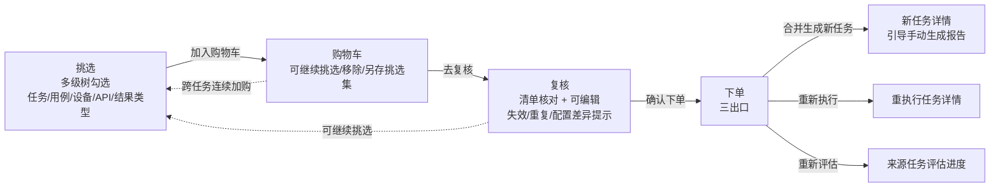

# 挑选合并功能交互重设计（吸收原合并任务 · 多级挑选 · 购物车复核合并）

> 卡 INT-576 ｜ UX设计师A ｜ 2026-10-17 ｜ 性质：**专项交互重设计规范**——在 09_任务域.md（INT-354）既有「挑选合并」口径之上做交互闭环重设计，**部分取代** 09_任务域.md §3.4/§3.8/§3.9/§3.10 与 §5.11/§5.14（取代关系见 §0.2）。
> 基准（全部实测，无杜撰）：本平台后端 `api_gateway/routes/cherry_pick_bp.py`、`api_gateway/application/services/task/cherry_pick_service.py`、`task_service/infrastructure/persistence/cherry_pick_repository.py`、`task_service/infrastructure/persistence/_task_crud_mixin.py:merge_tasks`、`task_service/infrastructure/persistence/models/{task_models,task_cherry_pick_models,result_models}.py`、`scripts/migrations/202610/add_cherry_pick_tables_int339.py`；本平台 Vue 现状 `frontend/src/views/Tasks/{CherryPickPanel,MergedTaskPanel,Tasks}.vue`、`frontend/src/components/common/modal/CherryPickDialog.vue`、`frontend/src/composables/task/usePickCart.ts`、`frontend/src/composables/task/useTaskBatchOps.ts`；UX 既有规范 09_任务域.md（INT-354）、01_全局基座.md（INT-343）、00_页面清单与RBAC划分.md（INT-353）；功能设计文档 INT-339《任务结果CherryPick挑选合并功能设计文档.md》、主库《任务合并功能设计文档.md》（V9.7.10 旧内容，滞后回写另卡，本卡以 V9.7.31 实测 merge_tasks 实现为准）。
> 技术栈：React 19 + TS + Rsbuild + Tailwind 4 + shadcn 风格组件（@base-ui/react + cva + tailwind-merge）+ TanStack Router/Query/Table + Zustand + react-hook-form/zod + sonner/vaul/cmdk + Public Sans/Lora 字体——照基座卡 INT-343 全套；CSS/组件/模态窗直接复用 newAPI 现成件（`D:\00_code\new_api_xagents\web\src\components\ui\*`、`web\src\components\data-table\*`），多主题预设机制（lake-view 默认参考预设）。
> 红线遵守：只产出设计规范文档（`doc/UX设计规范/`），不写任何前端代码、不改 `frontend-react/`；页面文案一律中文，站内不出现 Cherry-Pick 字样（接口路径除外）；基准取材全部来自实测源码与文档，不杜撰。

---

## 0. 文档性质与取代关系

### 0.1 为什么新建专项规范（而非增量改 09_任务域.md）

- 本卡是**交互闭环级重设计**（功能归并 + 多级挑选 + 购物车复核合并 + 易用性），改动面远大于 09_任务域.md 的单节增量；若在 09 内打补丁会造成「新旧口径并存、引用方分不清版本」。
- 09_任务域.md §3.9/§5.14 已承载旧「挑选合并页签 + 购物车族」口径，本卡将其整体升级取代，09 保留旧文作为演进记录，冲突处由本卡「取代注记」指引（§0.2）。
- 本卡是 INT-339 功能设计文档的**交互落地规范**，供主项目实施卡直接消费；文件编号顺延既有 `NN_页面.md` 约定（18），并在 README 登记。

### 0.2 与既有规范的取代/冲突关系（冲突处裁定倾向）

| 既有规范位置 | 既有口径 | 本卡裁定 | 关系 |
| --- | --- | --- | --- |
| 09 §3.4 页签栏（四页签：日常/已发布/合并/挑选合并） | 「合并」「挑选合并」双页签 | **「合并」页签收编进「挑选合并」**，任务列表终态三页签（日常/已发布/挑选合并） | 取代（§2） |
| 09 §3.8 合并任务列表 | 仅整任务合并容器（`merged=true`）独立页签 | 并入「挑选合并」页签，新增「合并方式」筛选（整任务合并/结果挑选合并） | 取代（§2.2） |
| 09 §3.9 挑选合并页签 | 只展示 cherry-pick 容器 + 购物车 Drawer + 挑选集 Popover；页内不做挑选筛选器 | 页签承载统一合并容器列表 + **「开始挑选」进入四步向导**（挑选→购物车→复核→下单）；挑选交互从弹窗升级为页内工作区 | 取代（§3/§4/§5） |
| 09 §3.10 批量浮条「合并任务」钮（task:merge） | 勾选 ≥2 已完成/已合并任务 → 整任务合并 | **按钮撤销**，吸收为挑选向导「任务级」粒度（整任务加购→复核→合并），统一按 `task:cherry_pick` 判定 | 取代（§2.1） |
| 09 §5.11 合并任务确认弹窗 | 整任务合并确认（ConfirmDialog） | 并入复核→下单向导（§5），旧独立弹窗撤除 | 取代（§5） |
| 09 §5.14 挑选合并族（加购弹窗/购物车 Drawer/下单向导） | 三步：挑选→购物车→下单；挑选只在弹窗内平铺结果行 | 升级为**四步向导**（复核为独立步骤）+ 多级挑选树 + 购物车多级分组/批量移除；保留加购弹窗作为「任务详情/对比报告」快捷入口（复用同一多级树，预筛来源任务） | 取代（§3/§4/§5） |
| INT-339 功能设计文档 §9 前端设计 | 四页签（日常/已发布/合并/挑选合并）；挑选交互三档粒度基线 E2E 用例选择页 | 页签按本卡收编（§2）；三档粒度保留并升格为**多级树勾选**（§3.3）；其余口径（引用持有/仅终态可挑/跨任务强制确认/三出口）**沿用不变** | 一致 + 深化 |
| INT-339 功能设计文档 §2「与任务合并的关系」 | 整任务合并（源任务标记 merged）与结果挑选（源任务不变）为两个功能 | 创建入口/交互流程统一（§2），但**容器语义保留两类**（TaskMergeRelation / TaskCherryPickRelation）由「合并方式」标识；源任务 merged 归档语义**不保留**——任务级挑选走结果挑选语义、源任务不变（§10 #1 已拍板） | 裁定（2026-10-17）：交互统一、语义并存 |

> 红线：不杜撰后端端点。凡设计依赖现接口不具备的能力，一律进 §11「待后端立项」清单并给出契约要求；实施卡在接口落地前按容错禁用口径处理（09 §3.12 同款纪律）。

---

## 1. 需求重述与设计目标

负责人原话（2026-10-17，INT-339 评论）：

> 原来的合并任务功能得合并到新的挑选合并功能。任务、用例、被测设备/API、每个设备可能有多个 result_type，每一级别都能被挑选，然后加入购物车，然后复核，然后合并，整个交互流程得重新设计，要方便用户使用。可以在挑选合并里挑，也可以在购物车里挑出不要的。你让UX项目仔细设计一番，然后主项目再根据UX完成需求。

设计目标（四条）：

1. **功能归并**：原「合并任务」（整任务合并）吸收进「挑选合并」，统一入口、统一流程，不留双入口双流程。
2. **多级挑选**：任务 → 用例 → 被测设备/API → result_type 四级均可勾选，联动规则明确，层级不迷失。
3. **购物车复核**：挑选即加购；购物车内可挑出不要的（含批量）；复核为独立步骤（清单核对+可编辑）；合并下单出清。
4. **易用性**：入口清晰、操作最少、反馈明确；深浅色 + 多主题下观感一致。

---

## 2. 功能归并：原「合并任务」并入「挑选合并」

### 2.1 现状事实（实测，非杜撰）

**A. 整任务合并（旧「合并任务」功能）**

| 项 | 实测事实 | 出处 |
| --- | --- | --- |
| 入口 | 日常列表批量勾选 ≥2 个任务 → 批量浮条「合并任务」钮 → ConfirmDialog → `POST /tasks/merge` | `useTaskBatchOps.ts:124-153`；09 §3.10/§5.11 |
| 准入 | 全部任务状态 ∈ {completed, merged}（已合并任务可再合并，展开为原始源任务） | `_task_crud_mixin.py:merge_tasks` 注释「允许合并已完成/合并任务/已合并任务」 |
| 产出 | 合并容器任务（status=completed）+ `TaskMergeRelation(merged_task_id, source_task_id, source_result_count)` 关系行；源任务仅标 `merged`（status 置 `merged`），**无 `merged_into` 列**——V9.7.31 Task 模型无此列，源任务与合并容器关系由 `TaskMergeRelation(source_task_id)` 承载（INT-265 已裁定此替代）；**结果不搬家**（V9.7.31 容器+关系展开引用） | `task_models.py:133-147`；`_task_crud_mixin.py:191-…` |
| 列表 | `GET /tasks?merged=true`（TaskMergeRelation 存在性判定） | `MergedTaskPanel.vue` |
| 权限 | `task:merge`（**React 基线按码过滤**：`frontend-react/src/features/tasks/components/task-bulk-actions.tsx:125` 按 `hasPermission('task:merge')` 过滤；Vue 现状合并按钮为状态门控，重写统一按码过滤） | 09 §3.10/§8；`frontend-react/src/features/tasks/components/task-bulk-actions.tsx:125` |

**B. 结果挑选合并（现有「挑选合并」功能）**

| 项 | 实测事实 | 出处 |
| --- | --- | --- |
| 入口 | 任务详情关联用例行 / 对比报告结果行「加入购物车」→ 挑选弹窗；任务页「挑选购物车」全局入口（角标计数）；「挑选合并」页签 | `Tasks.vue:18-26`；09 §3.9/§5.14 |
| 挑选 | `GET /tasks/cherry-picks/candidates`（多条件 AND：来源任务/设备/用例/关键字/执行·评估状态/时间范围；仅终态任务）；结果级平铺勾选 | `cherry_pick_service.py:list_candidates`；`CherryPickDialog.vue` |
| 购物车 | per-user，`cherry_pick_cart_items(result_id + 溯源快照)`；按来源任务分组；单条移除/一键移除失效/清空/另存挑选集 | `cherry_pick_repository.py:cart_list`；`CherryPickDialog.vue` step2 |
| 下单 | `POST /tasks/cherry-picks/cart/checkout` 三出口：merge（容器 + `TaskCherryPickRelation` 引用）/ reexecute / reevaluate | `cherry_pick_service.py:checkout*` |
| 列表 | `GET /tasks?cherry_pick=true`（TaskCherryPickRelation 存在性判定） | `CherryPickPanel.vue` |
| 权限 | 加购/购物车增删/另存挑选集/下单 = `task:cherry_pick`；候选/购物车只读/预览/溯源 = `task:read` | `cherry_pick_bp.py` 全表 |

### 2.2 归并裁定

**裁定①（页签去留）：「合并」页签收编进「挑选合并」页签，任务列表终态三页签。**

```
任务列表页签（终态）：日常 ｜ 已发布 ｜ 挑选合并（含合并容器计数）
```

- 理由：整任务合并与结果挑选合并的产出都是「合并容器任务」（引用源结果、创建即 completed、一等公民），本质同族；双页签让用户对「合并」的两种形态来回切，认知负担大。统一页签后按「合并方式」筛选（§2.3），一类容器一个家。
- 「挑选合并」页签计数 = 两类合并容器总数（`merged=true ∪ cherry_pick=true`，接口见 §11-1）。
- 旧链 redirect（路由同步）：路径式页签 `/tasks/$tab` 白名单由 `['daily','published','merged','cherry-picks']` 收敛为 `['daily','published','cherry-picks']`；`/tasks/merged` 与旧 `/tasks?tab=merged` / `?tab=cherry-picks` 均 redirect 到 `/tasks/cherry-picks`（合并方式筛选随 URL 态可带 `merge_type=whole|picked`）。
- **00 总表（INT-353 路由表 `/tasks`）同步影响**：三页签终态需同步 `00_页面清单与RBAC划分.md` 的 `/tasks` 路由条目（四页签口径）与旧路径 redirect 表；00 总表正文由总控另处同步（2026-10-17 裁定 #2 附带说明，本卡只在此注明）。

**裁定②（创建入口统一）：批量浮条「合并任务」钮撤销，整任务合并吸收为挑选向导的「任务级」挑选粒度。**

- 交互：勾选 ≥1 个终态任务 → 批量浮条改为「加入挑选」（`task:cherry_pick`）→ 打开挑选向导（§3），任务级节点即整任务勾选（等价旧「合并任务」的创建动作，但流程升级为 挑选→购物车→复核→合并）。
- 也可在挑选向导内直接按「任务」维度勾选（来源任务列表多选 → 整任务加购），两条入口同一目标。
- 原「合并任务」确认弹窗（09 §5.11）撤除，由复核/下单向导取代。

**裁定③（层级关系与共存）：两类合并容器在「挑选合并」页签统一展示、统一操作、按「合并方式」区分。**

| 合并方式 | 容器标识 | 溯源展示 | 源任务处置 | 说明 |
| --- | --- | --- | --- | --- |
| 整任务合并 | `TaskMergeRelation` 存在性（`merged=true`） | 展开源任务列表（含各源贡献结果数） | 源任务标记 `merged`（**存量行为，仅历史容器**；新任务级挑选不再触发该归档） | 旧功能吸收后的产出形态；新任务级挑选默认走结果挑选语义（源任务不变，2026-10-17 裁定 #1 已拍板） |
| 结果挑选合并 | `TaskCherryPickRelation` 存在性（`cherry_pick=true`） | 展开源任务→结果分组（结果级溯源） | 源任务保持原样（INT-339 红线） | 主形态 |

- 两类容器共用行操作（查看详情/查看报告/生成报告（引导手动生成）/发布/收藏/删除/重命名），列定义仅「合并方式」与「来源数/结果数」两列随方式切换文案。

**裁定④（权限收敛）：页签内一切写操作（加购/购物车增删/复核/下单/另存挑选集）统一 `task:cherry_pick`；`task:merge` 不再作为「合并任务」入口判定码（保留在 seed 中，供后端批量接口兼容，前端不再使用）。** 只读浏览/候选/预览/溯源按 `task:read`。algo_engineer（仅 task:read，无 task:cherry_pick）**挑选合并链整链隐藏、页签列表只读可见**（09 §8 注 5 口径延续）。

### 2.3 统一「挑选合并」页签结构

```
/tasks/cherry-picks（SectionPageLayout fixedContent）
├─ Title「挑选合并」
├─ Actions：［+ 开始挑选］（primary，task:cherry_pick）｜［打开购物车］（outline + 角标计数）｜［管理挑选集］（ghost Popover）
├─ 筛选工具栏（LogsFilterToolbar 形态）
│   ├─ 搜索（名称/描述/标签）｜执行状态 ｜ 评估状态 ｜ 时间范围
│   ├─ 合并方式（facet 单选：全部/整任务合并/结果挑选）← §11-1
│   └─ stats 徽章行（合并容器总数/整任务合并数/结果挑选数）← §11-1
├─ DataTablePage（容器任务表）
│   列：☑ 选择 ｜ 任务名称（次行「合并方式 + 来源 {n} 任务 · 结果 {m} 条」）｜ 执行状态 ｜ 评估状态 ｜ 用例数 ｜ 创建时间 ｜ 操作
│   renderRow expandable：溯源展开（按合并方式自适应，§2.2）
└─ Footer：分页 Portal
```

空态：「暂无挑选合并任务」/「点击「开始挑选」，从任务/用例/设备/结果类型任一层级勾选执行结果，加入购物车后复核合并」+ 引导按钮「了解挑选合并」。

---

## 3. 多级挑选：层级模型与联动规则

### 3.1 层级模型（任务 / 用例 / 被测设备/API / result_type）

挑选树为**四级分组 + 结果行叶**结构，每级均可勾选：

```
来源任务（T）
└─ 用例（C）
   ├─ 被测设备 或 被测 API（D）          ← 设备与 API 二选一（TestResult.device_id / api_id 实测）
   │  └─ 结果类型 result_type（R）        ← 同一设备可挂多个 result_type（如 real-time / final / streaming）
   │     └─ 执行结果行（叶，result_id）   ← 数据真相，勾选以 result_id 集为准
   └─ 被测 API（D'）
      └─ 结果类型（R'）→ 结果行
```

- **数据映射（实测）**：叶 = `test_results` 行（`id`）；`device_id`/`api_id` 二选一；`result_type` 从该行 `result_data`（或 `result_data_path` 指向的完整结果）内 `result_type` 字段解析（`report_data_builder_task_mixin.py:_extract_result_type` 实测口径，缺省 `default`）；`algorithm_type` 为算法列（全局切换器联动维度，非挑选层级）。
- **层级名称来源**：任务名 = 候选行 `task_name`（现返）；设备名 = 设备表名称（`device_acl_repository` 批量查询，预览已用同源）；用例名 = 用例表（现候选未返，§11-2）；result_type = 候选行解析（现候选未返，§11-2）。
- **"每个设备可能多个 result_type"的交互含义**：同任务同用例同设备下，按 result_type 再分一组；用户可只加某设备某结果类型的结果（例如只挑 `real-time` 流式轨，不挑 `final` 定稿轨）。

### 3.2 联动规则（选中态 · 向上向下联动）——本卡明确规则，全链路统一

| 规则 | 行为 |
| --- | --- |
| R1 勾选父级 | 该节点**全部子孙**选中（含叶结果行） |
| R2 取消父级 | 该节点**全部子孙**取消（不留任何子级残留） |
| R3 勾选子级 | 父级呈**部分选中**（Checkbox indeterminate）；**全部**直接子级选中后父级转全选 |
| R4 取消 device 节点 | **其下 result_type 与结果行全部取消**（不保留其下 result_type）——明确裁定：device 是 result_type 的容器，取消容器即清容器内容 |
| R5 取消 result_type 节点 | 仅清该 result_type 下的结果行；**device 保持部分选中** |
| R6 用例级勾选 | = 选中其下全部 device × result_type × 结果行（跨设备、跨结果类型全含） |
| R7 任务级勾选 | = 整任务全部结果行选中（等价旧「合并任务」的选取全集） |
| R8 跨任务 | 不同任务互为独立根，各自勾选互不影响；购物车合并展示时按任务分组（§4） |
| R9 反选/全选 | 「全选当前筛选」= 当前筛选命中全部 result_id 选中（跨页语义见 §11-4）；「反选」= 当前页可见节点取反，已选跨页项保留 |
| R10 已加购态 | 已在购物车的 result_id，挑选树对应叶显示「已加购」标记（打勾 + muted 文案），重复加购由后端幂等跳过（`uq_cherry_cart_user_result` 实测）；取消勾选 ≠ 移除购物车（移除在购物车/复核完成，§4） |

### 3.3 挑选工作区交互（页内四步向导第 1 步）

```
┌─ 挑选（Step 1/4）────────────────────────────────────────────┐
│ 筛选栏（§3.4） ［搜索 ］［来源任务▾］［设备▾］［结果类型▾］［执行状态▾］［评估状态▾］［时间范围▾］［重置］ │
│ 视图切换：树形（默认）｜平铺（结果行列表）                              │
│ ┌ 树形区（虚拟滚动 max-h-[520px]）                                │
│ │ ☐ 任务 A（36 条）                                              │
│ │   ☐ 用例 001（6 条）                                          │
│ │     ☐ 设备 设备-01（4 条）                                    │
│ │       ☐ 结果类型 real-time（2 条）                            │
│ │          ☑ 结果行 1（已加购）· 结果行 2                        │
│ │       ☐ 结果类型 final（2 条）                                 │
│ │   ☑ 用例 002（[三] 部分选中，2/5 条）                         │
│ └────────────────────────────────────────────────────────────┘
│ 已选汇总条（sticky bottom，DataTableBulkActions 形态）：已选 {n} 条 · 来自 {m} 个任务 · 覆盖 {d} 台设备 ｜ ［全选当前筛选］［反选］［清空］［加入购物车（{n}）］ │
└──────────────────────────────────────────────────────────────┘
```

- **三档粒度（沿用 INT-339 §4.1 口径，升格到树）**：①逐条勾选（叶）；②按节点整组（用例/设备/result_type 节点勾选，R1/R6）；③按维度筛选后批量（筛选栏 facet 命中 → 「全选当前筛选」）。
- **树节点行**：Checkbox（三态：全选/部分/未选）+ 类型图标（任务=ClipboardList、用例=ListChecks、设备=Smartphone、API=ArrowLeftRight、结果类型=Tag）+ 名称 + 计数 Badge「{n} 条」+ 展开/收起（Collapsible 默认收起到任务级，可「全部展开/全部收起」）。
- **叶结果行**：Checkbox + 用例名（缺名时显示用例 ID）+ 设备/API 名 + 结果类型 Badge（mono，数据值）+ 执行状态 StatusBadge + 评估状态 Badge + 时间（mono）。
- **平铺视图**：现有结果行列表形态（09 §5.14 基版），保留供「按条件细看」使用；勾选状态与树形共享同一 `selectedResultIds` 集（Zustand，§7）。
- **加载/空态**：Skeleton（树骨架 3 层）；空态「无符合条件的执行结果」/「仅已完成、执行失败、已停止的终态任务可挑选，且默认剔除已删除用例的结果」（对齐 `PickableTaskStatus` 与 `excluded=0` 实测）。

### 3.4 挑选筛选器（多条件 AND，全部可选）

| 条件 | 形态（newAPI 组件） | 说明/出处 |
| --- | --- | --- |
| 搜索 | Input debounce 500ms | 命中用例名/用例 ID（`case_keyword` 实测，INT-401 语义） |
| 来源任务 | FacetedFilter 多选（Command 搜索 + 计数） | `task_ids`；选项 = 可挑选终态任务集合（候选行聚合去重） |
| 设备 | FacetedFilter 多选 | `device_ids`；选项 = 设备表（`devicesApi.getAllFlat` 同源）；API 型任务对应「API」筛选（`api_ids`，§11-2 候选补 api_name 后落） |
| 结果类型 | FacetedFilter 多选（动态选项 = 当前筛选命中去重的 result_type 集合） | §11-2 候选返 result_type 后落；选项值显示原始数据值（mono），红线下不做英文界面，值本身是数据 |
| 执行状态 | FacetedFilter singleSelect | completed/failed/stopped（仅终态） |
| 评估状态 | FacetedFilter singleSelect | 已评估/未评估（`evaluated` 实测） |
| 时间范围 | Select | 全部时间/今日/昨日/近7天/近30天/自定义（`start_date`/`end_date` 实测） |

### 3.5 待后端立项（§11 汇总）

- §11-2：候选行补 `case_name`/`device_name`/`api_name`/`result_type`（结果级解析）。
- §11-3（可选）：候选树聚合端点（任务→用例→设备→result_type，含每节点 result_id 集与计数）——供树形勾选与「全选当前筛选」跨页语义；接口落地前前端由平铺候选行重建树（受 per_page≤200 分页限制，跨页全选降级为「当前已加载」并 Tooltip 说明）。
- §11-4：`POST /tasks/cherry-picks/candidates/select-all` 返回当前筛选命中全部 result_id 集合（供跨页全选）。

### 3.6 多任务用例展示口径（INT-713 负责人反馈修订：不「全平铺」、照用例管理页显示）

> 负责人 2026-10-18（INT-713 评论）：「前端这也有问题，用例全平铺，你得考虑到多任务用例照用例管理页面显示，然后还有每个用例下边有多个设备，每个设备有多个结果类型的数据」。本节收口挑选树的**展示口径**：树形为唯一主视图、用例节点照用例管理页呈现、多任务用例按任务根分组并提供「用例视角」重排。

**裁定①（树形为主、平铺仅辅助）**：挑选工作区默认且主展示 = **树形视图**（任务→用例→被测设备/API→result_type→结果行叶，§3.1/§3.3），「平铺」仅保留为辅助列表（「按条件细看」），不默认、不作为主展示——避免「用例全平铺」观感；两视图勾选态共享同一 `selectedResultIds` 集（Zustand）。

**裁定②（用例节点照用例管理页显示）**：用例级分支节点呈现用例管理页（11_用例域 §3.3 用例卡）的**卡片级元信息**，让多任务场景下用例可辨识：

| 用例节点元素 | 渲染（对齐 11 用例域 §3.3） | 数据源（§11 待补） |
| --- | --- | --- |
| 用例名 | `font-medium truncate` + 超长 Tooltip | 候选行 `case_name`（§11-2） |
| CaseIdBadge | mono 徽章，点击复制 toast「已复制」 | `case_id` |
| 算法徽章 | Badge secondary（getAlgorithmLabel 中文名） | 候选行 `algorithm_type`（**INT-577 §11-2 已落地实测返回**，`cherry_pick_service.py:470`） |
| 标签 chips | TagBadge 按分类呈现，最多 6 枚 +「+N」 | 候选行 `tags`/`category`（**§11-7 仍待后端**） |
| 时长 / 轮次 | Badge outline `{x}m {y}s` + `{rounds} 轮`（有值才显） | 候选行 `duration`/`rounds`（**§11-7 仍待后端**） |
| 计数徽章 | 「{n} 条」（既有） | 节点 result_ids 计数 |
| 名称缺省降级 | 缺 `case_name` → 「用例不可用 {前 8 位 id}…」（INT-713 打回 #1 口径，不裸显 UUID） | — |

- **INT-762 复核（2026-10-18）**：`algorithm_type` 已随 §11-2 落地（候选行实测返回）；`tags`/`category`/`duration`/`rounds` 四项未落地前，用例节点保持「名称 + 计数 + 算法徽章」最小呈现，不阻塞树形层级；实施卡在 §11-7 剩余四项落地后补全卡片级元信息。

**裁定③（多任务用例：默认按任务根分组 + 「用例视角」重排）**：

- **默认树形（任务视角）**：同一用例在多个任务下各有结果 → 每个任务根下各挂自己的「用例→设备→结果类型」子树（R8 跨任务独立根，互不影响勾选）；用例在每任务下可分别勾选其不同设备/结果类型（如任务 A 下只挑该用例的 `real-time`、任务 B 下挑 `final`）。
- **用例视角（视图切换新增：「树形 ｜ 用例视角 ｜ 平铺」）**：按用例名聚合跨任务——**用例 → 来源任务列表 → 设备/API → result_type → 结果行**，照用例管理页「分组/标签筛选 + 平铺用例」的浏览习惯：让用户在一个用例节点下看到**多任务的设备×结果类型**全貌，跨任务批量加购该用例的特定结果；勾选态与任务视角共享同一 `selectedResultIds` 集。默认收起至用例级。
- 用例视角下节点联动复用 R1-R7（父级=用例含其下全部任务×设备×结果类型；取消任务级节点仅清该任务下的结果行，用例保持部分选中）。

**裁定④（层级完整性：每用例下多个设备、每设备多个结果类型）**：树形必须渲染完整三级分支（用例→设备/API→result_type），设备级分支下不得把结果类型折叠为平铺叶——同一用例同设备下多个 result_type（如 real-time/final/streaming）各成独立分支（§3.1 层级模型 + R4/R5 联动）；缺 `result_type` 数据时折叠为「结果类型待补充」（§11-2 落地前，现有 PENDING 折叠口径）。

**实施要点**（本卡 §7.5 增量）：①默认视图锁定 `tree`（平铺仅显式切换）；②用例节点渲染 CaseIdBadge/算法/标签/时长元信息（§11-7 落地后）；③新增「用例视角」重排（`buildPickTree` 增加按 `caseId` 聚合变体，复用同一 R1-R10 联动纯函数）；④候选树构建保持从平铺候选行重建（§11-3 落地前），多任务用例跨任务分组口径同上。

### 3.7 层级展示规范（逐级明细，INT-762 新增专项节）

> 本节把挑选树「任务 → 用例 → 被测设备/API → result_type → 结果行」**每一级**的展示与交互逐条收口，
> 直接回应 INT-713 负责人反馈「用例全平铺，得按 任务→用例→设备→结果类型 重新设计」与 INT-762 验收
> 「每一级有展示与交互说明，多任务场景不『平铺』」。已落地实现对位：
> `frontend-react/src/domain/lib/cherry-pick-tree.ts`（树构建与 R1-R10 联动纯函数，含 result_type 分组/待补充折叠）、
> `features/tasks/cherry-pick/components/pick-tree.tsx`（树组件）。多任务用例展示口径见 §3.6（裁定①-④）。

#### 3.7.1 逐级展示与交互明细（任务 → 用例 → 设备/API → result_type → 结果行）

| 层级 | 展示元素（实测/实现对位） | 计数口径 | 展开 / 收起 | 选中态 | 取消联动 |
| --- | --- | --- | --- | --- | --- |
| **任务级（根）** | 任务名（`font-medium truncate` + 超长 Tooltip）+ 任务图标（ClipboardList）；候选行 `task_name` | 「{n} 条」= 该任务下全部结果行数（跨用例×设备×result_type 合计） | **默认收起至任务级**；每任务根独立 Collapsible；工具栏「全部展开/全部收起」 | Checkbox 三态（R7：勾选=整任务全部结果选中） | 取消=清空该任务全部结果（R2），不留子级残留 |
| **用例级** | 用例名 + CaseIdBadge（mono，点击复制 toast）+ 算法徽章（Badge secondary）+ 标签 chips（最多 6 枚 +「+N」）+ 时长/轮次 Badge（有值才显）+ 用例图标（ListChecks）；缺 `case_name` →「用例不可用 {前 8 位 id}…」（不裸显 UUID） | 「{n} 条」= 该用例在该任务根下的结果行数；**用例视角**下=跨任务聚合计数 | Collapsible，默认收起；展开显示「设备/API」子层 | Checkbox 三态（R6：勾选=其下全部设备×result_type×结果行） | 取消=清该用例下全部结果 |
| **设备 / API 级** | 设备名 或 API 名（`TestResult.device_id`/`api_id` 二选一实测）+ 设备图标（Smartphone）/ API 图标（ArrowLeftRight）；缺名 →「设备不可用/API不可用 {前 8 位 id}…」 | 「{n} 条」= 该设备/API 下全部结果行数（跨 result_type 合计） | Collapsible，默认收起；展开显示「result_type」子层 | Checkbox 三态 | 取消=清空其下 result_type 与结果行（**R4 容器语义**：取消设备即清容器内容） |
| **result_type 级** | result_type 原始数据值（Badge mono，如 `real-time`/`final`/`streaming`）+ 图标（Tag）；候选未返/缺值 → 折叠为「结果类型待补充」（PENDING 口径，`cherry-pick-tree.ts:54-55`） | 「{n} 条」= 该 result_type 下结果行数 | Collapsible，默认收起；展开显示结果行叶；**同一设备多个 result_type 各成独立并列分支**（层级完整性，不压平为平铺叶） | Checkbox 三态 | 取消=仅清该 result_type 结果行，**父设备保持部分选中**（R5） |
| **结果行（叶）** | 用例名 + 设备/API 名 + result_type Badge（mono）+ 执行状态 StatusBadge + 评估状态 Badge + 时间（mono）+ **「已加购」标记**（R10：已加购叶打勾 + muted 文案） | 无子级（叶） | 不可展开 | Checkbox 二态（单结果） | 取消=仅该结果行 |

#### 3.7.2 购物车与复核的层级口径（含 result_type 折叠/展开）

- 购物车树（§4.2 `CartTree`）与挑选树**同层级同构**：组头=来源任务，组内按 用例→设备/API→result_type 下钻；`CherryPickCartItem.source_result_type` 已落地（INT-577 §11-5）后完整重建 result_type 级——**result_type 折叠/展开口径**：同一设备下多个 result_type 各成独立分支可独立展开/收起；快照缺 `source_result_type` 的历史条目折叠为「结果类型待补充」单组（Tooltip「结果类型待后端接口」）。
- 移除矩阵逐级可用（§4.3）：单条（叶行 X）/ 节点（用例/设备/result_type 行「移除该组」）/ 整组（来源任务组头）/ 批量勾选移除；取消设备级组=清其下全部（R4 同构）。
- 复核步骤（§5.2）同一树 + 清单核对摘要 + 编辑；摘要按层级统计（结果 {n} 条 / 来源任务 {m} 个 / 设备 {d} 台 / 用例 {c} 个）。

#### 3.7.3 多任务场景展示

- **默认「任务视角」**：每任务根独立子树（R8 跨任务互不影响），同一用例在多任务下各自挂自己的「设备→result_type」分支；勾选可分别进行（如任务 A 只挑该用例 `real-time`、任务 B 挑 `final`）。
- **「用例视角」视图**（视图切换新增，§3.6 裁定③）：用例 → 来源任务列表 → 设备/API → result_type → 结果行，跨任务聚合浏览；默认收起至用例级；与任务视角共享同一 `selectedResultIds`。
- **树形为主、平铺仅辅助**（§3.6 裁定①）：默认锁定 `tree`，平铺仅显式切换，多任务场景绝不默认平铺。

---

### 3.8 三视图与两阶段挑选重做（INT-1034 专项）

> 负责人 2026-10-20 实测（INT-1034）：日常任务 tab 需要独立按钮入口；挑选应先**选择要合并的任务**、再选择这些任务里要合并的用例/结果；当前只有任务视图需重做——任务下分**用例视图 / 设备视图 / 结果类型视图**；报告里具体用例卡片也需要按分组；**整个平台用例相关的地方都得照用例管理来显示**。
> 本节在 §3.6/§3.7 基础上**重做挑选工作区**（入口 / 两阶段 / 三视图 / 用例显示统一），**部分取代** §3.3 的视图切换（树形/用例视角/平铺）与 §3.6 裁定①/③ 的视图模型——冲突处以本节为准。

#### 3.8.1 入口：日常任务 tab 独立按钮（裁定①）

| 项 | 实测 / 对位 | 设计裁定 |
| --- | --- | --- |
| 现状 | 日常 tab 无独立按钮，仅批量浮条「加入挑选」（勾选任务后出现） | `task-bulk-actions.tsx:129-150` → `tasks/index.tsx:121-125` `handleJoinPick` |
| 新增入口 | 日常页签筛选工具栏右端（收藏/回收站工具条旁） | 「开始挑选」按钮（primary，`task:cherry_pick` 权限过滤）→ 打开挑选向导，落在**两阶段第 1 阶段（选择任务）**；日常列表已勾选任务时预选该批直达第 2 阶段 |
| 保留 | 批量浮条「加入挑选」 | 保留为快捷入口（任务级预选 → 直达两阶段第 2 阶段），与按钮入口并存（§6.1 入口矩阵同步） |


#### 3.8.2 两阶段挑选：先选任务 → 再选结果（裁定②）

**阶段 1 · 选择任务**（新 `PickTaskStage` 组件）：

```
┌─ 挑选 · 阶段 1：选择任务 ────────────────────────────────┐
│ 搜索 ［任务名称］            ｜ 已选 {n} 个任务            │
│ ☑ 任务 A    [已完成]   36 条   2026-10-18 09:00          │
│ ☑ 任务 B    [已完成]   24 条   2026-10-18 10:00          │
│ ☐ 任务 C    [执行失败] 12 条   2026-10-17 15:00          │
│ ［全选当前筛选］ ［清空］          ［下一步：选择结果（{n}）］    │
└─────────────────────────────────────────────────────────┘
```

- 数据源：候选行聚合的可挑选任务集合（终态 `completed/failed/stopped`，实测 `PICKABLE_TASK_STATUS` / `fetchPickableTasks`），按状态/名称排序。
- 任务行：☑ Checkbox + 任务名 + 执行状态 StatusBadge + 结果计数「{n} 条」+ 创建时间（mono）。
- 工具栏：「全选当前筛选」「清空」；主钮「下一步：选择结果（{n}）」（选中 ≥1 启用）。
- 空态：「暂无可挑选的终态任务」。

**阶段 2 · 选择结果**（现 `PickStep` 重构）：

```
┌─ 挑选 · 阶段 2：选择结果 ────────────────────────────────┐
│ 已选任务：任务 A · 任务 B  ［更换任务（回阶段 1）］           │
│ 视图切换：用例视图 ｜ 设备视图 ｜ 结果类型视图              │
│ ┌ 树形区（按当前视图渲染，§3.8.3）───────────────────────┐ │
│ └─────────────────────────────────────────────────────┘ │
│ 已选 {n} 条结果 · 来自 {m} 个任务 · 覆盖 {d} 台设备         │
│ ［全选当前筛选］［反选］［清空］     ［加入购物车（{n}）］      │
└─────────────────────────────────────────────────────────┘
```

- 顶部任务集摘要条：「已选任务：{任务名…}」+「更换任务」ghost 钮（回阶段 1；勾选**跨阶段保留**不清空——对齐 §6.2「改筛选不清勾选」解耦口径）。
- 视图切换三钮：**用例视图｜设备视图｜结果类型视图**（替换现 树形/用例视角/平铺）。
- 勾选联动 R1-R10 全复用，三视图共享同一 `selectedResultIds`（Zustand）；已选汇总条 `SelectedSummaryBar` 沿用。

#### 3.8.3 三视图：用例 / 设备 / 结果类型（裁定③）

三棵聚合树共用同一候选行源与 `selectedResultIds`，仅顶层分组维度不同：

| 视图 | 顶层 | 第二层 | 第三层 | 叶 | 树构建（`cherry-pick-tree.ts`） |
| --- | --- | --- | --- | --- | --- |
| **用例视图** | 用例（**用例管理卡**） | 设备/API | result_type | 结果行 | `buildPickCaseView` 升级（含分组/标签组织） |
| **设备视图** | 设备/API | result_type | 用例 | 结果行 | `buildPickDeviceView`（**新增**） |
| **结果类型视图** | result_type | 设备/API | 用例 | 结果行 | `buildPickResultTypeView`（**新增**） |

> **任务维度由阶段 1 承载**：三视图树内不再设任务级分支（任务集已在阶段 1 锁定，符合「先选任务→再选结果」）；但**叶结果行补「来源任务名」**（候选行 `taskName` 实测）——多任务结果在同一用例/设备/结果类型节点下并排时用于消歧（同一叶在任务 A 与任务 B 各出现一次，勾选按 result_id 独立）。

**用例视图（照用例管理页面）**：

- 用例节点 = **用例管理卡**（复用 `features/testcases/components/case-card.tsx`：名称 / CaseIdBadge / 算法徽章 / 标签 / 时长·轮次）+ 计数 Badge「{n} 条」；缺名降级「用例不可用 {前 8 位}…」（§3.7.1 口径）。
- **组织维度照用例管理页现行实现**（`grouped-case-list.tsx` / `tag-case-list.tsx` + `case-sub-view-toggle.tsx`，组织维度语义对齐 11_用例域 §3.5/§3.6）：**分组视图**（按用例分组聚合 +「未分组」兜底）/**标签视图**（按标签聚合 +「未设置标签」兜底）；分组/标签下可选 **平铺** 或 **交叉分组**（分组视图内按标签、标签视图内按用例分组）——复用用例管理 `case-sub-view-toggle.tsx` 同款（会话内存，不进 URL），交叉聚合复用 `domain/lib/sub-view-aggregation.ts` 同款纯函数。
- 用例卡展开 → 设备/API → result_type → 结果行叶；用例卡勾选 = **R6 用例级**（其下全部设备×结果类型×结果行）。
- 用例卡元信息缺省降级：`tags/category/duration/rounds` 待 §11-7 后端补字段，落地前「名称 + 算法徽章 + 计数」最小呈现（§3.6 裁定②注记延续）。

**设备视图**：

- 设备/API 顶层（`Smartphone`/`ArrowLeftRight` 图标，`device_id`/`api_id` 二选一），设备名 + 计数「{n} 条」；缺名降级「设备不可用/API不可用 {前 8 位}…」（§3.7.1）。
- result_type 第二层（`Tag` 图标 + mono Badge；缺省折叠「结果类型待补充」）。
- 用例第三层（用例名 + CaseIdBadge + 算法徽章）；叶 = 结果行（§3.7.1 叶行口径）。
- 联动：取消设备 = 清其下 result_type 与结果行（**R4 容器语义**）；取消 result_type = 仅清结果行、父设备保持部分选中（R5）。

**结果类型视图**：

- result_type 顶层（数据值 Badge mono，缺省「结果类型待补充」折叠）→ 设备/API → 用例 → 结果行叶。
- 联动同设备视图（R4/R5/R6 全复用，§3.2）。

#### 3.8.4 全站用例显示统一（裁定④）

> 负责人 2026-10-20："整个平台用例相关的地方都得照用例管理来显示"。

- **统一组件**：全站展示用例信息处一律照用例管理页用例卡（`CaseCard`，11_用例域 §3.3 字段口径），不另造平铺文本行。
- 落位清单：挑选树用例节点（§3.8.3 用例视图）、购物车 `CartTree` 用例节点（§4.2 同步）、报告具体用例卡片（15_报告域 §3.3.7 同步）、任务详情关联用例行、开始测试用例选择（随各自域卡同步）。
- 实施：平台通用 `CaseCard` 复用（现 `features/testcases/components/case-card.tsx`），挑选/购物车/报告/任务域共用。

#### 3.8.5 报告用例卡片分组（15_报告域同步）

- 报告具体用例（15 §3.3.7）：用例卡片按 **分组 / 标签** 分组组织（组头 = 组名 + 计数，未分类/未设置标签兜底），组内用例卡照用例管理显示；分组维度切换照用例管理页（平铺 / 按分组 / 按标签）。
- 详规见 **15_报告域.md §3.3.7**（INT-1034 同步写入）。

#### 3.8.6 实施清单（供实施卡拆分）

1. **入口按钮**：`tasks/index.tsx` 日常 tab + `tasks-filter-toolbar.tsx` 右端加「开始挑选」（`task:cherry_pick` 权限），打开向导两阶段；批量浮条「加入挑选」保留（预选任务直达阶段 2）。
2. **两阶段状态机**：`pick-step.tsx` 加 `phase: 'tasks' | 'results'`；新增 `pick-task-stage.tsx`（任务选择列表 + 全选/清空/下一步）；任务集摘要条 +「更换任务」。
3. **三视图树构建**：`cherry-pick-tree.ts` 新增 `buildPickDeviceView`（设备→结果类型→用例→叶）、`buildPickResultTypeView`（结果类型→设备→用例→叶）；升级 `buildPickCaseView`（用例卡 + 分组/标签组织：按分组/按标签客户端聚合，复用 `sub-view-aggregation.ts` 同款纯函数）；三视图叶行携带 `taskName` 消歧（§3.8.3 任务维度注记）。
4. **三视图组件**：`pick-step.tsx` 视图切换三钮；用例视图用例节点 = `CaseCard`（新增 compact 变体 `pick-case-card.tsx`）；设备/结果类型视图复用 `PickTree` 层级行渲染（§3.7.1 用例级升级为卡）。
5. **购物车同步**：`cart-tree.tsx` 用例节点改 `CaseCard`（compact，§4.2 层级同构）。
6. **报告同步**：`specific-case-comparison.tsx` 用例卡分组（组头 + 组内卡），15 文档同步。
7. **hooks**：`use-cherry-pick-candidates.ts` 增 `useCherryPickDeviceView` / `useCherryPickResultTypeView`（对称现 `useCherryPickCaseView`）。
8. **回归断言**：两阶段状态机 + 三视图勾选一致性（同一 `selectedResultIds`）+ 用例卡复用 + 报告分组 + 全站无 Cherry-Pick 字样（§8 五角色矩阵沿用）。

---

## 4. 购物车

### 4.1 购物车数据与分组（实测约束）

- 后端购物车条目 = `CherryPickCartItem` 快照（`result_id` + `source_task_id/name/case_id/device_id/api_id/execution_status`，`cherry_pick_repository.cart_list` 实测），per-user、服务端持久化、按来源任务分组返回（`cart_get`）。
- **前端购物车镜像**：Zustand `usePickCartStore`（§7）保存会话镜像（`groups` + `total` + `invalidItemIds`），加购/移除/清空/下单后 `refreshCart()` 同步——角标计数数据源（§6.3）。

### 4.2 分组展示（任务 → 用例 → 设备 → result_type 树，与挑选页同构）

- 购物车树复用挑选树的同一组件（`CartTree` = `PickTree` 只读+管理态），按来源任务分组，组内同 3.1 层级下钻。
- 组头 = 来源任务名 + 计数 Badge「{n} 条」+ 移除整组（ghost destructive）。
- 节点行 = Checkbox（三态，用于批量移除选择）+ 名称 + 计数 + 展开/收起。
- 叶行 = 用例名 + 设备/API 名 + 结果类型 Badge + 执行/评估状态 + 失效标记（`invalid` 实测）。
- **分组维度说明**：购物车与挑选页**同层级口径**——因为购物车条目携带完整溯源快照，可重建同一棵树（唯一缺 `result_type`，§11-5 补 `source_result_type` 后完整重建；未补前 result_type 级分组以「结果类型待补充」折叠或按缺省合并，Tooltip 说明）。

### 4.3 移除交互（含批量）

| 操作 | 交互 | 接口（实测/待立项） |
| --- | --- | --- |
| 移除单条 | 叶行尾 X 钮 → 确认 toast | `POST /cart/items/remove`（item_ids=[id]）实测 |
| 移除节点（用例/设备/result_type） | 节点行「移除该组」ghost 钮 → ConfirmDialog「将移除该{用例/设备/结果类型}下的 {n} 条结果」→ 前端展开节点 result_id 集批量移除 | `POST /cart/items/remove`（item_ids 数组）实测 |
| 移除整组（来源任务） | 组头「移除整组」→ ConfirmDialog | 同上（该组全部 item_id） |
| **批量移除** | 购物车/复核页勾选多条（含节点级勾选 R1-R5 同构）→ 底部批量浮条「移除已选（{n}）」destructive | 同上 |
| 一键移除失效 | 有 `invalidItemIds` 时浮条/组头出现「移除失效条目（{n}）」 | `POST /cart/items/remove`（invalidItemIds）实测 |
| 清空 | 「清空购物车」ghost destructive → ConfirmDialog | `DELETE /cart/items` 实测 |
| 另存挑选集 | 「另存为挑选集」→ Dialog 命名（`INPUT_CONFIRM` 形态） | `POST /cart/save-as-set` 实测 |
| 恢复挑选集 | 挑选集 Popover/抽屉「恢复进购物车」 | `POST /sets/{id}/to-cart` 实测 |

- **购物车内挑出不要的**：即上表「移除」全矩阵——购物车不是只读清单，用户可在此挑出不需要的（单条/节点/整组/批量），完成「也可以购物车里挑出不要的」负责人口径。

### 4.4 购物车呈现形态（两处共用一组件）

| 形态 | 位置 | 内容 |
| --- | --- | --- |
| **购物车抽屉**（Sheet `sm:max-w-lg`，全局入口=导航栏右上角角标，INT-344 落位） | 任意页面可达 | 购物车树 + 移除矩阵 + 「继续挑选」（关抽屉回挑选/跳挑选向导）+ 主钮「去复核（{n}）」 |
| **复核步骤**（页内向导 Step 3，§5.2） | 挑选合并页签向导内 | 同一购物车树 + 清单核对摘要 + 编辑 + 主钮「确认下单」 |

---

## 5. 复核合并闭环（挑选 → 加入购物车 → 复核 → 合并）

### 5.1 四步主链路（流程图）



- **四步定义**：挑选（选）→ 加入购物车（加）→ 复核（核）→ 合并/下单（下）。「加入购物车」是挑选步骤的提交动作与购物车状态的建立；复核是**独立步骤**（与旧三步向导的最大差异，§5.4）。
- **入口与衔接**：任何入口（§6.1）进入向导都从 Step 1 挑选开始；已加购项在挑选树显示「已加购」（R10），可直接点「去购物车/去复核」跳过剩余挑选。
- **下单成功出清**：已下单条目出清、未下单（失效/重复）条目保留（实测 `checkout_merge` 的 `cart_clear(keep_result_ids)` 口径）；toast「挑选合并任务已创建」→ 跳转新任务详情；合并出口 Alert 引导「挑选合并任务无执行过程，任务完成自动生成报告不适用，请在任务详情中手动生成报告」。

### 5.2 复核步骤（Step 3）交互

```
┌─ 复核（Step 3/4）────────────────────────────────────────────┐
│ 清单核对摘要（3 StatBadge + 提示条）：                            │
│   结果 {n} 条 ｜ 来源任务 {m} 个 ｜ 设备 {d} 台 / 用例 {c} 个         │
│   ⚠ 失效 {i} 条（Alert warning + ［一键移除失效条目］）              │
│   ⚠ 同设备同用例多来源 {k} 组（Alert info「将全部保留并标注来源」）    │
│   ⚠ 跨任务配置不一致（Alert warning「{p} 个来源任务配置不一致，默认取   │
│      首个来源任务，可展开任务级配置覆盖」）——INT-339 §11-③ 强制确认    │
│ ┌ 购物车树（复用 §4.2，编辑态：移除矩阵同 §4.3）──────────────────────┐
│ └────────────────────────────────────────────────────────────┘
│ ［返回挑选］［清空购物车］［另存为挑选集］ ｜ 主钮［确认下单（{n}）］       │
└──────────────────────────────────────────────────────────────┘
```

- 复核摘要数据 = `POST /tasks/cherry-picks/preview` 实测返回（`total_results/invalid_result_ids/source_task_count/device_ids/case_count/execution_status_counts/duplicates/config_inconsistent/config_fields/source_configs`）——**零新增接口**。
- 复核页可编辑：与购物车页同一移除矩阵（§4.3），即「购物车里挑出不要的」在复核前最后把关；编辑后摘要实时重算（本地派生 + 关键点 `preview` 重拉）。
- 主钮「确认下单」→ 进入 Step 4 下单向导。

### 5.3 下单步骤（Step 4）三出口

| 出口 | 交互 | 接口（实测） | 成功态 |
| --- | --- | --- | --- |
| **合并生成新任务**（默认） | 三出口 RadioGroup 选中 → 预览区（结果/设备/用例统计 + 重复 Alert + 失效条目标注与一键移除 + 跨任务配置不一致 Alert）→ 字段（新任务名称* / 说明 / 任务级配置折叠区：算法类型/算法参数/任务配置，默认取首个来源任务，可覆盖）→ 若 `configInconsistent` 再弹 ConfirmDialog 强制确认 → 主钮「确认下单」（进行中「下单中…」） | `POST /cart/checkout action=merge` | toast + 跳 `/tasks/:id` + 引导手动生成报告 |
| **重新执行** | 说明「按所选结果的用例×设备集合创建重执行任务并启动」→ 字段（重执行任务名称，可选默认自动命名）→ 主钮「确认下单」 | `POST /cart/checkout action=reexecute` | toast + 跳重执行任务详情（自动启动失败时保留条目并提示手动启动） |
| **重新评估** | 说明「对所选结果按来源任务逐个发起重新评估（不重跑执行）」→ 主钮「确认下单」 | `POST /cart/checkout action=reevaluate` | toast（部分失败提示条目保留）+ 跳首个来源任务详情查看评估进度 |

- **与旧下单向导（09 §5.14c）差异**：新增「复核」独立步骤（§5.2），下单本身字段/三出口/强制确认沿用旧口径，只移入四步向导末步。

### 5.4 与旧三步口径（09 §5.14）的差异清单

| 维度 | 旧（09 §5.14） | 新（本卡） |
| --- | --- | --- |
| 步骤数 | 三步：挑选→购物车→下单 | 四步：挑选→购物车→复核→下单（复核独立，含清单核对+预校验） |
| 挑选层级 | 结果行平铺（三档粒度=单条/分组整组/维度批量） | 四级树勾选（任务/用例/设备/result_type）+ 叶行；三档粒度升格到树 |
| 购物车分组 | 按来源任务平铺 | 按来源任务→用例→设备→result_type 树（§11-5 补字段后完整） |
| 购物车移除 | 单条 X + 清空 + 一键失效 | 单条/节点/整组/**批量勾选移除**/一键失效/清空（§4.3 全矩阵） |
| 复核 | 无独立复核；购物车即下单前检查 | 复核独立步骤：摘要核对 + 失效/重复/配置差异 Alert + 可编辑 |
| 旧「合并任务」 | 独立批量浮条入口 + 独立确认弹窗 | 撤销，吸收为任务级挑选（§2.2） |

---

## 6. 易用性设计（入口清晰 / 层级不迷失 / 操作最少 / 反馈明确）

### 6.1 入口矩阵

| 入口 | 位置 | 行为 | 权限 |
| --- | --- | --- | --- |
| 「开始挑选」 | **① 日常任务 tab 筛选工具栏右端（INT-1034 新增入口，收藏/回收站工具条旁）**；② 挑选合并页签 Actions 区主钮 | ① 打开挑选向导并落在**两阶段阶段 1（选择任务）**；日常列表已勾选任务时预选该批直达阶段 2（§3.8.2）；② 页内进入四步向导（替换页签内容区，顶部「返回列表」退出） | `task:cherry_pick` |
| 「加入购物车」 | 任务详情关联用例结果行 / 对比报告结果行 | 打开挑选弹窗（复用多级树，**预筛来源任务=当前任务**，R10 已加购标记）→ 加购后可「继续挑选」或「去购物车」 | `task:cherry_pick` |
| 全局购物车角标 | 导航栏右上角（INT-344 落位） | 打开购物车抽屉（§4.4）→「去复核」跳挑选合并页签向导 Step 3 | 登录即可看角标；增删按 `task:cherry_pick` |
| 批量浮条「加入挑选」 | 日常/挑选合并列表勾选任务后 | 打开挑选向导并预选该批任务（任务级，等价旧「合并任务」入口）→ 直达两阶段阶段 2（§3.8.2） | `task:cherry_pick` |

### 6.2 层级不迷失

- 树形默认收起至任务级，展开即见「用例→设备→结果类型」路径；节点行计数 Badge 常显。
- 树顶面包屑（可选）：「任务 A › 用例 002 › 设备 设备-01 › real-time」随展开更新（桌面宽树内可见）。
- 已选汇总条（sticky bottom）始终显示选中规模（条数/任务数/设备数），跨页累加；部分选中节点用 indeterminate 三态直观表达。
- 筛选与勾选解耦：改筛选只影响候选可见集，**已勾选项不被清空**（跨筛选保留，直至用户「清空」）；筛选命中为空时给「调整条件」引导。

### 6.3 反馈明确（跨组件状态同步点清单——需求必覆盖）

| 同步点 | 数据源 | 触发 | 行为 |
| --- | --- | --- | --- |
| 全局购物车角标 | `usePickCartStore.total` | 加购/移除/清空/下单成功 | 角标 `{n}` 实时更新（0 隐藏）；INT-344 消费同一 store |
| 挑选合并页签计数 | 容器列表 `total` | 下单成功（create）/容器删除 | 页签计数徽章刷新（`invalidate` 容器列表 query） |
| 挑选页「已加购」标记 | `usePickCartStore.resultIdSet` | 加购成功 | 对应叶行显示「已加购」（R10）；移除后标记消失 |
| 购物车抽屉与挑选页 | `usePickCartStore`（单例镜像） | 任何一处增删 | 两处同屏/切换后即时一致（同一 store，非双源） |
| 复核摘要 | `preview` query | 进入复核 / 编辑购物车后重拉 | 摘要统计/Alert 实时刷新 |
| 下单成功 | checkout mutation | 成功 | toast + 购物车出清 + 容器列表 invalidate + 跳转 |
| 挑选集 | `usePickSets` | 另存/恢复/删除 | 抽屉与「管理挑选集」Popover 同步 |

- **状态所有权**：购物车镜像状态归 `usePickCartStore`（Zustand 单例），服务端为准、本地为镜像；任何写操作后 `refreshCart()` 拉服务端全量回写镜像（防本地与服务器漂移，对齐 `usePickCart.ts` 现实现模式）。

### 6.4 操作最少

- 父级勾选即全选（R1）、整组移除即清组（§4.3）；「一键移除失效」省去逐条核对；「全选当前筛选」一次批量。
- 默认聚焦高频路径：挑选页默认树形收起、默认不过滤；加购后停留购物车摘要（可「继续挑选」），不强制跳转。
- 记忆：筛选条件按用户会话记忆（非持久化）；「上次未完成向导」进入时提示续接（toast/条幅，可关闭）——可选增强，随 §10 确认。

---

## 7. React 组件树 + DDD 四层落位

### 7.1 组件树（interfaces 层，`frontend-react/src` 结构对齐现实施）

```
src/
├─ features/tasks/cherry-pick/                      # 挑选合并功能域（新）
│  ├─ index.tsx                                     # CherryPickTab：统一容器表（合并方式 facet + stats + 开始挑选）+ 向导开合（列表↔向导切换）
│  ├─ cherry-pick-wizard.tsx                        # 四步向导壳（Stepper：挑选→购物车→复核→下单；路由内状态机）
│  ├─ steps/
│  │  ├─ pick-step.tsx                              # Step1 挑选：两阶段状态机（phase='tasks'→'results'）+ 三视图切换（用例/设备/结果类型）+ 已选汇总条
│  │  ├─ cart-step.tsx                              # Step2 购物车：CartTree 管理态 + 移除矩阵 + 另存挑选集
│  │  ├─ review-step.tsx                            # Step3 复核：preview 摘要 + Alert 提示条 + CartTree 复核态 + 确认下单
│  │  └─ checkout-step.tsx                          # Step4 下单：三出口 RadioGroup + 合并预览/字段/强制确认
│  ├─ components/
│  │  ├─ pick-tree.tsx                              # 多级挑选树（Checkbox 三态 + Collapsible 节点 + 计数 Badge + 叶行）——挑选页与购物车共用；§3.8.3 设备/结果类型视图复用
│  │  ├─ pick-task-stage.tsx                        # §3.8.2 阶段1 任务选择列表（新：搜索/多选/全选/清空/下一步）
│  │  ├─ pick-case-card.tsx                         # §3.8.3 用例视图用例卡（CaseCard compact 变体：复用 features/testcases case-card 口径）
│  │  ├─ pick-filter-bar.tsx                        # 筛选栏（facet chips，LogsFilterToolbar 形态）
│  │  ├─ selected-summary-bar.tsx                   # 已选汇总条（DataTableBulkActions 形态，sticky bottom）
│  │  ├─ cart-drawer.tsx                            # 全局购物车抽屉（Sheet，INT-344 入口；复用 CartTree）
│  │  ├─ pick-dialog.tsx                            # 任务详情/对比报告结果行快捷加购弹窗（复用 PickTree，预筛来源任务）
│  │  ├─ pick-set-popover.tsx                       # 挑选集管理（Popover：恢复/删除）
│  │  ├─ merge-type-facet.tsx                       # 「合并方式」facet（整任务合并/结果挑选）← §11-1
│  │  └─ source-trace-row.tsx                       # 容器溯源展开行（按合并方式自适应：整任务=源任务列表/挑选=源任务→结果）
│  └─ constants.ts                                  # 层级常量/状态映射/文案（中文，§9 源）
├─ components/layout/…                              # 工作台壳（INT-344/346，本卡消费；全局购物车角标位挂 INT-344）
```

### 7.2 application 层（用例 hooks / 状态编排）

```
application/
├─ tasks/cherry-pick/
│  ├─ useCherryPickCandidates.ts   # 候选查询（filters + page → useQuery；候选树重建 pick-tree；已加购合并 usePickCartStore.resultIdSet）——三视图树构建 hook 亦落此处：useCherryPickCaseView / 新增 useCherryPickDeviceView / useCherryPickResultTypeView（候选行→三棵树，共享 resultIdSet，§3.8.3）
│  ├─ useCherryPickPreview.ts      # POST /cart/preview（复核摘要；queryKey 随 cart revision 失效）
│  ├─ useCherryPickCheckout.ts     # checkout mutation（action=merge/reexecute/reevaluate + 成功 invalidate 容器列表/角标出清）
│  ├─ usePickCartStore.ts          # Zustand 单例：cart 镜像(groups/total/invalidItemIds) + resultIdSet + revision + add/remove/clear/sync 动作（写后 refreshCart 回写）
│  ├─ usePickSets.ts               # 挑选集 list/save/restore/delete
│  └─ useCherryPickContainers.ts   # 统一容器列表（merged ∪ cherry_pick，§11-1）+ 合并方式 facet + 溯源
```

### 7.3 infrastructure 层（api + adapters/dto——唯一 snake_case 出现层）

```
infrastructure/
├─ api/cherryPickApi.ts            # /tasks/cherry-picks/* 全端点（cart/candidates/preview/checkout/sets/source）；§11 待后端字段契约位预留
├─ adapters/dto/cherryPickAdapter.ts   # DTO(snake_case)→Domain(camelCase) 转换（CherryPickCandidate/CartGroup/CartEntry/PickSet/PickPreview/TreeLayer）
└─ api/tasksApi.ts                 # 统一容器列表查询（merged=true ∪ cherry_pick=true，§11-1 落地前客户端双查询合并）
```

### 7.4 domain 层（camelCase 模型，零依赖）

```
domain/
└─ models/cherryPick.ts
   ├─ PickNode/PickLeaf            # 挑选树节点（层级枚举：task/case/device/resultType；children；count；resultIds 快照）
   ├─ CherryPickCandidate          # 候选叶（resultId/taskId/caseId/deviceId/apiId/resultType/executionStatus/evaluated/createdAt）
   ├─ CartEntry/CartGroup          # 购物车条目/组（itemId/resultId/sourceTaskId/sourceCaseId/sourceDeviceId/sourceResultType/invalid）
   ├─ PickSet                      # 挑选集（setId/name/itemCount）
   ├─ PickPreview                  # 复核摘要（totalResults/invalidResultIds/sourceTaskCount/deviceIds/caseCount/duplicates/configInconsistent/configFields）
   └─ enums.ts                     # PickLevel 枚举 + PickableTaskStatus 终态集合 + 文案映射（全中文）
```

- 依赖规则：interfaces/features → application → domain/infrastructure 单向；ui 纯 props；**前端只见 camelCase Domain**，snake_case 收敛在 `infrastructure/adapters/dto`（基座 §10.1）。

### 7.5 实施改造清单（供实施卡）

1. 落 `CherryPickTab` 统一容器表：合并方式 facet + stats 徽章行 + 「开始挑选」/「打开购物车」/「管理挑选集」Actions；旧「合并」「挑选合并」双页签收敛为三页签（redirect `?tab=merged` → `?tab=cherry-picks`）；容器列表双查询合并（§11-1 落地前客户端 `merged=true` + `cherry_pick=true` 两 query 合并分页）。
2. 落 `PickTree`（多级四层勾选 + 三态联动 R1-R10）+ `PickFilterBar`（facet 全套）+ `SelectedSummaryBar`（sticky）。
3. 落四步向导 `CherryPickWizard`（挑选→购物车→复核→下单）与 `CartTree`（购物车/复核两态复用）、`CartDrawer`（全局入口 INT-344）、`PickDialog`（任务详情/对比报告快捷加购，预筛来源任务）。
4. 落 `usePickCartStore`（单例镜像 + 角标计数）并接通 INT-344 全局购物车角标；全同步点（§6.3 表）落地。
5. 落复核摘要（`preview`）+ 三出口下单（`checkout`）+ 强制确认（configInconsistent）；购物车移除矩阵全量（§4.3）。
6. 批量浮条「合并任务」钮撤销，替换「加入挑选」；`task:merge` 前端不再消费（§2.2 裁定④）。
7. 文案按 §9 全量落；回归断言：五角色显隐矩阵（§8）+ 四步向导状态机 + 多级树联动 R1-R10 + 站内无 Cherry-Pick 字样。
8. §11 待后端立项项在接口落地前按容错禁用/降级口径实施（同 09 §3.12 纪律），并回写本卡修订记录。

---

## 8. RBAC 角色 → 页面 → 菜单/按钮可见性映射

角色清单与本平台 RBAC 权限点（实测 `seed_rbac.py` + 00 总表 §1）：admin（`*`）、tester（全任务链含 `task:cherry_pick`）、algo_engineer（仅 `task:read`/`published_task:read`）、device_admin（无 task 域）、guest（无 task 域）。

| 入口/操作 | 权限码 | admin | tester | algo_engineer | device_admin | guest |
| --- | --- | --- | --- | --- | --- | --- |
| 「挑选合并」页签（容器列表只读） | `task:read` | ✅ | ✅ | ✅（只读可见） | —（整页隐藏） | — |
| 「开始挑选」「打开购物车」「批量加入挑选」 | `task:cherry_pick` | ✅ | ✅ | —（隐藏） | — | — |
| 挑选向导 Step1-4（含多级勾选/加购/复核/下单/另存挑选集） | `task:cherry_pick` | ✅ | ✅ | —（整链隐藏） | — | — |
| 任务详情/对比报告结果行「加入购物车」 | `task:cherry_pick` | ✅ | ✅ | —（隐藏，10_测试执行 §3.1.1 只读观察同口径） | — | — |
| 全局购物车角标（浏览） | 登录即可（数据 `task:read`） | ✅ | ✅ | ✅（角标可见；点开抽屉只读，增删钮隐藏） | — | — |
| 候选/购物车只读/预览/溯源 | `task:read` | ✅ | ✅ | ✅（只读态） | — | — |
| 合并容器删除/重命名 | `task:delete`/`task:update` | ✅ | ✅ | — | — | — |
| 合并容器发布 | `task:publish` | ✅ | ✅ | —（仅 read） | — | — |
| 合并容器报告生成/查看 | `report:create`/`report:read` | ✅ | ✅ | ✅（报告读/生成随报告权限面） | — | — |

> 注：algo_engineer 持 `report:create/read`，但对**挑选合并链**（加购/购物车增删/复核/下单）整链隐藏（2026-10-16 拍板，10_测试执行 §3.1.1 同口径）；页签列表与购物车只读可见、不授额外权限（09 §8 注 5 待确认项，负责人 2026-10-17 裁定 #3 关闭）。
> AUTH_MODE=off 时后端注入 `permissions=['*']` 全量显示（基座 §9.1 兼容口径）。

---

## 9. 页面文案（中文全量）

### 页签与页头
- 页签：「日常」「已发布」「挑选合并」（计数徽章=合并容器总数）；旧「合并」页签文案撤除
- 按钮：「+ 开始挑选」「打开购物车」「管理挑选集」「返回列表」「了解挑选合并」

### 挑选（Step 1）
- 入口（§3.8.1）：日常 tab 筛选工具栏右端「开始挑选」（primary，`task:cherry_pick`）；批量浮条「加入挑选」保留为快捷入口
- 阶段 1 · 选择任务：「挑选 · 阶段 1：选择任务」「搜索任务名称」「已选 {n} 个任务」「全选当前筛选」「清空」「下一步：选择结果（{n}）」「暂无可挑选的终态任务」
- 阶段 2 · 选择结果：「挑选 · 阶段 2：选择结果」「已选任务：{任务名…}」「更换任务」「用例视图」「设备视图」「结果类型视图」「已选 {n} 条结果 · 来自 {m} 个任务 · 覆盖 {d} 台设备」
- 筛选：「搜索用例名称或 ID」「来源任务」「设备」「API」「结果类型」「执行状态」「评估状态」「时间范围」「重置」
- 已选汇总条：「已选 {n} 条结果 · 来自 {m} 个任务 · 覆盖 {d} 台设备」「全选当前筛选」「反选」「清空」「加入购物车（{n}）」
- 节点计数：「{n} 条」「部分选中」；叶行「已加购」；用例卡分组/标签组织：「未分组」「未设置标签」（§3.8.3 用例视图组织维度）
- 空态：「无符合条件的执行结果」「仅已完成、执行失败、已停止的终态任务可挑选，默认剔除已删除用例的结果」
- 加载：「正在加载执行结果…」

### 购物车（Step 2 / 抽屉）
- 标题：「我的购物车」「购物车为空」
- 操作：「继续挑选」「去复核（{n}）」「移除」「移除整组」「移除该组」「移除已选（{n}）」「移除失效条目（{n}）」「清空购物车」「另存为挑选集」「恢复进购物车」「删除挑选集」
- 确认：「将移除该{用例/设备/结果类型}下的 {n} 条结果，是否继续？」「将移除来源任务「{名称}」下的 {n} 条结果，是否继续？」「将清空购物车全部 {n} 条结果，是否继续？」
- 失效：「已失效（源结果已删除）」

### 复核（Step 3）
- 摘要：「结果 {n} 条」「来源任务 {m} 个」「设备 {d} 台」「用例 {c} 个」
- 提示条：
  - 「{i} 条购物车条目已失效（源结果被删除），下单时将跳过，可一键移除」
  - 「同设备同用例存在多来源结果 {k} 组，合并将全部保留并标注来源」
  - 「{p} 个来源任务的任务级配置（{配置项}）不一致，新任务默认取首个来源任务配置，可展开「任务级配置」覆盖」
- 按钮：「返回挑选」「确认下单（{n}）」

### 下单（Step 4）
- 三出口：「合并生成新任务」「重新执行」「重新评估」
- 描述：合并「挑选结果合并为新任务与报告，源任务保持原样」；重执行「按所选结果的用例×设备集合创建重执行任务并启动」；重评估「对所选结果按来源任务逐个发起重新评估（不重跑执行）」
- 合并字段：「新任务名称（必填）」「新任务描述（可选）」「任务级配置（可选，默认取首个来源任务）」「算法类型覆盖」「算法参数覆盖（JSON）」「任务配置覆盖（JSON）」
- 强制确认：「所选结果来自 {n} 个来源任务，其任务级配置（{配置项}）不一致。合并新任务将默认取首个来源任务配置，您可展开「任务级配置」覆盖。是否继续合并？」主钮「继续合并」副钮「返回修改」
- 提交：「确认下单」「下单中…」

### 容器列表（挑选合并页签）
- 空态：「暂无挑选合并任务」/「点击「开始挑选」，从任务/用例/设备/结果类型任一层级勾选执行结果，加入购物车后复核合并」
- 列头：「任务名称」「合并方式」「执行状态」「评估状态」「用例数」「来源」「创建时间」「操作」
- 合并方式：「整任务合并」「结果挑选」「来源 {n} 个任务 · 结果 {m} 条」
- 溯源展开：「源任务列表（{n} 个）」「源结果溯源（{m} 条）」「该合并任务暂无来源记录」「结果 {n} 条」
- 行操作：「查看详情」「查看报告」「生成报告（手动）」「发布」「收藏」「重命名」「删除」

### toast
- 成功：「已加入购物车 {n} 条」「已加入 {n} 条，{m} 条源结果已失效未加入」「已加入购物车 {n} 条（重复 {k} 条已跳过）」「已移除 {n} 条」「失效条目已移除」「购物车已清空」「挑选集「{名称}」已保存（{n} 条）」「已恢复 {n} 条进购物车」「挑选合并任务已创建（ID {id}），可手动生成报告」「重执行任务已创建并启动（ID {id}）」「重执行任务已创建（ID {id}），自动启动失败，请手动启动」「已对 {n} 个来源任务发起重新评估」「已对 {n} 个来源任务发起重新评估，{m} 个失败（条目已保留）」
- 失败：「加入购物车失败」「移除失败」「清空失败」「另存挑选集失败」「删除挑选集失败」「挑选集恢复失败」「合并预览失败（购物车可能为空）」「下单失败」

---

## 10. 待负责人确认清单（已拍板：负责人 2026-10-17 裁定 5 项全 A，INT-578 前置审核通过）

1. **整任务合并的「源任务标记 merged」归档语义** → **裁定 A（2026-10-17）**：任务级挑选默认走结果挑选语义、**源任务不变**（INT-339 红线）；**不保留**旧「整任务合并后源任务标记 merged」归档口径——复核→下单合并出口不提供「整任务合并」模式选项，容器统一走 `TaskCherryPickRelation` 语义。§2.2 裁定③「整任务合并」行「源任务标记 merged」仅指**存量历史容器**（旧功能已产出），新挑选链不再新增该归档。
2. **「合并」页签收编为三页签** → **裁定 A（2026-10-17）**：收编主案定稿，不保留独立「合并」页签（**推翻 INT-400 #13 四页签裁定**）；路由 redirect 同步见 §2.2 裁定①（含 00 总表同步注记）。
3. **algo_engineer 挑选合并只读可见性** → **裁定 A（2026-10-17）**：按现状定稿——页签列表只读可见 + 挑选合并链（加购/购物车增删/复核/下单）整链隐藏，**不授额外权限**（09 §8 注 5 待确认项就此关闭）。
4. **向导形态** → **裁定 A（2026-10-17）**：**页内四步向导**定稿（非独立路由页 `/tasks/cherry-picks/pick`）。
5. **筛选条件会话记忆** → **裁定 A（2026-10-17）**：**会话级记忆、不持久化**定稿（§6.4 可选增强按「会话级」落，不做跨会话持久化）。

## 11. 待后端立项清单（设计侧不杜撰端点；契约要求如下）

> **INT-762 复核（2026-10-18）**：除 §11-3（可选）与 §11-7 剩余四项外，其余已全部落地——#1 `merge_type`/`is_cherry_pick`/`stats` 实测（`api_gateway/schemas/task.py:83-102/332-342`）；#2 候选行 `case_name/device_name/api_name/result_type/algorithm_type` 实测（`task_service/application/task/cherry_pick_service.py:439-474`）；#4 `POST /tasks/cherry-picks/candidates/select-all` 实测（`cherry_pick_bp.py:77-82`）；#5 `CherryPickCartItem.source_result_type` 实测（`task_service/infrastructure/persistence/models/cherry_pick_models.py:53`）。已落地项不再作为 FEAT 立项对象。

1. ~~统一合并容器列表~~ **已落地（INT-577 §11-1）**：`GET /tasks` 返 `merge_type`（`whole|picked`）+ `is_cherry_pick` + `stats`（merged ∪ cherry_pick 并集）——供「挑选合并」页签统一列表 + 「合并方式」facet + 页签计数。
2. ~~候选行补展示字段~~ **已落地（INT-577 §11-2）**：`GET /tasks/cherry-picks/candidates` 每行返 `case_name`、`device_name`/`api_name`、`result_type`（结果级，从 `result_data`/`result_data_path` 解析）、`algorithm_type`——供多级挑选树节点命名与 result_type 分组/筛选。
3. **候选树聚合（可选，仍待立项）**：新增 `GET /tasks/cherry-picks/candidates/tree`，返回 任务→用例→设备→result_type 聚合树（每节点含 `result_id` 集与计数、`partial` 状态）——供树形勾选与「全选当前筛选」跨页语义；落地前前端由平铺候选行重建树（跨页全选经 #4 已实现，树级分组无需该端点）。
4. ~~全选当前筛选~~ **已落地（INT-577 §11-4）**：`POST /tasks/cherry-picks/candidates/select-all`（携带与 candidates 相同筛选条件），返回命中全部 `result_id` 集合——供跨页批量勾选。
5. ~~购物车条目快照补 `source_result_type`~~ **已落地（INT-577 §11-5）**：`CherryPickCartItem.source_result_type` 列（加购时点快照）+ `GET /cart` 返回——供购物车/复核树形分组到 result_type 级。
6. **批量移除接口确认**：现有 `POST /cart/items/remove`（item_ids 数组）已支持批量（实测），无需新端点；确认返回 `removed` 计数即可。
7. **候选行补用例卡片元信息（部分待立项）**：`algorithm_type` 已随 #2 落地；`tags`（含分类）、`category`、`duration`、`rounds` 仍待后端补——供挑选树用例节点照用例管理页呈现卡片级元信息；落地前这四项用「名称 + 计数」最小呈现，不阻塞树形层级。

---

## 12. Vue 前端同步说明（UX设计-VUE）

- 本规范的挑选合并交互闭环落地为 **React 版**（design/ux-redesign，`frontend-react/`）；**新 Vue 前端**（`design/ux-vue`，UX设计-VUE 项目）照本规范执行——**功能口径照 React 版**（本卡层级展示/联动规则/购物车复核口径），**风格照原 Vue**（tokens.css / components/common / 左侧导航栏），导航照 React 版重排（devloop §3.4）。
- UX 设计项目矩阵：UX设计-VUE 项目 id `d502fad1-ad0a-4e23-8198-35a5087693a8`，规范目录 `doc/UX设计规范-VUE/`，对齐总表 **`00_导航与功能对齐总表.md` D03 行**（任务结果挑选合并）已登记「交互闭环对齐 React 18_挑选合并（INT-576）」——本卡的「层级展示」口径（§3.6/§3.7 逐级明细）随总表同步进 Vue 侧拆卡；**INT-1034 的三视图与两阶段挑选（§3.8：入口按钮 / 先选任务→再选结果 / 用例·设备·结果类型三视图 / 全站用例显示统一照用例管理）同样随总表 D03 行同步进 Vue 侧拆卡**（Vue 拆卡时以 React 版功能口径 + 原 Vue 风格落）。
- Vue 拆卡以本规范 + `00_导航与功能对齐总表.md` 为准；圆角一律 tokens.css 圆角变量（基准=首页卡片，INT-756），CSS 冻结期内不硬编码颜色/圆角/阴影/间距（devloop §3.4）。
- 旧 Vue 页面（`frontend/src/views/Tasks/{CherryPickPanel,MergedTaskPanel}.vue`、`CherryPickDialog.vue`）只作旧业务功能基准，展示口径以本规范为准。

---

## 修订

| 日期 | 说明 |
| --- | --- |
| 2026-10-17 | 初稿（INT-576）：功能归并裁定（「合并」页签收编「挑选合并」，三页签终态；批量浮条「合并任务」撤销，吸收为任务级挑选）；多级挑选四级树模型 + 联动规则 R1-R10；购物车树形分组/移除矩阵（含批量移除）；四步复核合并闭环（挑选→购物车→复核→下单）+ 与旧三步差异清单；易用性四原则 + 跨组件状态同步点表；组件树 + DDD 四层 + 实施清单；RBAC 五角色矩阵；全量中文文案；待确认 5 项 + 待后端立项 6 项（均标不杜撰） |
| 2026-10-17 | 勘误修订（INT-578 前置审核通过 + 负责人拍板 5 项全 A）：§10 待确认 5 项改为已拍板（#1 不保留源任务 merged 归档，源任务不变 / #2 三页签主案定稿，推翻 INT-400 #13 / #3 algo_engineer 只读现状定稿 / #4 页内四步向导定稿 / #5 会话级记忆不持久化定稿）；§2.1 A 表「产出」行删 `merged_into` 口径（V9.7.31 Task 模型无此列，关系由 `TaskMergeRelation(source_task_id)` 承载，INT-265 裁定）；「权限」行注明 React 基线按码过滤（`task-bulk-actions.tsx:125` `hasPermission('task:merge')`）；§2.2 裁定①补 00 总表 `/tasks` 路由同步注记；§0.2 INT-339 §2 行与 §2.2 裁定③「整任务合并」行按 #1 收敛 |
| 2026-10-18 | **INT-713 负责人反馈修订（「用例全平铺，多任务用例照用例管理页面显示，每用例下多设备、每设备多结果类型」）**：新增 §3.6 多任务用例展示口径——裁定①树形为主视图、平铺仅辅助；裁定②用例节点照用例管理页呈现卡片级元信息（CaseIdBadge/算法/标签/时长，§11-7 待后端补候选字段，未落地前「名称+计数」最小呈现）；裁定③默认任务视角（R8 跨任务独立根）+ 新增「用例视角」视图（用例→来源任务→设备→result_type 聚合重排，照用例管理浏览习惯）；裁定④层级完整性（用例→设备→result_type 三级分支必渲染，多 result_type 各成独立分支）；§11 补 #7（候选行补用例卡片元信息） |
| 2026-10-18 | **INT-762 层级展示专项收口 + 后端落地复核**：新增 §3.7 层级展示规范（逐级明细——任务/用例/设备·API/result_type/结果行五级的展示元素·计数口径·展开收起·选中态·取消联动 + 购物车与复核的 result_type 折叠/展开口径 + 多任务场景展示）；§3.6 裁定②元信息表与注记按后端实测更新（`algorithm_type` 已随 §11-2 落地，`tags/category/duration/rounds` 仍待 §11-7）；§11 待后端立项清单按实测批量更新（#1/#2/#4/#5 标记已落地，引用 `task.py:83-102/332-342`、`cherry_pick_service.py:439-474`、`cherry_pick_bp.py:77-82`、`cherry_pick_models.py:53`；#3 可选仍待、#7 部分待）；新增 §12 Vue 前端同步说明（UX设计-VUE，对齐总表 D03 行） |
| 2026-10-20 | **INT-1034 三视图与两阶段挑选重做 + 全站用例显示统一**：新增 §3.8 专项——裁定①日常 tab 独立按钮「开始挑选」入口（保留批量浮条快捷入口）；裁定②两阶段挑选（阶段 1 选择任务 → 阶段 2 选择结果，勾选跨阶段保留，新增 `PickTaskStage`）；裁定③三视图（用例视图照用例管理页分组/标签组织、设备视图、结果类型视图，新增 `buildPickDeviceView`/`buildPickResultTypeView`，用例视图用例节点=用例管理卡 `CaseCard`）；裁定④全站用例显示统一（挑选树/购物车/报告具体用例/任务详情/开始测试均照用例管理 `CaseCard` 显示）；报告用例卡片分组口径写入 15_报告域 §3.3.7（组头=组名+计数、按分组/标签组织、未分类/未设置标签兜底）；§6.1 入口矩阵补日常 tab 入口、§7 组件树补 `pick-task-stage.tsx`/`pick-case-card.tsx`/三视图 hook 落位 `use-cherry-pick-candidates.ts`、§9 文案补两阶段/三视图全量；部分取代 §3.3 视图切换（树形/用例视角/平铺）与 §3.6 裁定①/③（冲突以 §3.8 为准） |
