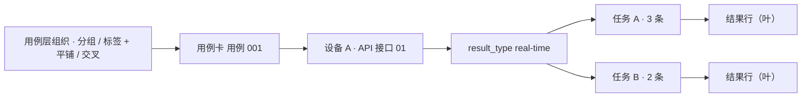
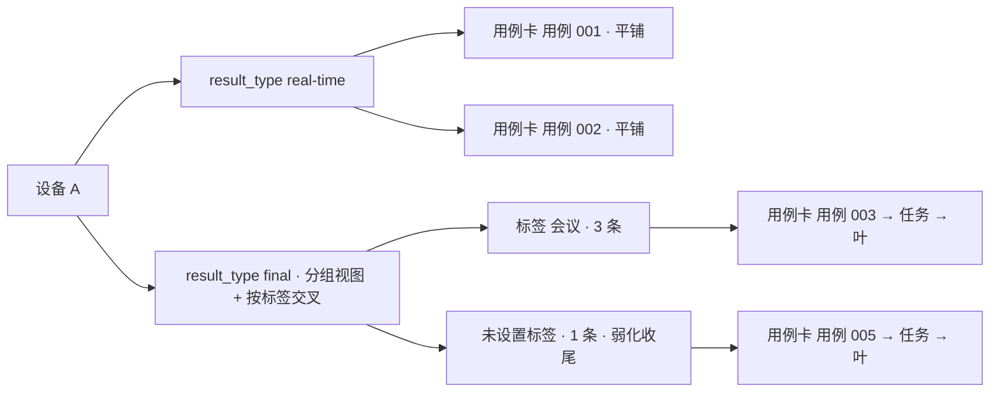
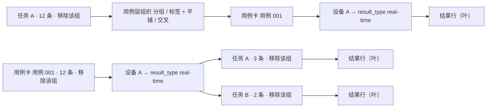
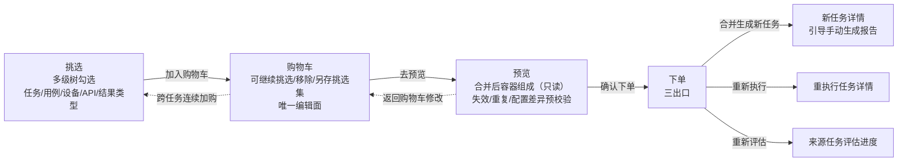
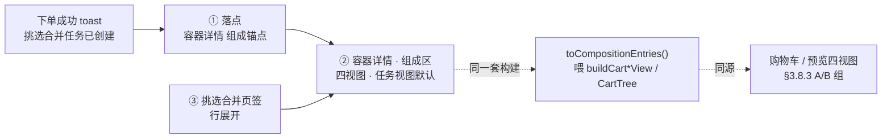

# 挑选合并功能交互重设计（吸收原合并任务 · 多级挑选 · 购物车预览合并）

> 卡 INT-576 ｜ UX设计师A ｜ 2026-10-17 ｜ 性质：**专项交互重设计规范**——在 09_任务域.md（INT-354）既有「挑选合并」口径之上做交互闭环重设计，**部分取代** 09_任务域.md §3.4/§3.8/§3.9/§3.10 与 §5.11/§5.14（取代关系见 §0.2）。
> 基准（全部实测，无杜撰）：本平台后端 `api_gateway/routes/cherry_pick_bp.py`、`api_gateway/application/services/task/cherry_pick_service.py`、`task_service/infrastructure/persistence/cherry_pick_repository.py`、`task_service/infrastructure/persistence/_task_crud_mixin.py:merge_tasks`、`task_service/infrastructure/persistence/models/{task_models,task_cherry_pick_models,result_models}.py`、`scripts/migrations/202610/add_cherry_pick_tables_int339.py`；本平台 Vue 现状 `frontend/src/views/Tasks/{CherryPickPanel,MergedTaskPanel,Tasks}.vue`、`frontend/src/components/common/modal/CherryPickDialog.vue`、`frontend/src/composables/task/usePickCart.ts`、`frontend/src/composables/task/useTaskBatchOps.ts`；UX 既有规范 09_任务域.md（INT-354）、01_全局基座.md（INT-343）、00_页面清单与RBAC划分.md（INT-353）；功能设计文档 INT-339《任务结果CherryPick挑选合并功能设计文档.md》、主库《任务合并功能设计文档.md》（V9.7.10 旧内容，滞后回写另卡，本卡以 V9.7.31 实测 merge_tasks 实现为准）。
> 技术栈：React 19 + TS + Rsbuild + Tailwind 4 + shadcn 风格组件（@base-ui/react + cva + tailwind-merge）+ TanStack Router/Query/Table + Zustand + react-hook-form/zod + sonner/vaul/cmdk + Public Sans/Lora 字体——照基座卡 INT-343 全套；CSS/组件/模态窗直接复用 newAPI 现成件（`D:\00_code\new_api_xagents\web\src\components\ui\*`、`web\src\components\data-table\*`），多主题预设机制（lake-view 默认参考预设）。
> 红线遵守：只产出设计规范文档（`doc/UX设计规范/`），不写任何前端代码、不改 `frontend-react/`；页面文案一律中文，站内不出现 Cherry-Pick 字样（接口路径除外）；基准取材全部来自实测源码与文档，不杜撰。

---

## 0. 文档性质与取代关系

### 0.1 为什么新建专项规范（而非增量改 09_任务域.md）

- 本卡是**交互闭环级重设计**（功能归并 + 多级挑选 + 购物车预览合并 + 易用性），改动面远大于 09_任务域.md 的单节增量；若在 09 内打补丁会造成「新旧口径并存、引用方分不清版本」。
- 09_任务域.md §3.9/§5.14 已承载旧「挑选合并页签 + 购物车族」口径，本卡将其整体升级取代，09 保留旧文作为演进记录，冲突处由本卡「取代注记」指引（§0.2）。
- 本卡是 INT-339 功能设计文档的**交互落地规范**，供主项目实施卡直接消费；文件编号顺延既有 `NN_页面.md` 约定（18），并在 README 登记。

### 0.2 与既有规范的取代/冲突关系（冲突处裁定倾向）

| 既有规范位置 | 既有口径 | 本卡裁定 | 关系 |
| --- | --- | --- | --- |
| 09 §3.4 页签栏（四页签：日常/已发布/合并/挑选合并） | 「合并」「挑选合并」双页签 | **「合并」页签收编进「挑选合并」**，任务列表终态三页签（日常/已发布/挑选合并） | 取代（§2） |
| 09 §3.8 合并任务列表 | 仅整任务合并容器（`merged=true`）独立页签 | 并入「挑选合并」页签，新增「合并方式」筛选（整任务合并/结果挑选合并） | 取代（§2.2） |
| 09 §3.9 挑选合并页签 | 只展示 cherry-pick 容器 + 购物车 Drawer + 挑选集 Popover；页内不做挑选筛选器 | 页签承载统一合并容器列表 + **「开始挑选」进入四步向导**（挑选→购物车→预览→下单）；挑选交互从弹窗升级为页内工作区 | 取代（§3/§4/§5） |
| 09 §3.10 批量浮条「合并任务」钮（task:merge） | 勾选 ≥2 已完成/已合并任务 → 整任务合并 | **按钮撤销**，吸收为挑选向导「任务级」粒度（整任务加购→预览→合并），统一按 `task:cherry_pick` 判定 | 取代（§2.1） |
| 09 §5.11 合并任务确认弹窗 | 整任务合并确认（ConfirmDialog） | 并入预览→下单向导（§5），旧独立弹窗撤除 | 取代（§5） |
| 09 §5.14 挑选合并族（加购弹窗/购物车 Drawer/下单向导） | 三步：挑选→购物车→下单；挑选只在弹窗内平铺结果行 | 升级为**四步向导**（预览为独立步骤）+ 多级挑选树 + 购物车多级分组/批量移除；保留加购弹窗作为「任务详情/对比报告」快捷入口（复用同一多级树，预筛来源任务） | 取代（§3/§4/§5） |
| INT-339 功能设计文档 §9 前端设计 | 四页签（日常/已发布/合并/挑选合并）；挑选交互三档粒度基线 E2E 用例选择页 | 页签按本卡收编（§2）；三档粒度保留并升格为**多级树勾选**（§3.3）；其余口径（引用持有/仅终态可挑/跨任务强制确认/三出口）**沿用不变** | 一致 + 深化 |
| INT-339 功能设计文档 §2「与任务合并的关系」 | 整任务合并（源任务标记 merged）与结果挑选（源任务不变）为两个功能 | 创建入口/交互流程统一（§2），但**容器语义保留两类**（TaskMergeRelation / TaskCherryPickRelation）由「合并方式」标识；源任务 merged 归档语义**不保留**——任务级挑选走结果挑选语义、源任务不变（§10 #1 已拍板） | 裁定（2026-10-17）：交互统一、语义并存 |

> 红线：不杜撰后端端点。凡设计依赖现接口不具备的能力，一律进 §11「待后端立项」清单并给出契约要求；实施卡在接口落地前按容错禁用口径处理（09 §3.12 同款纪律）。

---

## 1. 需求重述与设计目标

负责人原话（2026-10-17，INT-339 评论）：

> 原来的合并任务功能得合并到新的挑选合并功能。任务、用例、被测设备/API、每个设备可能有多个 result_type，每一级别都能被挑选，然后加入购物车，然后复核，然后合并，整个交互流程得重新设计，要方便用户使用。可以在挑选合并里挑，也可以在购物车里挑出不要的。你让UX项目仔细设计一番，然后主项目再根据UX完成需求。

设计目标（四条）：

1. **功能归并**：原「合并任务」（整任务合并）吸收进「挑选合并」，统一入口、统一流程，不留双入口双流程。
2. **多级挑选**：任务 → 用例 → 被测设备/API → result_type 四级均可勾选，联动规则明确，层级不迷失。
3. **购物车预览**：挑选即加购；购物车内可挑出不要的（含批量）；预览为独立步骤（只读，看合并后容器组成 + 预校验）；合并下单出清。
4. **易用性**：入口清晰、操作最少、反馈明确；深浅色 + 多主题下观感一致。

---

## 2. 功能归并：原「合并任务」并入「挑选合并」

### 2.1 现状事实（实测，非杜撰）

**A. 整任务合并（旧「合并任务」功能）**

| 项 | 实测事实 | 出处 |
| --- | --- | --- |
| 入口 | 日常列表批量勾选 ≥2 个任务 → 批量浮条「合并任务」钮 → ConfirmDialog → `POST /tasks/merge` | `useTaskBatchOps.ts:124-153`；09 §3.10/§5.11 |
| 准入 | 全部任务状态 ∈ {completed, merged}（已合并任务可再合并，展开为原始源任务） | `_task_crud_mixin.py:merge_tasks` 注释「允许合并已完成/合并任务/已合并任务」 |
| 产出 | 合并容器任务（status=completed）+ `TaskMergeRelation(merged_task_id, source_task_id, source_result_count)` 关系行；源任务仅标 `merged`（status 置 `merged`），**无 `merged_into` 列**——V9.7.31 Task 模型无此列，源任务与合并容器关系由 `TaskMergeRelation(source_task_id)` 承载（INT-265 已裁定此替代）；**结果不搬家**（V9.7.31 容器+关系展开引用） | `task_models.py:133-147`；`_task_crud_mixin.py:191-…` |
| 列表 | `GET /tasks?merged=true`（TaskMergeRelation 存在性判定） | `MergedTaskPanel.vue` |
| 权限 | `task:merge`（**React 基线按码过滤**：`frontend-react/src/features/tasks/components/task-bulk-actions.tsx:125` 按 `hasPermission('task:merge')` 过滤；Vue 现状合并按钮为状态门控，重写统一按码过滤） | 09 §3.10/§8；`frontend-react/src/features/tasks/components/task-bulk-actions.tsx:125` |

**B. 结果挑选合并（现有「挑选合并」功能）**

| 项 | 实测事实 | 出处 |
| --- | --- | --- |
| 入口 | 任务详情关联用例行 / 对比报告结果行「加入购物车」→ 挑选弹窗；任务页「挑选购物车」全局入口（角标计数）；「挑选合并」页签 | `Tasks.vue:18-26`；09 §3.9/§5.14 |
| 挑选 | `GET /tasks/cherry-picks/candidates`（多条件 AND：来源任务/设备/用例/关键字/执行·评估状态/时间范围；仅终态任务）；结果级平铺勾选 | `cherry_pick_service.py:list_candidates`；`CherryPickDialog.vue` |
| 购物车 | per-user，`cherry_pick_cart_items(result_id + 溯源快照)`；按来源任务分组；单条移除/一键移除失效/清空/另存挑选集 | `cherry_pick_repository.py:cart_list`；`CherryPickDialog.vue` step2 |
| 下单 | `POST /tasks/cherry-picks/cart/checkout` 三出口：merge（容器 + `TaskCherryPickRelation` 引用）/ reexecute / reevaluate | `cherry_pick_service.py:checkout*` |
| 列表 | `GET /tasks?cherry_pick=true`（TaskCherryPickRelation 存在性判定） | `CherryPickPanel.vue` |
| 权限 | 加购/购物车增删/另存挑选集/下单 = `task:cherry_pick`；候选/购物车只读/预览/溯源 = `task:read` | `cherry_pick_bp.py` 全表 |

### 2.2 归并裁定

**裁定①（页签去留）：「合并」页签收编进「挑选合并」页签，任务列表终态三页签。**

```
任务列表页签（终态）：日常 ｜ 已发布 ｜ 挑选合并（含合并容器计数）
```

- 理由：整任务合并与结果挑选合并的产出都是「合并容器任务」（引用源结果、创建即 completed、一等公民），本质同族；双页签让用户对「合并」的两种形态来回切，认知负担大。统一页签后按「合并方式」筛选（§2.3），一类容器一个家。
- 「挑选合并」页签计数 = 两类合并容器总数（`merged=true ∪ cherry_pick=true`，接口见 §11-1）。
- 旧链 redirect（路由同步）：路径式页签 `/tasks/$tab` 白名单由 `['daily','published','merged','cherry-picks']` 收敛为 `['daily','published','cherry-picks']`；`/tasks/merged` 与旧 `/tasks?tab=merged` / `?tab=cherry-picks` 均 redirect 到 `/tasks/cherry-picks`（合并方式筛选随 URL 态可带 `merge_type=whole|picked`）。
- **00 总表（INT-353 路由表 `/tasks`）同步影响**：三页签终态需同步 `00_页面清单与RBAC划分.md` 的 `/tasks` 路由条目（四页签口径）与旧路径 redirect 表；00 总表正文由总控另处同步（2026-10-17 裁定 #2 附带说明，本卡只在此注明）。

**裁定②（创建入口统一）：批量浮条「合并任务」钮撤销，整任务合并吸收为挑选向导的「任务级」挑选粒度。**

- 交互：勾选 ≥1 个终态任务 → 批量浮条改为「加入挑选」（`task:cherry_pick`）→ 打开挑选向导（§3），任务级节点即整任务勾选（等价旧「合并任务」的创建动作，但流程升级为 挑选→购物车→预览→合并）。
- 也可在挑选向导内直接按「任务」维度勾选（来源任务列表多选 → 整任务加购），两条入口同一目标。
- 原「合并任务」确认弹窗（09 §5.11）撤除，由预览/下单向导取代。

**裁定③（层级关系与共存）：两类合并容器在「挑选合并」页签统一展示、统一操作、按「合并方式」区分。**

| 合并方式 | 容器标识 | 溯源展示 | 源任务处置 | 说明 |
| --- | --- | --- | --- | --- |
| 整任务合并 | `TaskMergeRelation` 存在性（`merged=true`） | 展开源任务列表（含各源贡献结果数） | 源任务标记 `merged`（**存量行为，仅历史容器**；新任务级挑选不再触发该归档） | 旧功能吸收后的产出形态；新任务级挑选默认走结果挑选语义（源任务不变，2026-10-17 裁定 #1 已拍板） |
| 结果挑选合并 | `TaskCherryPickRelation` 存在性（`cherry_pick=true`） | 展开源任务→结果分组（结果级溯源） | 源任务保持原样（INT-339 红线） | 主形态 |

- 两类容器共用行操作（查看详情/查看报告/生成报告（引导手动生成）/发布/收藏/删除/重命名），列定义仅「合并方式」与「来源数/结果数」两列随方式切换文案。

**裁定④（权限收敛）：页签内一切写操作（加购/购物车增删/下单/另存挑选集）统一 `task:cherry_pick`；向导第 3 步「预览」只读（INT-1988 起不承载任何写操作），随向导按 `task:cherry_pick` 进入；`task:merge` 不再作为「合并任务」入口判定码（保留在 seed 中，供后端批量接口兼容，前端不再使用）。** 只读浏览/候选/预览接口/溯源按 `task:read`。algo_engineer（仅 task:read，无 task:cherry_pick）**挑选合并链整链隐藏、页签列表只读可见**（09 §8 注 5 口径延续）。

### 2.3 统一「挑选合并」页签结构

```
/tasks/cherry-picks（SectionPageLayout fixedContent）
├─ Title「挑选合并」
├─ Actions：［+ 开始挑选］（primary，task:cherry_pick）｜［打开购物车］（outline + 角标计数）｜［管理挑选集］（ghost Popover）
├─ 筛选工具栏（LogsFilterToolbar 形态）
│   ├─ 搜索（名称/描述/标签）｜执行状态 ｜ 评估状态 ｜ 时间范围
│   ├─ 合并方式（facet 单选：全部/整任务合并/结果挑选）← §11-1
│   └─ stats 徽章行（合并容器总数/整任务合并数/结果挑选数）← §11-1
├─ DataTablePage（容器任务表）
│   列：☑ 选择 ｜ 任务名称（次行「合并方式 + 来源 {n} 任务 · 结果 {m} 条」）｜ 执行状态 ｜ 评估状态 ｜ 用例数 ｜ 来源 ｜ 创建时间 ｜ 操作
│   执行状态列：混态容器显示「部分失败」（§5.5.4 展示映射）
│   renderRow expandable：溯源展开（按合并方式自适应，§2.2；**结果挑选容器的展开体 = 四视图组成树，§5.5.3 ③**；**整任务合并容器保持源任务列表**，因无逐结果引用、`source` 端点不适用，§5.5.2 ⑤）
└─ Footer：分页 Portal
```

空态：「暂无挑选合并任务」/「点击「开始挑选」，从任务/用例/设备/结果类型任一层级勾选执行结果，加入购物车后预览合并」+ 引导按钮「了解挑选合并」。

---

## 3. 多级挑选：层级模型与联动规则

### 3.1 层级模型（用例 / 被测设备-API / result_type / 任务）

> **2026-10-24 负责人口径（INT-1499 / 实施 INT-1694）：层级位置一律以 §3.8.3 为准。** 挑选树有两套形态，本节只作通用概念速览，不单独定义层级：
> - **A 基础三视图**（用例 / 设备 / 结果类型视图，阶段 2 与购物车同形）：**任务在最末一级（叶的前一级）**；任务之上的用例层组织 / 用例卡 / 设备·API / result_type **跨任务共享**，到任务层才按任务分叉。
> - **B 任务视图**（仅购物车 / 预览步骤，默认视图）：**任务在第一级**，任务下再分「用例 / 设备 / 结果类型」三个子模式，子树**只含该任务条目**。

A 组（基础三视图）的通用层级，每级均可勾选：

```
A 基础三视图（阶段 2 与购物车同形，任务在末级）
用例层组织（分组 / 标签 + 平铺 / 交叉）
└─ 用例卡（C）
   ├─ 被测设备 或 被测 API（D）          ← 设备与 API 二选一（TestResult.device_id / api_id 实测）
   │  └─ 结果类型 result_type（R）        ← 同一设备可挂多个 result_type（如 real-time / final / streaming）
   │     └─ 来源任务（T）                 ← 末级：同一上层组合跨任务时在此按任务分叉
   │        └─ 执行结果行（叶，result_id）   ← 数据真相，勾选以 result_id 集为准
   └─ 被测 API（D'）
      └─ 结果类型（R'）→ 来源任务（T'）→ 结果行

B 任务视图（仅购物车 / 预览步骤，默认视图，任务在首级）
来源任务（T）
├─ 用例子模式：用例层组织（任务内：分组 / 标签 + 平铺 / 交叉）
│  └─ 用例卡（C）→ 被测设备/API（D）→ result_type（R）→ 结果行（叶）
├─ 设备子模式：设备/API（D）→ result_type（R）→ 用例层组织（任务内）→ 用例卡（C）→ 结果行（叶）
└─ 结果类型子模式：result_type（R）→ 设备/API（D）→ 用例层组织（任务内）→ 用例卡（C）→ 结果行（叶）
```

> **B 组三子模式的组织层位置见 §3.8.3**：用例子模式在任务之下、用例卡之上；设备 / 结果类型子模式在**任务内 result_type 之下、用例卡之上**（不是「任务下直接换维度」）。

- **跨任务共享与任务层分叉**：同一用例 / 设备·API / result_type 跨多个任务时只出现一次（A 组），到任务层才按 `taskId` 分簇；叶行不再显示来源任务名。B 组相反：任务子树只含该任务条目。
- **数据映射（实测）**：叶 = `test_results` 行（`id`）；`device_id`/`api_id` 二选一；`result_type` 从该行 `result_data`（或 `result_data_path` 指向的完整结果）内 `result_type` 字段解析（`report_data_builder_task_mixin.py:_extract_result_type` 实测口径，缺省 `default`）；`algorithm_type` 为算法列（全局切换器联动维度，非挑选层级）。
- **层级名称来源**：任务名 = 候选行 `task_name`（现返）；设备名 = 设备表名称（`device_acl_repository` 批量查询，预览已用同源）；用例名 = 用例表（现候选未返，§11-2）；result_type = 候选行解析（现候选未返，§11-2）。
- **"每个设备可能多个 result_type"的交互含义**：同任务同用例同设备下，按 result_type 再分一组；用户可只加某设备某结果类型的结果（例如只挑 `real-time` 流式轨，不挑 `final` 定稿轨）。

### 3.2 联动规则（选中态 · 向上向下联动）——本卡明确规则，全链路统一

| 规则 | 行为 |
| --- | --- |
| R1 勾选父级 | 该节点**全部子孙**选中（含叶结果行） |
| R2 取消父级 | 该节点**全部子孙**取消（不留任何子级残留） |
| R3 勾选子级 | 父级呈**部分选中**（Checkbox indeterminate）；**全部**直接子级选中后父级转全选 |
| R4 取消 device 节点 | **其下 result_type 与结果行全部取消**（不保留其下 result_type）——明确裁定：device 是 result_type 的容器，取消容器即清容器内容 |
| R5 取消 result_type 节点 | 仅清该 result_type 下的结果行；**device 保持部分选中** |
| R6 用例级勾选 | = 选中其下全部 device × result_type × 结果行（跨设备、跨结果类型全含） |
| R7 任务级勾选 | = 整任务全部结果行选中（等价旧「合并任务」的选取全集） |
| R8 跨任务 | 不同任务互为独立根，各自勾选互不影响；购物车任务视图按来源任务分组（§4.2） |
| R9 反选/全选 | 「全选当前筛选」= 当前筛选命中全部 result_id 选中（跨页语义见 §11-4）；「反选」= 当前页可见节点取反，已选跨页项保留 |
| R10 已加购态 | 已在购物车的 result_id，挑选树对应叶显示「已加购」标记（打勾 + muted 文案），重复加购由后端幂等跳过（`uq_cherry_cart_user_result` 实测）；取消勾选 ≠ 移除购物车（移除只在购物车完成，预览步骤只读，§4） |

### 3.3 挑选工作区交互（页内四步向导第 1 步）

> **2026-10-24 标注：本节为三视图重做（§3.8）前的旧形态线框，视图切换与层级以 §3.8.2 / §3.8.3 为准。** 现行阶段 2 的视图切换为「用例视图｜设备视图｜结果类型视图」三钮（`PickStep` 两阶段），任务层在三视图**末级**；下方线框中的「视图切换：树形（默认）｜平铺」与「任务 A」根均为旧形态（平铺视图已由三视图取代），本节仅保留筛选栏、汇总条、加载 / 空态等交互细节作为参考。

```
┌─ 挑选（Step 1/4）────────────────────────────────────────────┐
│ 筛选栏（§3.4） ［搜索 ］［来源任务▾］［设备▾］［结果类型▾］［执行状态▾］［评估状态▾］［时间范围▾］［重置］ │
│ 视图切换：树形（默认）｜平铺（结果行列表）                              │
│ ┌ 树形区（虚拟滚动 max-h-[520px]）                                │
│ │ ☐ 任务 A（36 条）                                              │
│ │   ☐ 用例 001（6 条）                                          │
│ │     ☐ 设备 设备-01（4 条）                                    │
│ │       ☐ 结果类型 real-time（2 条）                            │
│ │          ☑ 结果行 1（已加购）· 结果行 2                        │
│ │       ☐ 结果类型 final（2 条）                                 │
│ │   ☑ 用例 002（[三] 部分选中，2/5 条）                         │
│ └────────────────────────────────────────────────────────────┘
│ 已选汇总条（sticky bottom，DataTableBulkActions 形态）：已选 {n} 条 · 覆盖 {m} 个来源任务 · {d} 台设备 ｜ ［全选当前筛选］［反选］［清空］［加入购物车（{n}）］ │
└──────────────────────────────────────────────────────────────┘
```

- **三档粒度（沿用 INT-339 §4.1 口径，升格到树）**：①逐条勾选（叶）；②按节点整组（用例/设备/result_type 节点勾选，R1/R6）；③按维度筛选后批量（筛选栏 facet 命中 → 「全选当前筛选」）。
- **树节点行**：Checkbox（三态：全选/部分/未选）+ 类型图标（任务=ClipboardList、用例=ListChecks、设备=Smartphone、API=ArrowLeftRight、结果类型=Tag）+ 名称 + 计数 Badge「{n} 条」+ 展开/收起（Collapsible 默认收起到任务级，可「全部展开/全部收起」）。
- **叶结果行**：Checkbox + 用例名（缺名时显示用例 ID）+ 设备/API 名 + 结果类型 Badge（mono，数据值）+ 执行状态 StatusBadge + 评估状态 Badge + 时间（mono）。
- **平铺视图**：现有结果行列表形态（09 §5.14 基版），保留供「按条件细看」使用；勾选状态与树形共享同一 `selectedResultIds` 集（Zustand，§7）。
- **加载/空态**：Skeleton（树骨架 3 层）；空态「无符合条件的执行结果」/「仅已完成、执行失败、已停止的终态任务可挑选，且默认剔除已删除用例的结果」（对齐 `PickableTaskStatus` 与 `excluded=0` 实测）。

### 3.4 挑选筛选器（多条件 AND，全部可选）

| 条件 | 形态（newAPI 组件） | 说明/出处 |
| --- | --- | --- |
| 搜索 | Input debounce 500ms | 命中用例名/用例 ID（`case_keyword` 实测，INT-401 语义） |
| 来源任务 | FacetedFilter 多选（Command 搜索 + 计数） | `task_ids`；选项 = 可挑选终态任务集合（候选行聚合去重） |
| 设备 | FacetedFilter 多选 | `device_ids`；选项 = 设备表（`devicesApi.getAllFlat` 同源）；API 型任务对应「API」筛选（`api_ids`，§11-2 候选补 api_name 后落） |
| 结果类型 | FacetedFilter 多选（动态选项 = 当前筛选命中去重的 result_type 集合） | §11-2 候选返 result_type 后落；选项值显示原始数据值（mono），红线下不做英文界面，值本身是数据 |
| 执行状态 | FacetedFilter singleSelect | completed/failed/stopped（仅终态） |
| 评估状态 | FacetedFilter singleSelect | 已评估/未评估（`evaluated` 实测） |
| 时间范围 | Select | 全部时间/今日/昨日/近7天/近30天/自定义（`start_date`/`end_date` 实测） |

### 3.5 待后端立项（§11 汇总）

- §11-2：候选行补 `case_name`/`device_name`/`api_name`/`result_type`（结果级解析）。
- §11-3（可选）：候选树聚合端点，**聚合树形态按 §3.8.3 A 组：任务在末级**（用例层组织 / 用例卡 / 设备·API / result_type 跨任务共享，到任务层才按 `taskId` 分叉；B 组任务视图由购物车客户端按已返条目构建，不由该端点承载），含每节点 result_id 集与计数——供树形勾选与「全选当前筛选」跨页语义；接口落地前前端由平铺候选行重建树（受 per_page≤200 分页限制，跨页全选降级为「当前已加载」并 Tooltip 说明）。
- §11-4：`POST /tasks/cherry-picks/candidates/select-all` 返回当前筛选命中全部 result_id 集合（供跨页全选）。

### 3.6 多任务用例展示口径（INT-713 负责人反馈修订：不「全平铺」、照用例管理页显示）

> 负责人 2026-10-18（INT-713 评论）：「前端这也有问题，用例全平铺，你得考虑到多任务用例照用例管理页面显示，然后还有每个用例下边有多个设备，每个设备有多个结果类型的数据」。本节收口挑选树的**展示口径**：树形为唯一主视图、用例节点照用例管理页呈现、多任务用例按任务根分组并提供「用例视角」重排。

**裁定①（树形为主、平铺仅辅助）**：挑选工作区默认且主展示 = **树形视图**（任务→用例→被测设备/API→result_type→结果行叶，§3.1/§3.3），「平铺」仅保留为辅助列表（「按条件细看」），不默认、不作为主展示——避免「用例全平铺」观感；两视图勾选态共享同一 `selectedResultIds` 集（Zustand）。

**裁定②（用例节点照用例管理页显示）**：用例级分支节点呈现用例管理页（11_用例域 §3.3 用例卡）的**卡片级元信息**，让多任务场景下用例可辨识：

| 用例节点元素 | 渲染（对齐 11 用例域 §3.3） | 数据源（§11 待补） |
| --- | --- | --- |
| 用例名 | `font-medium truncate` + 超长 Tooltip | 候选行 `case_name`（§11-2） |
| CaseIdBadge | mono 徽章，点击复制 toast「已复制」 | `case_id` |
| 算法徽章 | Badge secondary（getAlgorithmLabel 中文名） | 候选行 `algorithm_type`（**INT-577 §11-2 已落地实测返回**，`cherry_pick_service.py:470`） |
| 标签 chips | TagBadge 按分类呈现，最多 6 枚 +「+N」 | 候选行 `tags`/`category`（**§11-7 仍待后端**） |
| 时长 / 轮次 | Badge outline `{x}m {y}s` + `{rounds} 轮`（有值才显） | 候选行 `duration`/`rounds`（**§11-7 仍待后端**） |
| 计数徽章 | 「{n} 条」（既有） | 节点 result_ids 计数 |
| 名称缺省降级 | 缺 `case_name` → 「用例不可用 {前 8 位 id}…」（INT-713 打回 #1 口径，不裸显 UUID） | — |

- **INT-762 复核（2026-10-18）**：`algorithm_type` 已随 §11-2 落地（候选行实测返回）；`tags`/`category`/`duration`/`rounds` 四项未落地前，用例节点保持「名称 + 计数 + 算法徽章」最小呈现，不阻塞树形层级；实施卡在 §11-7 剩余四项落地后补全卡片级元信息。

**裁定③（多任务用例：默认按任务根分组 + 「用例视角」重排）**（**2026-10-24 起视图与层级以 §3.8.3 为准**）：

- **默认树形（任务视角）**：同一用例在多个任务下各有结果 → 每个任务根下各挂自己的「用例→设备→结果类型」子树（R8 跨任务独立根，互不影响勾选）；用例在每任务下可分别勾选其不同设备/结果类型（如任务 A 下只挑该用例的 `real-time`、任务 B 下挑 `final`）。
- **用例视角（视图切换新增：「树形 ｜ 用例视角 ｜ 平铺」）**：按用例名聚合跨任务——**用例 → 来源任务列表 → 设备/API → result_type → 结果行**，照用例管理页「分组/标签筛选 + 平铺用例」的浏览习惯：让用户在一个用例节点下看到**多任务的设备×结果类型**全貌，跨任务批量加购该用例的特定结果；勾选态与任务视角共享同一 `selectedResultIds` 集。默认收起至用例级。
- 用例视角下节点联动复用 R1-R7（父级=用例含其下全部任务×设备×结果类型；取消任务级节点仅清该任务下的结果行，用例保持部分选中）。

**裁定④（层级完整性：每用例下多个设备、每设备多个结果类型）**：树形必须渲染完整三级分支（用例→设备/API→result_type），设备级分支下不得把结果类型折叠为平铺叶——同一用例同设备下多个 result_type（如 real-time/final/streaming）各成独立分支（§3.1 层级模型 + R4/R5 联动）；缺 `result_type` 数据时折叠为「结果类型待补充」（§11-2 落地前，现有 PENDING 折叠口径）。

**实施要点**（本卡 §7.5 增量）：①默认视图锁定 `tree`（平铺仅显式切换）；②用例节点渲染 CaseIdBadge/算法/标签/时长元信息（§11-7 落地后）；③~~新增「用例视角」重排（`buildPickTree` 增加按 `caseId` 聚合变体）~~ **作废（2026-10-24，以 §3.8.3 为准）**：该能力已由「用例视图 + 末级任务层」承载，实施按 §3.8.6 第 3 条 `buildPickCaseView`（任务层在末级），不再另建按 `caseId` 聚合变体；④候选树构建保持从平铺候选行重建（§11-3 落地前），多任务用例跨任务分组口径同上。

### 3.7 层级展示规范（逐级明细，INT-762 新增专项节）

> **层级位置以 §3.8.3 为准（2026-10-24 负责人口径）**：本节是三视图重做前的通用层级说明（任务在最外一层）；现行形态为 **基础三视图任务在末级 + 任务视图任务在首级**，冲突处一律以 §3.8 为准。
>
> **本节的五级序不含「用例层组织」层**：B 组三子模式的组织层位置一律见 **§3.8.3**（用例子模式在任务之下、用例卡之上；设备 / 结果类型子模式在**任务内 result_type 之下、用例卡之上**）。§3.7 保留为历史小节，与 §3.8.3 冲突处以 §3.8.3 为准。
>
> 本节把挑选树「任务 → 用例 → 被测设备/API → result_type → 结果行」**每一级**的展示与交互逐条收口，
> 直接回应 INT-713 负责人反馈「用例全平铺，得按 任务→用例→设备→结果类型 重新设计」与 INT-762 验收
> 「每一级有展示与交互说明，多任务场景不『平铺』」。已落地实现对位：
> `frontend-react/src/domain/lib/cherry-pick-tree.ts`（树构建与 R1-R10 联动纯函数，含 result_type 分组/待补充折叠）、
> `features/tasks/cherry-pick/components/pick-tree.tsx`（树组件）。多任务用例展示口径见 §3.6（裁定①-④）。

#### 3.7.1 逐级展示与交互明细（任务 → 用例 → 设备/API → result_type → 结果行）

| 层级 | 展示元素（实测/实现对位） | 计数口径 | 展开 / 收起 | 选中态 | 取消联动 |
| --- | --- | --- | --- | --- | --- |
| **任务级（根）** | 任务名（`font-medium truncate` + 超长 Tooltip）+ 任务图标（ClipboardList）；候选行 `task_name` | 「{n} 条」= 该任务下全部结果行数（跨用例×设备×result_type 合计） | **默认收起至任务级**；每任务根独立 Collapsible；工具栏「全部展开/全部收起」 | Checkbox 三态（R7：勾选=整任务全部结果选中） | 取消=清空该任务全部结果（R2），不留子级残留 |
| **用例级** | 用例名 + CaseIdBadge（mono，点击复制 toast）+ 算法徽章（Badge secondary）+ 标签 chips（最多 6 枚 +「+N」）+ 时长/轮次 Badge（有值才显）+ 用例图标（ListChecks）；缺 `case_name` →「用例不可用 {前 8 位 id}…」（不裸显 UUID） | 「{n} 条」= 该用例在该任务根下的结果行数；**用例视角**下=跨任务聚合计数 | Collapsible，默认收起；展开显示「设备/API」子层 | Checkbox 三态（R6：勾选=其下全部设备×result_type×结果行） | 取消=清该用例下全部结果 |
| **设备 / API 级** | 设备名 或 API 名（`TestResult.device_id`/`api_id` 二选一实测）+ 设备图标（Smartphone）/ API 图标（ArrowLeftRight）；缺名 →「设备不可用/API不可用 {前 8 位 id}…」 | 「{n} 条」= 该设备/API 下全部结果行数（跨 result_type 合计） | Collapsible，默认收起；展开显示「result_type」子层 | Checkbox 三态 | 取消=清空其下 result_type 与结果行（**R4 容器语义**：取消设备即清容器内容） |
| **result_type 级** | result_type 原始数据值（Badge mono，如 `real-time`/`final`/`streaming`）+ 图标（Tag）；候选未返/缺值 → 折叠为「结果类型待补充」（PENDING 口径，`cherry-pick-tree.ts:54-55`） | 「{n} 条」= 该 result_type 下结果行数 | Collapsible，默认收起；展开显示结果行叶；**同一设备多个 result_type 各成独立并列分支**（层级完整性，不压平为平铺叶） | Checkbox 三态 | 取消=仅清该 result_type 结果行，**父设备保持部分选中**（R5） |
| **结果行（叶）** | 用例名 + 设备/API 名 + result_type Badge（mono）+ 执行状态 StatusBadge + 评估状态 Badge + 时间（mono）+ **「已加购」标记**（R10：已加购叶打勾 + muted 文案） | 无子级（叶） | 不可展开 | Checkbox 二态（单结果） | 取消=仅该结果行 |

#### 3.7.2 购物车与预览步骤的层级口径（含 result_type 折叠/展开）

- 购物车树（§4.2 `CartTree`）**默认任务视图**：任务在第 1 层，任务下按「用例 / 设备 / 结果类型」子模式下钻，子树只含该任务条目；另有 用例 / 设备 / 结果类型 三视图，**任务在末级、任务之上各层跨任务共享**（与阶段 2 同形，§3.8.3）。`CherryPickCartItem.source_result_type` 已落地（INT-577 §11-5）后完整重建 result_type 级——**result_type 折叠/展开口径**：同一设备下多个 result_type 各成独立分支可独立展开/收起；快照缺 `source_result_type` 的历史条目折叠为「结果类型待补充」单组（Tooltip「结果类型待后端接口」）。
- 移除矩阵逐级可用（§4.3）：单条（叶行 X）/ 任一分支节点「移除该组」（用例卡 / 设备·API / result_type / 任务 / 组织层组头，各自只清本节点）/ 批量勾选移除；取消设备级组=清其下全部（R4 同构）。
- 预览步骤（§5.2）同一套树 + 摘要徽章 + 预校验 Alert，**只读**（无移除矩阵、无批量浮条）；摘要按层级统计（结果 {n} 条 / 来源任务 {m} 个 / 设备 {d} 台 / 用例 {c} 个）。

#### 3.7.3 多任务场景展示

> **2026-10-24 核对：本节与 §3.8 冲突处以 §3.8 为准。** 原「默认任务视角 + 用例视角」的视图模型已被 §3.8.3 取代——默认视角现为购物车的「任务视图」（任务第 1 层，B 组）与三视图的「任务末级」（A 组）；原「用例视角（用例 → 来源任务列表 → 设备/API → result_type）」不再单独存在，其能力由「用例视图 + 末级任务层」承载。

- **任务视角（现对应 §3.8.3 B 组的「任务视图」，仅购物车 / 预览步骤）**：每任务根独立子树（R8 跨任务互不影响），子树只含该任务条目；勾选可分别进行（如任务 A 只挑该用例 `real-time`、任务 B 挑 `final`）。
- **用例视角（现对应 §3.8.3 A 组的「用例视图」）**：用例层组织 → 用例卡 → 设备/API → result_type → **任务 → 结果行**，跨任务共享上层、任务在末级；与任务视图共享同一 `selectedResultIds`。
- **树形为主、平铺仅辅助**（§3.6 裁定①）：默认锁定 `tree`，平铺仅显式切换，多任务场景绝不默认平铺。

---

### 3.8 三视图与两阶段挑选重做（INT-1034 专项）

> **2026-10-24 负责人口径：三视图任务为末级 + 新增任务视图（任务为首级）（INT-1499 / 实施 INT-1694）**

> 负责人 2026-10-20 实测（INT-1034）：日常任务 tab 需要独立按钮入口；挑选应先**选择要合并的任务**、再选择这些任务里要合并的用例/结果；当前只有任务视图需重做——任务下分**用例视图 / 设备视图 / 结果类型视图**；报告里具体用例卡片也需要按分组；**整个平台用例相关的地方都得照用例管理来显示**。
> 本节在 §3.6/§3.7 基础上**重做挑选工作区**（入口 / 两阶段 / 三视图 / 用例显示统一），**部分取代** §3.3 的视图切换（树形/用例视角/平铺）与 §3.6 裁定①/③ 的视图模型——冲突处以本节为准。

#### 3.8.1 入口：日常任务 tab 独立按钮（裁定①）

| 项 | 实测 / 对位 | 设计裁定 |
| --- | --- | --- |
| 现状 | 日常 tab 无独立按钮，仅批量浮条「加入挑选」（勾选任务后出现） | `task-bulk-actions.tsx:129-150` → `tasks/index.tsx:121-125` `handleJoinPick` |
| 新增入口 | 日常页签筛选工具栏右端（收藏/回收站工具条旁） | 「开始挑选」按钮（primary，`task:cherry_pick` 权限过滤）→ 打开挑选向导，落在**两阶段第 1 阶段（选择任务）**；日常列表已勾选任务时预选该批直达第 2 阶段 |
| 保留 | 批量浮条「加入挑选」 | 保留为快捷入口（任务级预选 → 直达两阶段第 2 阶段），与按钮入口并存（§6.1 入口矩阵同步） |


#### 3.8.2 两阶段挑选：先选任务 → 再选结果（裁定②）

**阶段 1 · 选择任务**（新 `PickTaskStage` 组件）：

```
┌─ 挑选 · 阶段 1：选择任务 ────────────────────────────────┐
│ 搜索 ［任务名称］            ｜ 已选 {n} 个任务            │
│ ☑ 任务 A    [已完成]   36 条   2026-10-18 09:00          │
│ ☑ 任务 B    [已完成]   24 条   2026-10-18 10:00          │
│ ☐ 任务 C    [执行失败] 12 条   2026-10-17 15:00          │
│ ［全选当前筛选］ ［清空］          ［下一步：选择结果（{n}）］    │
└─────────────────────────────────────────────────────────┘
```

- 数据源：候选行聚合的可挑选任务集合（终态 `completed/failed/stopped`，实测 `PICKABLE_TASK_STATUS` / `fetchPickableTasks`），按状态/名称排序。
- 任务行：☑ Checkbox + 任务名 + 执行状态 StatusBadge + 结果计数「{n} 条」+ 创建时间（mono）。
- 工具栏：「全选当前筛选」「清空」；主钮「下一步：选择结果（{n}）」（选中 ≥1 启用）。
- 空态：「暂无可挑选的终态任务」。

**阶段 2 · 选择结果**（现 `PickStep` 重构）：

```
┌─ 挑选 · 阶段 2：选择结果 ────────────────────────────────┐
│ 已选任务：任务 A · 任务 B  ［更换任务（回阶段 1）］           │
│ 视图切换：用例视图 ｜ 设备视图 ｜ 结果类型视图              │
│ ┌ 树形区（按当前视图渲染，§3.8.3）───────────────────────┐ │
│ └─────────────────────────────────────────────────────┘ │
│ 已选 {n} 条结果 · 覆盖 {m} 个来源任务 · {d} 台设备         │
│ ［全选当前筛选］［反选］［清空］     ［加入购物车（{n}）］      │
└─────────────────────────────────────────────────────────┘
```

- 顶部任务集摘要条：「已选任务：{任务名…}」+「更换任务」ghost 钮（回阶段 1；勾选**跨阶段保留**不清空——对齐 §6.2「改筛选不清勾选」解耦口径）。
- 视图切换三钮：**用例视图｜设备视图｜结果类型视图**（替换现 树形/用例视角/平铺）；三钮内**任务层恒在末级**，仅选中 1 个任务时省略（§3.8.3 A 组）。
- 勾选联动 R1-R10 全复用，三视图共享同一 `selectedResultIds`（Zustand）；已选汇总条 `SelectedSummaryBar` 沿用。

#### 3.8.3 三视图：用例 / 设备 / 结果类型（裁定③）

> **2026-10-24 负责人口径：三视图任务为末级 + 新增任务视图（任务为首级）（INT-1499 / 实施 INT-1694）**——本节 2026-10-20 / 2026-10-21 的旧口径（任务不进树、任务只由阶段 1 独立承载、顶层组头标跨任务规模、跨任务批量移除、叶行带来源任务名消歧）**全部作废**。层级以本节两张表为准，与实施卡 INT-1694 的目标树逐字一致。

两套树形态共用同一候选行源与同一 `selectedResultIds`（Zustand），只差**任务层放在哪一级**：

| 形态 | 任务层位置 | 出现位置 | 说明 |
| --- | --- | --- | --- |
| **A 基础三视图**（用例 / 设备 / 结果类型） | **最末一级**（叶的前一级） | 阶段 2 挑选 + 购物车 / 预览步骤 | 两处**同形**，共用同一套纯函数 |
| **B 任务视图**（任务下分 用例 / 设备 / 结果类型 三子模式） | **第一级** | **仅购物车 / 预览步骤**，且为默认视图 | 阶段 2 **没有**任务视图 |

##### A. 基础三视图层级（任务在末级，阶段 2 与购物车同形）

| 视图 | 第 1 层 | 第 2 层 | 第 3 层 | 第 4 层 | 第 5 层 | 叶 | 树构建（`cherry-pick-tree.ts`） |
| --- | --- | --- | --- | --- | --- | --- | --- |
| **用例视图** | **用例层组织**：分组视图 / 标签视图 + 平铺 / 交叉（照用例管理页） | 用例卡 | 设备/API | result_type | **任务** | 结果行 | `buildPickCaseView` / `buildCartCaseView` |
| **设备视图** | 设备/API | result_type | **用例层组织（分组 / 标签 + 平铺 / 交叉）** | 用例卡 | **任务** | 结果行 | `buildPickDeviceView` / `buildCartDeviceView` |
| **结果类型视图** | result_type | 设备/API | **用例层组织（分组 / 标签 + 平铺 / 交叉）** | 用例卡 | **任务** | 结果行 | `buildPickResultTypeView` / `buildCartResultTypeView` |

> **层级语义（A 组，最容易做反的一段，照此实现）**：
> - **任务只在最底一层**：叶挂在任务节点下，任务之上不再有任务分组。
> - **任务之上的所有节点跨任务共享**：用例层组织 / 用例卡 / 设备·API / result_type **不按 `taskId` 分簇**，树 key 不带 taskId 命名空间；到任务层才按 `taskId` 分开。
> - **用例层组织是独立的一层，用例卡在其下**：用例视图第 1 层；设备视图与结果类型视图**第 3 层（result_type 之下、用例卡之上）**——组织层是分支层（组头 / 兜底桶是它的节点），**用例卡挂在组织层之下**，两层不得合并成一句「用例层组织作用层」。
> - **同一条用例跨两个任务**：用例卡只出现一次，其下「设备/API → result_type」层也共享，最后按任务分成两个任务节点；同一设备跨两个任务同理。
> - **叶行不再显示来源任务名**（任务已是明确的一级节点；`showLeafTask` 全删）。
> - **所有分支节点（含任务节点）统一**：名称 + 计数「{n} 条」+ 三态复选框 + 展开 / 收起 +「移除该组」（= 本节点下全部条目，只清本节点；阶段 2 为加购语义、无移除钮）。
> - **阶段 2 只选中 1 个任务**时，任务层是恒定单值 → 该层自动省略不渲染；选中 ≥2 个任务才出现。**购物车 / 预览步骤恒显任务层**。

**用例视图（第 1 层 = 用例层组织，照用例管理页）**：

- **第 1 层 = 用例层组织**：**分组视图 / 标签视图**（组织维度照用例管理页现行实现：`grouped-case-list.tsx` / `tag-case-list.tsx` + `case-sub-view-toggle.tsx`，语义对齐 11_用例域 §3.5/§3.6）+ **平铺 / 交叉** 子视图；组织控件置顶常显；「未分组」「未设置标签」兜底桶收尾。**平铺子视图下组织层不渲染组头**（用例卡直接平铺），层级语义不变。
- **第 2 层 = 用例卡**（复用 `features/testcases/components/case-card.tsx`：名称 / CaseIdBadge / 算法徽章 / 标签 / 时长·轮次）+ 计数 Badge「{n} 条」；缺名降级「用例不可用 {前 8 位}…」（§3.7.1 口径）。
- **第 3 层 = 设备/API**（`Smartphone`/`ArrowLeftRight`，`device_id`/`api_id` 二选一；缺名降级「设备不可用/API不可用 {前 8 位}…」）；**第 4 层 = result_type**（`Tag` 图标 + mono Badge，缺值折叠「结果类型待补充」）；**第 5 层 = 任务**（任务名 + 计数 + 三态 Checkbox + 展开/收起）；叶 = 结果行。
- 用例卡元信息缺省降级：`tags/category/duration/rounds` 待 §11-7 后端补字段，落地前「名称 + 算法徽章 + 计数」最小呈现（§3.6 裁定②注记延续）。

**设备视图**：

- 层级：**设备/API → result_type → 用例层组织 → 用例卡 → 任务 → 结果行**（五层 + 叶，组织层与用例卡分列两层）。
- 第 1 层 设备/API 节点（`Smartphone`/`ArrowLeftRight` 图标，设备名 + 计数「{n} 条」；缺名降级同 §3.7.1）；第 2 层 result_type（`Tag` 图标 + mono Badge；缺省折叠「结果类型待补充」）。
- **第 3 层 = 用例层组织（INT-1125，独立分支层）**：照用例管理页 **分组视图 / 标签视图** 组织 + **平铺 / 交叉** 子视图（见下「用例层组织」）；组头 / 兜底桶是该层节点，**平铺子视图不渲染组头、用例卡直接挂本层**。
- **第 4 层 = 用例卡**：组织层之下渲染用例管理卡 `PickCaseCard`（不再用内联文本行），卡片文案与元信息同用例管理页用例卡。
- **第 5 层 = 任务**：同一设备下同一用例的结果按任务分叉；设备 / result_type / 用例层组织 / 用例卡四层跨任务共享。
- 联动：取消任务 = 清该任务下全部结果（R2/R7）；取消设备 = 清其下 result_type、组织层、用例卡与结果行（**R4 容器语义**）；取消 result_type = 仅清其下结果行、父设备保持部分选中（R5）；取消组织层组头 = 仅清该组用例卡及其结果行；取消用例卡 = R6。

**结果类型视图**：

- 层级：**result_type → 设备/API → 用例层组织 → 用例卡 → 任务 → 结果行**（组织层与用例卡分列两层）。
- 第 1 层 result_type（数据值 Badge mono，缺省「结果类型待补充」折叠）；第 2 层 设备/API；**第 3 层 用例层组织（独立分支层，同设备视图：组头 / 兜底桶为该层节点，平铺子视图不渲染组头）**；**第 4 层 用例卡 `PickCaseCard`**；**第 5 层 任务**；叶 结果行。
- 用例层照用例管理页 **分组视图 / 标签视图** 组织 + **平铺 / 交叉** 子视图（见下「用例层组织」）。
- 联动同设备视图（R4/R5/R6 全复用，§3.2；取消组织层组头只清本组）。

基础三视图层级示意（以用例视图为例，设备 / 结果类型视图同构，只是前几层维度换位）：



> 读图要点：`用例卡 → 设备 · API → result_type` 三段**跨任务共享只画一次**，到「任务」才分叉；阶段 2 只选 1 个任务时任务节点省略，叶直接挂在 result_type 下。

##### B. 任务视图（任务在首级，仅购物车 / 预览步骤，默认视图）

任务视图把任务提到**第一级**，任务下再分「用例 / 设备 / 结果类型」三个**子模式**（`cart-panel.tsx` 子模式切换器）。子树**只含该任务条目**，key 带 `taskId` 命名空间。

| 子模式 | 第 1 层 | 第 2 层 | 第 3 层 | 第 4 层 | 第 5 层 | 叶 |
| --- | --- | --- | --- | --- | --- | --- |
| **用例** | **任务** | 用例层组织（分组 / 标签 + 平铺 / 交叉） | 用例卡 | 设备/API | result_type | 结果行 |
| **设备** | **任务** | 设备/API | result_type | **用例层组织** | 用例卡 | 结果行 |
| **结果类型** | **任务** | result_type | 设备/API | **用例层组织** | 用例卡 | 结果行 |

- **位置**：**仅购物车抽屉与预览步骤（§4.2 / §5.2）有**，且是默认视图；**阶段 2 挑选没有任务视图**（阶段 2 的任务选择在第 1 阶段完成，任务层落在三视图末级）。
- **任务节点（第 1 层）**：来源任务名（`source_task_name`，缺名降级「任务不可用 {前 8 位}…」）+ 计数 Badge「{n} 条」（该任务在当前子模式下的全部条目数）+ 三态 Checkbox + 展开 / 收起 +「移除该组」（= 该任务在当前视图下的全部条目，§4.3）。
- **任务内组织层（三子模式都有）**：用例子模式在任务节点下直接复用 `PickCaseOrgList` / `PickCaseOrgControls`（分组视图 / 标签视图 + 平铺 / 交叉，与用例管理页同款，与基础三视图共用同一控件与纯函数）；**设备 / 结果类型子模式的组织层在 result_type 之下（第 4 层）、用例卡之上（第 5 层）**，组头 / 兜底桶为该层节点，平铺子视图不渲染组头。组织维度是**任务内**的，不跨任务聚合。
- **数据源**：任务层 = 购物车条目 `source_task_id/source_task_name`（已落地，无需后端）；用例分组 / 标签 = 购物车条目 `tags`/`groupId`（**INT-1693** 后端在跑）——未落地前任务视图用例子模式全落「未分组」/「未设置标签」兜底桶，组织控件常显；INT-1693 落地后同一套纯函数自动出真名，不改树结构。
- **切换语义**：视图（任务视图 ↔ 三视图）与子模式（用例 / 设备 / 结果类型）切换**不改变勾选态与失效标记**。

任务视图用例子模式层级示意（设备 / 结果类型子模式的组织层**不在任务下第 2 层**，而是在任务内 result_type 之下、用例卡之上：**任务 → 设备/API → result_type → 用例层组织 → 用例卡 → 结果行**；结果类型子模式前两层换为 result_type → 设备/API）：


> 读图要点：任务在第一级（与基础三视图相反）；任务内组织层、用例卡、设备 / result_type 只属于该任务，不再跨任务共享。

##### 用例层组织（A 组与 B 组共用）

- **组织层位置（明确到层级，不写「作用层」）**：
  - **用例视图 · 第 1 层**（用例卡之上、树顶）；
  - **A 组 设备视图 / 结果类型视图 · 第 3 层**（result_type 之下、用例卡之上，用例卡为第 4 层）；
  - **B 组 任务视图 设备 / 结果类型子模式 · 任务内第 4 层**（`任务 → 设备/API → result_type → **用例层组织** → 用例卡 → 结果行`）；
  - **B 组 任务视图 用例子模式 · 任务内第 2 层**（任务之下、用例卡之上）。
- **独立分支层**：分组 / 标签视图下组头与兜底桶是该层节点，用例卡挂在其下；**平铺子视图不渲染组头，用例卡直接挂上一层**（层级语义不变，仍占该层）。
- **组织状态共享**：org 维度（分组 / 标签）+ 子视图（平铺 / 交叉）是**用例视图 / 设备视图 / 结果类型视图与任务视图三子模式共享的同一份会话态**（`usePickOrg` 单例，阶段 2 与购物车同款），任一处切换组织维度 / 子视图，其余视图即时同款；组织与 `selectedResultIds` 完全解耦——只影响用例层视觉分组，**勾选联动 R1-R10 与共享 `selectedResultIds` 不变**。
- **组织控件**：复用 `case-sub-view-toggle.tsx`（Tabs 胶囊：**分组视图 / 标签视图**）+ 子视图选项（`GROUP_SUB_VIEW_OPTIONS` 平铺 / 按标签、`TAG_SUB_VIEW_OPTIONS` 平铺 / 按用例分组），交叉聚合复用 `domain/lib/sub-view-aggregation.ts` 同款纯函数（`groupCasesByCaseGroup`/`groupCasesByTag`）。
- **组织渲染**：
  - **分组视图 + 平铺**：用例卡平铺于该层（默认）；
  - **分组视图 + 交叉（按标签）**：用例按标签桶组织（子组头 = 标签名 + 色点 / 分类角标 + 计数；无标签用例入「未设置标签」兜底桶末尾）；
  - **标签视图 + 平铺**：用例卡平铺；
  - **标签视图 + 交叉（按用例分组）**：用例按分组桶组织（子组头 = 组名 + 计数；无分组用例入「未分组」兜底桶末尾）。
- **兜底口径**：阶段 2 候选行已带 `tags`/`group_id`/`group_name`（INT-1130 / INT-1497 已落地）；**购物车条目缺这三个字段（INT-1693 未落地前）→ 购物车三视图与任务视图三子模式全落兜底桶，组织控件常显**；INT-1693 落地后按真实分组 / 标签组织，纯客户端聚合、不新增后端请求。
- **组件落位**：组织控件 + 用例卡 + 子组头 = `pick-case-org-list.tsx`（用例视图第 1 层、设备 / 结果类型视图第 3 层组织层、任务视图任务内组织层共用，见 §3.8.6 / §7）。

用例层组织示意（以设备视图为例，组织层为第 3 层；结果类型视图同构，前两层换为 result_type → 设备/API）：



#### 3.8.4 全站用例显示统一（裁定④）

> 负责人 2026-10-20："整个平台用例相关的地方都得照用例管理来显示"。

- **统一组件**：全站展示用例信息处一律照用例管理页用例卡（`CaseCard`，11_用例域 §3.3 字段口径），不另造平铺文本行。
- 落位清单：挑选树用例节点（§3.8.3 用例视图）、购物车 `CartTree` 用例节点（§4.2 同步）、报告具体用例卡片（15_报告域 §3.3.7 同步）、任务详情关联用例行、开始测试用例选择（随各自域卡同步）。
- 实施：平台通用 `CaseCard` 复用（现 `features/testcases/components/case-card.tsx`），挑选/购物车/报告/任务域共用。

#### 3.8.5 报告用例卡片分组（15_报告域同步）

- 报告具体用例（15 §3.3.7）：用例卡片**改照用例管理页交互**（INT-1125）——**分组视图 / 标签视图** 组织控件 + **平铺 / 交叉** 子视图（复用 `case-sub-view-toggle.tsx` 同款语义），组头 = 组名 + 计数「{n} 个用例」，未分类/未设置标签兜底弱化；组内用例卡照用例管理显示。
- 详规见 **15_报告域.md §3.3.7**（INT-1034 同步写入 + INT-1125 修订）。
- **交叉引用（2026-10-24）**：报告「具体用例」的**三视图与用例卡维度显示**由 **INT-1724** 定义（15_报告域.md），**本文不展开**；本节只保留「报告用例卡片按分组 / 标签组织」这一口径。

#### 3.8.6 实施清单（供实施卡拆分）

1. **入口按钮**：`tasks/index.tsx` 日常 tab + `tasks-filter-toolbar.tsx` 右端加「开始挑选」（`task:cherry_pick` 权限），打开向导两阶段；批量浮条「加入挑选」保留（预选任务直达阶段 2）。
2. **两阶段状态机**：`pick-step.tsx` 加 `phase: 'tasks' | 'results'`；新增 `pick-task-stage.tsx`（任务选择列表 + 全选/清空/下一步）；任务集摘要条 +「更换任务」。
3. **三视图树构建（任务在末级）**：`cherry-pick-tree.ts` 新增共用纯函数 `buildTaskLeafBranches(rows, keyPrefix)`（按 `taskId` 分簇 → 任务分支（`level: 'task'`，名取 `taskName`/`sourceTaskName`）→ 叶）；`buildPickCaseView`（用例层组织 → 用例卡 → 设备/API → result_type → **任务 → 叶**）、`buildPickDeviceView`（设备/API → result_type → **用例层组织** → 用例卡 → **任务 → 叶**）、`buildPickResultTypeView`（result_type → 设备/API → **用例层组织** → 用例卡 → **任务 → 叶**）统一走它；**任务之上的节点不按 taskId 分簇**（跨任务共享，key 不带 taskId 命名空间）；`showLeafTask` 删除。阶段 2 仅选中 1 个任务时任务层省略。**设备 / 结果类型视图的组织层是 result_type 之下的独立分支层（`level: 'org'`，组头 / 兜底桶节点），用例卡是它的子层，不得把两层压成一层。**
4. **三视图组件**：`pick-step.tsx` 视图切换三钮；用例视图用例节点 = `CaseCard`（新增 compact 变体 `pick-case-card.tsx`）；**设备/结果类型视图用例层组织（INT-1125）**——把 `pick-case-view.tsx` 的用例层组织逻辑（org 维度 + 子视图 + 用例卡 + 子组头）抽为可复用 `pick-case-org-list.tsx`，org 状态提升到阶段 2（三视图 + 任务视图三子模式共享，`usePickOrg` 会话态）；设备/结果类型视图 = `PickTree` 顶/二层分支行（设备/API、result_type）+ **第 3 层组织层 `pick-case-org-list`（平铺子视图不渲染组头，用例卡直接挂本层）** + 第 4 层用例卡 + 末级任务分支行；任务视图设备 / 结果类型子模式 = `PickTree` 任务节点 + 设备/API + result_type + **任务内组织层** + 用例卡 + 叶。
5. **购物车视图（任务视图默认）**：`cart-view-switcher.tsx` 四值不变，`'task'` 按钮文案由「任务分组」改为「任务视图」且保持默认；`cart-panel.tsx` 任务视图下渲染**子模式切换器**（用例 / 设备 / 结果类型），**三个子模式都渲染组织控件**（分组 / 标签 + 平铺 / 交叉，复用 `usePickOrg`）——用例子模式的组织层在**任务之下、用例卡之上**，设备 / 结果类型子模式的组织层在**任务内 result_type 之下、用例卡之上**（第 4 层，用例卡第 5 层）；`cherry-pick-tree.ts` 的现有 `buildCartTree(groups)` 作为购物车树基座（任务视图 = `CartTree view='task'` 分支，第 1 层为任务、子树只含该任务条目、key 带 taskId 命名空间；**不新增 `buildCartTaskView`**），`buildCartCaseView` / `buildCartDeviceView` / `buildCartResultTypeView` 按 A 组末端补任务层；`cart-tree.tsx` 新增 `renderTaskNode`、`renderTopGroup` 改为普通分支行、删 `showLeafTask`；删 `collectSourceTaskCount` 与组头跨任务规模文案；各分支节点自带「移除该组」（§4.3 同步）。购物车用例视图顶层复用 `pick-case-org-list.tsx` 的 `PickCaseOrgList` / `PickCaseOrgControls`（阶段 2 已在用）。
6. **报告同步**：`specific-case-comparison.tsx` 用例卡分组改组织控件（§3.3.7：分组视图/标签视图 + 平铺/交叉，见 15_报告域.md），15 文档同步。
7. **hooks**：`use-cherry-pick-candidates.ts` 增 `useCherryPickDeviceView` / `useCherryPickResultTypeView`（对称现 `useCherryPickCaseView`）；`usePickOrg`（三视图 + **任务视图三子模式**共享组织状态）；购物车四视图树构建用 `useMemo` 派生（domain 纯函数）即可，无需新 hook。
8. **回归断言**：两阶段状态机 + 三视图勾选一致性（同一 `selectedResultIds`）+ **基础三视图任务层恒在末级（叶的前一级）、任务视图任务恒在首级** + **阶段 2 与购物车三视图同形**（同一纯函数、同一层级）+ **组织层位置断言：用例视图第 1 层；A 组设备·结果类型视图在 result_type 之下、用例卡之上；B 组设备·结果类型子模式在任务内 result_type 之下、用例卡之上** + 三视图与任务视图三子模式 org 状态共享、分组/标签组织切换勾选不清空 + **平铺子视图不渲染组头、用例卡直接挂上一层** + 购物车任务视图三子模式 + 切换视图 / 子模式勾选态与失效标记不变 + 购物车四视图下四种移除操作全可用（节点「移除该组」只清本节点）+ 用例卡复用 + 报告分组（三视图见 INT-1724）+ 全站无 Cherry-Pick 字样（§8 五角色矩阵沿用）。

---

## 4. 购物车

### 4.1 购物车数据与分组（实测约束）

- 后端购物车条目 = `CherryPickCartItem` 快照（`result_id` + `source_task_id/name/case_id/device_id/api_id/execution_status`，`cherry_pick_repository.cart_list` 实测），per-user、服务端持久化、按来源任务分组返回（`cart_get`）。
- **前端购物车镜像**：Zustand `usePickCartStore`（§7）保存会话镜像（`groups` + `total` + `invalidItemIds`），加购/移除/清空/下单后 `refreshCart()` 同步——角标计数数据源（§6.3）。

### 4.2 购物车展示（四视图：任务视图默认 + 用例 / 设备 / 结果类型，INT-1125 / 2026-10-24 层级口径）

**视图切换（INT-1125 新增；2026-10-24 负责人层级口径修正）**：购物车抽屉 / 预览页顶部视图切换器「**任务视图（默认）｜用例视图｜设备视图｜结果类型视图**」——四项共享同一购物车条目集（`usePickCartStore` 单例镜像），切换即时生效、不改变已勾选移除选择态与失效标记。

| 视图 | 任务层位置 | 层级（自上而下） | 树构建（`cherry-pick-tree.ts`） |
| --- | --- | --- | --- |
| **任务视图**（默认） | **第 1 层** | 任务 →〔子模式〕→ 叶（见 ①） | `CartTree view='task'`（树基座 `buildCartTree(groups)`） |
| **用例视图** | **末级**（叶的前一级） | 用例层组织 → 用例卡 → 设备/API → result_type → **任务** → 叶 | `buildCartCaseView` |
| **设备视图** | **末级**（叶的前一级） | 设备/API → result_type → **用例层组织** → 用例卡 → **任务** → 叶 | `buildCartDeviceView` |
| **结果类型视图** | **末级**（叶的前一级） | result_type → 设备/API → **用例层组织** → 用例卡 → **任务** → 叶 | `buildCartResultTypeView` |

> 后三视图与阶段 2 挑选（§3.8.3 A 组）**同形、共用同一套纯函数**：任务之上各层跨任务共享、不按 `taskId` 分簇，到任务层才分叉。**任务视图是购物车 / 预览步骤独有的默认视图，阶段 2 没有**（§3.8.3 B 组）。

**① 任务视图（默认）**

树区顶部**子模式切换器**：「**用例｜设备｜结果类型**」。三条子链路：

| 子模式 | 第 1 层 | 第 2 层 | 第 3 层 | 第 4 层 | 第 5 层 | 叶 |
| --- | --- | --- | --- | --- | --- | --- |
| 用例 | **任务** | 用例层组织（分组 / 标签 + 平铺 / 交叉） | 用例卡 | 设备/API | result_type | 结果行 |
| 设备 | **任务** | 设备/API | result_type | **用例层组织** | 用例卡 | 结果行 |
| 结果类型 | **任务** | result_type | 设备/API | **用例层组织** | 用例卡 | 结果行 |

- 任务节点（第 1 层）= 来源任务名（`source_task_name`，缺名降级「任务不可用 {前 8 位}…」）+ 计数 Badge「{n} 条」+ 三态 Checkbox + 展开 / 收起 +「移除该组」（= 该任务在当前子模式下的全部条目）；子树**只含该任务条目**，key 带 `taskId` 命名空间。
- 用例子模式下任务内**复用 `PickCaseOrgList` / `PickCaseOrgControls`**（分组 / 标签 + 平铺 / 交叉，与用例管理页同款）；**设备 / 结果类型子模式的组织层在 result_type 之下（第 4 层）、用例卡之上（第 5 层）**，同样复用同一对组件；分组 / 标签数据源 = 购物车条目 `tags`/`groupId`（**INT-1693**，未落地前全落「未分组」/「未设置标签」兜底桶，控件常显）。
- 节点行 = Checkbox（三态，用于批量移除选择）+ 名称 + 计数 + 展开 / 收起；用例节点 = `PickCaseCard`（§3.8.4 全站用例显示统一）。
- 叶行 = 用例名 + 设备 / API 名 + 结果类型 Badge + 执行 / 评估状态 + 失效标记（`invalid` 实测），**不显示来源任务名**。

**② 用例视图 / 设备视图 / 结果类型视图**

- **树构建**：`buildCartCaseView` / `buildCartDeviceView` / `buildCartResultTypeView`，与挑选页 §3.8.3 A 组同层级——**任务在最末一级（叶的前一级）**；任务之上的组织层 / 用例卡 / 设备·API / result_type **跨任务共享、不按 `taskId` 分簇**：同一用例 / 同一设备出现在两个任务的购物车里，上层节点只出现一次，最后按任务分成两个任务节点。
- 用例视图顶层**复用 `pick-case-org-list.tsx` 的 `PickCaseOrgList` / `PickCaseOrgControls`**（阶段 2 已在用）；**设备 / 结果类型视图的组织层在 result_type 之下、用例卡之上（第 3 层，与前两层的设备·API / result_type 同构）**，同样复用该组件；分组 / 标签数据源 = **INT-1693**，未落地前落兜底桶，控件常显；平铺子视图不渲染组头，用例卡直接挂上一层。
- 任务节点与其他分支节点同形态：名称 + 计数「{n} 条」+ 三态 Checkbox + 展开 / 收起 +「移除该组」（= 本节点下全部条目，**只清本节点、不跨节点**）。
- 叶行不显示来源任务名；失效条目标「已失效」（`invalid` 实测）。
- result_type 级受 §11-5 快照限制，「结果类型待补充」折叠不变。
- **移除矩阵在四视图下全可用（§4.3 同步）**：单条移除（叶行 X）、任一分支节点「移除该组」（用例卡 / 设备·API / result_type / 任务 / 组织层组头，各自只清本节点）、批量勾选移除、一键移除失效、清空、另存挑选集——勾选共享同一 `selectedEntryIds`。

四视图切换示意（任务视图与用例视图并列，设备 / 结果类型视图与用例视图同构）：



> 读图要点：上半 = 任务视图（任务为第 1 层，子树只含该任务条目）；下半 = 用例视图（任务在末级，`用例卡 → 设备 · result_type` 两段跨任务共享、只画一次）。

### 4.3 移除交互（含批量）

| 操作 | 交互 | 接口（实测/待立项） |
| --- | --- | --- |
| 移除单条 | 叶行尾 X 钮 → 确认 toast | `POST /cart/items/remove`（item_ids=[id]）实测 |
| 移除该组（任一分支节点） | 节点行「移除该组」ghost 钮 → ConfirmDialog「将移除「{名称}」下的 {n} 条结果，是否继续？」→ 前端展开该节点 result_id 集批量移除；用例卡 / 设备·API / result_type / **组织层组头** / 任务节点**同规则，只清本节点、不跨节点**（组织层组头 = 用例视图第 1 层 / 设备·结果类型视图第 3 层 / 任务视图设备·结果类型子模式任务内第 4 层，只清该组下用例卡及其结果行；平铺子视图无组头，故无此钮） | `POST /cart/items/remove`（item_ids 数组）实测 |
| 任务节点移除 | 任务节点「移除该组」= 该任务在**当前视图**下的全部条目（任务视图 = 该任务全部条目；用例 / 设备 / 结果类型视图 = 该任务在该视图下的全部条目）；确认文案「将移除任务「{名称}」下的 {n} 条结果，是否继续？」 | 同上（该任务全部 item_id） |
| **批量移除** | 购物车抽屉勾选多条（含节点级勾选 R1-R5 同构）→ 底部批量浮条「移除已选（{n}）」destructive；**预览步骤只读，无批量移除**（§5.2） | 同上 |
| 一键移除失效 | 有 `invalidItemIds` 时浮条出现「移除失效条目（{n}）」 | `POST /cart/items/remove`（invalidItemIds）实测 |
| 清空 | 「清空购物车」ghost destructive → ConfirmDialog | `DELETE /cart/items` 实测 |
| 另存挑选集 | 「另存为挑选集」→ Dialog 命名（`INPUT_CONFIRM` 形态） | `POST /cart/save-as-set` 实测 |
| 恢复挑选集 | 挑选集 Popover/抽屉「恢复进购物车」 | `POST /sets/{id}/to-cart` 实测 |

- **购物车内挑出不要的**：即上表「移除」全矩阵——购物车不是只读清单，用户可在此挑出不需要的（单条 / 节点 / 任务 / 批量），完成「也可以购物车里挑出不要的」负责人口径。

### 4.4 购物车呈现形态（两处共用一组件）

| 形态 | 位置 | 内容 |
| --- | --- | --- |
| **购物车抽屉**（Sheet `sm:max-w-lg`，全局入口=导航栏右上角角标，INT-344 落位） | 任意页面可达 | **四视图切换器（§4.2：任务视图默认 + 用例/设备/结果类型）+ 任务视图子模式切换器（用例/设备/结果类型）** + 购物车树 + 移除矩阵 + 「继续挑选」（关抽屉回挑选/跳挑选向导）+ 主钮「去预览（{n}）」 |
| **预览步骤**（页内向导 Step 3，§5.2） | 挑选合并页签向导内 | **合并后容器组成的只读预览**：摘要徽章 + 预校验 Alert + 四视图组成树（`CartTree` 只读、无复选框、无移除入口）+ 主钮「确认下单」；**编辑一律回 Step 2 购物车**（INT-1988） |

---

## 5. 预览合并闭环（挑选 → 加入购物车 → 预览 → 合并）

### 5.1 四步主链路（流程图）



- **四步定义**：挑选（选）→ 加入购物车（加）→ 预览（看）→ 合并/下单（下）。「加入购物车」是挑选步骤的提交动作与购物车状态的建立；预览是**独立步骤**（与旧三步向导的最大差异，§5.4），职责是**在不可逆的合并动作之前，让用户看到「合并后会是什么样」**，而不是把购物车清单再列一遍（INT-1988）。
- **步骤名不用「复核」**：站内「复核」已专指结果侧的人工复核 / AI 复核（§5.2 改名缘由），向导第 3 步统一叫**「预览」**。
- **入口与衔接**：任何入口（§6.1）进入向导都从 Step 1 挑选开始；已加购项在挑选树显示「已加购」（R10），可直接点「去购物车/去预览」跳过剩余挑选。
- **下单成功出清**：已下单条目出清、未下单（失效/重复）条目保留（实测 `checkout_merge` 的 `cart_clear(keep_result_ids)` 口径）；toast「挑选合并任务已创建」→ 跳转新任务详情；合并出口 Alert 引导「挑选合并任务无执行过程，任务完成自动生成报告不适用，请在任务详情中手动生成报告」。

### 5.2 预览步骤（Step 3）交互 —— 合并后容器组成的只读预览

> **改名缘由（INT-1988，负责人 2026-10-26T06:47Z「复合步骤的意义是啥, 是不是改成 预览啥的」）**：
> ① **撞名**——站内「复核」已专指结果侧的人工复核 / AI 复核（`frontend-react/src/infrastructure/adapters/dto/iam-adapter.ts:72` 的 `task.result.review` →「任务结果复核」；`features/tasks/detail/case-association.tsx:256-258` 同时消费 `task.result.review` 与 `task.result.ai_review`；配套组件 `features/tasks/components/manual-review-dialog.tsx` / `manual-review-batch-bar.tsx` / `features/ai-review/quick-ai-review-dialog.tsx`），向导步骤再叫「复核」会把两件事混成一件；
> ② **内容重复**——改版前 Step 3 相对 Step 2 只多一次 `preview` 摘要，主体是把同一棵购物车树原样再渲染一遍（`steps/review-step.tsx:98` 的 `CartPanel`，编辑能力也重复），三个数字在 Step 4 又出现第三次，信息增量接近零；
> ③ **正确定位**——合并不可逆，用户真正需要在按「确认下单」之前看到的，是**合并后会生成什么形状的容器**（§5.5 同一套组成视图），而不是清单的第二份拷贝。
> **因此 Step 3 = 预览：只读、看组成、不再可编辑；编辑（勾选/移除/批量/一键移除失效）统一留在 Step 2 购物车。**

```
┌─ 预览（Step 3/4）──────────────────────────────────────────────────────┐
│ ① 挑选 › ② 购物车 › [③ 预览] › ④ 下单                          ［返回列表］│
│ 合并预览 · 下单后将生成的容器组成（只读）                                  │
│ ［结果 9 条］［来源任务 3 个］［设备 2 台 / 用例 9 个］                     │
│ ⓘ 2 条结果执行失败，合并后按原状态保留（失败任务可被挑选合并，正常业务态）    │
│ ⚠ 失效 {i} 条（Alert warning）：下单时将跳过——［返回购物车移除］            │
│ ⚠ 同设备同用例多来源 {k} 组（Alert info）：合并将全部保留并标注来源         │
│ ⚠ 跨任务配置不一致（Alert warning）：默认取首个来源任务，可展开任务级配置覆盖 │
│ ┌ 组成预览 ────────────────────────────────────────────────────────┐ │
│ │［任务视图｜用例｜设备｜结果类型］［执行状态 ▾］［全部展开］［全部收起］   │ │
│ │  ▾ 话轮接管_打断_小艺E2E测试任务  4 条                              │ │
│ │    ▾ 测试用例_JG0242_多轮接管-上下文_…  1 条                        │ │
│ │        ▾ pura90小艺 › default                                       │ │
│ │            └ 源结果 #3838 · 已完成 ［失效时：删除线 +「已失效」］     │ │
│ │  ▸ 豆包-话轮接管-打断E2E测试任务  3 条                              │ │
│ │  ▸ E2E测试任务_2026/8/27 16:06:11  2 条 · 失败 2                    │ │
│ └───────────────────────────────────────────────────────────────────┘ │
│ ［返回购物车修改］                              主钮［确认下单（9）］       │
└────────────────────────────────────────────────────────────────────────┘
```

**① 头部摘要（3 枚 StatBadge，保留现版式）**：`结果 {n} 条`（`preview.total_results`）｜`来源任务 {m} 个`（`preview.source_task_count`）｜`设备 {d} 台 / 用例 {c} 个`（`preview.device_ids.length` / `preview.case_count`）。**这三枚只在本步骤出现一次**——Step 4 不再重复（§5.3）。

**② 预校验 Alert（四条，前三条口径同现状，只把「移除」动作指回购物车）**：

| 触发字段 | 文案 | 操作 |
| --- | --- | --- |
| `invalid_result_ids.length > 0` | 「{i} 条购物车条目已失效（源结果被删除），下单时将跳过」 | **「返回购物车移除」**（跳 Step 2；**本步骤不提供「一键移除失效」**——预览只读） |
| `duplicates.length > 0` | 「同设备同用例存在多来源结果 {k} 组，合并将全部保留并标注来源」 | 无（说明性） |
| `config_inconsistent` | 「{p} 个来源任务的任务级配置（{配置项}）不一致，新任务默认取首个来源任务配置，可展开「任务级配置」覆盖」 | 无（下单步骤可覆盖） |
| `execution_status_counts.failed > 0`（新增） | 「{f} 条结果执行失败，合并后按原状态保留」 | 无（说明性；措辞不得暗示异常，§5.5.4） |

**③ 组成预览（主体，只读）**：复用 §5.5 的组成视图构建与渲染——四视图（任务视图默认｜用例｜设备｜结果类型）、层级与购物车/容器组成区**逐项一致**（§3.8.3 A/B 两组），树用 `CartTree`（`readOnly`，**不渲染复选框、不渲染移除钮、无批量浮条**）。视图层级照抄 §5.5.3 四视图表，不另立一套。

**④ 页脚**：`［返回购物车修改］`（回 Step 2）+ 主钮 `［确认下单（{n}）］`（→ Step 4）。**「清空购物车」「另存为挑选集」不在本步骤**（已随编辑能力回收到 Step 2 / 购物车抽屉）；Stepper 的 ①② 可直接回跳。

**⑤ 数据装配（零新增接口、零 mock；复用现有树/视图纯函数 + 新增一条映射纯函数）**：

| 输入 | 端点（已落地） | 用途 |
| --- | --- | --- |
| 购物车条目集 | `GET /tasks/cherry-picks/cart`（`usePickCartStore` 单例镜像，§4.1） | 组成树条目：`result_id / source_task_id / source_task_name / source_case_id / source_case_name / source_device_id+name / source_api_id+name / source_result_type / execution_status / invalid` |
| 预览摘要 | `POST /tasks/cherry-picks/preview`（`useCherryPickPreview`） | 头部三枚徽章、失效 id 集、重复组、配置差异、执行状态分布 |

- **不得**改成调 `GET /tasks/cherry-picks/{id}/source`——那是**下单之后**的容器端点，预览阶段容器还不存在（没有 id、没有关系行）。这是本步骤与 §5.5 组成区最根本的区别。
- 组成条目 = `PickCartEntry[]` 直接映射为 `CompositionEntry`（两者同形，§5.5.8 已明「CompositionEntry 与 PickCartEntry 同形」）：新增纯函数 `toPreviewCompositionEntries(entries: PickCartEntry[], preview: PickPreview): CompositionEntry[]`，只补 `invalid = preview.invalidResultIds.includes(resultId) || entry.invalid`，其余字段直取快照。
- **失效以 `preview.invalid_result_ids` 为准、条目 `invalid` 兜底**（服务端判定优先，本地快照可能滞后）。
- **真实取值示例（2026-10-26 实测，docker 网关 15000 / 主库 `intelligent_audio_test`）**：购物车放入任务 312（E2E 失败任务 2 条 failed）、402（话轮接管_打断_小艺 4 条 completed）、407（豆包-话轮接管-打断 3 条 completed），`POST /preview` 返回 `total_results=9 / source_task_count=3 / source_task_ids=[312,402,407] / device_ids=[9,10] / device_names=["pura90小艺","pura90豆包"] / case_count=9 / execution_status_counts={completed:7,failed:2} / duplicates=[] / config_inconsistent=false`。本 run 为只读取数，取完已清空购物车（取数前购物车为空）。

**⑥ 与 §5.5 容器详情「组成」区的差异（同一套视图，两种数据源；实施不得混用）**：

| 维度 | **预览步骤（Step 3，下单前）** | 容器详情组成区（§5.5.3 ②，下单后） |
| --- | --- | --- |
| 语义 | 「将要生成的容器会长什么样」——预测 | 「这个容器由什么组成」——既成事实 |
| 数据源 | `GET /cart` + `POST /preview` | `GET /tasks/cherry-picks/{id}/source` + `GET /tasks/{id}` |
| 条目构造 | `toPreviewCompositionEntries(PickCartEntry[])`（快照直取） | `toCompositionEntries(source, cases, devices, apis)`（端点 + 详情 join） |
| 用例名 / 设备名 / result_type | 购物车快照自带（`source_case_name` / `source_device_name` / `source_result_type`）；缺名降级「用例不可用 {前 8 位}…」 | `source` 结果级字段 + 详情 join |
| 评估状态 | **不渲染**（快照不含评估状态；`evaluationStatus` 恒 null，显示会让全部条目误落「未评估」） | 渲染（叶行徽章 + 评估状态筛选） |
| 组织控件（分组/标签） | **不渲染**（快照无 `tags` / `group_name`，全落兜底桶，控件无意义）；用例视图直接平铺用例卡 | 渲染（详情 `cases[].group_name` / `tags`） |
| 溯源 / 源结果时间 | **不渲染**（快照无源结果时间；溯源会离开向导、丢失步骤态） | 渲染（「溯源」跳源任务 + 源结果时间） |
| 失效 | `preview.invalid_result_ids` + 条目 `invalid` | `results[].missing` |
| 空态 | 购物车为空 | 该任务没有合并来源记录 |
| 降级提示 | 「按购物车快照展示，评估状态与分组标签在下单后可见」 | 「结果级状态待后端补字段，当前按用例状态显示」 |

**⑦ 状态**：

| 场景 | 呈现 |
| --- | --- |
| 加载中（cart / preview 任一 pending） | 徽章骨架 + 树骨架 3 层 |
| 购物车为空（`total = 0`） | `Empty`：「购物车为空，暂无可预览的合并组成」+「返回购物车」；主钮禁用 |
| preview 请求失败 | 树区 `Empty`：「合并预览失败」+「重试」；徽章保留骨架位、不做假数字；toast 沿用「合并预览失败（购物车可能为空）」 |
| 失效 > 0 | Alert + 叶行 muted + 删除线 + Badge「已失效」+ 分支计数「· 失效 {k}」 |
| 筛选无命中 | `Empty`「无符合筛选条件的来源结果」+「重置筛选」（工具行常显） |
| 深色 | 与购物车 / 容器组成区同一套 token（`bg-card` / `border-border` / `--primary` / `--warning` / `--destructive` / `--muted-foreground` 删除线），见 §5.5.7 |

**⑧ 实施落位（供 UX规划师拆卡）**：

| 层 | 落位 | 说明 |
| --- | --- | --- |
| domain | `domain/lib/container-composition.ts` **追加** `toPreviewCompositionEntries(entries, preview)` | 纯函数、零依赖；与 `toCompositionEntries` 并列，共用 `CompositionEntry` / `groupCompositionEntries` / `summarizeComposition` |
| application | `application/tasks/cherry-pick/use-preview-composition.ts`（新增） | `usePickCartStore.groups` + `useCherryPickPreview()` → `entries / groups / summary / loading / error / retry`；**不新增 query**（两个既有数据源，preview 已随 cart revision 失效） |
| interfaces | `features/tasks/cherry-pick/components/preview-composition.tsx`（新增薄壳）<br/>`features/tasks/detail/container-composition.tsx` **增 `mode?: 'container' \| 'preview'`**<br/>`steps/review-step.tsx` → **`steps/preview-step.tsx`**（改名） | `mode='preview'` 关闭：评估状态筛选、评估徽章、源结果时间、溯源钮、组织控件、`#composition` 锚点高亮；**四视图一律走 `CartTree`**（任务视图 `buildCartTree`；用例视图 `buildCartCaseView`；设备 / 结果类型视图**不传 `org`**，`cart-tree.tsx:370-372` 只在传 `org` 时插组织层）——快照无分组 / 标签，用例视图**不进 `CaseSubGroupHeader` 分桶**，避免整屏只有一个「未分组」组头；标题「合并预览」+ 副标题「下单后将生成的容器组成（只读）」；空态/降级文案换本表 ⑦ / ⑥ |
| 常量 | `features/tasks/cherry-pick/constants.ts` | `WIZARD_STEPS` 第 3 步 `label:'预览'`、`subtitle:'合并后容器组成（只读）'`；文案红线词表改为「挑选合并/挑选/加入购物车/购物车/**预览**/下单/挑选集」，并注明**「复核」保留给结果侧人工复核 / AI 复核**，不再指向导步骤 |

**⑨ 设计图（真实数据，浅 / 深）**：本目录 `18_预览步骤_可视稿.html`（预览步骤主视图 + 去重后的下单步骤 + 状态组件；数据取自 2026-10-26 实测 3 个来源任务 / 9 条结果 / 2 台设备 / 失败 2 条）；交付评论附渲染图 `INT-1988_预览步骤_浅色.png` / `INT-1988_预览步骤_深色.png` / `INT-1988_预览步骤_状态.png`。

### 5.3 下单步骤（Step 4）三出口

| 出口 | 交互 | 接口（实测） | 成功态 |
| --- | --- | --- | --- |
| **合并生成新任务**（默认） | 三出口 RadioGroup 选中 → 出口说明 → 失效 Alert（`invalid_result_ids` 非空时：「{i} 条失效条目下单时将跳过，可返回购物车移除」）→ 字段（新任务名称* / 说明 / 任务级配置折叠区：算法类型/算法参数/任务配置，默认取首个来源任务，可覆盖）→ 若 `configInconsistent` 再弹 ConfirmDialog 强制确认 → 主钮「确认下单」（进行中「下单中…」） | `POST /cart/checkout action=merge` | toast + 跳 `/tasks/:id#composition`（**落在「组成」区**，§5.5.3 ①）+ 引导手动生成报告 |
| **重新执行** | 说明「按所选结果的用例×设备集合创建重执行任务并启动」→ 字段（重执行任务名称，可选默认自动命名）→ 主钮「确认下单」 | `POST /cart/checkout action=reexecute` | toast + 跳重执行任务详情（自动启动失败时保留条目并提示手动启动） |
| **重新评估** | 说明「对所选结果按来源任务逐个发起重新评估（不重跑执行）」→ 主钮「确认下单」 | `POST /cart/checkout action=reevaluate` | toast（部分失败提示条目保留）+ 跳首个来源任务详情查看评估进度 |

- **与旧下单向导（09 §5.14c）差异**：新增「预览」独立步骤（§5.2），下单本身字段/三出口/强制确认沿用旧口径，只移入四步向导末步。
- **去重（INT-1988）**：Step 4 **不再渲染**「结果 {n} 条 / 来源任务 {m} 个 / 设备 {d} 台·用例 {c} 个」三枚 StatBadge（改版前在 Step 3 出现一次、Step 4 又出现一次；三个数字的增量信息为零，统计口径统一由 Step 3 预览页承担）。保留：失效 Alert、三出口、新任务字段、任务级配置折叠区、`configInconsistent` 强制确认。页脚次钮「返回预览」。

### 5.4 与旧三步口径（09 §5.14）的差异清单

| 维度 | 旧（09 §5.14） | 新（本卡） |
| --- | --- | --- |
| 步骤数 | 三步：挑选→购物车→下单 | 四步：挑选→购物车→**预览**→下单（预览独立，含容器组成预览+预校验） |
| 挑选层级 | 结果行平铺（三档粒度=单条/分组整组/维度批量） | 四级树勾选（任务/用例/设备/result_type）+ 叶行；三档粒度升格到树 |
| 购物车分组 | 按来源任务平铺 | 按来源任务→用例→设备→result_type 树（§11-5 补字段后完整）；**INT-1125 增 用例/设备/结果类型三视图切换（任务视图默认，任务在末级；任务视图任务在首级，2026-10-24 口径）** |
| 购物车移除 | 单条 X + 清空 + 一键失效 | 单条/节点/整组/**批量勾选移除**/一键失效/清空（§4.3 全矩阵） |
| 第 3 步 | 无独立步骤；购物车即下单前检查 | **预览**独立步骤（只读）：合并后容器组成预览（四视图）+ 失效/重复/配置差异预校验 + 3 枚摘要徽章；**编辑只在购物车**（§5.2） |
| 下单页统计 | — | 不重复统计（三枚徽章只在预览页出现，§5.3 去重） |
| 旧「合并任务」 | 独立批量浮条入口 + 独立确认弹窗 | 撤销，吸收为任务级挑选（§2.2） |

### 5.5 合并后任务（挑选合并容器）呈现 —— 三处落点同源四视图（INT-1699）

> **负责人 2026-10-24 口径**：「还得显示合并后的任务是咋样的；执行部分失败、评估部分失败的任务也运行被挑选合并」。
> 本节定义**合并完成之后**容器任务长什么样、在哪三处看到它、部分失败怎么标。**适用范围 = 结果挑选容器**（`task_cherry_pick_relations` 有引用行）；整任务合并容器（`task_merge_relations`）不进本节呈现，口径见 §5.5.2 ⑤。视图层级与 §3.8.3 **完全同源**：A 组基础三视图（用例 / 设备 / 结果类型）**任务在末级**，B 组任务视图**任务在首级**；三处落点复用购物车的同一套视图构建（任务视图 = `CartTree view='task'` + 树基座 `buildCartTree`，三视图 = `buildCartCaseView` / `buildCartDeviceView` / `buildCartResultTypeView`），**不另造一套树、不新增端点**。

#### 5.5.1 事实基线（2026-10-24 实测，docker 网关 15000 / 主库 `intelligent_audio_test`）

实测做法：用 5 条真实结果走 `POST /tasks/cherry-picks/cart/checkout action=merge` 生成容器（任务 419 的 5714/5715/5716 为已完成、任务 384 的 3792/3796 为执行失败），得到容器任务 **580**；下列取值均为该容器的真实返回。**580 已于 2026-10-24 01:15Z 软删**（`deleted=t`、`GET /tasks/580` → 404，但 `task_cherry_pick_relations` 关系行未级联、`source` 端点仍返 200）——本 run 自建测试数据，已清理。

| 项 | 实测事实（真实取值） | 出处 |
| --- | --- | --- |
| 创建即终态 | `status=completed`；`execution_status` 由继承的 TaskCase 汇总派生 → 实测 **`failed`**（5 条用例中 3 条 failed）；`evaluation_status=completed` | `GET /tasks/580` |
| 描述默认值 | `description="挑选合并自 2 个来源任务"`（下单「说明」留空时后端默认文案） | `cherry_pick_service.py:812` |
| 用例集与计数 | `case_count=5`、`total_cases=5`、`completed_cases=2`、`failed_cases=3`；用例行状态继承源 TaskCase（非所选结果状态） | `GET /tasks/580` |
| 关联资源 | `devices=[{id:9,name:"pura90小艺"}]`、`apis=[]`、`tags=[]`、`labs=[]`——设备 / API / 标签从源任务继承 | 同上 |
| 时间字段 | `started_at=min(源结果创建时间)`、`completed_at=max(源结果创建时间)` → 实测 `used_time="541小时14分钟"`（跨月跨度，**不具业务含义**） | 同上 |
| 结果不搬家 | 容器无 `test_results`；结果经 `task_cherry_pick_relations` 引用源结果 | `_create_container_task` |
| 列表项字段 | `is_cherry_pick=true`、`merge_type="picked"`、`source_task_count=2`、`source_result_count=5`、`source_tasks[]`（各源 status + 用例计数）、`devices[]`、`reports.count=0` | `GET /tasks?cherry_pick=true` |
| 溯源端点 | `GET /api/v1/tasks/cherry-picks/{task_id}/source` → `{task_id,is_cherry_pick,total,groups[{source_task_id,source_task_name,results[{result_id,source_case_id,source_device_id,source_api_id,missing,created_at}]}]}`——**只到 id 级：无用例名 / 设备名 / result_type / 结果级执行·评估状态，也没有源任务的 `status`**（本节以下其余端点沿用本规范惯例省略 `/api/v1` 前缀） | 路由 `cherry_pick_bp.py:103`（`@router.get('/{task_id}/source')`）+ `app.py:165` 挂载前缀 `/api/v1/tasks/cherry-picks`；查询 `cherry_pick_repository.py:312`（只读 `task_cherry_pick_relations`） |
| 容器不可再挑 | `pickable-tasks` 全量 117 条中**不含容器 580**（580 软删前实测；completed 79 / failed 33 / stopped 5，均为有 `test_results` 的源任务） | 实测 |
| 存活容器数 | `GET /tasks?cherry_pick=true` → **`total=0`、`stats{total:0, whole:0, picked:0}`**；`GET /tasks/472` / `503` / `580` 均 **404**——**真库当前 0 个存活挑选合并容器**，下列「单来源容器」只能是历史样本 | 2026-10-24 实测 |
| 单来源容器是合法形态（历史样本） | `checkout_merge` **不限制来源任务数**，从 1 个任务挑 1 条结果也会生成容器（描述「挑选合并自 1 个来源任务」）。关系表遗留 3 组样本：580（2 源 / 5 结果，本卡自建后软删）、**472 / 503（各 1 源 / 1 结果，Task 已于 2026-10-22 软删）**——**均为已软删容器的孤儿关系行，不代表「现存容器」** | `checkout_merge`（`cherry_pick_service.py:701` 起全程无来源数校验）；`task_cherry_pick_relations` 实测 `(580,2,5) / (472,1,1) / (503,1,1)` |
| 整任务合并容器 | `task_merge_relations` 实测 **0 行**；该表只存 `merged_task_id / source_task_id / source_result_count`，**无逐结果引用**，`source` 端点无法解析 → 走「非容器」分支（实测非容器返 **HTTP 400 / `code:203`**，**不是 404**，见 §5.5.2 ⑤） | 真库实测 + `models/task_models.py:160` |
| 详情页现状 | `GET /tasks/{id}` **无 `is_cherry_pick` / `merge_type` 字段**；详情页四卡（任务信息 / 进度概览 / API 资源 / 关联用例 + 实时日志）**无「组成」区**，只有继承后的用例行 | `task-detail-content.tsx` |

**两个实测结论直接决定本节设计：**

1. **部分失败在容器上是"混在状态里"的**：5 条用例 3 条失败，容器 `execution_status` 直接是 `failed`，列表与详情只显示「已失败」，用户看不出「5 条里失败 3 条」。
2. **状态口径会打架**：容器用例行状态继承**源 TaskCase**，而所选结果自身的执行状态可能不同——实测 5715 结果 `execution_status=completed`，其用例行却是 `failed`（源 TaskCase 当时失败）。因此「组成」区的叶行状态**必须取源结果状态**，且必须在用例卡上标注继承来源，否则用户会看到"叶成功、父失败"的矛盾。

#### 5.5.2 标识与信息头

**① 列表行（挑选合并页签，§2.3）**：任务名称 + 次行「合并方式徽章 · 来源 {n} 个任务 · 结果 {m} 条」；「执行状态」列对混态容器显示**「部分失败」**（见 §5.5.4），不再笼统显示「已失败」。

**② 容器详情信息头（新增 `ContainerHeaderBadges`，插在 `TaskInfoCard` 头行、任务名之后）**：

| 元素 | 取值 / 规则 | 数据源（不新增端点） |
| --- | --- | --- |
| 合并方式徽章 | 恒为「结果挑选」（`outline`）：`source` 端点 **200 且 `groups` 非空**才判定为挑选合并容器；**详情页不渲染「整任务合并」徽章**（详情接口无 `merge_type`，非容器实测返 400 而非 404，判定口径见 ⑤） | `source.is_cherry_pick` |
| 来源任务数 | 「来源 {n} 个任务」StatBadge（`secondary`，点击弹 Popover：来源任务名 + 各源结果数 `groups[].results.length`（本地计数）；**源任务状态待 §11-8 增 `source_task_status` 后显示——落地前该位不渲染、不占位、不显示「—」**） | `source.groups[]` |
| 结果数 | 「结果 {m} 条」 | `source.total` |
| 用例数 | 「用例 {c} 个」 | 详情 `case_count` |
| 创建时间 | mono 小字 | 详情 `created_at` |
| 混合态徽章 | 0 < 失败用例 < 用例数 → 「部分失败 {f}/{c}」（`warning`）；失败用例 = 用例数 → 「全部失败」（`destructive`）；= 0 → 不显示 | 详情 `failed_cases` / `case_count` |

**③「挑选合并自 {n} 个来源任务」文案裁定：保留为描述字段的默认值，但不在信息头重复堆叠。**
- 描述格（§4.2 任务信息卡可编辑区）继续显示后端默认文案，用户可在下单时改写、之后也可编辑；
- 信息头改用**结构化摘要**（来源 / 结果 / 用例三段 StatBadge），因为它比一句自然语言更易扫读、可点击溯源、能显示失效数；
- 两者不冲突：描述是"人写的说明"，信息头是"机器算出的组成"。

**④ 容器详情页的版面调整（相对现四卡）**：

| 卡片 | 容器上如何处理 | 理由 |
| --- | --- | --- |
| 任务信息卡 | **保留**，头行追加 ② 的徽章组 | 基本信息仍需要 |
| 进度概览卡 | **隐藏** | 容器无执行过程，进度永远 100%/无意义；`used_time` 实测是跨月跨度（§5.5.1），展示即误导 |
| **「组成」区（新增）** | **首屏主区**，紧跟信息卡 | 这是"合并后的任务长什么样"的答案（§5.5.3 ②） |
| API 资源 / 关联资源 | **保留**（设备 / API 从源继承） | 与组成区互补：组成区回答"结果怎么来的"，资源区回答"跑在什么上" |
| 关联用例卡 | **降级为「用例清单」折叠区**，置于组成区之后 | 组成区已按用例组织；平铺用例清单只作批量查看/复核入口 |
| 实时日志卡 | **隐藏**（容器无日志） | 实测容器无执行记录，日志区恒空 |
| 报告区 | **保留**，空态改为引导手动生成（§5.5.6） | 容器不自动生成报告 |

**⑤ 整任务合并容器（历史数据）：本节四视图组成区不适用，详情页保持现状。**

- **为什么不能复用整任务合并**：整任务合并走 `task_merge_relations`（`models/task_models.py:160`，只存 `merged_task_id / source_task_id / source_result_count`，**没有逐结果引用**）；而 `source` 端点只查 `task_cherry_pick_relations`（`cherry_pick_repository.py:312`），解析不到 → 走「非容器」分支。同时详情接口 `TaskDetailData`（`schemas/task.py:130-166`）**没有 `is_cherry_pick` / `merge_type`**，前端在详情页只能靠这个端点识别。
- **非容器实测是 HTTP 400，不是 404（契约级事实，2026-10-24 网关实测）**：

  ```
  GET /api/v1/tasks/cherry-picks/419/source      # 419 为普通任务
  HTTP/1.1 400 Bad Request
  {"success":false,"code":203,"message":"该任务不是挑选合并容器任务"}
  ```

  代码链（业务码在链路中丢失，与 HTTP 404 无关）：`source_trace` 把业务码塞在 `data` 里返回 `{'success': False, 'data': {'code': 404}, 'code': 404}`（`task_service/application/task/cherry_pick_service.py:928-931`）→ gRPC 包装 `_resp` 把 `data['code']` **弹出后丢弃**、未回写信封业务码（`task_service/interfaces/grpc/cherry_pick.py:18-27`）→ 网关 `cherry_pick_proxies._resp` 取不到 `code` → `api_gateway/application/services/task/cherry_pick_service.py:255-257` 的 `_CODE_HTTP_MAP.get(None, 400)` 兜底为 **400**。**故前端不得按 404 判定，也不得让后端加别名端点。**
- **判定写死（不新增端点、不新增函数）**：直接复用既有 `fetchContainerSourceTrace(taskId)`（`infrastructure/api/cherry-pick-api.ts:577`；wiring/react 已实现——请求 `/tasks/cherry-picks/{taskId}/source`，**任意 `ApiError` → `null`，不阻断任务详情**）。

  | 端点返回 | 判定 | 呈现 |
  | --- | --- | --- |
  | 200 且 `groups` 非空 | 挑选合并容器 | 渲染 §5.5.2 ② 徽章组 + §5.5.3 ② 组成区 |
  | 200 但 `groups = []` | 挑选合并容器（关系行缺失，异常态） | 渲染徽章组；组成区走 §5.5.6「无来源记录」空态 |
  | 任何 4xx（当前实测 **400 / `code:203`**） | **非挑选合并容器**（普通任务 / 整任务合并容器） | **静默**：不渲染组成区、不渲染合并徽章、不进错态，**四卡保持现状**（继承来的用例集照常在关联用例卡可见） |
  | 5xx / 网络中断 | 同上（`fetchContainerSourceTrace` 已把它们一并归一 `null`） | 同上静默。**详情页绝不因这个可选增强区变成错误页**；若将来要求 5xx 显式重试，须让 infrastructure 透出 `httpStatus`，另立卡，不在本卡伪造判定 |

- **非容器是常态，不做 4xx 重试/错误态**：站内绝大多数任务不是容器，400 是预期返回而非故障；给 4xx 弹「加载失败」会让每个普通任务详情页都出现红条。
- **与审核口径 (a) 的唯一偏差（已实测确认，非遗漏）**：审核建议「5xx / 网络异常 → 错误态」，但既有 `fetchContainerSourceTrace` 把所有 `ApiError`（含 5xx 与网络中断，`client.ts:271-276 / 286` 统一抛 `ApiError`）一并归一 `null`，前端在**不新增重复函数、不改既有函数**的前提下无法把 5xx 与 4xx 区分开。本卡因此按「任意非 200 → 非容器、静默」落地（与代码逐字一致），并把「5xx 可重试态」记为后续增强：需 infrastructure 让该函数透出 `httpStatus`/`isNetworkError`，另立卡；本卡不为此虚构判定。
- **注意 200 不等于「容器活着」**：`source` 端点只查关系表、不校验容器 Task 是否存活，容器软删后关系行不级联删除，端点仍返 200（实测关系表 3 组 7 行孤儿，对应容器 472 / 503 / 580 均已软删，`GET /tasks/{id}` 均 404）。详情页正确性由 `GET /tasks/{id}` 本身兜底（软删容器打不开详情页），`source` 不承担存活校验责任。
- **取舍依据**：真库 `task_merge_relations` 实测 **0 行**；且按 §10 #1 裁定，新挑选链不再产出整任务合并容器（容器统一走 `TaskCherryPickRelation`）。为 0 行的历史形态扩后端分支不值得，也不应让前端伪造判定。
- **列表侧不受影响**：挑选合并页签行仍按列表 read model 的 `merge_type='whole'` 显示「整任务合并」徽章与「来源 {n} 个任务 · 结果 {m} 条」（该字段只在列表 DTO 有，`cherry-pick.dto.ts:148-159`），行展开保持「源任务列表」形态（§5.5.3 ③）。
- **将来若要整任务合并容器也能看组成**：需后端在 `source` 端点补 `task_merge_relations` 分支（或统一写入 `task_cherry_pick_relations`），另立卡；本卡不扩该契约。

#### 5.5.3 三处落点：同一套视图构建、同一套层级



| 落点 | 位置 | 默认视图 | 关键要求 |
| --- | --- | --- | --- |
| **① 下单成功落点** | toast「挑选合并任务已创建（ID {id}），可手动生成报告」→ `navigate('/tasks/{id}#composition')` | 组成区 · 任务视图 | **默认落在「组成」区并把该区滚到视口顶部**，进入时组成区外描边高亮 1.2s 后消退；**不得**落在空的「结果列表」或「关联用例」上 |
| **② 容器详情「组成」区** | `TaskInfoCard` 之后（§5.5.2 ④） | 组成区 · 任务视图 | 四视图切换器（任务视图默认｜用例｜设备｜结果类型）+ 工具行（执行状态 / 评估状态筛选 + 全部展开 / 全部收起）；**任务视图恒渲染任务层——即使只有 1 个来源任务也渲**（关系表历史样本 472 / 503 即单来源容器；容器 Task 已软删，但形态本身由 `checkout_merge` 不限来源任务数保证合法；照 §3.8.3 B 组购物车口径，否则叶行丢掉归属） |
| **③ 挑选合并页签行展开** | 替换现 `SourceTraceRow` 的**结果挑选分支**（整任务合并分支保持源任务列表，§2.3 `renderRow` expandable） | 组成区 · 任务视图 | 保留「来源 {n} 个任务 · 结果 {m} 条」计数行；展开区高度上限 `max-h-[420px]` 内滚动；行不跳页即可看完整结构；**首次展开按需补 1 次容器详情查询**（见下「数据装配」，列表首屏零新增请求） |

**四视图层级（与 §3.8.3 / §4.2 逐字一致，实施直接调同一函数）**：

> **与 §5.2 预览步骤的区别（INT-1988）**：本节三处落点都是**下单之后**、数据来自 `source` 端点；向导 Step 3「预览」是**下单之前**、数据来自购物车快照 + `preview` 摘要，两者共用同一套视图构建与 `CartTree`，但**不共用取数**，且预览关闭评估状态、组织控件、溯源与源结果时间（差异逐项见 §5.2 ⑥）。实施时**不得**让预览步骤调 `source` 端点，也不得让容器组成区改吃购物车快照。另外，本节 §3.8.3 B 组「任务视图」的默认视图在向导里现在只落在 Step 3 预览与购物车抽屉两处。

| 视图 | 层级（自上而下） | 复用（购物车同源） |
| --- | --- | --- |
| **任务视图**（默认） | 来源任务 → 用例层组织（分组 / 标签 + 平铺 / 交叉）→ 用例卡 → 设备/API → result_type → 叶（源结果行） | `CartTree view='task'`（树基座 `buildCartTree(groups)`；用例子模式内复用 `PickCaseOrgList`） |
| **用例视图** | 用例层组织 → 用例卡 → 设备/API → result_type → **任务** → 叶 | `buildCartCaseView` |
| **设备视图** | 设备/API → result_type → 用例层组织 → 用例卡 → **任务** → 叶 | `buildCartDeviceView` |
| **结果类型视图** | result_type → 设备/API → 用例层组织 → 用例卡 → **任务** → 叶 | `buildCartResultTypeView` |

- **视图复用口径**：任务视图**不是独立纯函数**——它就是现有 `CartTree` 的 `view='task'` 分支（`cart-tree.tsx:322-327` 以 `buildCartTree(groups)` 为树基座），三视图直接调 `buildCartCaseView` / `buildCartDeviceView` / `buildCartResultTypeView`。组成区**复用 `CartTree` 组件本身**（`readOnly` 态、不渲染复选框），不新写树组件。**任务层恒渲染**（含单来源容器，§5.5.1）。
- **数据装配（不新增端点）**：组成条目 = `GET /tasks/cherry-picks/{task_id}/source` 的 `groups[].results[]` 转成与购物车同构的 `CompositionEntry`（`resultId / sourceTaskId / sourceTaskName / sourceCaseId / sourceDeviceId / sourceApiId / missing`），再 join 详情 `cases[]`（用例名 / `group_name` / `tags`，按 `source_case_id = case_id`）与 `devices[]` / `apis[]`（按 `source_device_id` / `source_api_id` 取名）；**与购物车同一 `PickCartEntry` 形状**，所以三视图纯函数与任务视图 `CartTree` 原样复用。
  - **落点 ②（容器详情）**：详情 query `GET /tasks/{id}` 本来就在（四卡即它渲染的），组成区只是多拉一次 `source`，**详情侧零额外请求**。
  - **落点 ③（页签行展开）**：列表 DTO `TaskContainerItemDto`（`cherry-pick.dto.ts:159`）只有任务名 + 计数，**没有 `cases[]`**；`source` 端点也只到 id 级。故**首次展开时按需补 1 次 `GET /tasks/{id}`**（既有容器详情端点，非新端点），取 `cases[]` / `devices[]` / `apis[]` 做 join；结果按 `taskId` 缓存在列表 hook 的 `Map<number, CompositionModel>`，再次展开复用、收起不释放、不重复请求。
  - **取舍写死**：这样列表首屏仍是 1 次列表 + 1 次 source 批量（现状），**只有被展开的行**多 1 次详情查询。若不拉详情，行展开树只能显示 `结果 #{id}` 裸 id 且用例层全落兜底桶（信息量骤降）——因此选「按需 1 次详情」，并接受"展开才有请求"的代价。
  - **§11-8 落地后的变化**：`source.results[]` 自带 `case_name / device_name / api_name / result_type / execution_status / evaluated` 后，**落点 ③ 的详情补拉即可取消**（source 一次到位），落点 ② 也不再需要 join；契约不变、树结构不变。
- **只读语义**：组成区**不渲染复选框**（容器是既成事实，不是待下单清单）；「移除该组」在此不出现。需要改动的用户走 §5.5.5「复用本次结果重新挑选」。
- **叶行内容**：`源结果 #{result_id}`（mono）+ 用例名（缺名降级「未知用例」，实测真实数据里就有 2 条）+ 设备/API 名 + result_type Badge（缺省折叠「结果类型待补充」）+ 执行状态 StatusBadge + 评估状态 Badge + 源结果时间（mono）+ 「溯源」钮（跳源任务详情该结果处）。
- **用例层组织**：复用 `PickCaseOrgList` / `PickCaseOrgControls`（§3.8.3 用例层组织），数据源 = 详情 `cases[].group_name` / `tags`（实测容器用例行**已带** `group_name` 与 `tags`，无需 INT-1693）；缺值落「未分组」/「未设置标签」兜底桶。组织状态为容器详情会话态，四视图共享。
- **加载 / 错误**：骨架 = 信息头 StatBadge 骨架 + 树骨架 3 层；**`source` 侧任何失败（4xx / 5xx / 网络中断）都被 `fetchContainerSourceTrace` 归一 `null` → 按非容器静默不渲染，详情页不出现「加载失败」错态、也不阻断四卡**（§5.5.2 ⑤）；只有落点 ③ 的**详情补拉失败**走 `Empty`「组成加载失败」+「重试」（§5.5.6），其余卡片照常渲染。

#### 5.5.4 部分失败 / 未评估条目的呈现

| 位置 | 呈现 | 口径 |
| --- | --- | --- |
| **叶行** | 执行状态 StatusBadge（已完成 `success` / 已失败 `destructive` / 已停止 `neutral`）+ 评估状态 Badge（已评估 `secondary` / **未评估** `outline` muted） | 取**源结果**的 `execution_status` / `evaluated`（§11-8 字段落地前降级见下） |
| **分支节点计数** | 全部成功 →「{n} 条」；有失败 →「{n} 条 · 失败 {f}」（失败部分用 `destructive` 文本色）；有失效 → 追加「· 失效 {k}」 | 按该节点下**过滤后**的叶统计，随筛选实时重算 |
| **用例卡** | 若用例继承状态与叶不一致（§5.5.1 结论 2），用例卡右上加 info 图标 + Tooltip「用例状态继承自来源任务；结果状态以叶行为准」 | 实测真实冲突 |
| **容器信息头** | 「部分失败 {f}/{c}」（`warning`）/「全部失败」（`destructive`）/ 不显示 | 0 < f < c / f = c / f = 0 |
| **列表执行状态列** | 混态显示 StatusBadge「部分失败」（`warning` + 小圆点）；`failed_cases = case_count` 才显示「已失败」 | 后端字符串仍为 `failed`，**纯前端展示映射**，不改契约 |
| **筛选联动** | 组成区工具行「执行状态」（全部 / 已完成 / 已失败 / 已停止）、「评估状态」（全部 / 已评估 / 未评估）facet，**纯客户端过滤组成树**：命中叶保留、保留其全部祖先、分支计数按命中集重算；筛选不改变层级结构与展开态 | 与 §3.4 同一套 facet 组件与语义；不写 URL |

**降级口径（§11-8 未落地前）**：`source` 端点现在不返回结果级状态，组成区叶行状态取**同 `source_case_id` 的容器用例行状态**，并在工具行右端显示一次性提示「结果级状态待后端补字段，当前按用例状态显示」；result_type 全部折叠为「结果类型待补充」。**后端字段落地后自动切回真实口径，不改树结构。**

**单来源容器与「全部失败」口径（历史样本实测，样本容器已软删）**：关系表样本 472 / 503 各只有 1 个来源任务、1 条结果，其用例 `execution_status=failed`、`failed_cases = case_count = 1` → **信息头显示「全部失败」**（`destructive`），**列表执行状态列显示「已失败」**（沿用表的映射：`failed_cases = case_count`），两处都**不显示「部分失败」**；组成区任务视图仍渲染这 1 个任务节点（§5.5.3 ②），叶行 1 条，节点计数「1 条 · 失败 1」。页签行次行计数为「来源 1 个任务 · 结果 1 条」。**取值取自两容器软删前的真实返回与仍在的关系行；容器 Task 已软删（2026-10-22），但「单来源 + 全失败」是 `checkout_merge` 允许的合法产物，规则照常适用。**

**同时把「部分失败任务可被挑选」写进组成区的解释文案**：容器内出现失败条目是**正常业务态**（实测可挑选任务 117 个中 33 个 `failed`、5 个 `stopped`，均可被挑选合并），文案不得出现「异常」「失败任务不可合并」等误导表述。

#### 5.5.5 再次挑选入口

| 入口 | 位置 | 行为 | 权限 |
| --- | --- | --- | --- |
| **复用本次结果重新挑选** | 容器详情 Actions 区（`TaskInfoCard` 下方操作组，与「生成报告」并列） | 取该容器引用的全部 `result_id`（`source` 端点）→ `POST /tasks/cherry-picks/cart/items` 批量加购（后端幂等跳过已加购）→ toast「已加入购物车 {n} 条（{k} 条源结果已失效未加入）」→ 打开购物车抽屉（可「去预览」） | `task:cherry_pick` |
| **开始挑选** | 同一操作组（ghost 次钮） | 打开挑选向导阶段 1（§3.8.2），**不预筛**任何来源任务 | `task:cherry_pick` |
| 行内「溯源」 | 组成区叶行尾部 | 打开源任务详情并定位该结果 | `task:read` |

- **容器本身不进阶段 1 可挑选清单**：实测容器无 `test_results`，纳入要改 `task_service` 的任务聚合口径并过契约评审——本卡**只定前端显式入口**，清单纳入另立后端卡（§10 待裁定 2 建议口径）。
- 「复用本次结果重新挑选」**不复制容器、不新建任务**，只是把同一批源结果重新交给购物车，用户可在此之上增删后再下单（等于"以这次合并为草稿再来一次"）。

#### 5.5.6 空态与失效

| 场景 | 判定 | 呈现 | 文案 |
| --- | --- | --- | --- |
| 源结果已删除 | `results[].missing = true` | 叶行整行 muted + 删除线 + Badge「已失效」；节点计数追加「· 失效 {k}」；组成区顶部 Alert（`warning`） | 「{k} 条源结果已失效（源任务或结果已被删除），仅保留溯源记录」+ 操作「只看失效」 |
| 容器无来源记录 | `groups = []`（端点 200 但无引用行，异常态）；页签行展开时 `source` 返 **4xx（实测 400 / `code:203`）**（列表与端点竞态，如容器刚被改 / 已软删） | 组成区 `Empty`（虚线框）；**详情页 `source` 任何 4xx 一律按「非挑选合并容器」静默处理、不渲染组成区（§5.5.2 ⑤），不走本空态** | 「该任务没有合并来源记录」/「若它是历史合并任务，来源关系可能在合并功能上线前生成」 |
| 页签行展开补拉详情失败 | `GET /tasks/{id}` 报错 | 展开区 `Empty` + 「重试」；行本体与计数照常 | 「组成加载失败」 |
| 组成区筛选无命中 | 筛选后 0 条 | 树区 `Empty`（保持工具行可见） | 「无符合筛选条件的来源结果」+「重置筛选」 |
| 无报告 | 列表项 `reports.count = 0` | 报告卡 `Empty` | 「该合并任务暂无报告」/「合并任务无执行过程，报告需手动生成」+ 按钮「生成报告」（`report:create`） |
| 加载中 | query pending | 骨架 | — |
| 组成加载失败 | **仅落点 ③ 的详情补拉**报错；`source` 侧 4xx/5xx/网络已归一 `null`、不进错态（§5.5.2 ⑤） | `Empty` + 「重试」 | 「合并来源加载失败」 |

#### 5.5.7 视觉与文案

- **层级与视觉语言**：与购物车 / 预览步骤的树**逐项一致**（节点行高 32、分支图标 14、计数 Badge `text-[10px] font-mono`、叶行 `text-xs`、缩进每级 16px）；不引入新的卡片样式。
- **Token**（lake-view 默认预设 + 深浅两套，全部取 `styles/theme.css` / `theme-presets.css` 变量，不硬编码）：
  - 容器卡片：`bg-card` / `border-border` / `rounded-[var(--radius)]`
  - 主色（可点击、主钮）：`--primary` = `oklch(0.765 0.177 163.22)`（lake-view）
  - 失败：`--destructive`；部分失败徽章：`--warning`；失效：`--muted-foreground` + 删除线
  - 组成区高亮（下单落点）：`ring-2 ring-primary/40`，1.2s 渐隐（`motion-safe`）
  - 深色：`--card:#182235` / `--border:#2c3b52` / `--muted-foreground:#a7b5ca`，徽章对比度沿用基座 §6 口径
- **字体层级**：容器名 `text-base font-semibold`（与现 `TaskInfoCard` 一致）；信息头 StatBadge `text-xs`；分支节点名 `text-sm font-medium`；叶行 `text-xs`；计数与 id 一律 `font-mono tabular-nums`。
- 全量中文文案见 §9「合并后任务（容器）」小节。
- **设计图（真实数据，浅 / 深）**：本目录 `18_合并后任务呈现_可视稿.html`（容器详情信息头 + 组成区任务视图 + 页签行展开 + 报告空态，数据取自实测容器 580 的 2 个来源任务 / 5 条结果 / 2 条失败结果，**580 已软删、取值为软删前真实返回**；**另附单来源容器 503 面板（历史样本：容器 Task 已软删，取值取自软删前真实返回与遗留关系行）**——1 个来源任务 / 1 条结果 / 「全部失败」，实证 §5.5.3 ② 任务层恒渲染与 §5.5.4 单来源口径）；交付评论附渲染图 `INT-1699_容器呈现_浅色.png` / `INT-1699_容器呈现_深色.png`。

#### 5.5.8 组件、纯函数与实施拆分

| 层 | 落位 | 说明 |
| --- | --- | --- |
| domain | `domain/lib/container-composition.ts` | `toCompositionEntries(sourceGroups, cases, devices, apis)` → `CompositionEntry[]`（与 `PickCartEntry` 同形，`domain/models/cherryPick.ts:78`）；`summarizeComposition(entries, view)` → `{total, failed, unevaluated, missing, taskCount, caseCount, deviceCount}`；三视图直接调用现有 `buildCartCaseView` / `buildCartDeviceView` / `buildCartResultTypeView`，任务视图走 `CartTree view='task'` |
| application | `application/tasks/use-container-composition.ts` | `useQuery(['task', id, 'cherry-pick-source'])` + 详情 query join；派生组成模型与摘要（`useMemo`）；**同一 hook 供落点 ② / ③ 复用**，列表侧按 `taskId` 缓存（`Map`） |
| infrastructure | **不新增函数**：复用既有 `fetchContainerSourceTrace(taskId)`（`infrastructure/api/cherry-pick-api.ts:577`，wiring/react 已有） | 已对接 `GET /tasks/cherry-picks/{taskId}/source`；既有语义「**任意 `ApiError` → `null`，不阻断任务详情**」正好承接 §5.5.2 ⑤——非容器实测 **HTTP 400 / `code:203`**（不是 404），4xx / 5xx / 网络异常一律 `null` → 判为非容器静默处理。**不再新增 `getContainerSource`**（同路径重复函数） |
| interfaces | `features/tasks/detail/container-composition.tsx`（组成区容器）<br/>`features/tasks/detail/container-header-badges.tsx`（信息头徽章组）<br/>`features/tasks/detail/container-view-switcher.tsx`（四视图 + 工具行，内部复用 `CartViewSwitcher` / `CartTree`）<br/>`features/tasks/cherry-pick/components/container-trace-expand.tsx`（**替换 `SourceTraceRow` 的结果挑选分支**，整任务合并分支保持源任务列表；保留计数行） | 全部纯 props；用例卡复用 `PickCaseCard`，组织控件复用 `PickCaseOrgList`；树复用 `CartTree`（`readOnly`） |

**实施卡拆分建议（供 UX规划师拆卡，按依赖排序）**：

1. **数据契约（FEAT·后端）**：`GET /tasks/cherry-picks/{id}/source` 的 `results[]` 增 `result_type` / `execution_status` / `evaluated` / `case_name` / `device_name` / `api_name` / `result_created_at`，`groups[]` 增 `source_task_status`（§11-8）；前端按 §5.5.4 降级口径先落。
2. **容器识别 + 信息头**：详情页复用 `fetchContainerSourceTrace` 判定容器（**200 且 `groups` 非空 → 容器；非 200（实测 400 / `code:203`）→ 非容器、静默不渲染**，§5.5.2 ⑤），渲染 `ContainerHeaderBadges`，隐藏进度/日志卡（§5.5.2 ④）。
3. **组成区 + 四视图**：`container-composition` + `container-view-switcher`，复用 `CartTree`（任务视图）与三视图纯函数；只读、组织控件、筛选联动。
4. **页签行展开替换**：`SourceTraceRow` 结果挑选分支 → `ContainerTraceExpand`（首次展开按需 1 次容器详情补拉 + 按 `taskId` 缓存），保留「来源 {n} 任务 · 结果 {m} 条」；整任务合并分支保持源任务列表。
5. **下单落点**：`checkout` 成功后跳 `#composition` + 高亮 + 引导报告。
6. **部分失败展示映射**：列表「部分失败」徽章、节点「{n} 条 · 失败 {f}」、叶行状态徽章。
7. **空态 / 失效 / 报告引导**：§5.5.6 六态。
8. **再次挑选入口**：§5.5.5 两个按钮 + 加购。
9. **Vue 同步**：随 §12 走 INT-701，功能同口径、视觉照原 Vue tokens。
10. **预览步骤（INT-1988，与上列 1~9 无依赖，可并行）**：`preview-step.tsx`（改自 `review-step.tsx`）+ `preview-composition.tsx` + `use-preview-composition.ts` + `toPreviewCompositionEntries`；`container-composition.tsx` 增 `mode='preview'`；`checkout-step.tsx` 删三枚统计徽章；`constants.ts` 步骤名与文案红线词表。

---

### 5.6 方案分支：A 完整改版（本规范主案）/ B 仅改名（供前置审核二选一）

> 本卡（INT-1988）按负责人 2026-10-26T06:47Z 的提问同时给出两套口径，**主案 A**，**备选 B** 仅在负责人只要「换个名字、不要动内容」时采用。审核人二选一给结论，实施卡按结论落。

| # | 改动项 | **A 完整改版（主案）** | **B 仅改名** |
| --- | --- | --- | --- |
| 1 | 步骤名 | 第 3 步「复核」→「预览」 | 同 A |
| 2 | 文案 | 去预览 / 返回购物车修改 / 预览摘要 / 合并预览 等全量（§9） | 同 A（否则名字改了、按钮还叫「去复核」） |
| 3 | Step 3 主体 | **换成合并后容器组成的只读预览**（`CartTree` 只读四视图，条目 = 购物车快照，摘要 = `preview`） | **保持现状**：同一棵 `CartPanel` 购物车树 + 摘要徽章 + Alert |
| 4 | 编辑能力 | 收回 Step 2，Step 3 只读（无复选框/移除/批量/清空/另存挑选集） | 保持现状（Step 3 仍可编辑） |
| 5 | Step 4 三枚徽章 | 删除（去重） | 保留（仍在第 3、4 步各出现一次） |
| 6 | 代码改动面 | `review-step.tsx`→`preview-step.tsx`、新增 `preview-composition.tsx` / `use-preview-composition.ts`、`container-composition.tsx` 增 `mode`、`checkout-step.tsx` 删徽章、`constants.ts` | 仅 `constants.ts` + `preview-step.tsx`（或仍叫 review-step）内文案、`checkout-step.tsx` 的「返回复核」→「返回预览」 |
| 7 | 解决负责人疑问的程度 | 完全解决（第 3 步不再是第 2 步的复印，用户能看到合并后的形状） | **部分解决**（只解决撞名；「意义是啥 / 树翻第二遍」的问题仍在） |
| 8 | 风险 | 需实施卡一次改造 + 回归（§7.5 5.1/5.2 断言）；预览与 §5.5 组成区需严守「两套取数不混用」 | 零实施风险，但下一轮仍会被问同一问题 |

- **推荐 A**：B 只把撞名问题消掉，负责人问的核心（「复合步骤的意义」）没有回答；而 A 的增量成本集中在一个薄壳组件 + 一个纯函数（§5.2 ⑧），且完全复用已落地的 §5.5 组成视图。
- **两案共同项**（无论选哪个都落）：步骤名「预览」、相关文案、`constants.ts` 文案红线词表（「复核」保留给结果侧人工复核 / AI 复核）。

---

## 6. 易用性设计（入口清晰 / 层级不迷失 / 操作最少 / 反馈明确）

### 6.1 入口矩阵

| 入口 | 位置 | 行为 | 权限 |
| --- | --- | --- | --- |
| 「开始挑选」 | **① 日常任务 tab 筛选工具栏右端（INT-1034 新增入口，收藏/回收站工具条旁）**；② 挑选合并页签 Actions 区主钮 | ① 打开挑选向导并落在**两阶段阶段 1（选择任务）**；日常列表已勾选任务时预选该批直达阶段 2（§3.8.2）；② 页内进入四步向导（替换页签内容区，顶部「返回列表」退出） | `task:cherry_pick` |
| 「加入购物车」 | 任务详情关联用例结果行 / 对比报告结果行 | 打开挑选弹窗（复用多级树，**预筛来源任务=当前任务**，R10 已加购标记）→ 加购后可「继续挑选」或「去购物车」 | `task:cherry_pick` |
| 全局购物车角标 | 导航栏右上角（INT-344 落位） | 打开购物车抽屉（§4.4）→「去预览」跳挑选合并页签向导 Step 3 | 登录即可看角标；增删按 `task:cherry_pick` |
| 批量浮条「加入挑选」 | 日常/挑选合并列表勾选任务后 | 打开挑选向导并预选该批任务（任务级，等价旧「合并任务」入口）→ 直达两阶段阶段 2（§3.8.2） | `task:cherry_pick` |
| 「复用本次结果重新挑选」 | **容器详情 Actions 区**（§5.5.5） | 把该容器引用的全部源结果重新加入购物车（幂等），打开购物车抽屉；不复制容器、不新建任务 | `task:cherry_pick` |

### 6.2 层级不迷失

- 树形默认收起至第 1 层（**基础三视图** = 各自第 1 层：用例视图=用例层组织、设备视图=设备·API、结果类型视图=result_type；**任务视图** = 任务级），展开即见完整层级路径（§3.8.3 A/B 两组：设备·结果类型视图与子模式的组织层在 result_type 之下、用例卡之上）；节点行计数 Badge 常显。
- 树顶面包屑（可选）：基础三视图「用例 002 › 设备 设备-01 › real-time › 任务 A」；任务视图「任务 A › 用例 002 › 设备 设备-01 › real-time」——随展开更新（桌面宽树内可见）。
- 已选汇总条（sticky bottom）始终显示选中规模（条数/任务数/设备数），跨页累加；部分选中节点用 indeterminate 三态直观表达。
- 筛选与勾选解耦：改筛选只影响候选可见集，**已勾选项不被清空**（跨筛选保留，直至用户「清空」）；筛选命中为空时给「调整条件」引导。

### 6.3 反馈明确（跨组件状态同步点清单——需求必覆盖）

| 同步点 | 数据源 | 触发 | 行为 |
| --- | --- | --- | --- |
| 全局购物车角标 | `usePickCartStore.total` | 加购/移除/清空/下单成功 | 角标 `{n}` 实时更新（0 隐藏）；INT-344 消费同一 store |
| 挑选合并页签计数 | 容器列表 `total` | 下单成功（create）/容器删除 | 页签计数徽章刷新（`invalidate` 容器列表 query） |
| 挑选页「已加购」标记 | `usePickCartStore.resultIdSet` | 加购成功 | 对应叶行显示「已加购」（R10）；移除后标记消失 |
| 购物车抽屉与挑选页 | `usePickCartStore`（单例镜像） | 任何一处增删 | 两处同屏/切换后即时一致（同一 store，非双源） |
| 预览摘要 | `preview` query | 进入预览 / 编辑购物车后重拉 | 摘要统计/Alert 实时刷新 |
| 预览组成树 | `usePickCartStore.groups` + `preview.invalid_result_ids` | 进入预览 / 购物车变更 | 条目集与失效标记同步更新；树与徽章同源于同一份条目集，不出现「徽章 9 条、树 8 条」 |
| 下单成功 | checkout mutation | 成功 | toast + 购物车出清 + 容器列表 invalidate + 跳转 |
| 挑选集 | `usePickSets` | 另存/恢复/删除 | 抽屉与「管理挑选集」Popover 同步 |

- **状态所有权**：购物车镜像状态归 `usePickCartStore`（Zustand 单例），服务端为准、本地为镜像；任何写操作后 `refreshCart()` 拉服务端全量回写镜像（防本地与服务器漂移，对齐 `usePickCart.ts` 现实现模式）。

### 6.4 操作最少

- 父级勾选即全选（R1）、整组移除即清组（§4.3）；「一键移除失效」省去逐条核对；「全选当前筛选」一次批量。
- 默认聚焦高频路径：挑选页默认树形收起、默认不过滤；加购后停留购物车摘要（可「继续挑选」），不强制跳转。
- 记忆：筛选条件按用户会话记忆（非持久化）；「上次未完成向导」进入时提示续接（toast/条幅，可关闭）——可选增强，随 §10 确认。

---

## 7. React 组件树 + DDD 四层落位

### 7.1 组件树（interfaces 层，`frontend-react/src` 结构对齐现实施）

```
src/
├─ features/tasks/cherry-pick/                      # 挑选合并功能域（新）
│  ├─ index.tsx                                     # CherryPickTab：统一容器表（合并方式 facet + stats + 开始挑选）+ 向导开合（列表↔向导切换）
│  ├─ cherry-pick-wizard.tsx                        # 四步向导壳（Stepper：挑选→购物车→预览→下单；路由内状态机）
│  ├─ steps/
│  │  ├─ pick-step.tsx                              # Step1 挑选：两阶段状态机（phase='tasks'→'results'）+ 三视图切换（用例/设备/结果类型）+ 已选汇总条
│  │  ├─ cart-step.tsx                              # Step2 购物车：CartTree 管理态 + 移除矩阵 + 另存挑选集（唯一编辑面）
│  │  ├─ preview-step.tsx                           # Step3 预览（原 review-step.tsx 改名，INT-1988）：摘要徽章 + 预校验 Alert + PreviewComposition（只读）+ 确认下单
│  │  └─ checkout-step.tsx                          # Step4 下单：三出口 RadioGroup + 失效 Alert + 字段/强制确认（**不再渲染三枚统计徽章**）
│  ├─ components/
│  │  ├─ pick-tree.tsx                              # 多级挑选树（Checkbox 三态 + Collapsible 节点 + 计数 Badge + 叶行）——挑选页与购物车共用；§3.8.3 设备/结果类型视图顶/二层分支行（设备·API / result_type）、第 3 层组织层下的用例卡与末级任务分支行（renderTaskNode）复用
│  │  ├─ pick-case-view.tsx                         # 用例视图容器（§3.8.3 A 组用例视图：第 1 层 org 维度 + 子视图 + 用例卡 → 设备/API → result_type → 任务；INT-1125 后用例层组织逻辑下沉到 pick-case-org-list.tsx）
│  │  ├─ pick-case-org-list.tsx                     # 用例层组织（INT-1125 新增）：分组视图/标签视图 Tabs + 平铺/交叉子视图 + 用例卡 + 子组头——位置：用例视图第 1 层、设备/结果类型视图第 3 层（result_type 之下、用例卡之上）、任务视图用例/设备/结果类型三子模式任务内（设备·结果类型子模式在任务内 result_type 之下）；平铺子视图不渲染组头（复用 case-sub-view-toggle.tsx + sub-view-aggregation.ts + pick-case-card.tsx）
│  │  ├─ pick-task-stage.tsx                        # §3.8.2 阶段1 任务选择列表（新：搜索/多选/全选/清空/下一步）
│  │  ├─ pick-case-card.tsx                         # §3.8.3 用例视图用例卡（CaseCard compact 变体：复用 features/testcases case-card 口径）
│  │  ├─ pick-filter-bar.tsx                        # 筛选栏（facet chips，LogsFilterToolbar 形态）
│  │  ├─ selected-summary-bar.tsx                   # 已选汇总条（DataTableBulkActions 形态，sticky bottom）
│  │  ├─ cart-drawer.tsx                            # 全局购物车抽屉（Sheet，INT-344 入口；复用 CartTree）
│  │  ├─ cart-view-switcher.tsx                     # 购物车四视图切换器（INT-1125 + 2026-10-24：任务视图默认 + 用例/设备/结果类型，§4.2；抽屉 / 预览步骤 / 容器组成区共用）；任务视图下另渲染子模式切换器（用例/设备/结果类型）
│  │  ├─ preview-composition.tsx                    # §5.2 Step3 组成预览薄壳（INT-1988）：购物车条目 + preview 摘要 → <ContainerComposition mode='preview'/>，只读
│  │  ├─ pick-dialog.tsx                            # 任务详情/对比报告结果行快捷加购弹窗（复用 PickTree，预筛来源任务）
│  │  ├─ pick-set-popover.tsx                       # 挑选集管理（Popover：恢复/删除）
│  │  ├─ merge-type-facet.tsx                       # 「合并方式」facet（整任务合并/结果挑选）← §11-1
│  │  ├─ source-trace-row.tsx                       # 容器溯源展开行（按合并方式自适应：整任务=源任务列表/挑选=四视图组成树）
│  │  └─ container-trace-expand.tsx                 # §5.5.3 ③ 页签行展开体（复用 ContainerComposition，保留「来源 {n} 任务 · 结果 {m} 条」）
│  └─ constants.ts                                  # 层级常量/状态映射/文案（中文，§9 源）
├─ features/tasks/detail/                           # 容器详情（§5.5）
│  ├─ container-header-badges.tsx                   # 信息头徽章组：合并方式 / 来源 {n} / 结果 {m} / 用例 {c} / 部分失败 {f}/{c}
│  ├─ container-composition.tsx                     # 「组成」区容器：四视图树 + 工具行（组织控件 / 状态筛选 / 展开收起）+ 空态失效态。**INT-1988 增 `mode='container' | 'preview'`**：preview 关闭评估状态筛选/评估徽章/源结果时间/溯源钮/组织控件/`#composition` 锚点高亮，空态与副标题换 §5.2 口径；容器详情与向导 Step3 预览共用同一组件
│  └─ container-view-switcher.tsx                   # 四视图切换器（任务视图默认｜用例｜设备｜结果类型，内部复用 CartViewSwitcher）
├─ components/layout/…                              # 工作台壳（INT-344/346，本卡消费；全局购物车角标位挂 INT-344）
```

### 7.2 application 层（用例 hooks / 状态编排）

```
application/
├─ tasks/cherry-pick/
│  ├─ useCherryPickCandidates.ts   # 候选查询（filters + page → useQuery；候选树重建 pick-tree；已加购合并 usePickCartStore.resultIdSet）——三视图树构建 hook 亦落此处：useCherryPickCaseView / useCherryPickDeviceView / useCherryPickResultTypeView（候选行→三棵树，共享 resultIdSet，§3.8.3）
│  ├─ usePickOrg.ts                # 用例层组织状态（INT-1125：org 维度 分组/标签 + 子视图 平铺/交叉，阶段 2 会话态；**三视图 + 任务视图三子模式共享同一份状态**；§3.8.3 用例层组织）
│  ├─ useCherryPickPreview.ts      # POST /cart/preview（预览摘要；queryKey 随 cart revision 失效）
│  ├─ use-preview-composition.ts   # §5.2 Step3 组成预览装配（INT-1988）：usePickCartStore.groups + useCherryPickPreview → entries/groups/summary/loading/error/retry；不新增 query
│  ├─ useCherryPickCheckout.ts     # checkout mutation（action=merge/reexecute/reevaluate + 成功 invalidate 容器列表/角标出清）
│  ├─ usePickCartStore.ts          # Zustand 单例：cart 镜像(groups/total/invalidItemIds) + resultIdSet + revision + add/remove/clear/sync 动作（写后 refreshCart 回写）——购物车四视图树构建以 entries 用 useMemo 派生（INT-1125）
│  ├─ usePickSets.ts               # 挑选集 list/save/restore/delete
│  └─ useCherryPickContainers.ts   # 统一容器列表（merged ∪ cherry_pick，§11-1）+ 合并方式 facet + 溯源
└─ tasks/use-container-composition.ts   # §5.5 容器组成查询（复用 fetchContainerSourceTrace 取 GET /tasks/cherry-picks/{id}/source + 详情 join → 组成模型与摘要），useMemo 派生、只读；落点 ② / ③ 共用，列表侧按 taskId 缓存
```

### 7.3 infrastructure 层（api + adapters/dto——唯一 snake_case 出现层）

```
infrastructure/
├─ api/cherry-pick-api.ts          # /tasks/cherry-picks/* 全端点（cart/candidates/preview/checkout/sets/source）；§5.5 容器判定复用既有 fetchContainerSourceTrace(taskId)（任意 ApiError → null；非容器实测 400 / code:203，不是 404），不新增 getContainerSource
├─ adapters/dto/cherry-pick-adapter.ts   # DTO(snake_case)→Domain(camelCase) 转换（CherryPickCandidate/PickCartGroup/PickCartEntry/PickSet/PickPreview/TreeLayer/ContainerSource）
└─ api/tasks-list-api.ts           # 统一容器列表查询（merged=true ∪ cherry_pick=true，§11-1 落地前客户端双查询合并）
```

### 7.4 domain 层（camelCase 模型，零依赖）

```
domain/
└─ models/cherryPick.ts
   ├─ PickNode/PickLeaf            # 挑选树节点（层级枚举：task/case/device/resultType；children；count；resultIds 快照）
   ├─ CherryPickCandidate          # 候选叶（resultId/taskId/caseId/deviceId/apiId/resultType/executionStatus/evaluated/createdAt）
   ├─ PickCartEntry/PickCartGroup  # 购物车条目/组（itemId/resultId/sourceTaskId/sourceCaseId/sourceDeviceId/sourceResultType/invalid）
   ├─ PickSet                      # 挑选集（setId/name/itemCount）
   ├─ PickPreview                  # 预览摘要（totalResults/invalidResultIds/sourceTaskCount/deviceIds+deviceNames/caseCount/executionStatusCounts/duplicates/configInconsistent/configFields）
   ├─ ContainerSource/CompositionEntry  # §5.5 容器组成：ContainerSource（taskId/total/groups[]）+ CompositionEntry（与 PickCartEntry 同形 + missing，三视图直接喂 buildCart*View、任务视图喂 CartTree）
   └─ enums.ts                     # PickLevel 枚举 + PickableTaskStatus 终态集合 + 文案映射（全中文）
```

- 依赖规则：interfaces/features → application → domain/infrastructure 单向；ui 纯 props；**前端只见 camelCase Domain**，snake_case 收敛在 `infrastructure/adapters/dto`（基座 §10.1）。

### 7.5 实施改造清单（供实施卡）

1. 落 `CherryPickTab` 统一容器表：合并方式 facet + stats 徽章行 + 「开始挑选」/「打开购物车」/「管理挑选集」Actions；旧「合并」「挑选合并」双页签收敛为三页签（redirect `?tab=merged` → `?tab=cherry-picks`）；容器列表双查询合并（§11-1 落地前客户端 `merged=true` + `cherry_pick=true` 两 query 合并分页）。
2. 落 `PickTree`（多级四层勾选 + 三态联动 R1-R10）+ `PickFilterBar`（facet 全套）+ `SelectedSummaryBar`（sticky）。
3. 落四步向导 `CherryPickWizard`（挑选→购物车→**预览**→下单）与 `CartTree`（购物车管理态 / 预览只读态复用；四视图 = 任务视图默认 + 用例/设备/结果类型，任务视图带三子模式，§4.2）、`CartDrawer`（全局入口 INT-344）、`PickDialog`（任务详情/对比报告快捷加购，预筛来源任务）。
4. 落 `usePickCartStore`（单例镜像 + 角标计数）并接通 INT-344 全局购物车角标；全同步点（§6.3 表）落地。
5. 落预览摘要（`preview`）+ 三出口下单（`checkout`）+ 强制确认（configInconsistent）；购物车移除矩阵全量（§4.3，**只在 Step 2 / 购物车抽屉**）。
5.1 **INT-1988 预览步骤（Step 3）改造**：`review-step.tsx` 改名 `preview-step.tsx`，主体从「再渲染一遍 `CartPanel`」换成 `<PreviewComposition/>`（只读四视图）；`domain/lib/container-composition.ts` 增 `toPreviewCompositionEntries(entries, preview)`；`application/tasks/cherry-pick/use-preview-composition.ts` 装配；`container-composition.tsx` 增 `mode='preview'`；页脚只留「返回购物车修改」「确认下单（{n}）」；`constants.ts` 步骤名与文案红线词表同步；`checkout-step.tsx` 删除三枚统计徽章（§5.3 去重）。
5.2 §5.2 回归断言：预览步骤**无复选框、无移除钮、无批量浮条、无清空/另存挑选集**；预览条目数 = `preview.total_results` = 树内叶数；失效条数与 `preview.invalid_result_ids` 一致；预览**不请求** `GET /tasks/cherry-picks/{id}/source`（Network 核对）；Step 4 不再出现「结果 {n} 条 / 来源任务 {m} 个 / 设备 {d} 台·用例 {c} 个」三枚徽章。
6. 批量浮条「合并任务」钮撤销，替换「加入挑选」；`task:merge` 前端不再消费（§2.2 裁定④）。
7. 文案按 §9 全量落；回归断言：五角色显隐矩阵（§8）+ 四步向导状态机 + 多级树联动 R1-R10 + 站内无 Cherry-Pick 字样。
8. §11 待后端立项项在接口落地前按容错禁用/降级口径实施（同 09 §3.12 纪律），并回写本卡修订记录。
9. **合并后任务呈现（§5.5，INT-1699）**：`container-header-badges.tsx` / `container-composition.tsx` / `container-view-switcher.tsx` / `container-trace-expand.tsx` + `use-container-composition.ts` + `container-composition.ts`；容器详情隐藏进度卡与实时日志卡、新增「组成」区为首屏主区；四视图复用 `buildCart*View` 纯函数（**不另建树**）；下单成功跳 `#composition` 并高亮；列表与节点「部分失败」展示映射（纯前端，不改后端枚举）。
10. §5.5 回归断言：容器详情组成区四视图与购物车四视图**同层级、同纯函数**；页签行展开与详情组成区**同一组件**；部分失败容器列表显示「部分失败」而非「已失败」；源结果失效（`missing`）有标记与统计；再次挑选加购幂等且不复制容器。

---

## 8. RBAC 角色 → 页面 → 菜单/按钮可见性映射

角色清单与本平台 RBAC 权限点（实测 `seed_rbac.py` + 00 总表 §1）：admin（`*`）、tester（全任务链含 `task:cherry_pick`）、algo_engineer（仅 `task:read`/`published_task:read`）、device_admin（无 task 域）、guest（无 task 域）。

| 入口/操作 | 权限码 | admin | tester | algo_engineer | device_admin | guest |
| --- | --- | --- | --- | --- | --- | --- |
| 「挑选合并」页签（容器列表只读） | `task:read` | ✅ | ✅ | ✅（只读可见） | —（整页隐藏） | — |
| 「开始挑选」「打开购物车」「批量加入挑选」 | `task:cherry_pick` | ✅ | ✅ | —（隐藏） | — | — |
| 挑选向导 Step1-4（含多级勾选/加购/预览/下单/另存挑选集） | `task:cherry_pick` | ✅ | ✅ | —（整链隐藏） | — | — |
| 任务详情/对比报告结果行「加入购物车」 | `task:cherry_pick` | ✅ | ✅ | —（隐藏，10_测试执行 §3.1.1 只读观察同口径） | — | — |
| 全局购物车角标（浏览） | 登录即可（数据 `task:read`） | ✅ | ✅ | ✅（角标可见；点开抽屉只读，增删钮隐藏） | — | — |
| 候选/购物车只读/预览/溯源 | `task:read` | ✅ | ✅ | ✅（只读态） | — | — |
| 合并容器删除/重命名 | `task:delete`/`task:update` | ✅ | ✅ | — | — | — |
| 合并容器发布 | `task:publish` | ✅ | ✅ | —（仅 read） | — | — |
| 合并容器报告生成/查看 | `report:create`/`report:read` | ✅ | ✅ | ✅（报告读/生成随报告权限面） | — | — |

> 注：algo_engineer 持 `report:create/read`，但对**挑选合并链**（加购/购物车增删/预览/下单）整链隐藏（2026-10-16 拍板，10_测试执行 §3.1.1 同口径）；页签列表与购物车只读可见、不授额外权限（09 §8 注 5 待确认项，负责人 2026-10-17 裁定 #3 关闭）。
> AUTH_MODE=off 时后端注入 `permissions=['*']` 全量显示（基座 §9.1 兼容口径）。

---

## 9. 页面文案（中文全量）

### 页签与页头
- 页签：「日常」「已发布」「挑选合并」（计数徽章=合并容器总数）；旧「合并」页签文案撤除
- 按钮：「+ 开始挑选」「打开购物车」「管理挑选集」「返回列表」「了解挑选合并」

### 挑选（Step 1）
- 入口（§3.8.1）：日常 tab 筛选工具栏右端「开始挑选」（primary，`task:cherry_pick`）；批量浮条「加入挑选」保留为快捷入口
- 阶段 1 · 选择任务：「挑选 · 阶段 1：选择任务」「搜索任务名称」「已选 {n} 个任务」「全选当前筛选」「清空」「下一步：选择结果（{n}）」「暂无可挑选的终态任务」
- 阶段 2 · 选择结果：「挑选 · 阶段 2：选择结果」「已选任务：{任务名…}」「更换任务」「用例视图」「设备视图」「结果类型视图」「已选 {n} 条结果 · 覆盖 {m} 个来源任务 · {d} 台设备」
- 筛选：「搜索用例名称或 ID」「来源任务」「设备」「API」「结果类型」「执行状态」「评估状态」「时间范围」「重置」
- 已选汇总条：「已选 {n} 条结果 · 覆盖 {m} 个来源任务 · {d} 台设备」「全选当前筛选」「反选」「清空」「加入购物车（{n}）」
- 节点计数：「{n} 条」「部分选中」；叶行「已加购」；**用例层组织（§3.8.3 用例层组织，三视图共用）：「分组视图」「标签视图」「平铺」「按标签」「按用例分组」「未分组」「未设置标签」**——位置：用例视图第 1 层 / 设备视图·结果类型视图第 3 层（result_type 之下、用例卡之上）；平铺子视图不渲染组头（用例卡直接挂上一层）；候选未返分组/标签字段时全落兜底桶，控件常显
- 任务层（§3.8.3 A 组，仅选中 ≥2 个任务时出现）：任务名 +「{n} 条」+ 三态复选框 + 展开/收起；**阶段 2 无「移除该组」钮**（加购语义）
- 空态：「无符合条件的执行结果」「仅已完成、执行失败、已停止的终态任务可挑选，默认剔除已删除用例的结果」
- 加载：「正在加载执行结果…」

### 购物车（Step 2 / 抽屉）
- 标题：「我的购物车」「购物车为空」
- 四视图切换（§4.2，INT-1125 / 2026-10-24）：「任务视图」「用例视图」「设备视图」「结果类型视图」（任务视图为默认）
- 任务视图子模式切换器（§4.2 ①）：「用例」「设备」「结果类型」；三子模式均带组织控件：「分组视图」「标签视图」「平铺」「按标签」「按用例分组」「未分组」「未设置标签」（用例子模式在任务之下、用例卡之上；**设备 / 结果类型子模式在任务内 result_type 之下、用例卡之上**）
- 操作：「继续挑选」「去预览（{n}）」「移除」「移除该组」「移除已选（{n}）」「移除失效条目（{n}）」「清空购物车」「另存为挑选集」「恢复进购物车」「删除挑选集」
- 确认：「将移除「{名称}」下的 {n} 条结果，是否继续？」（任一分支节点「移除该组」，只清本节点）「将移除任务「{名称}」下的 {n} 条结果，是否继续？」（任务节点）「将清空购物车全部 {n} 条结果，是否继续？」
- 失效：「已失效（源结果已删除）」

### 预览（Step 3）
- 步骤名：「预览」（Stepper 第 3 步；文案红线：**向导步骤不再叫「复核」**，「复核」一词保留给结果侧的人工复核 / AI 复核）
- 副标题 / 说明：「合并预览」「下单后将生成的容器组成（只读）」「编辑请在购物车进行」
- 摘要：「结果 {n} 条」「来源任务 {m} 个」「设备 {d} 台」「用例 {c} 个」
- 提示条：
  - 「{i} 条购物车条目已失效（源结果被删除），下单时将跳过」+ 钮「返回购物车移除」
  - 「{f} 条结果执行失败，合并后按原状态保留」
  - 「同设备同用例存在多来源结果 {k} 组，合并将全部保留并标注来源」
  - 「{p} 个来源任务的任务级配置（{配置项}）不一致，新任务默认取首个来源任务配置，可展开「任务级配置」覆盖」
- 组成预览工具行：「任务视图」「用例视图」「设备视图」「结果类型视图」「全部执行状态」「已完成」「已失败」「已停止」「全部展开」「全部收起」；右端提示「按购物车快照展示，评估状态与分组标签在下单后可见」
- 节点计数 / 叶行：「{n} 条」「{n} 条 · 失败 {f}」「{n} 条 · 失效 {k}」；叶行「源结果 #{id}」「用例不可用 {前 8 位}…」「结果类型待补充」「已失效」
- 空态 / 错误：「购物车为空，暂无可预览的合并组成」+「返回购物车」；「合并预览失败」+「重试」；「无符合筛选条件的来源结果」+「重置筛选」
- 加载：「正在生成合并预览…」
- 按钮：「返回购物车修改」「确认下单（{n}）」（**无**「清空购物车」「另存为挑选集」「移除」类编辑钮）

### 下单（Step 4）
- 三出口：「合并生成新任务」「重新执行」「重新评估」
- 描述：合并「挑选结果合并为新任务与报告，源任务保持原样」；重执行「按所选结果的用例×设备集合创建重执行任务并启动」；重评估「对所选结果按来源任务逐个发起重新评估（不重跑执行）」
- 统计：**不重复展示**「结果 {n} 条 / 来源任务 {m} 个 / 设备 {d} 台·用例 {c} 个」三枚徽章（只在 Step 3 预览页出现一次，§5.3 去重）
- 失效 Alert：「{i} 条失效条目下单时将跳过，可返回购物车移除」（只在下单前给出数量与去向，不重复列表）
- 合并字段：「新任务名称（必填）」「新任务描述（可选）」「任务级配置（可选，默认取首个来源任务）」「算法类型覆盖」「算法参数覆盖（JSON）」「任务配置覆盖（JSON）」
- 强制确认：「所选结果来自 {n} 个来源任务，其任务级配置（{配置项}）不一致。合并新任务将默认取首个来源任务配置，您可展开「任务级配置」覆盖。是否继续合并？」主钮「继续合并」副钮「返回修改」
- 按钮：「返回预览」「确认下单」；提交中「下单中…」

### 容器列表（挑选合并页签）
- 空态：「暂无挑选合并任务」/「点击「开始挑选」，从任务/用例/设备/结果类型任一层级勾选执行结果，加入购物车后预览合并」
- 列头：「任务名称」「合并方式」「执行状态」「评估状态」「用例数」「来源」「创建时间」「操作」
- 合并方式：「整任务合并」「结果挑选」「来源 {n} 个任务 · 结果 {m} 条」
- 执行状态（混态）：「部分失败」（`failed_cases` < `case_count` 时）/「已失败」（全失败时）
- 溯源展开：「源任务列表（{n} 个）」「源结果溯源（{m} 条）」「该合并任务暂无来源记录」「结果 {n} 条」
- 行操作：「查看详情」「查看报告」「生成报告（手动）」「发布」「收藏」「重命名」「删除」

### 合并后任务（容器详情 / 页签行展开，§5.5）
- 信息头：「结果挑选」「来源 {n} 个任务」「结果 {m} 条」「用例 {c} 个」「部分失败 {f}/{c}」「全部失败」「已失效 {k} 条」（「整任务合并」只出现在列表徽章，不在容器详情信息头，§5.5.2 ⑤）
- 信息头「来源任务」Popover：「{来源任务名}」「{n} 条」；源任务状态位待 §11-8 落地后显示（落地前不渲染该位）
- 组成区：「组成」「任务视图」「用例视图」「设备视图」「结果类型视图」「执行状态」「评估状态」「全部展开」「全部收起」「重置筛选」
- 筛选项：「全部状态」「已完成」「已失败」「已停止」「全部」「已评估」「未评估」
- 组织控件（复用 §3.8.3）：「分组视图」「标签视图」「平铺」「按标签」「按用例分组」「未分组」「未设置标签」
- 节点计数：「{n} 条」「{n} 条 · 失败 {f}」「{n} 条 · 失效 {k}」
- 叶行：「源结果 #{id}」「未知用例」「已失效」「未评估」「结果类型待补充」「溯源」
- 操作：「复用本次结果重新挑选」「开始挑选」「生成报告」「只看失效」
- 空态 / 提示：「该任务没有合并来源记录」「若它是历史合并任务，来源关系可能在合并功能上线前生成」「无符合筛选条件的来源结果」「合并来源加载失败」（仅落点 ③ 详情补拉失败；`source` 非 200 一律静默、不到此态，§5.5.2 ⑤）「组成加载失败」「该合并任务暂无报告」「合并任务无执行过程，报告需手动生成」「{k} 条源结果已失效（源任务或结果已被删除），仅保留溯源记录」「结果级状态待后端补字段，当前按用例状态显示」
- Tooltip：「用例状态继承自来源任务；结果状态以叶行为准」「仅执行失败 / 部分失败的任务也可被挑选合并，失败条目按原状态呈现」
- toast：「已加入购物车 {n} 条（{k} 条源结果已失效未加入）」「已加入购物车 {n} 条（重复 {k} 条已跳过）」

### toast
- 成功：「已加入购物车 {n} 条」「已加入 {n} 条，{m} 条源结果已失效未加入」「已加入购物车 {n} 条（重复 {k} 条已跳过）」「已移除 {n} 条」「失效条目已移除」「购物车已清空」「挑选集「{名称}」已保存（{n} 条）」「已恢复 {n} 条进购物车」「挑选合并任务已创建（ID {id}），可手动生成报告」「重执行任务已创建并启动（ID {id}）」「重执行任务已创建（ID {id}），自动启动失败，请手动启动」「已对 {n} 个来源任务发起重新评估」「已对 {n} 个来源任务发起重新评估，{m} 个失败（条目已保留）」
- 失败：「加入购物车失败」「移除失败」「清空失败」「另存挑选集失败」「删除挑选集失败」「挑选集恢复失败」「合并预览失败（购物车可能为空）」「下单失败」

---

## 10. 待负责人确认清单（已拍板：负责人 2026-10-17 裁定 5 项全 A，INT-578 前置审核通过）

1. **整任务合并的「源任务标记 merged」归档语义** → **裁定 A（2026-10-17）**：任务级挑选默认走结果挑选语义、**源任务不变**（INT-339 红线）；**不保留**旧「整任务合并后源任务标记 merged」归档口径——预览→下单合并出口不提供「整任务合并」模式选项，容器统一走 `TaskCherryPickRelation` 语义。§2.2 裁定③「整任务合并」行「源任务标记 merged」仅指**存量历史容器**（旧功能已产出），新挑选链不再新增该归档。
2. **「合并」页签收编为三页签** → **裁定 A（2026-10-17）**：收编主案定稿，不保留独立「合并」页签（**推翻 INT-400 #13 四页签裁定**）；路由 redirect 同步见 §2.2 裁定①（含 00 总表同步注记）。
3. **algo_engineer 挑选合并只读可见性** → **裁定 A（2026-10-17）**：按现状定稿——页签列表只读可见 + 挑选合并链（加购/购物车增删/预览/下单）整链隐藏，**不授额外权限**（09 §8 注 5 待确认项就此关闭）。
4. **向导形态** → **裁定 A（2026-10-17）**：**页内四步向导**定稿（非独立路由页 `/tasks/cherry-picks/pick`）。
5. **筛选条件会话记忆** → **裁定 A（2026-10-17）**：**会话级记忆、不持久化**定稿（§6.4 可选增强按「会话级」落，不做跨会话持久化）。

### 10.1 INT-1699 新增待确认（4 项，附建议口径）

| # | 议题 | 建议口径 | 理由（实测依据） |
| --- | --- | --- | --- |
| 1 | **引用视图 vs 快照视图**：容器引用源结果，源结果后续被重新评估 / 删除时，容器内展示是否跟随？ | **跟随源结果 + 失效标记**；快照只用于溯源字段（任务名、用例 id） | `task_cherry_pick_relations` 实测只存引用 id（`result_id/source_case_id/source_device_id`），无结果内容快照——跟随零额外成本；反过来做内容快照会造出"看起来还在、实际已删"的假象。`missing` 标记已在 `source_trace` 现成返回 |
| 2 | **容器再次挑选**：容器任务是否纳入阶段 1 可挑选清单？ | **本卡只定前端显式入口**（§5.5.5「复用本次结果重新挑选」+「开始挑选」）；**容器不进阶段 1 清单**，纳入另立后端卡 | 实测 `pickable-tasks` 117 条中不含容器（容器无 `test_results`）；纳入要改 `task_service` 任务聚合口径并过契约评审，属 FEAT 非本卡范围 |
| 3 | **页签行展开**是否保留原平铺溯源？ | **默认视图树，保留平铺溯源为次级「溯源详情」切换** | 平铺列表在"逐条核对 result_id"场景仍有用（审计、对账）；默认给结构、次级给明细，两者共存不打架 |
| 4 | **预览步骤是否预览「合并后将生成的容器」** | **已落地（INT-1988，2026-10-26）**：向导第 3 步定名「预览」，内容 = 由购物车条目集构造的容器组成只读预览 + `preview` 预校验；步骤数不变、接口零新增 | 下单前容器尚未生成（没有 id、没有关系行），故用购物车快照 + `toPreviewCompositionEntries` 在前端构造组成树，复用 §5.5 同一套四视图与 `CartTree`；**不调 `source` 端点**。改版前「复核 = 购物车四视图」的做法（INT-1694）由此取代（§5.2） |

## 11. 待后端立项清单（设计侧不杜撰端点；契约要求如下）

> **INT-762 复核（2026-10-18）**：除 §11-3（可选）与 §11-7 剩余四项外，其余已全部落地——#1 `merge_type`/`is_cherry_pick`/`stats` 实测（`api_gateway/schemas/task.py:83-102/332-342`）；#2 候选行 `case_name/device_name/api_name/result_type/algorithm_type` 实测（`task_service/application/task/cherry_pick_service.py:439-474`）；#4 `POST /tasks/cherry-picks/candidates/select-all` 实测（`cherry_pick_bp.py:77-82`）；#5 `CherryPickCartItem.source_result_type` 实测（`task_service/infrastructure/persistence/models/cherry_pick_models.py:53`）。已落地项不再作为 FEAT 立项对象。

1. ~~统一合并容器列表~~ **已落地（INT-577 §11-1）**：`GET /tasks` 返 `merge_type`（`whole|picked`）+ `is_cherry_pick` + `stats`（merged ∪ cherry_pick 并集）——供「挑选合并」页签统一列表 + 「合并方式」facet + 页签计数。
2. ~~候选行补展示字段~~ **已落地（INT-577 §11-2）**：`GET /tasks/cherry-picks/candidates` 每行返 `case_name`、`device_name`/`api_name`、`result_type`（结果级，从 `result_data`/`result_data_path` 解析）、`algorithm_type`——供多级挑选树节点命名与 result_type 分组/筛选。
3. **候选树聚合（可选，仍待立项）**：新增 `GET /tasks/cherry-picks/candidates/tree`，返回聚合树（每节点含 `result_id` 集与计数、`partial` 状态）；**聚合树形态按 §3.8.3 A 组：任务在末级**——用例层组织 / 用例卡 / 设备·API / result_type 跨任务共享，到任务层才按 `taskId` 分叉，契约**不得固化旧「任务→用例→设备→result_type」首级任务形态**；B 组任务视图仅存在于购物车客户端，不由该端点承载。——供树形勾选与「全选当前筛选」跨页语义；落地前前端由平铺候选行重建树（跨页全选经 #4 已实现，树级分组无需该端点）。
4. ~~全选当前筛选~~ **已落地（INT-577 §11-4）**：`POST /tasks/cherry-picks/candidates/select-all`（携带与 candidates 相同筛选条件），返回命中全部 `result_id` 集合——供跨页批量勾选。
5. ~~购物车条目快照补 `source_result_type`~~ **已落地（INT-577 §11-5）**：`CherryPickCartItem.source_result_type` 列（加购时点快照）+ `GET /cart` 返回——供购物车/预览树形分组到 result_type 级。
6. **批量移除接口确认**：现有 `POST /cart/items/remove`（item_ids 数组）已支持批量（实测），无需新端点；确认返回 `removed` 计数即可。
7. **候选行补用例卡片元信息（部分待立项）**：`algorithm_type` 已随 #2 落地；`tags`（含分类）、`category`、`duration`、`rounds` 仍待后端补——供挑选树用例节点照用例管理页呈现卡片级元信息；落地前这四项用「名称 + 计数」最小呈现，不阻塞树形层级。
8. **容器组成：`GET /api/v1/tasks/cherry-picks/{task_id}/source` 补结果级字段与源任务状态（INT-1699 新增，唯一缺口）**——真实路由 `cherry_pick_bp.py:103`（`@router.get('/{task_id}/source')`）+ `app.py:165` 挂载前缀 `/api/v1/tasks/cherry-picks`；前端 `cherry-pick-api.ts:511` 已在按 `/tasks/cherry-picks/{id}/source` 调用（`API_BASE_URL='/api/v1'`）。现返回值只到 id 级（`result_id/source_case_id/source_device_id/source_api_id/missing`）且无源任务 `status`，无法支撑 §5.5 的叶行状态徽章、result_type 分层与信息头 Popover。契约要求（**扩展既有端点，不新增端点**）：

   | 字段 | 类型 | 说明 |
   | --- | --- | --- |
   | `result_type` | string \| null | 与候选行同源解析（`result_data` / `result_data_path` 内 `result_type`，缺省 `default`） |
   | `execution_status` | string | 源结果执行状态（`completed/failed/stopped/…`） |
   | `evaluated` | bool | 源结果是否已评估（复用候选行的 `_evaluated_result_ids` 派生，`cherry_pick_service.py:596`） |
   | `case_name` | string \| null | 用例名（缺名降级「未知用例」，**不裸显 UUID**） |
   | `device_name` / `api_name` | string \| null | 设备 / API 名（二选一） |
   | `result_created_at` | string | 源结果自身创建时间（区别于关系行的 `created_at`） |
   | `groups[].source_task_status` | string \| null | 来源任务状态（`source_task_id → Task.status`；列表 DTO `TaskSourceBriefDto` 已有此字段，溯源端点没有，信息头 Popover 需要） |

   - **落地前降级口径（前端可先实施）**：叶行状态取同 `source_case_id` 的容器用例行状态；result_type 折叠「结果类型待补充」；信息头 Popover 不显示源任务状态位；用例名 / 设备名 / API 名可由容器详情 `cases[]` / `devices[]` / `apis[]` join 得到（§5.5.3 数据装配），不受本契约阻塞；工具行给一次性提示（§5.5.4）。
   - **落点 ③ 的前置依赖解除**：本契约落地后 `source` 端点一次到位，页签行展开的「按需补 1 次详情」可去掉（§5.5.3）。
   - **非容器的 HTTP 状态码实测是 400，不是 404（契约须知）**：`GET /api/v1/tasks/cherry-picks/419/source` → `HTTP 400` + `{"success":false,"code":203,"message":"该任务不是挑选合并容器任务"}`。链路：`source_trace` 把 `{'code':404}` 塞在 `data` 里（`task_service/application/task/cherry_pick_service.py:928-931`）→ gRPC `_resp` 弹出 `data.code` 后未回写信封业务码（`task_service/interfaces/grpc/cherry_pick.py:18-27`）→ 网关 `_CODE_HTTP_MAP.get(None, 400)` 兜底（`api_gateway/application/services/task/cherry_pick_service.py:255-257`）。**本卡不改后端、不加别名端点**：前端按「非 200 即非容器，静默」判定（§5.5.2 ⑤）；若后端将来把业务码透传，前端判定不变。
   - **整任务合并容器不在本契约范围**：其关系在 `task_merge_relations`（无逐结果引用），本端点对之走「非容器」分支（同 400），§5.5.2 ⑤ 已写明详情页按「非挑选合并容器」处理；若要支持需另立卡。
   - **另附数据缺陷（实测，建议单开修复卡，不在本规范范围）**：①`source` 端点只查关系表、不校验容器 Task 存活，且 `task_cherry_pick_relations` 不随容器软删级联 → 现库已有 3 组 7 行孤儿关系（472 / 503 / 580，容器全软删），软删容器仍返 200；②容器用例行状态继承源 TaskCase，可能与所选结果状态不一致——实测容器 580 中结果 5715 为 `completed`、对应用例行却是 `failed`。若后端不改，前端只能靠 §5.5.4 的 Tooltip 消解矛盾；根治应让容器 TaskCase 状态按**所选结果**派生。

---

## 12. Vue 前端同步说明（UX设计-VUE）

- 本规范的挑选合并交互闭环落地为 **React 版**（design/ux-redesign，`frontend-react/`）；**新 Vue 前端**（`design/ux-vue`，UX设计-VUE 项目）照本规范执行——**功能口径照 React 版**（本卡层级展示/联动规则/购物车预览口径），**风格照原 Vue**（tokens.css / components/common / 左侧导航栏），导航照 React 版重排（devloop §3.4）。
- UX 设计项目矩阵：UX设计-VUE 项目 id `d502fad1-ad0a-4e23-8198-35a5087693a8`，规范目录 `doc/UX设计规范-VUE/`，对齐总表 **`00_导航与功能对齐总表.md` D03 行**（任务结果挑选合并）已登记「交互闭环对齐 React 18_挑选合并（INT-576）」——本卡的「层级展示」口径（§3.6/§3.7 逐级明细）随总表同步进 Vue 侧拆卡；**INT-1034 的三视图与两阶段挑选（§3.8：入口按钮 / 先选任务→再选结果 / 用例·设备·结果类型三视图 / 全站用例显示统一照用例管理）同样随总表 D03 行同步进 Vue 侧拆卡**（Vue 拆卡时以 React 版功能口径 + 原 Vue 风格落）；**INT-1125 修订（设备/结果类型视图用例层 分组·标签组织 + 购物车用例/设备/结果类型三视图 + 报告具体用例组织控件）同步排期走 INT-701，不阻塞本卡**；**2026-10-24 负责人口径（基础三视图任务在末级 + 新增任务视图任务在首级，§3.8.3 A/B 两组）同样随总表 D03 行同步进 Vue 侧**；**2026-10-24 补充（INT-1725）：「分组 / 标签组织」在设备·结果类型视图与任务视图设备·结果类型子模式中是 `result_type` 之下、用例卡之上的独立一层，Vue 侧层级照此实现**。
- Vue 拆卡以本规范 + `00_导航与功能对齐总表.md` 为准；圆角一律 tokens.css 圆角变量（基准=首页卡片，INT-756），CSS 冻结期内不硬编码颜色/圆角/阴影/间距（devloop §3.4）。
- 旧 Vue 页面（`frontend/src/views/Tasks/{CherryPickPanel,MergedTaskPanel}.vue`、`CherryPickDialog.vue`）只作旧业务功能基准，展示口径以本规范为准。
- **INT-1699「合并后任务呈现」（§5.5）同步**：容器详情组成区四视图 / 信息头徽章 / 页签行展开 / 部分失败展示映射随总表 D03 行同步进 Vue 侧拆卡；层级与纯函数口径照 React 版（任务视图任务首级、三视图任务末级），视觉照原 Vue（tokens.css 圆角变量，CSS 冻结期内不硬编码）。
- **INT-1988「预览步骤」（§5.2 / §5.6）同步**：向导第 3 步在 Vue 侧同样叫**「预览」**、内容同样是**合并后容器组成的只读预览**（编辑只在购物车）；条目由购物车快照构造、摘要取 `preview`，**不调** `source` 端点；Step 4 同样不重复三枚统计徽章。Vue 侧实现按原 Vue 的分组树组件落地、功能口径照 React 版，随总表 D03 行同步。

---

## 修订

| 日期 | 说明 |
| --- | --- |
| 2026-10-17 | 初稿（INT-576）：功能归并裁定（「合并」页签收编「挑选合并」，三页签终态；批量浮条「合并任务」撤销，吸收为任务级挑选）；多级挑选四级树模型 + 联动规则 R1-R10；购物车树形分组/移除矩阵（含批量移除）；四步复核合并闭环（挑选→购物车→复核→下单）+ 与旧三步差异清单；易用性四原则 + 跨组件状态同步点表；组件树 + DDD 四层 + 实施清单；RBAC 五角色矩阵；全量中文文案；待确认 5 项 + 待后端立项 6 项（均标不杜撰） |
| 2026-10-17 | 勘误修订（INT-578 前置审核通过 + 负责人拍板 5 项全 A）：§10 待确认 5 项改为已拍板（#1 不保留源任务 merged 归档，源任务不变 / #2 三页签主案定稿，推翻 INT-400 #13 / #3 algo_engineer 只读现状定稿 / #4 页内四步向导定稿 / #5 会话级记忆不持久化定稿）；§2.1 A 表「产出」行删 `merged_into` 口径（V9.7.31 Task 模型无此列，关系由 `TaskMergeRelation(source_task_id)` 承载，INT-265 裁定）；「权限」行注明 React 基线按码过滤（`task-bulk-actions.tsx:125` `hasPermission('task:merge')`）；§2.2 裁定①补 00 总表 `/tasks` 路由同步注记；§0.2 INT-339 §2 行与 §2.2 裁定③「整任务合并」行按 #1 收敛 |
| 2026-10-18 | **INT-713 负责人反馈修订（「用例全平铺，多任务用例照用例管理页面显示，每用例下多设备、每设备多结果类型」）**：新增 §3.6 多任务用例展示口径——裁定①树形为主视图、平铺仅辅助；裁定②用例节点照用例管理页呈现卡片级元信息（CaseIdBadge/算法/标签/时长，§11-7 待后端补候选字段，未落地前「名称+计数」最小呈现）；裁定③默认任务视角（R8 跨任务独立根）+ 新增「用例视角」视图（用例→来源任务→设备→result_type 聚合重排，照用例管理浏览习惯）；裁定④层级完整性（用例→设备→result_type 三级分支必渲染，多 result_type 各成独立分支）；§11 补 #7（候选行补用例卡片元信息） |
| 2026-10-18 | **INT-762 层级展示专项收口 + 后端落地复核**：新增 §3.7 层级展示规范（逐级明细——任务/用例/设备·API/result_type/结果行五级的展示元素·计数口径·展开收起·选中态·取消联动 + 购物车与复核的 result_type 折叠/展开口径 + 多任务场景展示）；§3.6 裁定②元信息表与注记按后端实测更新（`algorithm_type` 已随 §11-2 落地，`tags/category/duration/rounds` 仍待 §11-7）；§11 待后端立项清单按实测批量更新（#1/#2/#4/#5 标记已落地，引用 `task.py:83-102/332-342`、`cherry_pick_service.py:439-474`、`cherry_pick_bp.py:77-82`、`cherry_pick_models.py:53`；#3 可选仍待、#7 部分待）；新增 §12 Vue 前端同步说明（UX设计-VUE，对齐总表 D03 行） |
| 2026-10-20 | **INT-1034 三视图与两阶段挑选重做 + 全站用例显示统一**：新增 §3.8 专项——裁定①日常 tab 独立按钮「开始挑选」入口（保留批量浮条快捷入口）；裁定②两阶段挑选（阶段 1 选择任务 → 阶段 2 选择结果，勾选跨阶段保留，新增 `PickTaskStage`）；裁定③三视图（用例视图照用例管理页分组/标签组织、设备视图、结果类型视图，新增 `buildPickDeviceView`/`buildPickResultTypeView`，用例视图用例节点=用例管理卡 `CaseCard`）；裁定④全站用例显示统一（挑选树/购物车/报告具体用例/任务详情/开始测试均照用例管理 `CaseCard` 显示）；报告用例卡片分组口径写入 15_报告域 §3.3.7（组头=组名+计数、按分组/标签组织、未分类/未设置标签兜底）；§6.1 入口矩阵补日常 tab 入口、§7 组件树补 `pick-task-stage.tsx`/`pick-case-card.tsx`/三视图 hook 落位 `use-cherry-pick-candidates.ts`、§9 文案补两阶段/三视图全量；部分取代 §3.3 视图切换（树形/用例视角/平铺）与 §3.6 裁定①/③（冲突以 §3.8 为准） |
| 2026-10-21 | **INT-1125 设备/结果类型视图分组·标签组织 + 购物车三视图 + 报告用例卡片照用例管理视图（负责人 2026-10-20 实测反馈：设备/结果类型视图用例平铺无组织、购物车无三视图、报告用例卡片未照用例管理视图）**：①§3.8.3 补**用例层组织**小节——三视图用例层统一 分组视图/标签视图 + 平铺/交叉（复用 `case-sub-view-toggle.tsx` + `sub-view-aggregation.ts` 同款语义），设备/结果类型视图用例层由内联文本行升级为用例管理卡 + 组织控件；组织状态阶段 2 会话态、三视图共享，勾选联动 R1-R10 与共享 `selectedResultIds` 不变；§3.8.6/§7 组件树补 `pick-case-org-list.tsx`/`usePickOrg`。②§4.2 购物车重写为**视图切换**（任务视图默认 + 用例/设备/结果类型，与挑选页同层级口径；三视图下 单条移除 / 节点「移除该组」/ 批量移除 / 失效标记全可用；该版任务层位置与组头口径已由 2026-10-24 行修订取代）；§4.3 移除矩阵、§4.4 两形态、§3.7.2、§5.4、§9 文案同步。③§3.8.6 实施清单扩展 4/5/7/8 项。④Vue 同步排期走 INT-701，不阻塞本卡 |
| 2026-10-24 | **负责人口径二次修正（INT-1499 / 实施 INT-1694，本卡 INT-1695 回写）**：基础三视图（用例 / 设备 / 结果类型）**任务改为末级（叶的前一级）**——任务之上的组织层 / 用例卡 / 设备·API / result_type **跨任务共享、不按 taskId 分簇**；**新增「任务视图」**（仅购物车 / 预览步骤，默认视图）：任务为第 1 层 +「用例 / 设备 / 结果类型」子模式切换器，子树只含该任务条目；阶段 2 三视图与购物车三视图同形、只选 1 个任务时省略任务层；所有分支节点（含任务节点）统一 名称 + 计数 + 三态复选框 + 展开 / 收起 +「移除该组」，叶行去掉来源任务名（`showLeafTask` 全删）；购物车用例视图顶层复用 `PickCaseOrgList`，任务视图用例子模式在任务内复用同一组织层（分组 / 标签数据源 = INT-1693，未落地前落兜底桶，控件常显）；§3.7.1 注记 / §3.7.2 / §3.7.3 / §3.8 章首 / §3.8.3（两张层级表 + 两组 mermaid）/ §3.8.6 / §4.2 / §4.3 / §4.4 / §5.4 / §6.2 / §7 / §9 / §12 同步 |
| 2026-10-24 | **INT-1699 新增 §5.5「合并后任务（挑选合并容器）呈现」**：以真实库实测容器（任务 580，2 个来源任务 / 5 条结果 / 3 条失败用例，验证后删除）为事实基线；定义标识与信息头（合并方式徽章 / 来源·结果·用例 StatBadge / 部分失败 {f}/{c}）、三处落点同源四视图（下单成功落 `#composition` / 容器详情组成区 / 页签行展开）、部分失败与未评估的叶行徽章与节点计数、列表「部分失败」展示映射、再次挑选入口（复用本次结果加购 + 开始挑选，容器不进阶段 1 清单）、六态空态与失效、容器详情版面调整（隐藏进度卡与实时日志卡、关联用例降级为折叠区）；§2.3 列头与展开体、§5.3 合并出口落点、§6.1 入口矩阵、§7 组件树与实施清单、§9 文案、§10.1 待确认 4 项（附建议口径）、§11-8 后端字段契约（含实测状态口径缺陷）、§12 Vue 同步、README 索引同步 |
| 2026-10-24 | **INT-1699 前置审核打回修订（方案一致性审计员）**：①**溯源端点路径**——全文 6 处 `GET /tasks/{id}/cherry-pick-source` 统一改为真实路由 `GET /tasks/cherry-picks/{task_id}/source`（完整路径 `/api/v1/tasks/cherry-picks/{task_id}/source`，`cherry_pick_bp.py:103` + `app.py:165`；前端 `cherry-pick-api.ts:511` 已在调），§11-8 标题同步为完整路径；②**页签行展开数据来源**——`TaskContainerItemDto` 无 `cases[]`、`source` 端点只到 id 级，写死为「首次展开按需补 1 次 `GET /tasks/{id}`（既有端点）+ 按 `taskId` 缓存」，并写明与「不新增端点 / 列表首屏零请求」的取舍与 §11-8 落地后取消补拉；③**信息头 Popover 状态**——`source.groups[]` 无源任务 `status`，§11-8 增 `groups[].source_task_status`，落地前该位不渲染；④**单来源容器**——实测 472 / 503 单来源容器存在，删除「≥2 个来源任务才显任务层」的矛盾表述，改为任务层恒渲染，并补单来源容器的「全部失败」展示口径；⑤**整任务合并容器**——`task_merge_relations` 0 行、无逐结果引用、`source` 404，写死 §5.5 只覆盖结果挑选容器（新增 §5.5.2 ⑤：200 → 容器 / 404 → 非容器、四卡保持现状），§2.3 / §5.5.3 ③ / §5.5.6 同步；⑥**顺手改**——不存在的 `buildCartTaskView` 改为实际实现（`CartTree view='task'` + `buildCartTree`，`cherry-pick-tree.ts:553` / `cart-tree.tsx:327`）、`CartEntry/CartGroup` → `PickCartEntry/PickCartGroup`（`cherryPick.ts:78/98`）、§7.3 文件名为 kebab（`cherry-pick-api.ts` / `cherry-pick-adapter.ts` / `tasks-list-api.ts`）且 `getContainerSource` 归位 `cherry-pick-api.ts`、「不新增前端请求」措辞改为「不新增端点」 |
| 2026-10-24 | **INT-1699 第 2 轮前置审核打回修订（方案一致性审计员）**：**A（契约级）**——非容器实测返 **HTTP 400 + `code:203`**（`GET /api/v1/tasks/cherry-picks/419/source`），不是 404；§5.5.2 ⑤ 重写为「200 且 `groups` 非空 → 容器；200+空 `groups` → 容器但走无来源空态；**任何 4xx → 非容器、静默、不进错态**；5xx / 网络 → 同路径归一 `null`」，并注明业务码在 `source_trace → gRPC _resp → 网关 _CODE_HTTP_MAP(None,400)` 链路丢失的成因；**infrastructure 不新增 `getContainerSource`，直接复用既有 `fetchContainerSourceTrace`（`cherry-pick-api.ts:577`，任意 `ApiError` → null）**，§5.5.3 加载口径 / §5.5.6 / §5.5.8 / §7.2 / §7.3 / §11-8 同步；**B（事实基线）**——`GET /tasks?cherry_pick=true` → `total=0`，472 / 503 / 580 三个容器 Task **均已软删**（`GET /tasks/{id}` 404，关系行 7 条孤儿），撤掉「真库现有 3 个挑选合并容器」表述，改为「单来源容器是 `checkout_merge` 允许的合法形态（历史样本）」；§5.5.1 新增「存活容器数」行、§5.5.3 ② / §5.5.4 / §5.5.7 / §11-8 尾注同步标注「历史样本、容器已软删」；新增「source 200 不等于容器存活」与孤儿关系行修复建议（另立卡）。可视稿 503 面板图注同步改为历史样本 |
| 2026-10-24 | **负责人口径补充（INT-1499 · 2026-10-24T03:51Z，本卡 INT-1725 回写，替代 INT-1695 版层级表）**：**`result_type` 之下、用例卡之上有「分组/标签组织」独立一层**，任务视图的设备 / 结果类型子模式同样带这一层。①§3.8.3 A 组层级表改为——用例视图：用例层组织 → 用例卡 → 设备/API → result_type → 任务 → 叶；设备视图：设备/API → result_type → **用例层组织** → 用例卡 → 任务 → 叶；结果类型视图：result_type → 设备/API → **用例层组织** → 用例卡 → 任务 → 叶。②B 组层级表改为——设备子模式：任务 → 设备/API → result_type → **用例层组织** → 用例卡 → 结果行；结果类型子模式：任务 → result_type → 设备/API → **用例层组织** → 用例卡 → 结果行。③设备 / 结果类型视图正文把原「第 3 层 = 用例层组织作用层 / 用例节点渲染 PickCaseCard」拆成两层（第 3 层组织层、第 4 层用例卡；B 组为任务内第 4 / 5 层）。④「用例层组织（A 组与 B 组共用）」改为明确列位置（用例视图第 1 层 / A 组设备·结果类型视图 result_type 之下 / B 组设备·结果类型子模式任务内 result_type 之下 / B 组用例子模式任务内第 2 层），补「平铺子视图不渲染组头、用例卡直接挂上一层」「三视图与任务视图三子模式共享同一份 org 状态」。⑤同步 §3.8.6（第 3/4/8 条）/ §4.2（四视图表 + 任务视图子模式表 + ② 条目）/ §4.3（组织层组头「移除该组」只清本节点，标注三层位置）/ §5.5.3 四视图表 / §6.2 / §7 组件树 / §9 文案；§3.8.5 增 INT-1724 交叉引用（报告「具体用例」三视图与用例卡维度由 15_报告域定义，本文不展开） |
| 2026-10-24 | **INT-1725 前置审核打回修订（方案一致性审计员，P2×2 + P3×2）**：①**§3.8.6 第 5 条**（`cart-panel.tsx` 子模式渲染）删去「用例子模式下再渲染组织控件」的实施歧义，改为**三个子模式都渲染组织控件**（用例子模式在任务之下、用例卡之上；设备 / 结果类型子模式在任务内 result_type 之下、用例卡之上，第 4 层；用例卡第 5 层），与 §4.2 ① / §9 / INT-1694 口径一致；②**§3.8.6 第 7 条** `usePickOrg` 改为「三视图 + **任务视图三子模式**共享组织状态」；③**§3.8.3 任务视图示意图题注**删去「只是任务下直接换维度」，写明设备 / 结果类型子模式 = 任务 → 设备/API → result_type → 用例层组织 → 用例卡 → 结果行；④**§3.1 B 组速览树**补全三子模式的组织层位置并加注「B 组三子模式的组织层位置见 §3.8.3」；**§3.7.1** 节首注记补「本节五级序不含用例层组织层，冲突以 §3.8.3 为准」（§3.7 保留为历史小节） |
| 2026-10-26 | **INT-1988 向导第 3 步「复核」改「预览」+ 内容改为合并后容器组成预览（负责人 2026-10-26T06:47Z「复合步骤的意义是啥, 是不是改成 预览啥的」）**：①**改名**——四步 = 挑选→购物车→**预览**→下单，全文（§0.2 / §1 / §2 / §3.7.2 / §3.8.3 / §4.2 / §4.3 / §4.4 / §5 / §6 / §7 / §8 / §9 / §10）把向导步骤的「复核」统一改「预览」，**「复核」一词保留给结果侧人工复核 / AI 复核**（`access-token.ts:62-63`），`constants.ts` 文案红线词表同步。②**§5.2 重写**——Step 3 主体由「再渲染一遍 `CartPanel`」改为 **`<PreviewComposition/>`（`CartTree` 只读四视图）**：条目由 `usePickCartStore` 快照构造（新增纯函数 `toPreviewCompositionEntries(entries, preview)`），摘要/失效取 `POST /tasks/cherry-picks/preview`，**零新增接口、不调 `GET /tasks/cherry-picks/{id}/source`**（那是下单后端点）；新增 ⑥ 表逐项列出与 §5.5 容器组成区的差异（评估状态、组织控件、溯源、源结果时间、失效口径、空态、降级提示）。③**职责切分**——编辑（勾选/移除/批量/一键移除失效/清空/另存挑选集）只留 Step 2 购物车与抽屉；Step 3 只读，页脚「返回购物车修改」「确认下单（{n}）」。④**§5.3 去重**——Step 4 删除重复的三枚 StatBadge，保留失效 Alert（文案指向「返回购物车移除」）、三出口、任务级配置折叠区；页脚「返回预览」。⑤**新增 §5.6 方案分支**（A 完整改版 / B 仅改名，供前置审核二选一，推荐 A）。⑥**§5.5.3 加注**预览与容器组成区共用视图但**不共用取数**；§6.3 新增「预览组成树」同步点；§7.1/§7.2/§7.5 增 `preview-step.tsx` / `preview-composition.tsx` / `use-preview-composition.ts` / `mode='preview'` 落位与回归断言；§9 全量文案（含预览页工具行、空态、叶行降级）；§10.1 #4 由「另立卡」改为「已落地（INT-1988）」；§12 Vue 同步。⑦**真实数据（2026-10-26 实测，docker 网关 15000 / 主库 `intelligent_audio_test`）**：购物车放任务 312（2 条 failed）+ 402（4 条 completed）+ 407（3 条 completed），`preview` 返回 `total_results=9 / source_task_count=3 / device_ids=[9,10] / case_count=9 / execution_status_counts={completed:7,failed:2} / duplicates=[] / config_inconsistent=false`；取数前购物车为空、取完已清空。可视稿 `18_预览步骤_可视稿.html`（浅/深 + 状态组件） |
