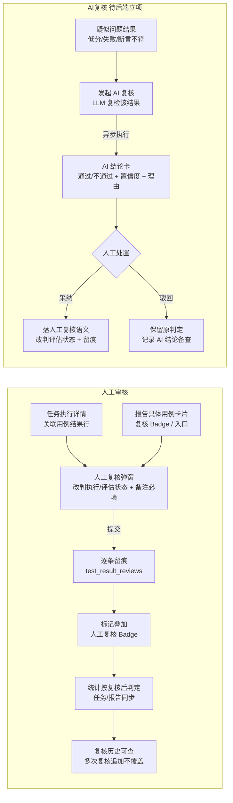

# 人工审核与 AI 复核交互设计（报告用例卡片 + 任务执行详情用例执行结果）

> 卡 INT-713 负责人反馈（2026-10-18）｜ 正式设计卡 **INT-762**（2026-10-18）｜ UX设计师D ｜ 2026-10-18 ｜ 性质：**专项交互设计规范**——负责人点名「人工审核 和 AI复核机制呢？在报告的具体用例卡片、任务执行详情的用例执行结果 都得设计完整的交互流程」。本规范覆盖两处消费面的**完整交互闭环**：人工审核（后端 INT-340 已落地，INT-734 修复任务详情复核字段回填，本规范补全交互与两处落位）与 AI 复核（现平台无此机制，本规范给出设计 + 待后端立项契约）。**部分补充/收口** 09_任务域.md §4.8/§5.16（任务侧人工复核）与 15_报告域.md §3.3.7/§3.5/§3.5.9（报告具体用例卡片）；VUE 设计项目（design/ux-vue）照本规范落位（功能口径照 React 版）。
> 基准（全部实测，无杜撰）：后端 `api_gateway/schemas/review.py`、`api_gateway/routes/review_bp.py`（`POST /tasks/results/review` + `GET /tasks/results/{task_id}/review-count|review-history`）、`task_service/application/task/review_service.py`、`task_service/infrastructure/persistence/review_repository.py`、`scripts/migrations/202610/add_test_result_reviews_int340.py`、`scripts/migrations/202608/seed_rbac.py`（`task.result.review` 已授 tester，admin 持 `*`）、`shared/models/common_enums.py`（`MANUAL_REVIEW_SUBMITTED`）；UX 既有规范 09_任务域.md（INT-354，§4.8/§5.16）、10_测试执行.md（INT-355，§5.2 用例详情）、15_报告域.md（INT-439，§3.3.7 具体用例/§3.5 用例卡片七块）、11_用例域.md（INT-356，评估维度 `llm_judge`）。
> 技术栈：React 19 + TS + Rsbuild + Tailwind 4 + shadcn 风格组件 + TanStack Router/Query/Table + Zustand + sonner/vaul/cmdk + Public Sans/Lora——照基座卡 INT-343；CSS/组件/模态窗直接复用 newAPI 现成件；多主题预设体系（lake-view 默认参考预设）。报告域图表引擎为 Chart.js v4（15 卡口径，本规范不新增图表）。
> 红线遵守：只产出设计规范文档（`doc/UX设计规范/`），不写前端代码、不改 `frontend/` `frontend-react/`；页面文案一律中文（状态枚举值/接口路径除外）；基准取材全部来自实测源码与文档，不杜撰。

---

## 0. 文档性质与取代/补充关系

| 既有规范位置 | 既有口径 | 本规范裁定 | 关系 |
| --- | --- | --- | --- |
| 09_任务域.md §4.8 人工复核标记与统计口径 | 任务详情与报告页均展示复核标记；统计按复核后判定；多次复核留痕；与挑选合并边界 | **保留并补全交互闭环**：任务侧入口/弹窗/批量/历史按本规范 §3 收口（可改判枚举按后端 INT-340 勘误） | 补充（§3） |
| 09_任务域.md §5.16 人工复核弹窗 | 改判执行「通过/失败/停止」、评估「待评估/评估中/计算中/已完成/评估失败/已停止」；备注选填 | **按后端契约勘误**：执行改判枚举 = 已完成/执行失败/已停止/**已跳过**（`REVIEWABLE_EXECUTION_STATUSES`）；评估改判枚举 = **已完成/评估失败**（`REVIEWABLE_EVALUATION_STATUSES`，双状态口径）；复核备注**必填**（schema `comment: min_length=1`） | 勘误 + 补全（§3.2） |
| 15_报告域.md §3.3.7/§3.5 报告具体用例卡片 | 用例卡片七块无复核标记/入口；报告无复核统计 | **报告侧人工复核 + AI 复核整块补入**（§4）：用例卡片复核 Badge + 明细、报告内复核入口（跳来源任务或报告内直审）、报告头/总览复核统计徽章、AI 复核结论卡 | 补充（§4） |
| （无既有）AI 复核机制 | 现平台无 AI 复核端点；仅评估维度有 `llm_judge` 与 voice_llm 的 `evaluation.reasoning`（LLM 评语） | **新增 AI 复核专项设计**（§5）：复用 LLM 判分能力对「疑似问题结果」做自动复检，产出 AI 结论 + 人工采纳/驳回闭环；端点与数据模型**待后端立项**（§8） | 新增 |
| （无既有）报告快照复核明细 | `report_summaries` 仅 `review_count` 列 | 报告快照复核明细字段（复核人/时间/改判前后/备注）**待后端立项**（§8-3）；落地前报告卡片复核 Badge 只显示计数 + 链接来源任务历史 | 新增 |

---

## 1. 机制现状（实测，非杜撰）

### 1.1 人工复核（后端 INT-340 已落地）

| 项 | 实测事实 | 出处 |
| --- | --- | --- |
| 提交 | `POST /api/v1/tasks/results/review`，载荷 `{result_ids:[int], execution_status?, evaluation_status?, comment(必填)}`；单条/批量逐条留痕；权限 `task.result.review` | `review_bp.py:20-22`；`schemas/review.py:20-35` |
| 可改判状态 | 执行：`completed/failed/stopped/skipped`（禁 pending/queued/running）；评估：`completed/failed`（双状态口径，负责人 2026-10-15 拍板）；至少设置一项 | `schemas/review.py:16-17`；`review_service.py:75-89` |
| 准入 | 结果所属任务须终态（`TaskStatus.is_terminal`）；结果须存在；原值已等于目标值时仅补备注不追加留痕 | `review_service.py:152-170` |
| 留痕 | `test_result_reviews` 表（`field_name/old_value/new_value/comment/created_by_user_id/created_at`），**多次复核追加行不覆盖**；`test_results` 加 `reviewed/reviewed_by_user_id/reviewed_at/last_review_comment/last_review_action` | `add_test_result_reviews_int340.py:67-94`；`review_repository.py` |
| 统计 | 复核后按任务重算 `completed_cases/failed_cases/total_cases`（`recalc_task_stats`）；跨服务联动 evaluation_service 改判 TRD 评估状态（失败告警降级） | `review_service.py:118-122/185-206` |
| 审计 | 旁路落 logs：事件 `MANUAL_REVIEW_SUBMITTED`（失败仅告警） | `review_service.py:210-231`；`common_enums.py:345` |
| 查询 | `GET /tasks/results/{task_id}/review-count`（已复核条数，`task:read`）；`GET /tasks/results/{task_id}/review-history`（任务复核历史，`task:read`） | `review_bp.py:25-33` |
| 权限 | `task.result.review` 已入 seed 并授 **tester**（TESTER_PERMS）；admin 持 `*` 通配；algo_engineer/device_admin/guest 未授（是否授 algo 按质检语义待拍板，09 §8 注 7 口径） | `seed_rbac.py:60/215` |
| 报告列 | `report_summaries` 加 `review_count INTEGER NOT NULL DEFAULT 0`（报告页复核标记，INT-340） | `add_test_result_reviews_int340.py:96-99` |
| 任务详情字段（INT-734 已修） | `TaskDetailData.review_count`（任务级已复核计数）+ `TaskCaseBrief.reviewed`（用例级「该用例下是否存在人工复核结果」标记）——驱动任务详情「人工复核」Badge 与统计徽章；INT-734 已修复 DB 未回填导致的 422 | `api_gateway/schemas/task.py:121/146` |

### 1.2 AI 复核（现状：无独立机制）

- 现平台**无 AI 复核端点/数据模型**（grep `ai_review` 等无实现）。
- 可复用能力：评估维度 `resultType='llm_judge'`（LLM Judge 维度，11_用例域 §5.5 实测：模型 + Prompt 模板 + 最大 Token + Temperature）；voice_llm 多轮 `evaluation.reasoning`（LLM 评语，15 报告域 §3.5.2 实测）；评估端点已能对单轮/整体评估产出判分。
- 结论：AI 复核 = **新机制**，设计侧给出交互闭环 + 契约建议，端点与数据模型待后端立项（§8）。

---

## 2. 交互闭环总览



- **两机制边界**：人工审核 = 人直接改判（权威、落统计）；AI 复核 = 机器先判、人再确认（辅助决策，不直接改统计，采纳后才落）。
- **两处消费面统一**：任务执行详情与报告具体用例卡片共用同一复核数据模型与标记语义；报告为落库快照，其复核标记/统计在生成时快照（§4）。

### 2.1 状态定义（人工审核 + AI 复核全状态）

**人工审核（权威层，落统计）——「通过 / 驳回 + 原因」映射后端改判契约（实测 `schemas/review.py:16-25`）：**

| 人工处置 | 交互呈现（弹窗改判 UI） | 后端落位 |
| --- | --- | --- |
| **审核通过** | 用例执行状态 →「已完成」+ 用例评估状态 →「已完成」 | `POST /tasks/results/review`：`execution_status=completed`（评估 `evaluation_status=completed` 可选） |
| **审核驳回** | 用例执行状态 →「执行失败 / 已停止 / 已跳过」+ 评估状态 →「评估失败」 | `execution_status=failed|stopped|skipped`（+ `evaluation_status=failed`） |
| **原因（必填）** | 「复核备注」Textarea 必填*（`min_length=1` 实测），占位「填写改判依据或复核意见」 | `comment`（`schemas/review.py:25`） |

- **结果维度状态机**：`未复核 →（人工提交）→ 已复核（执行/评估状态按改判生效）→ 统计按复核后判定重算`；同一结果可多次复核，追加留痕不覆盖（`test_result_reviews` 追加行）。
- **呈现落位**：已复核结果在执行/评估徽章旁叠加「人工复核」Badge（Tooltip 含复核人/时间/改判前后）；任务详情用例行由 `TaskCaseBrief.reviewed`（INT-734 已回填）驱动 Badge 显隐，任务头复核计数由 `TaskDetailData.review_count` 驱动。

**AI 复核（建议层，不直接改统计）——状态机（§4.3/§5 落位）：**

| 状态 | 定义 | 操作 / 反馈 |
| --- | --- | --- |
| **待发起** | 可发起对象 = 评估状态为已完成/评估失败、且该结果存在 LLM 判分或 voice_llm 评语的结果 | 「AI 复核」入口（ghost，Sparkles）；无 `evaluation:execute`/新码隐藏 |
| **执行中** | AI 异步复核执行中（可取消） | 进度条/轮询（15 报告域 §4.9 进度 Dialog 形态）；失败 Alert +「重试」，不落任何判定 |
| **已完成** | AI 结论落位：**复核通过 / 复核不通过 / 存疑** + 置信度 + 理由 | AI 结论卡展示（§4.3）；同一结果重复发起 → 复用最近结论并提示「该结果已有 AI 复核结论（{时间}），可查看/重新复核」（幂等） |
| **已采纳** | 人工采纳 AI 结论 → 落人工复核语义 | 打开 §3.2 复核弹窗预填 AI 判定的评估状态 + 备注（预填 AI 理由）→ 人工确认提交 → `test_result_reviews` 留痕 + 统计重算 |
| **已驳回** | 人工驳回 AI 结论 | AI 记录标记「已驳回」备查；原判定不变 |
| **待查（忽略）** | 人工关闭暂不处理 | AI 结论保留待查 |

---

## 3. 任务执行详情的用例执行结果（人工审核交互流程）

### 3.1 入口矩阵

| 入口 | 位置 | 行为 | 权限 |
| --- | --- | --- | --- |
| 「人工复核」钮 | 任务详情「关联用例」行尾（09 §4.4 既有）；仅终态任务单条结果可复核 | 打开 §3.2 复核弹窗（预填该结果） | `task.result.review` |
| 「人工复核」钮 | 测试执行用例详情弹窗（10 §5.2）结果行（设备×维度表行/结果音频行） | 同上 | `task.result.review` |
| 「批量复核」 | 任务详情关联用例**勾选多行 → 底部批量浮条**（DataTableBulkActions 形态，新增；照 11 用例域 §3.7 批量单轨——只作用于勾选） | 打开 §3.3 批量复核弹窗（同一改判字段应用到全部勾选结果，逐条留痕） | `task.result.review` |
| 「查看复核历史」link | 任务详情「关联用例」工具行/详情头（有复核时显） | 打开 §3.4 任务复核历史抽屉 | `task:read` |
| 覆盖保护 | 重新执行/重新评估（09 §5.7） | 该任务存在复核结果时硬确认「将覆盖人工复核结果」 | 既有 |

- 无 `task.result.review`：admin/tester 可见；algo_engineer 若未授则入口隐藏（09 §8 注 7，是否授 algo 待后端拍板）；复核历史/计数 `task:read` 即可见。

### 3.2 单条复核弹窗（对齐 09 §5.16 + 后端契约勘误）

```
┌─ 人工复核 — {用例名} ────────────────────────────────┐
│ 结果摘要：执行状态 Badge + 评估状态 Badge + 关联设备/API + 耗时 │
│ 改判 UI：                                               │
│   ① 用例执行状态 Select：已完成 / 执行失败 / 已停止 / 已跳过   │
│       （REVIEWABLE_EXECUTION_STATUSES，禁非终态；改判后标「人工改判」）│
│   ② 用例评估状态 Select：已完成 / 评估失败                    │
│       （REVIEWABLE_EVALUATION_STATUSES，双状态口径）        │
│   ③ 复核备注 Textarea（必填*，占位「填写改判依据或复核意见」） │
│ 说明行：状态可人工设置、评估分数默认不改（负责人 2026-10-14 口径）；│
│         至少设置一项执行/评估状态                            │
│ ［查看复核历史］link（该结果已有复核时显）                    │
│ 底栏：［取消］［提交复核］（进行中「提交中…」，无权限隐藏）      │
└────────────────────────────────────────────────────────┘
```

- 提交：`POST /tasks/results/review`（单条）。成功 toast「复核已提交，结果已按复核后判定计入统计」；失败红字（同值仅补备注/非终态/备注为空逐条透出）。
- 提交后即时同步：该行「人工复核」Badge 叠加、统计重算（任务统计 invalidate）、报告页同步（经报告重新聚合或快照刷新，见 §4）。

### 3.3 批量复核弹窗（新增）

- 形态：Dialog `sm:max-w-xl`，头「批量复核 — 已选 {n} 条结果」+ 结果摘要列表（滚动，行=用例名 + 设备 + 执行/评估状态，勾选态只读）+ 同一改判 UI（执行/评估 Select 二选一或都填 + 备注必填）+ 提示条「将逐条留痕，未终态或同值条目自动跳过并提示」。
- 提交：批量 `result_ids`，后端逐条留痕；成功 toast「已复核 {n} 条结果（{m} 条未生效：{原因}）」。
- 与 09 §5.16 单条弹窗共用同一组件（`ManualReviewDialog` 传 `resultIds[]`，单条=长度 1）。

### 3.4 任务复核历史抽屉（新增）

- 形态：Sheet `sm:max-w-lg`，标题「复核历史 — {任务名}」+ 计数 Badge「共 {n} 条」。
- 列表（`GET /tasks/results/{task_id}/review-history`，服务端按时间倒序）：行 = 时间（`YYYY-MM-DD HH:mm:ss` mono）+ 操作人（`用户 #id`，AUTH_MODE=off 显「—」）+ 用例名 + 字段徽章（执行状态/评估状态）+ 改判 `{原值} → {新值}`（mono，destructive 色箭头）+ 备注（LongText 截断 Tooltip）。
- 空态「暂无复核记录」；加载 Skeleton。
- 与单条弹窗「查看复核历史」共用同一组件（按 result_id 过滤或全任务）。

### 3.5 标记与统计口径（收口 09 §4.8）

- 已复核结果在执行/评估状态徽章旁叠加「人工复核」Badge（secondary outline + Tooltip「{复核人} · {复核时间} · 改判：执行 {原值}→{新值} / 评估 {原值}→{新值}」）。
- **INT-734 落地后驱动字段**：任务详情关联用例行「人工复核」Badge 显隐由 `TaskCaseBrief.reviewed` 驱动；任务头/统计徽章由 `TaskDetailData.review_count` 驱动（均实测 `api_gateway/schemas/task.py`）。
- 任务统计（徽章行/图表/报告聚合）一律按**复核后判定**计算（09 §4.8 既有口径，本规范不改变）。
- 多次复核追加不覆盖，历史可查（§3.4）。
- 边界：与挑选合并（Cherry-Pick）独立，不混合（09 §4.8 既有）。

### 3.6 任务侧组件树 + DDD 落位（interfaces 层）

```
src/features/tasks/components/
├─ manual-review-dialog.tsx        # §3.2/§3.3 复核弹窗（单条=resultIds[1]，批量=resultIds[n]）
├─ manual-review-batch-bar.tsx     # 任务详情关联用例勾选浮条「批量复核」（09 §4.4 关联用例新增）
├─ review-history-drawer.tsx       # §3.4 任务复核历史抽屉（Sheet）
└─ review-badge.tsx                # 「人工复核」Badge + Tooltip（任务侧/报告侧共用）

application/tasks/useReview.ts     # submitReview（mutation，invalidate 任务统计）+ reviewCount（query）+ reviewHistory（query）
infrastructure/api/reviewApi.ts    # POST /tasks/results/review + GET /{task_id}/review-count|review-history
infrastructure/adapters/reviewAdapter.ts  # DTO(snake_case)→Domain（ReviewHistoryItem/ReviewSubmitPayload）
domain/models/review.ts            # ReviewHistoryItem{id/resultId/taskId/testCaseId/fieldName/oldValue/newValue/comment/createdByUserId/createdAt}
                                   # REVIEWABLE 枚举 + 中文映射（§7）
```

---

## 4. 报告具体用例卡片（人工复核 + AI 复核）

> 报告为**落库快照**（15 报告域 §1.1/§3.1：报告是落库快照，编辑保存 `PUT /reports/{id}` 白名单）。复核标记/统计在**报告生成时快照**（`report_summaries.review_count` 实测列）；生成后来源任务再次复核不自动回流已发布报告快照（重新生成/重新聚合才更新，实施卡按后端确认）。

### 4.1 用例卡片复核标记（§3.5 块结构内落位）

- **统计入口**：报告头操作区/总览（15 §3.3.1）新增复核统计徽章：`review_count > 0` 时显示「已复核 {n} 条」（secondary outline，点击锚点到具体用例分区或筛选复核用例）。数据源 `report_summaries.review_count`（报告详情 `summary` 未含该字段时走报告级端点，§8-3）。
- **用例卡片标记**（15 §3.5 用例卡片七块）：卡片头行（用例名/CaseIdBadge 区）叠加「人工复核」Badge（`review-badge` 共用件；计数=该用例已复核结果数，来自报告快照复核明细 §8-3，未落地前显示「含复核」无计数）。
- **卡片内复核明细**：点击「人工复核」Badge → 展开/弹出该用例复核明细（时间/操作人/改判字段/原值→新值/备注），数据 = 报告快照复核明细（§8-3）或报告生成时从任务复核历史快照；无明细时 Badge 只读展示。
- **筛选**：具体用例筛选卡（15 §3.3.8/§3.3.7）新增「复核状态」筛选（全部/已复核/未复核，`task:read`）——用例列表按复核状态过滤。

### 4.2 报告内复核入口（两条路径）

| 路径 | 行为 | 权限 |
| --- | --- | --- |
| **A. 跳来源任务复核**（默认） | 用例卡片/具体用例行「人工复核」钮（15 §3.3.7 行操作新增）→ 打开 §3.2 复核弹窗（预填该用例来源任务结果；报告页携带 `task_id + result_id` 引用，经 `GET /tasks/{id}/cases/{caseId}/detail` 或结果行溯源）→ 提交后写回 task 域，报告重新聚合后刷新 | `task.result.review` |
| **B. 报告内直接复核**（增强，待后端立项） | 报告页直接对快照结果复核（改判写 `test_result_reviews` + 更新报告快照复核明细）——报告只读角色（guest）不授；实施卡按后端是否开放报告内复核端点决定去留，未立项前只落路径 A | `task.result.review` |

- **只读角色**（guest / 无 `task.result.review`）：用例卡片显示复核 Badge 与明细，复核/采纳按钮隐藏；AI 复核「采纳」钮同步隐藏。

### 4.3 报告侧 AI 复核流程（新增，待后端立项）

- **入口**：具体用例卡片（15 §3.5）「评估结果」区/低分维度行尾 + 具体用例列表行操作：「AI 复核」ghost 钮（Sparkles 图标，`evaluation:execute` 或新码，§8-2 待拍板）——**仅评估状态为已完成/评估失败、且该用例存在 LLM 判分或 voice_llm 评语的结果**可发起（Tooltip 说明）。
- **发起弹窗**：Dialog `sm:max-w-lg`——复核对象摘要（用例名 + 设备 + 维度 + 当前评估状态 + 现有 LLM 评语/理由摘要）+ 说明「由大模型对当前评估结果进行复检，产出复核结论供人工确认；不直接修改统计」+ 可选项（复核维度默认当前低分维度，多选）+ 主钮「发起 AI 复核」。
- **异步执行**：提交 → 进度条/轮询（照 15 报告域 §4.9 进度 Dialog 形态）→ 完成。
- **AI 结论卡**（结果区）：AI 复核结论（StatusBadge：复核通过=success / 复核不通过=warning / 存疑=info）+ 置信度（`{n}%` 或高/中/低，tabular-nums）+ 理由摘要（LongText，可展开）+ 对比行（AI 判定 vs 原评估判定）。加载 Skeleton；失败 Alert +「重试」。
- **人工处置**（关键闭环）：
  - **采纳**（主钮）：AI 结论转为人工复核语义——打开 §3.2 复核弹窗预填 AI 判定的评估状态 + 备注（预填 AI 理由）→ 人工确认提交 → 落 `test_result_reviews`（`created_by`=人工）→ 统计按复核后判定重算。
  - **驳回**（ghost 钮）：保留原判定；该 AI 结论标记「已驳回」备查（写 AI 复核记录，不写人工留痕）。
  - **忽略**（关闭）：暂不处理；AI 结论保留待查。
- **AI 复核历史**：报告侧可查该用例/任务的 AI 复核记录（§8-2 数据模型）；与人工复核历史分开展示（两个 Tab：人工复核 / AI 复核）。

### 4.4 报告侧组件树 + DDD 落位（interfaces 层）

```
src/features/report-view/components/
├─ review-stats-badge.tsx          # §4.1 报告头/总览「已复核 {n} 条」徽章
├─ case-review-marker.tsx          # §4.1 用例卡片「人工复核」Badge + 明细（复用 review-badge）
├─ case-review-filter.tsx          # §4.1 具体用例筛选卡「复核状态」筛选项
├─ ai-review-dialog.tsx            # §4.3 发起 AI 复核弹窗
├─ ai-review-result-card.tsx       # §4.3 AI 结论卡（结论/置信度/理由/采纳/驳回）
└─ review-history-tabs.tsx         # §4.3 复核历史抽屉（人工/AI 两 Tab，复用 §3.4 组件）

application/report-view/useReportReviews.ts  # 报告复核计数/明细/筛选 + AI 复核发起/结论/采纳
infrastructure/api/reviewApi.ts（同 §3.6）+ adapters/reviewAdapter.ts
domain/models/review.ts（同 §3.6 + AiReviewRecord{id/resultId/verdict/confidence/reasoning/adopted/rejected/createdAt}）
```

---

## 5. AI 复核机制设计（新机制，契约建议）

> 本节为 AI 复核的**完整交互与数据契约建议**；端点与数据模型待后端立项（§8），落地前报告/任务侧仅设计不实现（入口隐藏或 Tooltip「待后端」）。

### 5.1 定位与边界

- 定位：**评估结果的自动复检助手**——对疑似问题结果（低分、评估失败、断言不符、LLM 评语存疑）由大模型独立复检，产出 AI 判定供人确认。**不直接修改统计**；只有人工「采纳」才落入人工复核语义（改判评估状态 + 留痕 + 统计重算）。
- 与人工复核边界：AI 复核是**建议层**，人工复核是**权威层**；两者数据模型分表或同表分 `review_type`（§5.3）。
- 与 LLM Judge 维度边界：LLM Judge 是**评估维度**（执行时判分，产分数）；AI 复核是**事后复检**（对已有判定复核，产结论 + 置信度 + 理由）。AI 复核可复用 LLM Judge 的模型/Prompt 配置与 voice_llm 评语作为输入上下文。

### 5.2 交互流程（状态机）

```
发起（选择 用例×设备×结果/维度）→ 提交 → 执行中（异步，可取消）
→ 完成（AI 结论：复核通过/不通过/存疑 + 置信度 + 理由）
→ 人工处置：采纳（→ 人工复核弹窗预填 → 提交 → 落人工留痕 + 统计重算）
            / 驳回（AI 记录标记已驳回，原判定不变）
            / 忽略（AI 记录保留待查）
```

- 幂等：同一结果同一维度重复发起 → 复用最近一次 AI 结论（提示「该结果已有 AI 复核结论（{时间}），可查看/重新复核」）。
- 超时/失败：进度失败 → Alert + 重试；不落任何判定。

### 5.3 数据契约建议（待后端立项定稿）

```
ai_reviews 表（或 test_result_reviews 加 review_type 列，二选一由后端定）：
  id, result_id, task_id, test_case_id, dimension_id?, 
  verdict('passed'|'failed'|'uncertain'), confidence(0-1), reasoning TEXT,
  adopted(0/1), adopted_by_user_id, adopted_at, rejected(0/1), created_at

端点：
  POST /tasks/results/ai-review           # 发起（result_ids + dimension_ids?），权限待定（§8-2）
  GET  /tasks/results/{task_id}/ai-review-history
  POST /tasks/results/ai-review/{id}/adopt   # 采纳 → 落人工复核语义（复用 /review）
  POST /tasks/results/ai-review/{id}/reject  # 驳回
```

---

## 6. RBAC 角色 → 操作可见性映射

| 操作 | 权限码 | admin | tester | algo_engineer | device_admin | guest |
| --- | --- | --- | --- | --- | --- | --- |
| 查看复核标记/明细/历史/计数 | `task:read` | ✅ | ✅ | ✅（只读） | —（无 task:read） | — |
| 单条/批量人工复核提交 | `task.result.review` | ✅（`*`） | ✅（seed 已授） | 未授（质检语义可授，待拍板） | — | — |
| 报告内复核入口（路径 A） | `task.result.review` | ✅ | ✅ | 未授（隐藏） | — | — |
| 报告内直接复核（路径 B，待立项） | `task.result.review` | ✅ | ✅ | — | — | — |
| AI 复核发起/查看结论 | `evaluation:execute` 或新码（§8-2 待拍板） | ✅ | ✅（seed 持 evaluation:execute） | ✅（持 evaluation:execute？实测 algo 无 evaluation:execute——待拍板） | — | — |
| AI 复核采纳（落人工语义） | `task.result.review` | ✅ | ✅ | 未授（隐藏） | — | — |

> AUTH_MODE=off 时后端注入 `permissions=['*']` 全量显示（基座 §9.1 兼容口径）。

---

## 7. 页面文案（中文全量）

### 任务执行详情
- 按钮：「人工复核」「批量复核」「查看复核历史」；历史 Tab「人工复核」「AI 复核」
- 复核弹窗：「人工复核 — {用例名}」「用例执行状态」「用例评估状态」「复核备注（必填）」「填写改判依据或复核意见」「状态可人工设置、评估分数默认不改」「至少设置一项执行/评估状态」「提交复核」「提交中…」
- 批量：「批量复核 — 已选 {n} 条结果」「将逐条留痕，未终态或同值条目自动跳过并提示」
- 历史：「复核历史 — {任务名}」「共 {n} 条」「暂无复核记录」「执行状态」「评估状态」「改判 {原值} → {新值}」「操作人」「复核时间」「备注」
- 标记：「人工复核」「{复核人} · {复核时间} · 改判：执行 {原值}→{新值} / 评估 {原值}→{新值}」
- toast：「复核已提交，结果已按复核后判定计入统计」「已复核 {n} 条结果（{m} 条未生效：{原因}）」「复核失败」「该任务存在 {N} 条人工复核结果，重新执行/重新评估后人工复核填写的结果将被覆盖，是否继续？」「覆盖并继续」
- 覆盖保护（09 §5.7 既有，此处对齐）：「该任务存在 {N} 条人工复核结果，重新执行/重新评估后人工复核填写的结果将被覆盖，是否继续？」主钮「覆盖并继续」副钮「返回」

### 报告具体用例卡片
- 徽章：「已复核 {n} 条」「含复核」；筛选「复核状态」「全部/已复核/未复核」
- 入口：「人工复核」「AI 复核」「查看复核明细」「复核明细 — {用例名}」
- AI 复核：「AI 复核」「由大模型对当前评估结果进行复检，产出复核结论供人工确认；不直接修改统计」「复核维度（默认当前低分维度）」「发起 AI 复核」「AI 复核中…」「AI 复核结论」「复核通过/复核不通过/存疑」「置信度」「理由」「AI 判定 vs 原评估判定」「采纳为复核结果」「驳回」「已驳回」「该结果已有 AI 复核结论（{时间}），可查看或重新复核」「暂无 AI 复核记录」
- toast：「AI 复核已完成」「已采纳 AI 复核结论，复核已提交」「已驳回 AI 复核结论」「AI 复核失败」

---

## 8. 待后端立项清单（设计侧不杜撰端点）

1. **报告快照复核明细**：`GET /reports/{report_id}` 详情（或 `report_summaries`）补复核明细字段（已复核结果数 + 每结果复核人/时间/改判前后/备注）——供报告用例卡片复核 Badge 明细与统计徽章；落地前报告卡片只显计数（`review_count`）+ 链接来源任务复核历史。
2. **AI 复核端点与权限**：`POST /tasks/results/ai-review` + `GET /tasks/results/{task_id}/ai-review-history` + `POST .../adopt` + `POST .../reject`；权限码二选一（复用 `evaluation:execute` 或新码 `task.result.ai_review`，是否授 algo 一并拍板）；数据模型 `ai_reviews` 或 `test_result_reviews` 加 `review_type`（§5.3）。
3. **报告内直接复核**（路径 B，§4.2）：是否开放报告页直接改判端点；未立项前只落路径 A（跳来源任务复核）。
4. **algo_engineer 复核授权**：`task.result.review` 是否授 algo_engineer（09 §8 注 7 待拍板；按复核的质检语义可授）。
5. **AI 复核输入上下文**：AI 复核调用所需上下文（ASR 文本/参考文本/LLM 评语/维度分数）是否可由现有评估链路直接提供，或需新聚合端点——实施卡按后端评估服务现状确认。

---

## 9. Vue 前端同步说明（UX设计-VUE）

- 本规范覆盖两处消费面（报告具体用例卡片 + 任务执行详情用例执行结果），**新 Vue 前端**（`design/ux-vue`，UX设计-VUE 项目）照本规范落位——**功能口径照 React 版**（本规范的人工复核/AI 复核交互闭环），**风格照原 Vue**（tokens.css / components/common / 左侧导航栏），导航照 React 版重排（devloop §3.4）。
- UX 设计项目矩阵：UX设计-VUE 项目 id `d502fad1-ad0a-4e23-8198-35a5087693a8`，规范目录 `doc/UX设计规范-VUE/`，对齐总表 **`00_导航与功能对齐总表.md` D04 行**（任务结果人工复核，已有 `ResultReviewModal` INT-340，按钮级 `task.result.review`）与 **F5 行**（报告级人工复核端点——task 级已有，report-level 复核缺口见 §8-3）。本规范的批量复核/复核历史抽屉/AI 复核（§8-2 待立项）随总表同步进 Vue 侧拆卡。
- Vue 拆卡以本规范 + `00_导航与功能对齐总表.md` 为准；圆角一律 tokens.css 圆角变量（基准=首页卡片，INT-756），CSS 冻结期内不硬编码颜色/圆角/阴影/间距（devloop §3.4）。
- 旧 Vue 页面（`frontend/src/components/common/modal/ResultReviewModal.vue` 等）只作旧业务功能基准，交互口径以本规范为准。

---

## 修订

| 日期 | 说明 |
| --- | --- |
| 2026-10-18 | 初稿（INT-713 负责人反馈）：人工审核（INT-340 已落地）任务侧交互闭环收口（入口/单条批量弹窗/历史抽屉/标记统计）+ 报告具体用例卡片复核落位（统计徽章/卡片标记/明细/筛选/双路径入口）+ AI 复核新机制专项设计（定位/状态机/数据契约/RBAC/文案/待后端立项 5 项）；组件树 + DDD 四层；VUE 设计项目照本规范落位 |
| 2026-10-18 | **INT-762 交互闭环补全 + 后端字段复核**：新增 §2.1 状态定义（人工审核「通过/驳回 + 原因」映射后端改判契约 + AI 复核全状态机 待发起→执行中→已完成→已采纳/已驳回/待查）；§1.1 补任务详情字段行（INT-734 已修：`TaskDetailData.review_count` + `TaskCaseBrief.reviewed` 实测 `schemas/task.py:121/146`）；§3.5 标记与统计补 INT-734 驱动字段；新增 §9 Vue 前端同步说明（UX设计-VUE，对齐总表 D04/F5 行） |
