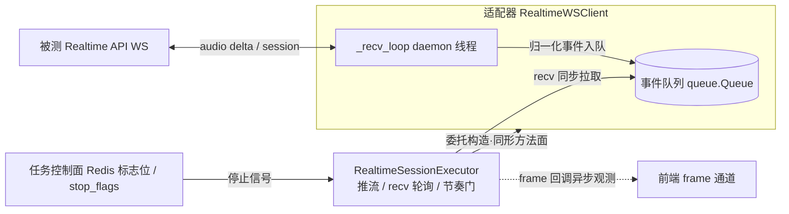
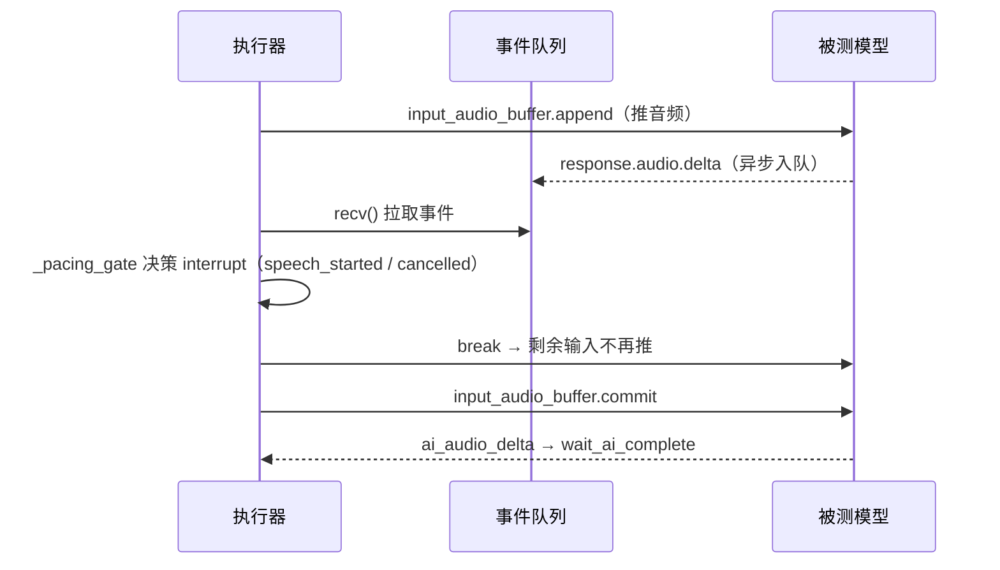

# 实机接入指南：API 测试与 Realtime API 测试

> 面向被测 API / Realtime API 提供方：把真实产品接入智能音频测试平台，跑两类自动化测试——
> **API 测试**（HTTP 一问一答 / 流式，`device_type=http_api`）与 **Realtime API 测试**（WebSocket 全双工，
> `device_type=websocket_api`）。本文只描述接入口径，不含平台安装部署（见 `doc/使用说明.md` 与部署文档）。

| 项 | 内容 |
| --- | --- |
| 版本 | V9.7.31（2026-10-22） |
| 适用仓库 | `Intelligent-Audio-TEST` |
| 关联设计 | `doc/功能设计文档/01_测试执行/07_流式推送与结果获取.md`（含 INT-475 附录）、`API测试功能设计文档.md` |
| 关联代码 | `api_test_service/`、`task_service/core/execution_engine/mixins/task_dispatch.py`、`mock_services/`、`shared/utils/api_key_provider.py` |

---

## 0. 接入总览

平台以「**被测 API**」为对象。你在平台维护一条被测 API 配置（`apis` 表），用例按
`device_type` 路由到对应执行器：

| 接入形态 | device_type | 被测对象 | 执行器 | 适配器/客户端 |
| --- | --- | --- | --- | --- |
| API 测试（HTTP） | `http_api` | HTTP 一问一答 / 流式接口 | `APISessionExecutor` | `HttpAPIAdapter` / `HttpStreamAdapter` |
| Realtime API 测试 | `websocket_api` | WebSocket 全双工（audio delta / session 事件） | `RealtimeSessionExecutor` | `OpenAIRealtimeAdapter` / `RealtimeWSClient` |

路由依据是**用例级** `device_type`（建任务时经 `case_devices` 携带），不是 `task.type`
（已废弃）。两类的共同接入步骤：

1. 在「API 管理」维护被测 API 配置（字段见 1.1 / 2.1）；
2. 配置用例 `rounds`（每轮音频、SPL、query、打断标记等）；
3. 建任务：选用例 + 选 API（`case_devices` 携带 `device_type` 与 `device_id`/`api_id`）；
4. 观察执行与结果（任务页 + 报告）。

联调优先用平台自带 mock 替身（mock_dut :5096 / mock_realtime_api :5098），通后再切真实地址。

---

## 1. API 测试（HTTP，device_type=http_api）

### 1.1 被测 API 配置字段

平台「API 管理」维护的被测 API 配置（`api_test_service/infrastructure/persistence/models/api_models.py` `class API`，表 `apis`），接入 HTTP API 时关心的字段：

| 字段 | 说明 |
| --- | --- |
| `name` | API 显示名称 |
| `vendor` | 供应商名称（如 `volc_ast` / `ali` / `tencent`；联调用 mock 替身时填 `mock`） |
| `api_url` | API 微服务主入口 URL |
| `api_endpoints` | API 接入点配置列表（JSON），优先于 `api_url` 参与端点轮询 |
| `device_type` | `http_api`（默认值） |
| `meta` | API 元数据（鉴权信息、`vendor_adapter`、`ws_headers` 等，JSON） |
| `default_max_process` | 默认最大并发处理数（默认 5，`api_executor.default_max_process` 兜底） |
| `default_max_timeout` | 默认最大超时（秒，默认 30） |
| `default_max_audio_duration` | 支持的最大音频时长（秒，默认 60） |
| `proxy_type` / `proxy_url` | 被测 API 网络代理（INT-839）：`proxy_type` ∈ http / https / socks5 / socks5h，`proxy_url` 为 `user:pass@host:port` 不含 scheme；配置代理时认证段必填；NULL/空 = 不用代理 |

校验规则（后端 `api_test_service/infrastructure/adapters/proxy_utils.py` `validate_proxy`，前端
`frontend/src/utils/proxyValidation.ts` 镜像）：`proxy_type` 为空则 `proxy_url` 必须为空；
非空则类型必须是四值之一、`proxy_url` 必填且带 `user:pass@` 认证段、不得含 scheme 前缀。

### 1.2 用例 rounds

API 测试用例由 `rounds`（轮次数组）驱动。单轮常见字段：

| 字段 | 说明 |
| --- | --- |
| `round_number` | 轮号（从 1 起） |
| `audio_id` / `audio_path` | 本轮输入音频（平台音频资产 ID 或存储引用） |
| `spl` | 目标 SPL（dB，经 `spl_to_gain` 换算增益） |
| `query` / `question` | 本轮文本问题（评估入参） |
| `correct_answer` | 参考答案（评估入参） |

HTTP 路径单轮执行由 `APITaskRunner`（`api_test_service/core/api_task_runner.py`）完成，
适配器经 `vendor_adapter_registry.create_from_config(...)` 分发（`api_test_service/infrastructure/adapters/registry.py`）。

### 1.3 建任务与执行

建任务时在 `case_devices` 中携带 `{"case_id": ..., "device_type": "http_api", "device_id": ...}`
（用例级路由依据，`task_service/infrastructure/persistence/_task_crud_mixin.py` 契约）。平台按
`_dispatch_case_by_type` → `_dispatch_api_case`（`task_service/core/execution_engine/mixins/task_dispatch.py`）
路由到 `api_test_service` 执行。单用例执行链路（`APITaskRunner`）：

1. **health_check**：请求被测侧 `/health`（端点路径可经 `API_PATH_HEALTH` 环境变量配置，默认 `/health`）；
   404/405 视为路径不存在可跳过，其余失败视为健康检查失败；
2. **create_task**：请求被测侧 `/api/create_task`，**携带 `audio_path` 存储引用**（音频文件经平台统一存储层解析，`resolve_audio_local_path`）+ `vendor` / `max_process` / `max_timeout` / `endpoints` 等显式参数，按算法字段映射（`extract_case_all_params`）组装请求体；响应须返回 `data.task_id`；
3. **wait_for_completion**：轮询 `/api/get_status/{task_id}`（轮询间隔默认 5 秒，`api_test.poll_interval`），
   **超时 = 音频时长 × 1.5**（`total_audio_duration * 1.5`，上限 `api_test.max_wait_time` 默认 43200 秒，下限 30 秒）；`completed/success/failed/error/pending` 收口，`failed/error/pending` 记为轮失败；
4. **get_final_result**：查询 `/api/get_final_result/{task_id}`，按算法输出字段映射提取结果；
5. **评估**：结果经 `_evaluate_result` → `evaluation_acl_repository.submit_evaluate_case` 提交 evaluation_service。

可选：`get_frame_results`（调试）、`delete_task`（清理被测侧远端任务）。

### 1.4 mock DUT 联调（mock_dut :5096）

未接入真实被测 API 前，用平台自带 HTTP 替身联调（端口注册于 `shared/config/service_ports.py`
`MOCK_DUT_API_HTTP_PORT = 5096`）：

```bash
python mock_services/mock_dut_api.py [--port 5096]
```

`mock_services/mock_dut_api.py` 提供：`/health`（GET）、`/api/create_task`（POST）、
`/api/get_status/{task_id}`（GET）、`/api/get_final_result/{task_id}`（GET）、
`/api/get_frame_results/{task_id}`（GET）、`/api/delete_task/{task_id}`（DELETE），
另有 `/chat`（POST）做 voice_llm 多轮会话替身（MockDialogAdapter 行为）。把被测 API 的
`api_url` 指向 `http://127.0.0.1:5096` 即可跑通端到端。

---

## 2. REALTIME API 测试（device_type=websocket_api）

Realtime 测试以 WebSocket 全双工直连被测 Realtime API：上行推音频（`input_audio_buffer.append` /
`commit`），下行收 AI 输出事件（audio/text delta、打断信号），经归一化后供执行器消费与节奏调节。

### 2.1 被测 Realtime API 配置

在 1.1 字段基础上，Realtime 路径额外关注：

| 配置 | 说明 |
| --- | --- |
| WS/WSS 端点 | `api_endpoints` 中 `ws://` / `wss://` 前缀条目优先，回退 `api_url` 同规则；`RealtimeSessionExecutor._resolve_ws_url` 校验必须带 `ws://` / `wss://` 前缀 |
| `meta.vendor_adapter` | `openai` / `openai_realtime`（`VendorAdapterType` 扁平 key）→ 注册表 `(AdapterProtocol.REALTIME, AdapterVendor.OPENAI)` 分发 `OpenAIRealtimeAdapter`（`api_test_service/infrastructure/adapters/vendors/openai_realtime_adapter.py`）；未配置回退 `RealtimeWSClient` 默认行为（api_driver / mock / 未配置，向后兼容） |
| `meta.session_config` | `session.update` 载荷（VAD / voice / instructions 等），`_build_session_config` 合并用例级 `session` 覆盖 |
| `meta.audio_config` | 目标音频格式声明（`sample_rate` 默认 **24000** / bit_depth / channels / container），`_build_session_config` 回退 `input_audio_sample_rate` |
| `meta.ws_headers` | WS 握手头（直传，显式 `Authorization` 头优先，不覆盖） |
| `meta.api_key` / 密钥链 | 见 2.1.1 |
| `proxy_type` / `proxy_url` | 同 1.1，Realtime WS 连接（`realtime_ws_client.connect()`）经 `websocket_proxy_kwargs` 注入代理参数 |

#### 2.1.1 密钥链（`shared/utils/api_key_provider.py`）

密钥解析收敛于 Infrastructure 层 `ApiKeyChainResolver`，Domain 层只见解析结果，密钥不落日志、不进报告。

- 单值链：**`case_config.api_key` → `api_config.meta.api_key` → 环境变量 `OPENAI_API_KEY`** 逐级回退
  （各级键名可配置，默认对齐约定）。
- 密钥池轮换（INT-1177）：`resolve_rotating` = case 层单值（最高优先）→ `meta.api_keys` 轮换池
  （round-robin 游标 + 冷却集合，同一 API 跨协议同源轮换）→ `meta.api_key` 单值回退 → env。
  WS 握手 401/403/429 时判定密钥池轮换（`realtime_ws_client.last_handshake_status`）。

### 2.2 用例 rounds（正常轮 + 打断轮 + pacing 策略）

Realtime 用例 `rounds` 除 1.2 字段外，还支持：

| 字段 | 说明 |
| --- | --- |
| `is_interruption` | 标记打断轮（`RealtimeRoundMode.INTERRUPTION`）：先等 AI 开口 → 延时后推打断音频 → 检测打断 → 等新回复 |
| `interruption_delay_ms` | AI 开口后到推打断音频的固定延时（默认 1000，可被 `round_config` 覆盖） |
| `pacing` | 输出调输入节奏配置：`{"pacing_strategy": "wait_turn_end", "turn_end_wait_timeout_s": 60, "pacing_fallback_timeout_s": 30}`（详见 2.4） |

正常轮时序（`RealtimeSessionExecutor._execute_normal_round`）：
流式推送混音 chunk（`RenderAudioStream` 消费链路，逐 chunk `send_audio_chunk` + 按 chunk 时长 sleep）
→ 推流中按节奏策略插 `recv()` 检输出事件（`_pacing_gate`）→ `commit_input` → `wait_ai_complete`
（`ai_start_timeout_seconds=25` / `ai_complete_timeout_seconds=60`，「超时但已开口视为成功」）。

打断轮时序（`_execute_interruption_round`）：① `wait_ai_speaking` 等 AI 开口（25s）→
② `sleep(interruption_delay_ms)` → ③ 流式推送打断音频 + `commit_input` → ④ barge-in 检测窗口
（`barge_in_window_seconds=5`，recv 轮询等 `user_speech_started` / `response_cancelled`）→
⑤ 打断成功则 `wait_ai_complete` 等新回复。打断轮推流阶段不套节奏门（避免抢占打断信号源）。

### 2.3 建任务与执行（case_devices 亲和）

Realtime 用例建任务时，**`case_devices` 必须携带 `device_type=websocket_api`**，否则按默认
`physical`（或 `http_api`）路由，不会进入 Realtime 通道。链路：

```mermaid
flowchart TB
    A[建任务 case_devices: device_type=websocket_api] --> B[task_service 认领用例<br/>_dispatch_case_by_type]
    B --> C{device_type=websocket_api}
    C -->|是| D[_route_realtime_dispatch<br/>RealtimeSessionRegistry.route_or_bind<br/>session:bind:{task_id} 亲和路由]
    D --> E[StartAPITest 直连绑定实例]
    E --> F[api_test_service<br/>RealtimeSessionExecutor]
    C -->|否| G[默认负载均衡通道<br/>不回退 Realtime 语义]
```

- **亲和绑定**：`RealtimeSessionRegistry.route_or_bind(task_id)`（`shared/utils/realtime_session_registry.py`）
  在派发侧解析 task → 实例绑定（无健康绑定则选最闲在册实例写入），`StartAPITest` 直连该实例，
  保证同任务 Realtime 会话粘同实例（Redis 不可用降级单实例语义）。
- 实例内闭环：WS 长连接与帧状态封闭在接单实例内存，跨轮保持；会话结束 `release` 清除绑定
  （`bind_ttl_seconds=3600` 兜底）。

### 2.4 超时与节奏配置

Realtime 全链路超时配置化（`shared/config/concurrency_config.json` `realtime_session` 段，
无魔法数字；执行器经 `config_manager.get_value('realtime_session', key, default)` 读取）：

| 键 | 默认 | 语义 |
| --- | --- | --- |
| `chunk_duration_ms` | 100 | RenderAudioStream 切片粒度 / 逐 chunk 推送节奏 |
| `ai_start_timeout_seconds` | 25 | 等 AI 首个 `ai_audio_delta`（`wait_ai_speaking`） |
| `ai_complete_timeout_seconds` | 60 | 等 AI 回复收尾（`wait_ai_complete` end_timeout） |
| `barge_in_window_seconds` | 5 | 打断检测窗口 |
| `interruption_delay_ms` | 1000 | AI 开口后到推打断音频的延时（round 级可覆盖） |
| `bind_ttl_seconds` | 3600 | 会话亲和绑定 TTL |
| `pacing_strategy` | `fixed` | 输出调输入节奏策略（见下） |
| `turn_end_wait_timeout_s` | 60 | `WAIT_TURN_END` 的 turn 结束等待上限 |
| `pacing_fallback_timeout_s` | 30 | `TIMEOUT_FALLBACK` 兜底超时 |

**输出调输入节奏（INT-475）**：策略枚举 `RealtimePacingStrategy`
（`shared/models/common_enums.py`，前端 `frontend/src/domain/enums.ts` 镜像同值）：

| 策略 | 值 | 语义 |
| --- | --- | --- |
| `FIXED` | `fixed` | 恒定节奏（默认=现状，回归基准） |
| `WAIT_TURN_END` | `wait_turn_end` | 模型输出 turn 进行中暂停输入推流，turn 结束后续推 |
| `ALLOW_BARGE_IN` | `allow_barge_in` | 输入推流中模型提前回话/打断 → 收敛输入推流（剩余输入不再推） |
| `TIMEOUT_FALLBACK` | `timeout_fallback` | 模型无输出/无 turn 结束时按配置超时兜底，不无限等待（可与前两者组合） |

配置优先级：**`case_config['pacing']` → `api_config.meta['pacing']` → `realtime_session` 全局 → 默认**；
FIXED 与动态策略互斥（含任一动态策略时 FIXED 被丢弃）。设计细节见
`doc/功能设计文档/01_测试执行/07_流式推送与结果获取.md` 附录。

### 2.5 执行器 × 适配器架构（图 A）

`RealtimeSessionExecutor` 经 `_resolve_realtime_transport` 委托构造适配器，只调**同形方法面**
（`connect` / `pre_process` / `send` / `recv` / `output` / `close`），轮次编排与适配器实现解耦；
信号回流为**生产者-消费者两段式**，停止走独立任务控制面：



要点（与代码一致，`api_test_service/core/realtime_session_executor.py` +
`api_test_service/infrastructure/adapters/transport/realtime_ws_client.py`）：

- **委托构造**：`_resolve_realtime_transport` 按 `adapter_type_from_config` 判定
  `vendor_adapter=openai / openai_realtime` 时经 `vendor_adapter_registry.resolve(
  AdapterProtocol.REALTIME, AdapterVendor.OPENAI, fallback=False)` 构造 `OpenAIRealtimeAdapter`，
  否则构造 `RealtimeWSClient`；两者暴露同一方法面，轮次编排零改动。
- **信号回流两段式**：`_recv_loop` daemon 线程（生产者）`ws.recv()` → 厂商事件入
  `queue.Queue`（异步）；执行器主线程 `recv()` 轮询（同步）→ `_pacing_gate` 决策 interrupt / 收敛。
  事件归一化与帧记录在收包侧（`_parse_event`），节奏门只读状态、不改变产出链路。
- **frame 通道异步观测**：`event_listener`（`_on_frame` 回调）逐帧推前端 frame 通道，不参与停止；
- **停止控制面**：任务停止走 Redis 标志位 + 本地 `stop_flags`（`_handle_control` / `stop_check`，
  见 API 测试功能设计文档 §3.8）。

### 2.6 事件回流停止时序（图 B）



停止点归纳（`_pacing_gate` 决策映射，详见 07 设计文档附录 A.3）：
收到 `user_speech_started` / `response_cancelled` → `interrupt` → 收敛输入推流（剩余输入不再推）；
收到 `connection_closed` / `error` → 放行，由 `wait_ai_complete` 收敛轮次失败。

### 2.7 mock Realtime API 联调（mock_realtime_api :5098）

```bash
# 打断轮联调：--barge-in 预置「AI 正在说话 + 打断」事件序列
python mock_services/mock_realtime_api.py --port 5098 --barge-in

# 输出调输入节奏联调：--speak-during-stream 输入推流中提前回话（INT-475）
python mock_services/mock_realtime_api.py --port 5098 --speak-during-stream \
    --speak-during-stream-after 2 --speak-during-stream-barge-in
```

`mock_services/mock_realtime_api.py`（`MockRealtimeBehavior`）行为可经命令行 / 环境变量
`MOCK_RT_*` / 配置文件 / WS 控制帧（`__mock_control` set_behavior）热更新：

| 行为字段 | 说明 |
| --- | --- |
| `barge_in` | 首轮 commit 响应结束后预置 `response.audio.delta` + `speech_started` + `response.cancelled`（打断轮联调） |
| `speak_during_stream` | 输入推流中（commit 前）模型提前回话，供 `WAIT_TURN_END` / `ALLOW_BARGE_IN` 验收 |
| `speak_during_stream_after` | 第 N 帧 append 后触发（默认 1） |
| `speak_during_stream_barge_in` | 提前回话携带 `speech_started` + `cancelled` 打断信号 |
| `speak_during_stream_complete` | False 模拟长回复未收口（供超时兜底验收） |
| `first_delta_delay_ms` | commit → 首个 delta 间隔（测首帧延迟） |
| `disconnect_after_events` | 第 N 个客户端事件后主动断开（测断连收敛） |
| `protocol_error_on_event` | 该事件回 error 帧（测协议错误） |

把被测 API 的 `api_endpoints` 指向 `ws://127.0.0.1:5098`（`vendor_adapter=openai` /
`vendor=mock`）即可跑通 Realtime 端到端。

---

## 3. 常见问题

| 现象 | 原因与处置 |
| --- | --- |
| **device_type 不生效** | Realtime 用例建任务时 `case_devices` 未携带 `device_type=websocket_api`（或漏传 `api_id`）。路由依据是**用例级** `device_type`；检查建任务请求的 `case_devices` 与 `task_case_relations.device_type` |
| **WS 连接失败** | ① 端点未配置 `ws://` / `wss://` 前缀（`_resolve_ws_url` 报「未配置 WebSocket 端点」）；② 被测侧不可达/拒绝握手——检查网络与防火墙；③ 握手 401/403/429 → 密钥问题，见「密钥不生效」；④ 配置了代理但 `proxy_url` 不合规（`validate_proxy`） |
| **session.updated 超时** | `pre_process` 下发 `session.update` 后等待 `session.updated` 确认（`wait_confirm_timeout=10s`）；超时 = 被测侧未按 OpenAI Realtime 协议回 `session.updated`。检查被测协议事件名（`_EVENT_TYPE_MAP` 映射面）与会话配置载荷 |
| **AI 未回复** | commit 后起始窗口（`ai_start_timeout_seconds=25`）内无 `ai_audio_delta` → 轮失败「AI 未回复」；检查被测是否配置了自动回复/`response.create` 语义。注意「超时但已开口视为成功」：已收到 delta 后收尾事件迟到不抹杀轮成功 |
| **打断未检出** | 打断轮窗口（`barge_in_window_seconds=5`）内未收到 `user_speech_started` / `response_cancelled` → 打断失败标记写入轮结果；检查被测 VAD 打断检测是否开启、`interruption_delay_ms` 是否给 AI 留出开口时间 |
| **密钥不生效** | 密钥链 `case_config.api_key` → `meta.api_key` → env `OPENAI_API_KEY` 逐级回退；WS 握手 401/403/429 时判定密钥池轮换（`meta.api_keys` 轮换池）。密钥不落日志、不进报告；排查先看执行日志的握手状态码 |

---

## 附：mock 服务端口注册（`shared/config/service_ports.py`）

| 端口 | 服务 |
| --- | --- |
| 5096 | `MOCK_DUT_API_HTTP_PORT`（HTTP DUT 替身） |
| 5098 | `MOCK_REALTIME_API_WS_PORT`（Realtime WS 替身） |
