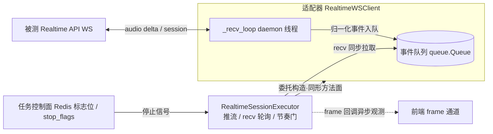
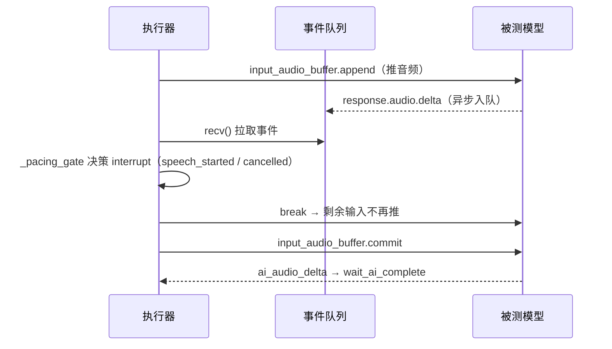

# 接入指南 · Realtime API 测试（websocket_api）

> 受众：接入新被测 Realtime API（WebSocket 实时会话接口）的开发者。
> 核心原则：**执行器通用，特殊处理固定三处落点（适配器 / 配置 / 评估计算器）**，与 E2E「通用 executor + 特殊全在 driver」同构。
> 定位：接入方开发者指南——如何写适配器、如何处理用例特殊处理。本文只描述接入口径，不含平台安装部署（见 `doc/使用说明.md` 与部署文档）。

## 一、接入总览（3 件事）

| 你要做的事 | 放哪 | 写代码？ |
| --- | --- | --- |
| ① 厂商协议适配器（WS 事件/握手/输出） | `api_test_service/infrastructure/adapters/vendors/你的厂商.py` | ✅ |
| ② 厂商注册（枚举 + 映射 + @register） | `common_enums.py` + `registry.py` | ✅（约 5 行） |
| ③ 参数配置（评估字段/会话/用例） | 算法配置 field_mapper + APIs 表 + 用例配置 | ❌ 纯配置 |

执行器（RealtimeSessionExecutor）是通用的：正常轮/打断轮/推流节奏/等待全是通用编排，用例配置驱动。**接任何厂商都不改执行器。**

## 二、写适配器（= Realtime 的 driver）

### 2.1 继承谁

```
ApiVendorAdapter (Port，抽象契约，domain/ports/)
   ├── RealtimeAdapterBase   ← Realtime 厂商继承这个（协议级，protocol/）
   │      └── OpenAIRealtimeAdapter  （官方样例：5 个类属性，零覆写）
   │      └── 你的厂商适配器
   └── (HTTP 厂商) 直接实现 Port（见《接入指南·普通 HTTP API》）
```

继承 `RealtimeAdapterBase` 白拿：WS 连接、事件队列、`pre_process/send/recv/output/close` 同形方法面、代理透传、密钥链、会话亲和。

**执行器 × 适配器架构（图 A）**：`RealtimeSessionExecutor` 经 `_resolve_realtime_transport` 委托构造适配器，只调**同形方法面**（`connect` / `pre_process` / `send` / `recv` / `output` / `close`），轮次编排与适配器实现解耦；信号回流为**生产者-消费者两段式**，停止走独立任务控制面：



要点（与代码一致，`api_test_service/core/realtime_session_executor.py` + `api_test_service/infrastructure/adapters/transport/realtime_ws_client.py`）：

- **委托构造**：`_resolve_realtime_transport` 按 `adapter_type_from_config` 判定 `vendor_adapter=openai / openai_realtime` 时经 `vendor_adapter_registry.resolve(AdapterProtocol.REALTIME, AdapterVendor.OPENAI, fallback=False)` 构造 `OpenAIRealtimeAdapter`，否则构造 `RealtimeWSClient`；两者暴露同一方法面，轮次编排零改动。
- **信号回流两段式**：`_recv_loop` daemon 线程（生产者）`ws.recv()` → 厂商事件入 `queue.Queue`（异步）；执行器主线程 `recv()` 轮询（同步）→ `_pacing_gate` 决策 interrupt / 收敛。事件归一化与帧记录在收包侧（`_parse_event`），节奏门只读状态、不改变产出链路。
- **frame 通道异步观测**：`event_listener`（`_on_frame` 回调）逐帧推前端 frame 通道，不参与停止。
- **停止控制面**：任务停止走 Redis 标志位 + 本地 `stop_flags`（`_handle_control` / `stop_check`，见 API 测试功能设计文档 §3.8）。

### 2.2 最小模板（事件协议与 OpenAI 相同 → 5 行就够）

```python
# adapters/vendors/my_vendor_adapter.py
from shared.models.common_enums import AdapterProtocol, AdapterVendor, VendorAdapterType
from api_test_service.infrastructure.adapters.protocol.realtime_adapter_base import RealtimeAdapterBase
from api_test_service.infrastructure.adapters.registry import register_vendor_adapter

@register_vendor_adapter
class MyVendorRealtimeAdapter(RealtimeAdapterBase):
    protocol = AdapterProtocol.REALTIME
    vendor = AdapterVendor.MY_VENDOR
    adapter_type = VendorAdapterType.MY_VENDOR
    display_name = 'xx Realtime 适配器'
    _transport_vendor = 'openai'   # 事件协议与 OpenAI 相同 → 到此结束
```

### 2.3 协议不同 → 覆写点表

| 厂商差异 | 覆写方法 | 写什么 |
| --- | --- | --- |
| 握手载荷不同 | `pre_process` | 你的 session.update 字段 |
| 事件字段不同 | `recv` | 厂商事件 → 归一化 `RealtimeFrameType`（打断依赖 `user_speech_started` / `response_cancelled`） |
| 输出结构不同 | `output` / `post_process` | 聚合 audio/text/frame |
| 等待语义不同 | `wait_ai_speaking` / `wait_ai_complete` | AI 开口/完成判定 |
| 打断字段方言不同 | `resolve_round_mode` | 默认读 `is_interruption`（`_as_bool` 兼容 int/bool/str）；厂商用 `barge_in` 等覆写 |
| 传输完全私有 | `_build_client` | 替换默认 WS 客户端 |

> **口径注**：`resolve_for` / `resolve_round_mode` 表驱动分发为 **INT-1299 目标态**。当前集成基线 `_execute_round`（`api_test_service/core/realtime_session_executor.py:312`）仍硬编码 `round_config.get('is_interruption')`，`_resolve_realtime_transport` 走 if/else 白名单（:290 `vendor_adapter_registry.resolve(...)`）。本文按目标态描述，**待 INT-1299 合入后校对**。

```python
# 覆写示例：厂商打断事件名不同 → 归一化
def recv(self, timeout=5.0):
    evt = self._client.recv(timeout)
    if evt.get('type') == 'vendor_a_barge':   # 厂商自己的打断事件
        return {'type': RealtimeFrameType.USER_SPEECH_STARTED.value, ...}
    return evt
```

## 三、注册（20 家也就这几行）

```python
# common_enums.py
class AdapterVendor(str, Enum):     MY_VENDOR = 'my_vendor'
class VendorAdapterType(str, Enum): MY_VENDOR = 'my_vendor'

# registry.py
_FLAT_KEY_DIMENSIONS = { ..., VendorAdapterType.MY_VENDOR: (AdapterProtocol.REALTIME, AdapterVendor.MY_VENDOR) }
```

分发是表驱动的（`resolve_for`）：配置了 `vendor_adapter=my_vendor` 走你的适配器；未配置走默认。执行器零改动。

## 四、用例特殊处理（纯配置）

### 4.1 rounds 字段

除正常轮字段（`round_number` / `audio_id` / `audio_path` / `spl` / `query` / `question` / `correct_answer`）外，Realtime 用例 `rounds` 支持：

| 字段 | 说明 |
| --- | --- |
| `is_interruption` | 标记打断轮（`RealtimeRoundMode.INTERRUPTION`）：先等 AI 开口 → 延时后推打断音频 → 检测打断 → 等新回复 |
| `interruption_delay_ms` | AI 开口后到推打断音频的固定延时（默认 1000，可被 round 级覆盖） |
| `interrupt_mode` | 打断点模式（INT-2080 目标态，见 6）：`fixed_delay`（缺省，`interruption_delay_ms`）/ `output_duration`（`interrupt_after_ms`） |
| `interrupt_after_ms` | `output_duration` 模式打断阈值：按已返回 AI 音频流长度（毫秒）判定打断时机 |
| `pacing` | 输出调输入节奏配置：`{"pacing_strategy": "wait_turn_end", "turn_end_wait_timeout_s": 60, "pacing_fallback_timeout_s": 30}`（见 4.3） |

### 4.2 特殊处理与适用算法

| 用例场景 | 配什么 | 适用算法 | 谁来处理 |
| --- | --- | --- | --- |
| 正常对话轮 | 每轮输入音频 + `query` | 全部 | 执行器通用编排 |
| **打断轮（插话）** | `is_interruption: true` + `interruption_delay_ms`（默认 1000ms）/ `interrupt_mode`（INT-2080，见 6） | **仅 voice_llm 等对话类** | 执行器 `_execute_interruption_round` 通用编排 |
| **推流中打断** | `pacing.pacing_strategy=allow_barge_in`（用例级或 API meta 级） | **仅 voice_llm 等对话类** | 执行器 `_pacing_gate` |
| **拒识** | `is_reject: true` + `timing`（静默/回复过程中） | **仅 voice_llm（reject_judge 维度）** | 评估侧计算器 |
| 评估字段名/映射 | param_mapping（source→target） | 按算法各自声明 | field_mapper（配置） |

> **打断轮 / 拒识 / 推流中打断是 voice_llm 这类「对话/拒识算法」的用例语义，其他算法（asr/der/wer 等）不需要**，各自有自己的字段与评估计算器，字段区分靠 field_mapper 按 algorithm_type 的 param_mapping。

**关键：这些特殊处理你不需要写代码。** 打断轮时序（等 AI 开口 → 延时 → 推打断音频 → 检测窗口）由通用执行器编排；拒识判定由评估侧 `reject_judge` 计算器负责；字段名映射由 field_mapper 配置驱动。适配器唯一要保证：**厂商事件正确归一到 `user_speech_started` / `response_cancelled`**（打断）和**如实采集轮次结果**（拒识）。

正常轮时序（`RealtimeSessionExecutor._execute_normal_round`）：流式推送混音 chunk（`RenderAudioStream` 消费链路，逐 chunk `send_audio_chunk` + 按 chunk 时长 sleep）→ 推流中按节奏策略插 `recv()` 检输出事件（`_pacing_gate`）→ `commit_input` → `wait_ai_complete`（`ai_start_timeout_seconds=25` 起始窗口判开口 / `ai_complete_timeout_seconds=60` 收尾窗口判完成）。成败语义：起始窗口内无 `ai_audio_delta` → 轮失败「AI 未回复」；已开口仅表明通过起始窗口，收尾事件 `ai_audio_done` 须在收尾窗口内到达，否则轮失败「AI 回复未在超时内完成」（`success = bool(complete and output['ai_complete'])`）。

打断轮时序（`_execute_interruption_round`）：① `wait_ai_speaking` 等 AI 开口（`ai_start_timeout_seconds=25`）→ ② `sleep(interruption_delay_ms)` → ③ 流式推送打断音频 + `commit_input` → ④ barge-in 检测窗口（`barge_in_window_seconds=5`，recv 轮询等 `user_speech_started` / `response_cancelled`）→ ⑤ 打断成功则 `wait_ai_complete` 等新回复。打断轮推流阶段不套节奏门（避免抢占打断信号源）。

> **时序口径（负责人 2026-10-23 拍板）**：
> - **正常轮完成判定**：事件驱动——`ai_audio_delta` 起始窗口判「已开口」、`ai_audio_done` 收尾窗口判「完成」，**超时仅兜底**（不改变成败语义；`success = bool(complete and output['ai_complete'])`）。
> - **打断点**：模式化——`fixed_delay` 按固定延时（`interruption_delay_ms`）或 `output_duration` 按已返回 AI 音频流长度（`interrupt_after_ms`）判定打断时机（INT-2080，见 6）。
> - **时延指标**：帧时间戳实测（`frame_results` 逐帧 `ts` / `offset_ms`：首帧 `first_frame_latency_ms`、打断 `barge_in_latency_ms`），**与超时无关**。

### 4.3 超时与节奏配置

Realtime 全链路超时配置化（`shared/config/concurrency_config.json` `realtime_session` 段，无魔法数字；执行器经 `config_manager.get_value('realtime_session', key, default)` 读取）：

| 键 | 默认 | 语义 |
| --- | --- | --- |
| `chunk_duration_ms` | 100 | RenderAudioStream 切片粒度 / 逐 chunk 推送节奏 |
| `ai_start_timeout_seconds` | 25 | 等 AI 首个 `ai_audio_delta`（`wait_ai_speaking`） |
| `ai_complete_timeout_seconds` | 60 | 等 AI 回复收尾（`wait_ai_complete` end_timeout） |
| `barge_in_window_seconds` | 5 | 打断检测窗口 |
| `interruption_delay_ms` | 1000 | AI 开口后到推打断音频的延时（round 级可覆盖） |
| `bind_ttl_seconds` | 3600 | 会话亲和绑定 TTL |
| `pacing_strategy` | `fixed` | 输出调输入节奏策略（见下） |
| `turn_end_wait_timeout_s` | 60 | `WAIT_TURN_END` 的 turn 结束等待上限 |
| `pacing_fallback_timeout_s` | 30 | `TIMEOUT_FALLBACK` 兜底超时 |

**输出调输入节奏（INT-475）**：策略枚举 `RealtimePacingStrategy`（`shared/models/common_enums.py`，前端 `frontend/src/domain/enums.ts` 镜像同值）：

| 策略 | 值 | 语义 |
| --- | --- | --- |
| `FIXED` | `fixed` | 恒定节奏（默认=现状，回归基准） |
| `WAIT_TURN_END` | `wait_turn_end` | 模型输出 turn 进行中暂停输入推流，turn 结束后续推 |
| `ALLOW_BARGE_IN` | `allow_barge_in` | 输入推流中模型提前回话/打断 → 收敛输入推流（剩余输入不再推） |
| `TIMEOUT_FALLBACK` | `timeout_fallback` | 模型无输出/无 turn 结束时按配置超时兜底，不无限等待（可与前两者组合） |

配置优先级：**`case_config['pacing']` → `api_config.meta['pacing']` → `realtime_session` 全局 → 默认**；FIXED 与动态策略互斥（含任一动态策略时 FIXED 被丢弃）。事件信号→决策映射（`_pacing_gate`）：`ai_audio_delta` / `ai_text_delta` → `WAIT_TURN_END` 暂停；`ai_audio_done` / `ai_text_done` → 放行；`user_speech_started` / `response_cancelled` → `ALLOW_BARGE_IN` 收敛；`connection_closed` / `error` → 放行由 `wait_ai_complete` 收敛。设计细节见 `doc/功能设计文档/01_测试执行/07_流式推送与结果获取.md` 附录。

### 4.4 事件回流停止时序（图 B）



停止点归纳（`_pacing_gate` 决策映射，详见 07 设计文档附录）：收到 `user_speech_started` / `response_cancelled` → `interrupt` → 收敛输入推流（剩余输入不再推）；收到 `connection_closed` / `error` → 放行，由 `wait_ai_complete` 收敛轮次失败。

## 五、WS 非实时接入（protocol=websocket + streaming=false）

除 Realtime 会话式外，被测 WS API 还支持**请求-响应式（非会话式）**接入：`apis` 配置 `protocol=websocket + streaming=false`（非实时），一轮一请求一回复，不维持会话。

| 维度 | WS 实时（Realtime 会话式，现状） | WS 非实时（请求-响应式，INT-2079 目标态） |
| --- | --- | --- |
| `apis.protocol` / `apis.streaming` | `websocket` / `true` | `websocket` / `false` |
| 交互形态 | 会话式，全双工流式（逐 chunk 推 `input_audio_buffer.append` + 事件回流） | 非会话式，请求-响应 |
| 可测轮次 | 正常轮 / 打断轮 / 推流节奏（pacing） | **正常轮 / 多轮** |
| 打断 / 拒识 / 推流中打断 | 有（`is_interruption` / `pacing`） | **无**——用例不配置即可，配置了也不生效 |
| 完成判定 | 事件驱动：`ai_audio_delta`→`ai_audio_done`，超时仅兜底 | 事件驱动：**音频流 + 完成事件**，超时仅兜底 |
| 时延 / 时长 | 帧时间戳实测（`first_frame_latency_ms` / `barge_in_latency_ms`） | 按**音频流实际长度与帧时间戳**实测 |

- **接入动作与 §二/三 相同**：继承 `RealtimeAdapterBase`（或实现 Port）+ 注册（枚举 + `_FLAT_KEY_DIMENSIONS` 一行映射 + `@register_vendor_adapter`），执行器零改动。
- **用例 `rounds`** 与普通轮一致（`round_number` / `audio_id` / `audio_path` / `query` / `question` / `correct_answer`），不配置 `is_interruption` / `pacing` 等会话能力字段即可。

> **口径注**：`(websocket, streaming=false)` 组合为 **INT-2079 目标态**。当前 `AVAILABLE_PROTOCOL_STREAMING` 缺该组合（写侧 400「实现未上线」）、执行器未上线；`apis` 表已有 `protocol` / `streaming` 两列（INT-1799 落地）。本文按目标态描述，**待 INT-2079 合入后校对**。

## 六、打断点模式（`interrupt_mode`）

打断轮（barge-in）的「AI 开口后何时推打断音频」由 `interrupt_mode` 模式化配置：

| 模式 | 值 | 打断点判定 | 配置键 |
| --- | --- | --- | --- |
| 固定延时（缺省） | `fixed_delay` | AI 开口后按**固定延时**推打断音频 | `interruption_delay_ms`（默认 1000，round 级可覆盖） |
| 输出时长 | `output_duration` | 按**已返回 AI 音频流长度**判定——累积达阈值即打断 | `interrupt_after_ms` |

- **适用**：voice_llm 打断轮（`is_interruption: true`，见 4.2）。
- **大块回复（一次返回多秒）场景**：模型一次回复可在一帧内返回多秒音频，固定延时可能错过「AI 已说够一会儿」的时机；用 `output_duration` 按已返回音频长度判定打断点更稳：

```json
{
  "round_number": 2,
  "is_interruption": true,
  "interrupt_mode": "output_duration",
  "interrupt_after_ms": 3000,
  "audio_id": 123
}
```

> **口径注**：`output_duration` / `interrupt_after_ms` 为 **INT-2080 目标态**。当前集成基线打断轮打断点仅 `interruption_delay_ms` 固定延时（`RealtimeSessionExecutor._execute_interruption_round` 第②步 `sleep(interruption_delay_ms / 1000.0)`），`output_duration` 未上线；本文按目标态描述，**待 INT-2080 合入后校对**。

## 七、APIs 表 + 建任务（配置）

### 7.1 被测 Realtime API 配置

在 `apis` 表维护被测 Realtime API 配置（`api_test_service/infrastructure/persistence/models/api_models.py` `class API`），Realtime 路径关心的字段：

| 配置 | 说明 |
| --- | --- |
| `name` | API 显示名称 |
| `vendor` | 供应商名称（如 `openai` / `volc`；联调用 mock 替身时填 `mock`） |
| `api_url` | API 微服务主入口 URL |
| `api_endpoints` | API 接入点配置列表（JSON），`ws://` / `wss://` 前缀条目优先于 `api_url`；`RealtimeSessionExecutor._resolve_ws_url` 校验必须带 `ws://` / `wss://` 前缀 |
| `device_type` | `websocket_api`（Realtime 用例建任务时 `case_devices` 必须携带，见 7.2） |
| `meta.vendor_adapter` | `openai` / `openai_realtime`（`VendorAdapterType` 扁平 key）→ 注册表 `(AdapterProtocol.REALTIME, AdapterVendor.OPENAI)` 分发 `OpenAIRealtimeAdapter`；未配置回退 `RealtimeWSClient` 默认行为 |
| `meta.session_config` | `session.update` 载荷（VAD / voice / instructions 等），`_build_session_config` 合并用例级 `session` 覆盖 |
| `meta.audio_config` | 目标音频格式声明（`sample_rate` 默认 **24000** / bit_depth / channels / container），`_build_session_config` 回退 `input_audio_sample_rate` |
| `meta.ws_headers` | WS 握手头（直传，显式 `Authorization` 头优先，不覆盖） |
| `meta.api_key` / `meta.api_keys` | 密钥单值与轮换池，见 7.1.1 |
| `proxy_type` / `proxy_url` | 被测 API 网络代理（INT-839）：`proxy_type` ∈ http / https / socks5 / socks5h，`proxy_url` 为 `user:pass@host:port` 不含 scheme；Realtime WS 连接（`realtime_ws_client.connect()`）经 `websocket_proxy_kwargs` 注入代理参数 |

#### 7.1.1 密钥链（`shared/utils/api_key_provider.py`）

密钥解析收敛于 Infrastructure 层 `ApiKeyChainResolver`，Domain 层只见解析结果，密钥不落日志、不进报告。

- 单值链：**`case_config.api_key` → `api_config.meta.api_key` → 环境变量 `OPENAI_API_KEY`** 逐级回退（各级键名可配置，默认对齐约定）。
- 密钥池轮换（INT-1177）：`resolve_rotating` = case 层单值（最高优先）→ `meta.api_keys` 轮换池（round-robin 游标 + 冷却集合，同一 API 跨协议同源轮换）→ `meta.api_key` 单值回退 → env。WS 握手 401/403/429 时判定密钥池轮换（`realtime_ws_client.last_handshake_status`）。

### 7.2 建任务（case_devices 亲和）

Realtime 用例建任务时，**`case_devices` 必须携带 `device_type=websocket_api`**（`{"case_id": ..., "device_type": "websocket_api", "device_id": api.id}`），否则按默认 `physical`（或 `http_api`）路由，不会进入 Realtime 通道。链路：

```mermaid
flowchart TB
    A[建任务 case_devices: device_type=websocket_api] --> B[task_service 认领用例<br/>_dispatch_case_by_type]
    B --> C{device_type=websocket_api}
    C -->|是| D[_route_realtime_dispatch<br/>RealtimeSessionRegistry.route_or_bind<br/>session:bind:{task_id} 亲和路由]
    D --> E[StartAPITest 直连绑定实例]
    E --> F[api_test_service<br/>RealtimeSessionExecutor]
    C -->|否| G[默认负载均衡通道<br/>不回退 Realtime 语义]
```

- **亲和绑定**：`RealtimeSessionRegistry.route_or_bind(task_id)`（`shared/utils/realtime_session_registry.py`）在派发侧解析 task → 实例绑定（无健康绑定则选最闲在册实例写入），`StartAPITest` 直连该实例，保证同任务 Realtime 会话粘同实例（Redis 不可用降级单实例语义）。
- 实例内闭环：WS 长连接与帧状态封闭在接单实例内存，跨轮保持；会话结束 `release` 清除绑定（`bind_ttl_seconds=3600` 兜底）。

## 八、验证

1. **mock 冒烟**：`mock_realtime_api.py --barge-in`（预置「AI 说话 + 打断」事件序列）→ 正常轮 + 打断轮跑通；输出调输入节奏联调用 `--speak-during-stream`（INT-475，见下）
2. **真机**：换 `api_url` 为被测端点，核对事件协议与归一化（`response.audio.delta` 等）
3. **回归**：`test_int497_openai_realtime_e2e.py`（分发 + 打断轮）、`test_int475_realtime_pacing.py`（节奏策略）

```bash
# 打断轮联调：--barge-in 预置「AI 正在说话 + 打断」事件序列
python mock_services/mock_realtime_api.py --port 5098 --barge-in

# 输出调输入节奏联调：--speak-during-stream 输入推流中提前回话（INT-475）
python mock_services/mock_realtime_api.py --port 5098 --speak-during-stream \
    --speak-during-stream-after 2 --speak-during-stream-barge-in
```

`mock_services/mock_realtime_api.py`（`MockRealtimeBehavior`）行为可经命令行 / 环境变量 `MOCK_RT_*` / 配置文件 / WS 控制帧（`__mock_control` set_behavior）热更新：

| 行为字段 | 说明 |
| --- | --- |
| `barge_in` | 首轮 commit 响应结束后预置 `response.audio.delta` + `speech_started` + `response.cancelled`（打断轮联调） |
| `speak_during_stream` | 输入推流中（commit 前）模型提前回话，供 `WAIT_TURN_END` / `ALLOW_BARGE_IN` 验收 |
| `speak_during_stream_after` | 第 N 帧 append 后触发（默认 1） |
| `speak_during_stream_barge_in` | 提前回话携带 `speech_started` + `cancelled` 打断信号 |
| `speak_during_stream_complete` | False 模拟长回复未收口（供超时兜底验收） |
| `first_delta_delay_ms` | commit → 首个 delta 间隔（测首帧延迟） |
| `disconnect_after_events` | 第 N 个客户端事件后主动断开（测断连收敛） |
| `protocol_error_on_event` | 该事件回 error 帧（测协议错误） |

把被测 API 的 `api_endpoints` 指向 `ws://127.0.0.1:5098`（`vendor_adapter=openai` / `vendor=mock`）即可跑通 Realtime 端到端。

## 九、FAQ

| 现象 | 原因与处置 |
| --- | --- |
| **device_type 不生效** | Realtime 用例建任务时 `case_devices` 未携带 `device_type=websocket_api`（或漏传 `api_id`）。路由依据是**用例级** `device_type`；检查建任务请求的 `case_devices` 与 `task_case_relations.device_type` |
| **WS 连接失败** | ① 端点未配置 `ws://` / `wss://` 前缀（`_resolve_ws_url` 报「未配置 WebSocket 端点」）；② 被测侧不可达/拒绝握手——检查网络与防火墙；③ 握手 401/403/429 → 密钥问题，见「密钥不生效」；④ 配置了代理但 `proxy_url` 不合规（`validate_proxy`） |
| **session.updated 超时** | `pre_process` 下发 `session.update` 后等待 `session.updated` 确认（`wait_confirm_timeout=10s`）；超时 = 被测侧未按 OpenAI Realtime 协议回 `session.updated`。检查被测协议事件名（`_EVENT_TYPE_MAP` 映射面）与会话配置载荷 |
| **AI 未回复** | commit 后起始窗口（`ai_start_timeout_seconds=25`）内无 `ai_audio_delta` → 轮失败「AI 未回复」；检查被测是否配置了自动回复/`response.create` 语义。已开口仅表明通过起始窗口，收尾事件 `ai_audio_done` 须在 `ai_complete_timeout_seconds=60` 内到达，否则轮失败「AI 回复未在超时内完成」 |
| **打断未检出** | 打断轮窗口（`barge_in_window_seconds=5`）内未收到 `user_speech_started` / `response_cancelled` → 打断失败标记写入轮结果；检查被测 VAD 打断检测是否开启、`interruption_delay_ms` 是否给 AI 留出开口时间 |
| **密钥不生效** | 密钥链 `case_config.api_key` → `meta.api_key` → env `OPENAI_API_KEY` 逐级回退；WS 握手 401/403/429 时判定密钥池轮换（`meta.api_keys` 轮换池）。密钥不落日志、不进报告；排查先看执行日志的握手状态码 |
