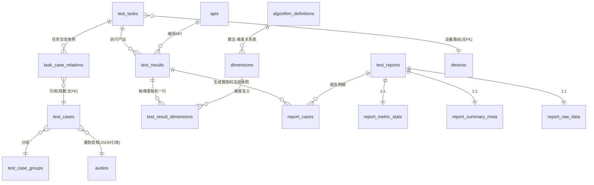
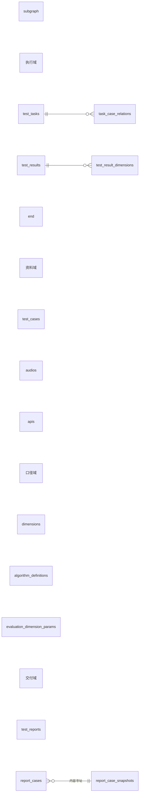

# 2026-10-24 表结构审计：是否需要重新设计

> **卡号**：INT-1794（审计·数据库）
> **审计对象**：主库 `intelligent_audio_test`（docker 容器 `intelligent-audio-test-postgres-1`，宿主 `127.0.0.1:15432`），PostgreSQL 16.8
> **代码基线**：V9.7.31 worktree，分支 `agent/agent/int-1794`，基线提交 `5e28c3c6d`
> **实测时间**：2026-10-24 16:18–17:10（+08）
> **方式**：只读。所有会话执行 `SET default_transaction_read_only = on`；未执行任何 DDL/DML/索引变更，未改动业务代码。
> **范围**：public schema 全部 95 张业务表（100% 覆盖，见 §3.2）。

## 0. 一句话结论

**不需要整体重新设计；需要「大字段外置 + 报告快照去冗余 + 生命周期治理 + 口径收敛」四处局部改造。**

理由（三条，均可证）：

1. **体积问题不是表结构问题。** 全库 851.9MB 里 90%（763MB）压在 3 张表的 **TOAST 大 JSON** 上：`test_result_dimensions` 219MB TOAST、`report_cases` 176MB、`logs` 61MB。行数维度上，除这 3 张表外最大的表只有 9,935 行 / 5.3MB。把大 JSON 搬走（INT-1786）与去重（INT-1787）之后，剩下的库约 150–250MB，现有实体关系完全撑得住。
2. **核心域的实体关系是对的。** 95 张表 = 代码 89 个 ORM 模型（`scripts/create_all_tables.py:30` 的 `EXPECTED_TABLE_COUNT = 89`）+ 6 张遗留/测试残留。任务—用例—结果—维度—报告—设备—音频—算法九个核心域的归属清晰，没有「一张表塞两个域」或「一个域散成十张表」的结构性错误。重画关系图的收益不抵迁移风险。
3. **真正的结构债在四处，都不需要动关系模型**：(a) 大 JSON 与热明细同表（§5）；(b) 报告快照 68% 重复存储（§6）；(c) 无生命周期治理（§7）；(d) 类型/软删/时间戳口径不统一（§9）。

**不做**：拆库、读写分离、按天分区（先做大字段外置，见 §13 拍板项）。

---

## 1. 审计方法与证据强度

| 证据类型 | 来源 | 强度 |
|---|---|---|
| 目录级结构 | `pg_class` / `pg_attribute` / `pg_constraint` / `pg_indexes` 导出 | 强（权威） |
| 行数 | 逐表 `count(*)` 精确统计（95/95 张表） | 强 |
| 体量 | `pg_total_relation_size` / `pg_relation_size(reltoastrelid)` | 强 |
| 业务数据抽样 | 重复度、孤儿、时间跨度、分类分布 | 中（单库单环境） |
| 代码归属 | ORM 模型 `__tablename__` 的 `file:line` | 强 |
| 索引使用率 | `pg_stat_user_indexes.idx_scan` | **不作证据**（见下） |
| 慢查询 | `pg_stat_statements` | **未就绪**（INT-1783 处理中） |

**统计被 reset 的影响（必须写明）**：docker 引擎 2026-10-24 15:55 宕机、16:18 恢复，`pg_stat_user_tables` / `pg_stat_user_indexes` 全部归零（`n_live_tup = 0`、`idx_scan = 0`、`n_tup_ins` 极小）。因此：

- 本报告**所有行数一律用 `count(*)`**，不引用 `n_live_tup`；
- **任何索引一律不以 `idx_scan = 0` 判死**（与 INT-1784 的处置口径一致）；
- 「从未使用」只作旁证，不作结论。

---

## 2. 库体量与热点（实测）

- 库大小：**864MB**（表 + 索引 + TOAST 合计 851.9MB，余为元数据/自由空间）
- 表：**95** 张；列：**1,182**；索引：**391** 个 / **77.4MB**；约束：**121**（主键 95 + 唯一 26 + **外键 0**）
- JSON/JSONB 列：**78** 个（`json` 40 + `jsonb` 38）；GIN 索引：**0** 个

| 表 | 行数 | 总计MB | heap | 索引 | TOAST |
|---|---:|---:|---:|---:|---:|
| `test_result_dimensions` | 51,857 | 275.5 | 50.6 | 2.9 | 219.2 |
| `logs` | 304,749 | 248.7 | 126.9 | 59.5 | 61.4 |
| `report_cases` | 33,919 | 238.4 | 57.6 | 2.0 | 176.3 |
| `test_results` | 5,546 | 51.9 | 6.0 | 0.9 | 44.4 |
| `task_case_relations` | 9,935 | 5.3 | 2.0 | 3.2 | 0.0 |
| `audio_annotations` | 4,990 | 4.6 | 4.1 | 0.5 | 0.0 |
| `upload_files` | 6,544 | 3.8 | 3.3 | 0.5 | 0.0 |
| `evaluation_dimension_params` | 8,329 | 3.3 | 2.2 | 1.0 | 0.0 |
| `test_cases` | 770 | 2.6 | 2.3 | 0.3 | 0.0 |
| `device_status_events` | 7,324 | 1.9 | 1.1 | 0.7 | 0.0 |

**前三张表合计 763MB = 90%。** 其中 TOAST 占 456MB —— 也就是说「库大」的直观印象来自这三张表里的**大 JSON 文本**（TOAST 合计 456MB），不是行数或关系复杂度。

---

## 3. 表清单与归属

### 3.1 归属方式

代码侧表定义全部在 `*/infrastructure/persistence/models/*.py`（89 张），迁移脚本 `scripts/migrations/` **没有任何仅存在于迁移、没有 ORM 模型的建表语句**（0 张）。因此「代码有表、库没有」或「库有表、代码没有」可以直接用集合差算：

```
库 95 张 − 代码 89 张 = 6 张遗留/测试残留（§3.3）
```

### 3.2 逐表结论（95 / 95，无「待定」）

判定口径：**保留**＝结构无需改动；**局部改**＝加列/改类型/补约束等小改；**大字段外置**＝JSON 搬到 rustfs 或等价存储；**归档/下线**＝停写并清理；**下线**＝无代码引用、可直接摘除。

| 表 | 域 | 行数 | 体积 | 结论 | 理由与证据 |
|---|---|---:|---:|---|---|
| `access_tokens` | 认证 | 26 | 64KB | 保留 | 26 行 / 64KB / 3 索引 / 1 个 JSON 列（JSON 合计 1KB）；读写按主键/外键列等值，无重复存储与孤儿迹象，本轮不动 |
| `ai_reviews` | 结果 | 36 | 96KB | 保留 | 36 行 / 96KB / 3 索引 / 0 个 JSON 列；读写按主键/外键列等值，无重复存储与孤儿迹象，本轮不动 |
| `algorithm_api_params` | 算法 | 13 | 96KB | 保留 | 13 行 / 96KB / 3 索引 / 0 个 JSON 列；读写按主键/外键列等值，无重复存储与孤儿迹象，本轮不动 |
| `algorithm_definition_drafts` | 算法 | 1 | 96KB | 保留 | 1 行 / 96KB / 2 索引 / 0 个 JSON 列；读写按主键/外键列等值，无重复存储与孤儿迹象，本轮不动 |
| `algorithm_definitions` | 算法 | 87 | 0.12MB | 保留 | 87 行 / 0.12MB / 4 索引 / 0 个 JSON 列；读写按主键/外键列等值，无重复存储与孤儿迹象，本轮不动 |
| `algorithm_device_params` | 算法 | 26 | 96KB | 保留 | 26 行 / 96KB / 3 索引 / 0 个 JSON 列；读写按主键/外键列等值，无重复存储与孤儿迹象，本轮不动 |
| `algorithm_dimension_relations` | 算法 | 720 | 0.23MB | 保留 | 720 行 / 0.23MB / 4 索引 / 0 个 JSON 列；读写按主键/外键列等值，无重复存储与孤儿迹象，本轮不动 |
| `algorithm_groups` | 算法 | 17 | 64KB | 保留 | 17 行 / 64KB / 3 索引 / 0 个 JSON 列；读写按主键/外键列等值，无重复存储与孤儿迹象，本轮不动 |
| `algorithm_reference_params` | 算法 | 7 | 64KB | 保留 | 7 行 / 64KB / 3 索引 / 0 个 JSON 列；读写按主键/外键列等值，无重复存储与孤儿迹象，本轮不动 |
| `api_rms_spl_mappings` | API | 29 | 96KB | 保留 | 29 行 / 96KB / 3 索引 / 1 个 JSON 列（JSON 合计 3KB）；读写按主键/外键列等值，无重复存储与孤儿迹象，本轮不动 |
| `apis` | API | 170 | 0.16MB | 局部改 | JSON 类型混用：meta/api_endpoints 为 json、audio_config/output_types 为 jsonb |
| `audio_algorithm_relations` | 音频 | 47 | 0.14MB | 保留 | 47 行 / 0.14MB / 8 索引 / 1 个 JSON 列（JSON 合计 0KB）；读写按主键/外键列等值，无重复存储与孤儿迹象，本轮不动 |
| `audio_annotations` | 音频 | 4,990 | 4.60MB | 保留 | 4,990 行 / 4.60MB / 5 索引 / 1 个 JSON 列（JSON 合计 3574KB）；读写按主键/外键列等值，无重复存储与孤儿迹象，本轮不动 |
| `audio_playback_history` | 音频 | 123 | 0.10MB | 保留 | 123 行 / 0.10MB / 3 索引 / 0 个 JSON 列；读写按主键/外键列等值，无重复存储与孤儿迹象，本轮不动 |
| `audio_tags` | 音频 | 2,944 | 0.55MB | 保留 | 2,944 行 / 0.55MB / 5 索引 / 0 个 JSON 列；读写按主键/外键列等值，无重复存储与孤儿迹象，本轮不动 |
| `audios` | 音频 | 2,280 | 1.71MB | 保留 | 2,280 行 / 1.71MB / 8 索引 / 0 个 JSON 列；读写按主键/外键列等值，无重复存储与孤儿迹象，本轮不动 |
| `benchmark_baselines` | 基准 | 0 | 40KB | 保留 | 0 行：功能未启用或无数据，结构保留（建表/迁移与 ORM 一致） |
| `benchmark_metric_mappings` | 基准 | 18 | 64KB | 保留 | 18 行 / 64KB / 3 索引 / 1 个 JSON 列（JSON 合计 0KB）；读写按主键/外键列等值，无重复存储与孤儿迹象，本轮不动 |
| `benchmark_rankings` | 基准 | 5 | 0.11MB | 保留 | 5 行 / 0.11MB / 6 索引 / 0 个 JSON 列；读写按主键/外键列等值，无重复存储与孤儿迹象，本轮不动 |
| `benchmark_reports` | 基准 | 5 | 0.19MB | 保留 | 5 行 / 0.19MB / 9 索引 / 1 个 JSON 列（JSON 合计 5KB）；读写按主键/外键列等值，无重复存储与孤儿迹象，本轮不动 |
| `benchmark_sources` | 基准 | 0 | 32KB | 保留 | 0 行：功能未启用或无数据，结构保留（建表/迁移与 ORM 一致） |
| `calibration_history` | 设备 | 21 | 96KB | 保留 | 21 行 / 96KB / 3 索引 / 1 个 JSON 列（JSON 合计 7KB）；读写按主键/外键列等值，无重复存储与孤儿迹象，本轮不动 |
| `case_algorithm_params` | 算法 | 15 | 96KB | 保留 | 15 行 / 96KB / 3 索引 / 0 个 JSON 列；读写按主键/外键列等值，无重复存储与孤儿迹象，本轮不动 |
| `categories` | 评估 | 96 | 0.12MB | 保留 | 96 行 / 0.12MB / 4 索引 / 0 个 JSON 列；读写按主键/外键列等值，无重复存储与孤儿迹象，本轮不动 |
| `cherry_pick_cart_items` | 挑选 | 0 | 0.12MB | 保留 | 0 行：功能未启用或无数据，结构保留（建表/迁移与 ORM 一致） |
| `cherry_pick_set_items` | 挑选 | 0 | 56KB | 保留 | 0 行：功能未启用或无数据，结构保留（建表/迁移与 ORM 一致） |
| `cherry_pick_sets` | 挑选 | 0 | 48KB | 保留 | 0 行：功能未启用或无数据，结构保留（建表/迁移与 ORM 一致） |
| `custom_oauth_providers` | 认证 | 0 | 48KB | 保留 | 0 行：功能未启用或无数据，结构保留（建表/迁移与 ORM 一致） |
| `device_alarm_rules` | 设备 | 13 | 40KB | 保留 | 13 行 / 40KB / 2 索引 / 0 个 JSON 列；读写按主键/外键列等值，无重复存储与孤儿迹象，本轮不动 |
| `device_alarms` | 设备 | 0 | 40KB | 保留 | 0 行：功能未启用或无数据，结构保留（建表/迁移与 ORM 一致） |
| `device_group_members` | 设备 | 1 | 72KB | 保留 | 1 行 / 72KB / 4 索引 / 0 个 JSON 列；读写按主键/外键列等值，无重复存储与孤儿迹象，本轮不动 |
| `device_groups` | 设备 | 29 | 0.10MB | 保留 | 29 行 / 0.10MB / 6 索引 / 0 个 JSON 列；读写按主键/外键列等值，无重复存储与孤儿迹象，本轮不动 |
| `device_status_events` | 设备 | 7,324 | 1.87MB | 局部改 | 7,324 行、按时间追加；设备硬删不清理本表，已产生 70 条孤儿（10-22~23） |
| `device_tags` | 设备 | 0 | 32KB | 保留 | 0 行：功能未启用或无数据，结构保留（建表/迁移与 ORM 一致） |
| `devices` | 设备 | 142 | 0.17MB | 保留 | 142 行 / 0.17MB / 6 索引 / 2 个 JSON 列（JSON 合计 1KB）；读写按主键/外键列等值，无重复存储与孤儿迹象，本轮不动 |
| `dimensions` | 评估 | 886 | 1.34MB | 保留 | 886 行 / 1.34MB / 7 索引 / 4 个 JSON 列（JSON 合计 587KB）；读写按主键/外键列等值，无重复存储与孤儿迹象，本轮不动 |
| `evaluation_dimension_params` | 算法 | 8,329 | 3.27MB | 保留 | 8,329 行 / 3.27MB / 3 索引 / 0 个 JSON 列；读写按主键/外键列等值，无重复存储与孤儿迹象，本轮不动 |
| `evaluation_strategies` | 评估 | 0 | 80KB | 保留 | 0 行：功能未启用或无数据，结构保留（建表/迁移与 ORM 一致） |
| `favorites` | 收藏 | 0 | 72KB | 保留 | 0 行：功能未启用或无数据，结构保留（建表/迁移与 ORM 一致） |
| `int90_poison` | 遗留 | 0 | 8KB | 下线 | 测试残留：tests/unit/test_int90_db_session_hygiene.py:50 自建，生产代码无引用，0 行 |
| `laboratories` | 设备 | 37 | 96KB | 保留 | 37 行 / 96KB / 5 索引 / 0 个 JSON 列；读写按主键/外键列等值，无重复存储与孤儿迹象，本轮不动 |
| `languages` | 遗留 | 0 | 16KB | 下线 | 无 ORM 模型、无代码引用、0 行（旧音频翻译功能遗留） |
| `logs` | 观测 | 304,749 | 248.71MB | 归档/下线 | 304,749 行 249MB、15 个索引；业务日志 2026-10-22 起已改落文件，DB 只剩审计事件（约 340 行/天） |
| `oauth_clients` | 认证 | 0 | 24KB | 保留 | 0 行：功能未启用或无数据，结构保留（建表/迁移与 ORM 一致） |
| `oauth_refresh_tokens` | 认证 | 0 | 48KB | 保留 | 0 行：功能未启用或无数据，结构保留（建表/迁移与 ORM 一致） |
| `param_mappings` | 算法 | 4,727 | 1.08MB | 保留 | 4,727 行 / 1.08MB / 4 索引 / 0 个 JSON 列；读写按主键/外键列等值，无重复存储与孤儿迹象，本轮不动 |
| `permissions` | 认证 | 130 | 80KB | 保留 | 130 行 / 80KB / 2 索引 / 0 个 JSON 列；读写按主键/外键列等值，无重复存储与孤儿迹象，本轮不动 |
| `playback_devices` | 设备 | 42 | 0.14MB | 局部改 | is_deleted 为 integer，与其余 32 张表的 boolean deleted 口径不一致 |
| `prompt_audio_relations` | 遗留 | 0 | 8KB | 下线 | 无 ORM 模型、无代码引用、0 行（旧提示音关联遗留） |
| `published_tasks` | 任务 | 2 | 0.34MB | 保留 | 2 行 / 0.34MB / 8 索引 / 2 个 JSON 列（JSON 合计 140KB）；读写按主键/外键列等值，无重复存储与孤儿迹象，本轮不动 |
| `report_cases` | 报告 | 33,919 | 238.45MB | 局部改+去冗余 | 33,919 行 238MB；10,837 种不同 payload（68% 重复）、795 个不同用例、200 份报告；冻结快照口径不得改回查 |
| `report_comparison_matrix` | 报告 | 39 | 1.55MB | 保留 | 39 行 / 1.55MB / 4 索引 / 1 个 JSON 列（JSON 合计 1326KB）；读写按主键/外键列等值，无重复存储与孤儿迹象，本轮不动 |
| `report_detail_data` | 遗留 | 0 | 24KB | 下线 | 无 ORM 模型、0 行；列是 report_metric_stats + report_raw_data 的并集；代码 `_create_report_detail_data` 实写另两表（INT-1784 已列下线） |
| `report_export_records` | 报告 | 0 | 32KB | 保留 | 0 行：功能未启用或无数据，结构保留（建表/迁移与 ORM 一致） |
| `report_favorites` | 报告 | 0 | 32KB | 保留 | 0 行：功能未启用或无数据，结构保留（建表/迁移与 ORM 一致） |
| `report_metric_stats` | 报告 | 206 | 0.71MB | 保留 | 206 行 / 0.71MB / 4 索引 / 6 个 JSON 列（JSON 合计 498KB）；读写按主键/外键列等值，无重复存储与孤儿迹象，本轮不动 |
| `report_raw_data` | 报告 | 206 | 0.44MB | 保留 | 206 行 / 0.44MB / 4 索引 / 1 个 JSON 列（JSON 合计 268KB）；读写按主键/外键列等值，无重复存储与孤儿迹象，本轮不动 |
| `report_shares` | 报告 | 53 | 80KB | 保留 | 53 行 / 80KB / 4 索引 / 1 个 JSON 列（JSON 合计 0KB）；读写按主键/外键列等值，无重复存储与孤儿迹象，本轮不动 |
| `report_studio_chart_specs` | 报告 | 0 | 32KB | 保留 | 0 行：功能未启用或无数据，结构保留（建表/迁移与 ORM 一致） |
| `report_studio_document_versions` | 报告 | 0 | 32KB | 保留 | 0 行：功能未启用或无数据，结构保留（建表/迁移与 ORM 一致） |
| `report_studio_documents` | 报告 | 0 | 32KB | 保留 | 0 行：功能未启用或无数据，结构保留（建表/迁移与 ORM 一致） |
| `report_studio_export_jobs` | 报告 | 0 | 32KB | 保留 | 0 行：功能未启用或无数据，结构保留（建表/迁移与 ORM 一致） |
| `report_summaries` | 报告 | 207 | 0.11MB | 保留 | 207 行 / 0.11MB / 3 索引 / 1 个 JSON 列（JSON 合计 1KB）；读写按主键/外键列等值，无重复存储与孤儿迹象，本轮不动 |
| `report_summary_meta` | 报告 | 206 | 0.66MB | 保留 | 206 行 / 0.66MB / 4 索引 / 9 个 JSON 列（JSON 合计 449KB）；读写按主键/外键列等值，无重复存储与孤儿迹象，本轮不动 |
| `role_permissions` | 认证 | 182 | 96KB | 保留 | 182 行 / 96KB / 3 索引 / 0 个 JSON 列；读写按主键/外键列等值，无重复存储与孤儿迹象，本轮不动 |
| `roles` | 认证 | 6 | 48KB | 保留 | 6 行 / 48KB / 2 索引 / 0 个 JSON 列；读写按主键/外键列等值，无重复存储与孤儿迹象，本轮不动 |
| `spl_mappings` | 设备 | 92 | 0.13MB | 保留 | 92 行 / 0.13MB / 4 索引 / 1 个 JSON 列（JSON 合计 13KB）；读写按主键/外键列等值，无重复存储与孤儿迹象，本轮不动 |
| `stats_cache` | 遗留 | 1 | 48KB | 下线 | 已改 Redis（api_gateway/application/services/stats_cache.py:8 起）；表内仅 1 行残留，0 代码引用 |
| `system_options` | 系统 | 11 | 32KB | 保留 | 11 行 / 32KB / 1 索引 / 1 个 JSON 列（JSON 合计 0KB）；读写按主键/外键列等值，无重复存储与孤儿迹象，本轮不动 |
| `tag_categories` | 用例 | 60 | 0.11MB | 保留 | 60 行 / 0.11MB / 4 索引 / 0 个 JSON 列；读写按主键/外键列等值，无重复存储与孤儿迹象，本轮不动 |
| `tags` | 用例 | 222 | 0.16MB | 保留 | 222 行 / 0.16MB / 5 索引 / 0 个 JSON 列；读写按主键/外键列等值，无重复存储与孤儿迹象，本轮不动 |
| `task_api_relations` | 任务 | 31 | 56KB | 保留 | 31 行 / 56KB / 3 索引 / 0 个 JSON 列；读写按主键/外键列等值，无重复存储与孤儿迹象，本轮不动 |
| `task_case_relations` | 任务 | 9,935 | 5.29MB | 保留 | 9,935 行 / 5.29MB / 7 索引 / 0 个 JSON 列；读写按主键/外键列等值，无重复存储与孤儿迹象，本轮不动 |
| `task_cherry_pick_relations` | 任务 | 230 | 0.13MB | 保留 | 230 行 / 0.13MB / 4 索引 / 0 个 JSON 列；读写按主键/外键列等值，无重复存储与孤儿迹象，本轮不动 |
| `task_device_relations` | 任务 | 288 | 0.10MB | 保留 | 288 行 / 0.10MB / 4 索引 / 0 个 JSON 列；读写按主键/外键列等值，无重复存储与孤儿迹象，本轮不动 |
| `task_laboratory_relations` | 任务 | 0 | 32KB | 局部改 | ORM 模型无 __table_args__，全新库 create_all 不建 UNIQUE(task_id,lab_id) 与两个索引（迁移建过 → 代码/迁移漂移） |
| `task_merge_relations` | 任务 | 0 | 32KB | 保留 | 0 行：功能未启用或无数据，结构保留（建表/迁移与 ORM 一致） |
| `task_tags` | 任务 | 0 | 32KB | 保留 | 0 行：功能未启用或无数据，结构保留（建表/迁移与 ORM 一致） |
| `test_case_groups` | 用例 | 237 | 0.20MB | 保留 | 237 行 / 0.20MB / 6 索引 / 0 个 JSON 列；读写按主键/外键列等值，无重复存储与孤儿迹象，本轮不动 |
| `test_case_tags` | 用例 | 1,605 | 0.41MB | 保留 | 1,605 行 / 0.41MB / 4 索引 / 0 个 JSON 列；读写按主键/外键列等值，无重复存储与孤儿迹象，本轮不动 |
| `test_cases` | 用例 | 770 | 2.57MB | 局部改 | 4 个 json 列；`config->>lab_id` 参与 WHERE，但全表仅 770 行，暂不需要 GIN |
| `test_reports` | 报告 | 207 | 0.27MB | 保留 | 207 行 / 0.27MB / 12 索引 / 0 个 JSON 列；读写按主键/外键列等值，无重复存储与孤儿迹象，本轮不动 |
| `test_result_dimensions` | 结果 | 51,857 | 275.48MB | 大字段外置 | 51,857 行 275MB，其中 api_raw_response 221MB（均 4.6KB、最大 133KB）；维度分列（score/raw_value/status）健康，问题只在 2 个凭证型 JSON |
| `test_result_reviews` | 结果 | 24 | 64KB | 保留 | 24 行 / 64KB / 3 索引 / 0 个 JSON 列；读写按主键/外键列等值，无重复存储与孤儿迹象，本轮不动 |
| `test_results` | 结果 | 5,546 | 51.86MB | 大字段外置候选 | 5,546 行 52MB，result_data 42MB 大 JSON（均 8.0KB、最大 448KB）；明细同源重复 |
| `test_tasks` | 任务 | 312 | 0.23MB | 保留 | 312 行 / 0.23MB / 7 索引 / 2 个 JSON 列（JSON 合计 14KB）；读写按主键/外键列等值，无重复存储与孤儿迹象，本轮不动 |
| `transfer_chunks` | 传输 | 0 | 24KB | 保留 | 0 行：功能未启用或无数据，结构保留（建表/迁移与 ORM 一致） |
| `transfer_records` | 传输 | 36 | 0.11MB | 保留 | 36 行 / 0.11MB / 3 索引 / 0 个 JSON 列；读写按主键/外键列等值，无重复存储与孤儿迹象，本轮不动 |
| `translation_directions` | 遗留 | 0 | 16KB | 下线 | 无 ORM 模型、无代码引用、0 行（同上） |
| `upload_chunks` | 音频 | 2,421 | 0.99MB | 保留 | 2,421 行 / 0.99MB / 3 索引 / 0 个 JSON 列；读写按主键/外键列等值，无重复存储与孤儿迹象，本轮不动 |
| `upload_files` | 音频 | 6,544 | 3.84MB | 保留 | 6,544 行 / 3.84MB / 3 索引 / 0 个 JSON 列；读写按主键/外键列等值，无重复存储与孤儿迹象，本轮不动 |
| `upload_tasks` | 音频 | 402 | 0.17MB | 保留 | 402 行 / 0.17MB / 2 索引 / 0 个 JSON 列；读写按主键/外键列等值，无重复存储与孤儿迹象，本轮不动 |
| `user_oauth_bindings` | 认证 | 0 | 32KB | 保留 | 0 行：功能未启用或无数据，结构保留（建表/迁移与 ORM 一致） |
| `user_permissions` | 认证 | 0 | 24KB | 保留 | 0 行：功能未启用或无数据，结构保留（建表/迁移与 ORM 一致） |
| `users` | 认证 | 85 | 0.14MB | 保留 | 85 行 / 0.14MB / 5 索引 / 0 个 JSON 列；读写按主键/外键列等值，无重复存储与孤儿迹象，本轮不动 |

### 3.3 六张孤儿表

| 表 | 行数 | 体积 | 判定依据 |
|---|---:|---|---|
| `int90_poison` | 0 | 8KB | 测试残留：tests/unit/test_int90_db_session_hygiene.py:50 自建，生产代码无引用，0 行 |
| `languages` | 0 | 16KB | 无 ORM 模型、无代码引用、0 行（旧音频翻译功能遗留） |
| `translation_directions` | 0 | 16KB | 无 ORM 模型、无代码引用、0 行（同上） |
| `prompt_audio_relations` | 0 | 8KB | 无 ORM 模型、无代码引用、0 行（旧提示音关联遗留） |
| `report_detail_data` | 0 | 24KB | 无 ORM 模型、0 行；列是 report_metric_stats + report_raw_data 的并集；代码 `_create_report_detail_data` 实写另两表（INT-1784 已列下线） |
| `stats_cache` | 1 | 48KB | 已改 Redis（api_gateway/application/services/stats_cache.py:8 起）；表内仅 1 行残留，0 代码引用 |

处置建议：全部随 §12 阶段 1 一并下线（`report_detail_data` 已在 INT-1784 的范围里；其余 5 张需各自补一条「确认无引用 → drop」的迁移）。`int90_poison` 是单元测试在**主库**留下的残留，属于测试隔离缺陷，应同时在测试侧修正（不要只 drop 表）。

下线前的一处附带清理：`api_gateway/schemas/_algorithm_param_schemas.py:64` 的 DTO 描述仍写着「`options_source`：NULL=静态, translation_directions=翻译方向表, languages=语言表」。实测全库只有 `case_algorithm_params.options_source` 一列，15 行**全为 NULL**，运行时无任何读取方（全仓 grep 只命中 schema 定义）；两表可安全下线，同时把该字段的描述改掉，避免误导。

---

## 4. 键与约束

### 4.1 主键

| 主键类型 | 表数 | 例 |
|---|---:|---|
| `bigint` | 69 | `test_result_dimensions.id`、`report_cases.id` |
| `integer` | 16 | `test_tasks.id`、`audios.id`、`devices.id` |
| `varchar(50)` | 6 | `test_cases.id`、`upload_files.id`、`test_case_groups.id` |
| `varchar(36)` | 3 | `report_studio_documents.doc_id` |
| `varchar(255)` | 1 | `system_options.key` |

**结论：可接受，不建议改。** 两套主键风格（自增整型 vs 业务 UUID 串）有明确分工：自增整型给内部高频表，字符串主键给需要外部可引用的实体（用例、上传、Studio 文档）。代价是 `test_cases.id` 为 `varchar(50)` 导致 `test_results.test_case_id` 也是 `varchar(50)`，索引宽度比整型大 2–3 倍 —— 但 `test_case_id` 相关索引总量不到 2MB，不值得为此做一次全表重写。

### 4.2 外键：全库 0 个（有意为之，但已出现破损）

`scripts/migrations/202608/remove_foreign_keys_and_soft_delete.py:5-10` 的设计声明是「删除数据库中所有外键约束，改由应用层代码自行管理引用完整性」。实测 121 个约束里 **FK = 0**，与设计一致。

**但应用层并没有兜住。** 实测四类孤儿：

| 关系 | 孤儿数 / 总数 | 时间分布 | 判断 |
|---|---:|---|---|
| `test_results.test_case_id → test_cases.id` | **2,817 / 5,546（50.8%）** | 全部在 2026-08（2,672）与 09（145）；**10 月为 0** | 历史遗留：`test_cases` 现存最早一行是 2026-09-22，8–9 月的结果引用的用例早已不存在（导入/清理期造成） |
| `task_case_relations.test_case_id → test_cases.id` | **351 / 9,935** | 09 月 156、**10 月 195** | **现行代码仍在产生**：回收站彻底删除与软删清理都会清理本表，但仍有 10 月孤儿，根因**未验**（可能是跨库导入或绕开清理的删除路径） |
| `device_status_events.device_id → devices.id` | **70 / 7,324** | 全部 2026-10-22 ~ 10-23 | **可定位的代码缺口**：`device_service/infrastructure/persistence/soft_delete_cleaner.py:53-55` 硬删设备时只清 `device_tags`，不清 `device_status_events` |
| `test_results.task_id → test_tasks.id` | 1 / 5,546 | — | 单条，忽略 |

**结论**：不恢复全库 FK（会与软删/回收站/跨服务写入的系统性设计冲突，且 69 张表的写路径要重排）。改为两条轻量治理：
1. 修设备硬删的事件级联（`soft_delete_cleaner.py:53-55` 补一条 `DELETE FROM device_status_events`），这是明确缺陷；
2. 加一个**孤儿巡检**（只读定时任务，按上表四条关系计数并告警），替代「靠人记得清理」。

### 4.3 唯一约束（26 个）

分布合理：软删实体用**部分唯一索引**（`WHERE deleted = false`），如 `uq_laboratories_code_active`、`uq_algorithm_group_name`、`uq_device_group_root_name_active`；多对多关系用复合唯一（`uq_task_case_route`、`uq_cherry_set_item_result`）。

两处不一致：
- `task_laboratory_relations` 的 `UNIQUE(task_id, lab_id)` 只存在于迁移脚本（`scripts/migrations/202608/add_laboratory_tables.py:211-234`），ORM 模型 `task_service/infrastructure/persistence/models/task_models.py:152` **没有 `__table_args__`** → 全新库 `create_all` 建不出该约束与两个索引。属于代码/迁移漂移，应补回模型（工作量 S）。
- `report_metric_stats` / `report_summary_meta` / `report_raw_data` / `report_summaries` / `report_detail_data` 同时存在 **unique(report_id) 约束 + 同列普通索引**，普通索引是纯冗余（每个 16KB，量小但定义级冗余）。

### 4.4 可空性与默认值

- 1,182 列中可空 617（52%）、非空 565。宽表里相当一部分「非空」列没有数据库级 DEFAULT，靠 ORM 默认值写。
- 最典型的风险是**软删标志**：33 张表有 `deleted`/`is_deleted`，其中 **22 张没有 DB 级 DEFAULT**（只有 ORM `default=False`）。任何绕过 ORM 的写入（迁移脚本、raw SQL、导入工具）都会留下 `NULL`，而过滤条件写的是 `deleted = false` —— `NULL` 行会被**同时**排除在「有效」与「已删」之外，静默丢数据。这是既有实战教训（隔离库 raw SQL 插入后查不到行）。
  → 建议：阶段 5 统一补 `DEFAULT false`（S 工作量、无锁风险，`ALTER COLUMN SET DEFAULT` 不重写表）。

### 4.5 核心关系图



图中 `||--o{` 与 `}o--||` 拓扑由代码与查询路径推导（本库无 FK 可依），只表示**逻辑引用**，不表示数据库强制。

---

## 5. JSON / JSONB 78 列

### 5.1 分布与体量

`json` 40 列、`jsonb` 38 列；**3 张表内部混用**：`apis`（2 json + 2 jsonb）、`report_detail_data`（5+3）、`report_summary_meta`（8 jsonb + 1 json）。

前 12 名：

| 表 | 列 | 行数 | 非空 | 均长B | 最大B | 合计MB |
|---|---|---:|---:|---:|---:|---:|
| `test_result_dimensions` | `api_raw_response` | 51,857 | 50,051 | 4630 | 136763 | 221.0 |
| `report_cases` | `algorithm_results` | 33,919 | 33,919 | 4788 | 235596 | 154.9 |
| `test_results` | `result_data` | 5,546 | 5,546 | 7966 | 447790 | 42.1 |
| `test_result_dimensions` | `api_request_body` | 51,857 | 42,096 | 615 | 1876 | 24.7 |
| `report_cases` | `metrics` | 33,919 | 33,919 | 577 | 1561 | 18.7 |
| `report_cases` | `audios` | 33,919 | 33,919 | 472 | 1238 | 15.3 |
| `report_cases` | `reference_params` | 33,919 | 33,919 | 239 | 906 | 7.7 |
| `report_cases` | `results` | 33,919 | 33,919 | 149 | 171 | 4.8 |
| `test_results` | `algorithm_result` | 5,546 | 5,545 | 832 | 1822 | 4.4 |
| `audio_annotations` | `data` | 4,990 | 4,990 | 733 | 1866 | 3.5 |
| `report_cases` | `tags` | 33,919 | 33,919 | 98 | 142 | 3.2 |
| `report_comparison_matrix` | `comparison_matrix` | 39 | 39 | 34809 | 648568 | 1.3 |

### 5.2 访问模式（决定要不要 GIN / 要不要拆列）

- **大 JSON 全部是「按主键整行读」**：`test_result_dimensions.api_raw_response` / `api_request_body` 由 `evaluation_service` 的维度查询按 `test_result_id` 取整行（`evaluation_dimension_repository.py:511-547`，`include_body` 默认 `False`）；`report_cases.*` 由 `report_id` 取整批；`test_results.result_data` 由结果 id 取。
- **全库没有对大表 JSON 的过滤/聚合**。仅两处 JSON WHERE：`test_cases.config->>'lab_id'`（770 行，`task_service/infrastructure/persistence/_testcase_repo_common.py:46`）与 `device_status_events.detail` 的 `json_extract`（7,324 行，`device_monitor_repository.py:391-399`）—— 两张小表，顺序扫描代价可忽略。
- 因此：**GIN 索引当前不必要**（0 个 GIN 不是缺陷，是匹配现状）。GIN 只有在「按标签/按 lab_id 过滤百万级明细」出现后才值得加。

### 5.3 结论：外置 > 拆列 > GIN

| 列 | 体量 | 读频率 | 建议 |
|---|---:|---|---|
| `test_result_dimensions.api_raw_response` | 221MB | 仅 LLM 复检时读（`ai_review_checker.py:128` 显式 `include_body=True`） | **外置 rustfs**（INT-1786），DB 留 `raw_response_ref` + 摘要字段 |
| `test_result_dimensions.api_request_body` | 24.7MB | 同上 | 同批外置 |
| `report_cases.algorithm_results` | 155MB | 报告渲染需要（报告口径冻结） | **去重**（内容寻址，INT-1787），不拆列 |
| `test_results.result_data` | 42MB | 结果详情 / 报告生成 | **外置候选**（第二批） |
| `report_cases.metrics/audios/reference_params/results/tags` | 49MB | 报告渲染 | 内容寻址去重时一并处理 |

**为什么不是「拆列」**：`api_raw_response` 的结构是上游 API 的自由 JSON（`resp_data` 原样落库，`endpoint_worker.py:542`），没有稳定 schema 可拆；强行拆列会把「上游改了字段就丢数据」变成系统性问题。

---

## 6. 冗余与反规范化

### 6.1 `report_cases`：68% 的 payload 重复（**冻结快照是设计要求，重复不是**）

负责人 2026-10-24 口径（INT-1787）：「用例配置需要冻结到报告……不得改成回查 `test_cases` 实时值」。本审计**确认并遵守**该约束，只处理「重复存储」：

| 指标 | 实测 |
|---|---|
| 行数 | 33,919 |
| 不同 payload（md5 of 6 个 JSON） | **10,837** → 重复率 **68%** |
| 不同用例 | 795 |
| 不同报告 | 200 |
| 被 ≥2 份报告引用的用例 | 771 |
| 同一报告内 (report_id, test_case_id) 重复 | 525 组（最多 2 次） |
| 同一报告内 payload 完全相同 | 32 组 |

结论：**同一用例在不同报告里重复存了同一份快照**。这种重复可以消掉而不破坏冻结语义 —— 把快照按内容寻址存一份（`report_case_snapshots`，键 = payload 哈希），`report_cases` 只留引用 + 报告级差异字段（分数、轮次、执行结果）。`report_cases` 的语义仍然是「生成报告那一刻的值」，只是物理上不重复写 N 遍。预期 238MB → 约 75–90MB。

### 6.2 `report_detail_data`：列并集 + 0 行

列结构与 `report_metric_stats`（6 个 JSON）+ `report_raw_data`（1 个 JSON）的并集一致，0 行、无 ORM 模型、无代码引用。属早期设计中转态残留，直接下线（INT-1784 范围）。

### 6.3 `test_results.result_data` 与 `test_result_dimensions`

同一个结果的「总评分/明细」在 `test_results.result_data`（均 8.0KB）与 `test_result_dimensions`（每结果平均 14 行、最多 91 行）里各存一份。这是**有意的两级模型**（结果级汇总 + 维度级逐轮），不建议合并；但两者都可以走外置/去重，应放在同一批实施以免两次搬迁。

### 6.4 `published_tasks` 的快照：**有意重复，不动**

`published_tasks.report_snapshot`（63KB/行）与 `snapshot_config` 是**发布时刻冻结**的配置，与报告快照同理，属于「有意的反规范化」。只提醒：当前仅 2 行 340KB，若发布任务成为常态，需要与 `report_cases` 一起去重，否则会成为第二个体量热点。

---

## 7. 增长与生命周期

### 7.1 实测月度增量

| 表 | 2026-08 | 2026-09 | 2026-10（截至 24 日） | 备注 |
|---|---:|---:|---:|---|
| `test_result_dimensions` | 14,324 | 5,968 | **31,565** | 10-20 单日 14,188（批量执行） |
| `report_cases` | 630 | 8,695 | **24,594** | 平均 1,024/天 |
| `test_results` | 2,672 | 1,463 | **1,411** | 约 59/天 |
| `logs` | — | — | **304,749** | 全部在 10-17~10-24；10-22 起业务日志改文件，之后仅 4,713 行（其中审计类 4,605） |
| `audios` | 726 | 1,227 | 327 | 人工上传，不构成压力 |
| `test_tasks` | 165 | 67 | 80 | — |
| `device_status_events` | — | — | 7,324 | 仅在 10-22 起产生 |

### 7.2 12 个月体量预测（按 10 月速率线性外推，不含外置改造）

| 表 | 12 个月新增行 | 12 个月新增体积 | 依据 |
|---|---:|---:|---|
| `test_result_dimensions` | ≈ 379,000 | **≈ 2.0GB** | 31,565 行/月 × 5.3KB/行 |
| `report_cases` | ≈ 295,000 | **≈ 2.1GB** | 24,594 行/月 × 7.0KB/行 |
| `test_results` | ≈ 17,000 | ≈ 0.16GB | 1,411 行/月 × 9.4KB/行 |
| `logs`（仅审计事件） | ≈ 123,000 | ≈ 40MB | 338 行/天 |

**不做改造，12 个月后库约 5GB，其中 4GB 是两张表的重复/凭证型 JSON。** 这是本审计支持「外置 + 去重优先于分区/拆库」的量化依据。

### 7.3 保留策略建议

| 表 | 建议 | 理由 |
|---|---|---|
| `logs` | 由 INT-1785 决定去留；结构上只保留审计类（auth/device/benchmark），历史存量流式归档后 truncate | 业务日志已文件化，DB 表只剩历史与审计 |
| `test_result_dimensions` | 明细在线保留 90 天，之后仅保留分数（`score/raw_value/status`），`api_raw_response` 迁 rustfs 并设 TTL | 明细只在复检/追溯时用 |
| `report_cases` | 不设 TTL（报告是交付物），改为去重 | 冻结快照是业务要求 |
| `device_status_events` | 保留 30 天滚动窗口 | 监控类时序数据，无长期价值 |
| `audios` | 不设 TTL（含物理文件引用） | 软删即可 |

---

## 8. 索引策略

### 8.1 现状

391 个索引 / 77.4MB。**定义级完全重复 4 组**（INT-1784 已列，尚未在主库执行）：

| 表 | 重复索引 |
|---|---|
| `logs` | `idx_logs_task_id` = `idx_task_id` |
| `test_reports` | `idx_report_task_id` = `idx_test_reports_task_id` |
| `audio_algorithm_relations` | `idx_audio_algo_rel_algorithm_type` = `idx_audio_algorithm_type`；`idx_audio_algo_rel_audio_id` = `idx_audio_algorithm_audio` |

**前缀冗余**（单列索引是多列索引的最左前缀）：`logs.idx_category ⊂ idx_category_time`、`logs.idx_level ⊂ idx_level_time`、`logs.idx_task_id ⊂ idx_task_time`、`report_metric_stats.idx_report_metric_stats_report_id ⊂ UNIQUE(report_id)`。

`logs` 一表 15 个索引 / 59.5MB 是全库最夸张的（表本身 127MB heap）：`idx_category_time`(10MB)、`idx_level_time`(8.4MB)、`idx_task_time`(8.3MB)、`idx_time`(6.2MB) 四个时间轴索引各自维护。

### 8.2 判定规则（给后续索引评审用）

1. **只删定义级可证冗余**：完全重复、或单列是既有复合索引最左前缀。`idx_scan = 0` **不作依据**（统计会 reset，见 §1）。
2. **每张核心表的目标索引集 = 主键 + 唯一约束 + 「等值过滤列 → 排序/范围列」各一条复合索引**，不为每个过滤维度单独建单列索引。
3. **写放大预算**：单表索引总体积 ≤ heap 的 50%，或索引数 ≤ 6。当前 `logs` 索引 59.5MB / heap 126.9MB = 47%（临界）；`test_reports` 12 个索引但表仅 0.27MB，属「表小索引多」的低优先项。
4. **新增索引必须带使用场景**（端点 + 查询形态），并在 `pg_stat_statements` 就绪后 30 天复盘。

### 8.3 核心表目标索引集

| 表 | 现状 | 目标 | 说明 |
|---|---:|---|---|
| `logs` | 15 | **6–7** | 保留 pkey、`idx_time`、`idx_task_time`、`idx_category_time`、`idx_level_time`、`ix_logs_created_by_user_id`；删完全重复与单列前缀索引；随 INT-1785 归档后可进一步减到 3–4 |
| `test_result_dimensions` | 5 | 4 | 删 `dimension_id` 单列（若确认无「按维度反查」端点）；`(test_result_id, round_number)` 保留 |
| `report_cases` | 5 | 4 | 保留 `(report_id)`、`(test_case_id)`；`category` 单列看报告筛选是否真用 |
| `test_results` | 9 | 6 | `excluded`、`lab_id`、`api_id`、`device_id` 四个低选择度单列索引可合并/删除 |
| `test_cases` | 11 | 8 | `deleted` 单列与 `deleted_at` 部分索引重叠；`group_id` 与 `group_id_active` 二选一 |
| `test_reports` | 12 | 6 | 表仅 207 行，索引维护成本低，但 `idx_report_type`/`idx_report_status` 已被 `(type,status)` 覆盖 |

---

## 9. 类型与口径

| 维度 | 实测 | 结论 |
|---|---|---|
| 时间戳 | 190 个 `timestamp without time zone`，**0 个 `timestamptz`** | 全库无时区语义。ORM 默认值 `utc8now()`（`shared/models/database.py:44`）返回**带 +08:00 的 aware datetime**，写进无时区列时被 PostgreSQL 按会话时区（UTC）折算后存 UTC；而 `server_default=func.now()` 存的是服务器本地（UTC）。两套来源混在同一列 |
| 时间戳实测偏差 | `logs.time - logs.created_at` 落在 7~9 小时区间的行 **4,585 / 304,749（1.5%）**，其余行两列一致 | 同一张表内两列口径不一致。按写入代码推断：`time` 由应用层写（`task_service/infrastructure/persistence/log_repository.py:282-283` 回退 `now_cst()`，+8 aware），`created_at` 由 DB 默认 `func.now()` 写（UTC）；**为何只有 1.5% 行带偏移未完全验证**。影响：任何用 `time` 做「近 N 小时」窗口过滤的查询在这 1.5% 行上偏 8 小时 |
| 枚举 | 45 个 `status/type/category/level/role` 类列，全部 `varchar` + 应用侧常量 | 无数据库枚举约束。已出现大小写不一致：`logs.category` 有 `system`(39,783) 与 `System`(69) 两个值 |
| 软删除 | 33 张表有标志；**22 张无 DB 默认值**；`playback_devices.is_deleted` 是 `integer`，其余是 `boolean`；`test_results.excluded` 是 `integer` 表示「从任务移除」，与 `deleted` 语义不同 | 三种口径并存（boolean deleted / integer is_deleted / integer excluded）。建议保留语义差异，但把类型与默认值收敛（阶段 5） |
| ID | 5 种主键类型（见 §4.1）；FK 列类型与被引用列一致 | 可接受 |
| 数值 | `double precision` 34 列、`numeric` 1 列 | 评分/精度字段用浮点，跨报告比对会出现 0.1+0.2 类误差。**未发现由此引发的业务缺陷**，但报告「指标一致」类需求要注意 |
| 文本 | `varchar` 367、`text` 60 | 长文本（logs.content、report_cases.logs）已是 `text`，无需改 |

**结论**：类型层没有需要重构的错误，只有**口径收敛**（阶段 5，S~M 工作量，可按表分批）。

---

## 10. 查询模式

`pg_stat_statements` 未安装（INT-1783 处理中），本节按**代码调用点**归纳，不引用统计。

| 核心查询路径 | 涉及表 | 结构匹配度 |
|---|---|---|
| 任务列表 / 详情（`task_service`） | `test_tasks`、`task_case_relations`、`task_device_relations` | ✅ 匹配；`task_case_relations` 有 7 个索引偏多 |
| 开始测试 → 执行 → 结果落库 | `test_results`、`test_result_dimensions` | ⚠️ `test_result_dimensions` 一行一维度一轮，单结果最多 91 行；写入时带 4.6KB JSON，写放大明显（外置后改善） |
| 结果详情 / 评估维度查看 | `test_result_dimensions`（含 `api_raw_response`）→ 走 gRPC；`include_body=False` 时**不读大 JSON** | ✅ 读取方已做「大字段按需」隔离，这是外置能安全落地的前提 |
| 报告生成（`report_service`） | 跨服务取结果 + `report_cases`/`report_metric_stats` 批量写 | ⚠️ 一次报告平均写 170 行 report_cases（最多 793），每行 7KB → 一次报告 1–5MB 写入 |
| 报告查看 / 导出 | `report_cases`、`report_*` 1:1 子表 | ✅ 按 `report_id` 取整批，索引充分 |
| 用例列表 / lab 过滤 | `test_cases`（`config->>'lab_id'`） | ✅ 770 行，顺序扫描可接受 |
| 日志查询 | `logs` 按 `time`/`category`/`level`/`task_id` 过滤 | ⚠️ 4 个时间轴索引，需按 §8.3 收敛；表将被归档 |
| 设备监控 | `device_status_events` 按设备+时间 | ✅ `(device_id, time)` 覆盖 |
| 算法配置读取 | `algorithm_*` + `param_mappings` + `evaluation_dimension_params`（8,329 行） | ✅ 小表，全量加载 |

---

## 11. 目标逻辑模型



与现状的差异只有一处：**新增 `report_case_snapshots`（内容寻址的冻结快照表）**，`report_cases` 保留报告级差异（分数/轮次/执行结果）。其余实体关系不变。

### 冻结快照清单（**不得回查实时源**）

| 快照 | 位置 | 冻结时点 |
|---|---|---|
| 用例配置 | `report_cases.name/description/category/tags/metrics/results/audios/reference_params/algorithm_results` | 生成报告时 |
| 发布配置 | `published_tasks.snapshot_config`、`report_snapshot` | 任务发布时 |
| 报告设备/维度口径 | `report_summary_meta.*`（devices/dimension_values/field_mappings…） | 生成报告时 |

任何「去冗余 / 外置 / 归档」方案都必须保持上述三处是**值拷贝**，不允许改成引用实时表。

---

## 12. 分阶段迁移计划

原则：每阶段独立上线、可独立回滚；主库变更一律另开环境卡由解阻工程师执行；本卡不执行任何变更。

| 阶段 | 内容 | 卡号 | 依赖 | 回滚 |
|---|---|---|---|---|
| 0 | PG 观测基线：`pg_stat_statements` + 慢 SQL 阈值（一次容器重启） | INT-1783 | — | 移除 `shared_preload_libraries` 重启 |
| 1 | 索引下线（23 个定义级冗余）+ `report_detail_data` 下线 + **本卡新增 5 张孤儿表下线** | INT-1784 | 阶段 0 提供 `idx_scan` 旁证（不阻塞） | `CREATE INDEX` 重建（定义已在迁移里） |
| 2 | `logs` 收口：历史归档 + 审计保留天数 | INT-1785 | 阶段 1（先删冗余索引再归档，减少归档时的写放大） | 归档文件回灌 |
| 3 | 大 JSON 外置：`api_raw_response` / `api_request_body` → rustfs + DB 留引用 | INT-1786 | **必须先于阶段 4**（吸收最大的写放大）；需要 rustfs 可用性与 INT-1786 的评审结论 | 双写期回切读 DB 列 |
| 4 | `report_cases` 去冗余（内容寻址快照） | INT-1787（backlog，待拍板） | 阶段 3 之后；需要负责人确认「冻结语义不变」 | 保留原列一个版本周期 |
| 5 | 口径收敛（本卡新增建议）：软删默认值、JSON json→jsonb、`task_laboratory_relations` 模型补约束、设备删事件级联、孤儿巡检 | 待拆 | 可与 1/2 并行，互不冲突 | 逐条 `ALTER COLUMN` 反向 |

**顺序冲突说明**：

- 阶段 1 与阶段 2 都动 `logs`（索引 vs 数据）。先索引后归档：删索引本身几乎瞬时且不重写表，归档是长事务，先减索引可降低归档期间的写放大。
- 阶段 3 与阶段 4 都动 JSON，但表不同（维度明细 vs 报告快照），可以并行开发；**上线顺序必须是 3 先于 4**，因为 3 的写入链路改动（evaluation_service）与 4 的读取链路（report_service）若同时切换，出问题无法二分定位。
- 阶段 5 与任何阶段都不冲突（不同表、不同列），可按表分批，建议从 `deleted` 默认值开始（无锁、无数据重写）。
- **不要**在阶段 3/4 之前做按天分区：分区会锁表重写，且改造后表体量预期下降一个数量级，分区收益消失。

### 12.1 建议拆出的卡清单（按 devloop §1.2 分道，供规划师拆发）

| 建议卡 | 内容 | 分道 | 依赖 | 工作量 |
|---|---|---|---|---|
| 缺陷·设备硬删不清理事件 | `device_service/infrastructure/persistence/soft_delete_cleaner.py:53-55` 补 `DELETE FROM device_status_events`，并复核 `playback_devices`/`devices` 同级子表 | 开发 D（device_service） | 无 | S |
| 缺陷·引用完整性巡检 | 只读定时任务，按 §4.2 四条关系计数 + 阈值告警（不恢复 FK） | 开发 D（shared/task_service） | 无 | S |
| 局部改·`task_laboratory_relations` 模型补约束 | ORM `__table_args__` 补 `UNIQUE(task_id, lab_id)` 与两个索引，与迁移对齐 | 开发 A（task_service） | 无 | S |
| 局部改·软删默认值收敛 | 22 张无 DB 默认值的 `deleted` 列补 `DEFAULT false`；`playback_devices.is_deleted` 口径对齐 | 开发 D（迁移） | 阶段 1 之后（避免与索引变更同批上锁） | S |
| 局部改·JSON 类型收敛 | 40 个 `json` 列 → `jsonb`（`report_detail_data` 直接随下线删除） | 开发 D（迁移） | 阶段 3/4 之后（避免搬迁两次） | M |
| 下线·5 张遗留表 | `int90_poison`/`languages`/`translation_directions`/`prompt_audio_relations`/`stats_cache` 确认无引用后 drop；同时修测试隔离（`test_int90_db_session_hygiene.py` 不应在共享库建表） | 开发 D + 解阻（环境卡） | 阶段 1 | S |
| 观测·索引 30 天复盘 | `pg_stat_statements` 就绪 30 天后按 §8.2 规则二次裁决 `idx_scan=0` 的索引 | 规划师排 + 方案一致性审计员复核 | INT-1783 | S |

主库变更（阶段 1/5 的 DDL）一律另开环境卡，由解阻工程师执行；本卡不执行任何变更。

---

## 13. 需要负责人拍板的事项

1. **`report_cases` 去冗余（阶段 4）是否启动**：改动报告交付链路的存储形态（对外 API 不变）。建议在阶段 3 落地后启动。→ INT-1787 已在 backlog 等此拍板。
2. **`logs` 表去留**：业务日志已文件化（10-22 起），DB 只剩审计事件 + 历史。选项：(a) 只留审计表并改名 `audit_logs`；(b) 保留 `logs` 但清理历史。→ INT-1785 已按 (b) 推进，本审计确认结构上可行。
3. **是否恢复核心外键**：本审计建议**不恢复**，改孤儿巡检 + 修设备级联（§4.2）。若要求强一致，则需接受回收站/跨服务写入路径的系统性改造。
4. **是否拆库 / 读写分离**：**不建议**。当前 864MB、95 表、单实例，瓶颈是大字段而非并发；拆库会把现在跨服务 gRPC 的调用变成跨库分布式事务。
5. **是否按时间分区**：**不建议**（见 §12 顺序冲突说明）。若阶段 3/4 落地后 `test_result_dimensions` 仍超 500MB，再评估「按月分区 + 冷分区 detach」。
6. **`api_raw_response` 的保留期**：外置后 raw response 是否需要在对象存储设 TTL（如 180 天）。属于合规/追溯口径，需业务确认。

---

## 14. 附录：复现与计数

### 14.1 表数（覆盖度证明）

```sql
-- 95
SELECT count(*) FROM information_schema.tables
WHERE table_schema='public' AND table_type='BASE TABLE';
```

本报告 §3.2 逐表行数 = 95，与上式一致（无「待定」行）。

### 14.2 体量与 TOAST

```sql
SELECT c.relname, pg_total_relation_size(c.oid) total,
       pg_relation_size(c.oid) heap, pg_indexes_size(c.oid) idx,
       pg_relation_size(c.reltoastrelid) toast
FROM pg_class c JOIN pg_namespace n ON n.oid=c.relnamespace
WHERE n.nspname='public' AND c.relkind='r'
ORDER BY 2 DESC;
```

### 14.3 重复度

```sql
SELECT count(*) rows_total,
       count(DISTINCT md5(coalesce(algorithm_results::text,'')||'|'||coalesce(metrics::text,'')||'|'||
             coalesce(audios::text,'')||'|'||coalesce(reference_params::text,'')||'|'||
             coalesce(results::text,'')||'|'||coalesce(tags::text,''))) AS distinct_payload,
       count(DISTINCT test_case_id) AS distinct_case,
       count(DISTINCT report_id) AS distinct_report
FROM report_cases;
-- 33919 / 10837 / 795 / 200
```

### 14.4 孤儿

```sql
SELECT count(*) FROM test_results r
 LEFT JOIN test_cases c ON c.id=r.test_case_id WHERE c.id IS NULL;      -- 2817
SELECT count(*) FROM task_case_relations r
 LEFT JOIN test_cases c ON c.id=r.test_case_id WHERE c.id IS NULL;      -- 351
SELECT count(*) FROM device_status_events e
 LEFT JOIN devices d ON d.id=e.device_id
 WHERE e.device_id IS NOT NULL AND d.id IS NULL;                        -- 70
```

### 14.5 JSON 列

```sql
SELECT c.relname, a.attname, format_type(a.atttypid,a.atttypmod)
FROM pg_attribute a JOIN pg_class c ON c.oid=a.attrelid
JOIN pg_namespace n ON n.oid=c.relnamespace AND n.nspname='public'
WHERE c.relkind='r' AND a.attnum>0 AND NOT a.attisdropped
  AND a.atttypid IN ('json'::regtype,'jsonb'::regtype);                 -- 78
```

### 14.6 本次审计未覆盖 / 证据不足

| 项 | 原因 | 后续 |
|---|---|---|
| 索引实际使用率 | docker 引擎 15:55 宕机导致 `pg_stat` 全清（16:18 重启） | INT-1783 落地后 30 天复盘 |
| 慢查询 Top-N | `pg_stat_statements` 未安装 | 同上 |
| `task_case_relations` 10 月 195 条孤儿的根因 | 清理路径（`trash_repository.py:195-225`、`soft_delete_cleaner.py:55-75`）都覆盖该表，未复现出产生路径 | 建议开缺陷卡，用写入探针复现 |
| 生产真实负载 vs 本库副本 | 主库是 INT-1158 导入的生产数据副本，增长速率取自副本上的人工操作 | 生产环境若有独立监控数据应复核 §7.2 |
