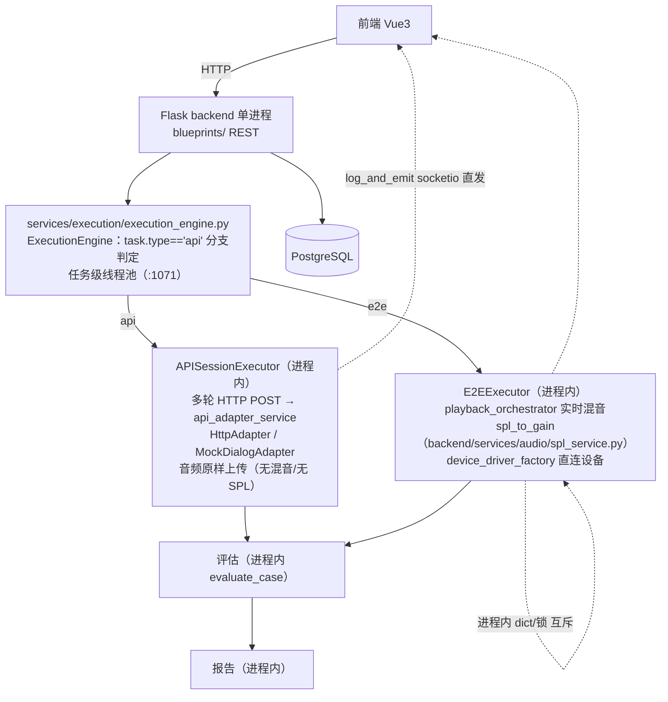
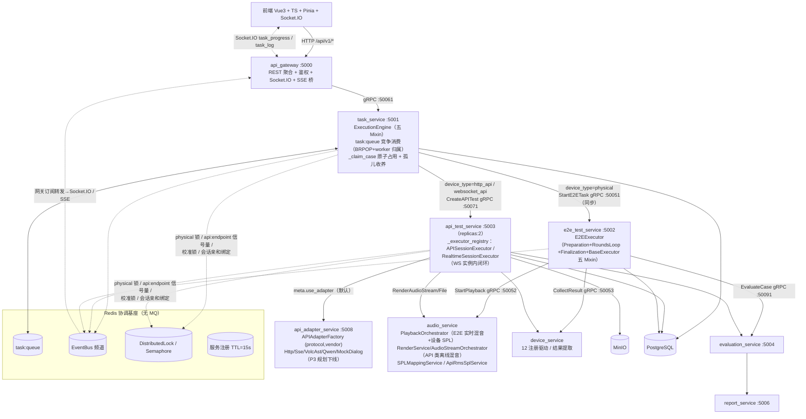

# INT-263 验收包 A. 测试执行（E2E/API/Realtime + 混音/SPL）

> 编制：方案一致性审计员，2026-10-13。方法：按设计文档（权威基线 doc/功能设计文档/）提取可验证契约，逐条到代码核验（网关路由→服务实现→数据模型三层），全部结论带 file:line 证据；7 个专项核验（E2E 链/API 链/Realtime 链/混音与 SPL/驱动与 Adapter/pytest 覆盖/前端素材）+ 平台证据（INT-32 台账、INT-95 主链卡）交叉汇成。
>
> 代码基线：origin/V9.7.31 @ `3c0cfc7c`（INT-252 批次，2026-10-13 推送）；本地另有 `861c7f46`（INT-246，in_progress 未推送）。文档基线：V9.7.31 树 doc/功能设计文档/。核验为只读静态审计 + 复用 INT-95 实机证据，未重跑实机链。

---

## 1. 改造前后流程图

### 1.1 V9.7.10（单体）流程

要点：调度/执行/混音/SPL/评估/报告全部同进程；WS 实时通道仅内存预留（无 Realtime 执行器）；互斥为进程内锁；进度经 socketio 直发。

### 1.2 V9.7.31（微服务）流程

依据 doc/功能设计文档/01_测试执行/03_流程图.md §1.1、02_架构设计.md §3.1–3.3，经代码核验修正：

### 1.3 差异说明（架构演进点逐条）

| # | V9.7.10 单体 | V9.7.31 微服务 | 依据 |
|---|---|---|---|
| 1 | `task.type=='api'` 进程内分支实例化执行器（execution_engine.py:1035） | 用例级 `TaskCase.device_type` 三值路由 + gRPC 跨服务分发（task_dispatch.py:107-119；task.type/testcase.test_type 列已删，迁移 202610/drop_task_type_and_testcase_test_type.py） | 02_架构 §1.1/§3.3 |
| 2 | Realtime WS 同进程、不可水平扩展 | api_test_service replicas:2 + WS 数据面直连被测 + 实例内闭环（realtime_ws_client.py:95-110） | 02_架构 §1.2/§5.2 |
| 3 | 进程内 dict/锁互斥 | Redis 分布式锁/信号量：physical `lock:task:physical:{device_id}`（task_dispatch.py:205-230）、api endpoint 信号量（api_concurrency_manager.py:10,44）、SPL 校准锁（api_rms_spl_config_service.py:207-216） | 02_架构 §5.3；08 §6.5 |
| 4 | 单进程调度循环 | task_service 统一 BRPOP task:queue 竞争消费 + worker_instance_id 归属 + 心跳过期孤儿收养（scheduler.py:104,264-296）；用例级走 gRPC 不经队列 | 02_架构 §5.4 |
| 5 | socketio 进程内直发（log_handler.py:71） | EventBus 五通道 → 网关 event_bus_forwarder（:25-48）→ Socket.IO；按 task_id 事件隔离（UC-1001） | 03_流程图 §3.4 |
| 6 | 混音/SPL 在执行进程内；**API 链无混音无 SPL**（api_session_executor.py:235-246 首音频原样上传） | 混音/SPL 下沉 audio_service：E2E 实时链不变（PlaybackOrchestrator→AudioDriver callback）；API 类三模式统一 RoundRenderService→RenderAudioStream/File gRPC→AudioStreamOrchestrator 六步混音（离线），含格式适配层 | 08 §一/§二/§三 |
| 7 | SPL 仅设备侧一套（spl_mappings） | 双套对称体系：E2E 物理映射（device_service）+ API 类数字 RMS 映射（api_rms_spl_mappings 新表，api_models.py:56-72），公式同基准（-30dBFS 补偿/±25dB 限幅） | 08 §六 |
| 8 | 校准靠本地 DB 串行 | 校准分布式锁（Redis，TTL+重试）；数字校准（已知 RMS→评估识别→回写） | 08 §6.5 |
| 9 | 无 Realtime 执行器（WS 适配器仅存在于注释） | RealtimeSessionExecutor + 会话亲和 + frame/summary 双通道（后端）+ mock 替身（:5098/:5097） | 07 §一/§四 |
| 10 | 魔法值硬编码 | 枚举/配置化（common_enums.py、service_ports.py、concurrency_config.json、config_manager 动态段） | 02_架构 §八 |
| 11 | — | 新增分布式协调流程图：SPL 校准、physical 互斥、孤儿收养、多任务事件隔离 | 03_流程图 §三 |

---

## 2. 能力验收手册（负责人可执行）

环境准备：`run_all.py` 起 11 服务 + 前端 5173（隔离验收可用 `--test-db`）；健康口径 = health_smoke 25/25（10 HTTP /health + 11 gRPC 含 50052 + 3 infra + 5173，INT-252 同口径）。前端 hash 路由，入口 `http://localhost:5173`。测试账号 `admin/admin123`（UI 登录冒烟同款）或 `dev_user/dev_password`（引导建号，角色 admin）。

### A. 登录与环境

| # | 页面路径 → 操作 | 期望结果 |
|---|---|---|
| A1 | 打开 5173 → 自动跳 `/#/login` | 登录页渲染（登录/注册双 Tab + OAuth 动态按钮） |
| A2 | 输入 admin/admin123 → 登录 | 跳转首页 `/#/`；网络面板可见先 `GET /auth/login/encryption-key` 取公钥，提交体含 `password_encrypted+encryption_key_id`（安全上下文 RSA-OAEP；非安全上下文自动降级 PKCS1v15） |
| A3 | 异常流：错误密码 / 无权限路由 | 错误提示不跳转；越权路由被 meta.permission 守卫重定向首页 |

### B. 主链七步（API 链——INT-95 第 10 轮任务 601 已实机一次连续跑通，以下为复核路径）

| # | 页面路径 → 操作 | 期望结果 |
|---|---|---|
| B1 | /#/AudioImport → 上传多轮素材 | 分片/直传双线均 2xx（先例：分片 2224、直传 2225，presign→PUT→complete-direct） |
| B2 | 上传后生成用例 | E2E/API 用例自动生成，rounds 逐轮注入完整（INT-89 回归点） |
| B3 | /#/tasks → 创建新任务 → 选类型 | ⚠️ 已知疑点：`/create-e2e-task`、`/create-api-task` 未注册路由（tasks.ts:222,224，静态证据），如 404 请改走 B3' 并记入问题清单 |
| B3' | /#/APITest 或 /#/E2ETest → TestFlow 五步向导（选择算法→用例→设备/被测API→执行→结果） | 步骤 2「开始任务」校验通过（API 需选用例+在线 API；E2E 需选 ≥1 设备）→ `POST /api/v1/tasks` 201 + `POST /tasks/{id}/start` |
| B4 | 执行页观察 | 进度条/计数/日志/预计完成时间实时刷新（Socket.IO task_progress） |
| B5 | 异常流：断 WS（DevTools offline） | 黄条降级提示「实时连接已断开，进度已切换为 HTTP 轮询刷新」→ 每 5s `GET /tasks/{id}/progress`；恢复后回 WS 并停轮询（INT-203 修复） |
| B6 | 任务完成后 | 评估自动触发（EvaluateCase），报告生成 socket `report_generated` 通知，跳 `/#/report/{id}` |
| B7 | /#/report/{id} → 查看 → 发布 | 逐轮指标在位（先例：pass_rate 100%、TRD 8 行全 completed）；发布走 `POST /reports/{id}/publish`（注意 TestFlow 步骤 4 的「保存/发布」仅本地状态，真正发布在报告页） |
| B8 | 任务标记 benchmark → 已发布/排行 | Benchmark 排行 ReadModel 出现该任务实测数据（先例：pt6，TURN_EVAL @0.85 / AVG_RESPONSE_LATENCY @850） |
| B9 | 异常流（已知缺陷 INT-262） | 报告按任务检索：`/reports/by_task` 未透出、列表 `?task_id=` 过滤无效——本条验收以列表+详情人工核对替代，待 INT-262 修复后复验 |

### C. E2E 物理链（受环境排除项约束，见 §5-#1）

| # | 页面路径 → 操作 | 期望结果 |
|---|---|---|
| C1 | /#/Device 测试设备页签 → 扫描设备/新增 | system 合法值 Android/HarmonyOS/iOS（别名 harmony 归一，INT-206）；驱动解析回显 `driver_found=true` + 驱动名 |
| C2 | 设备卡「测试」 | 200 + 真机响应；离线设备文案不误导（INT-164 口径） |
| C3 | /#/E2ETest 向导选 E2E 用例+播放设备 → 开始 | 驱动 initialize 真机下发（先例：Xiaoyilivechat 6.7s）；逐轮 环境检查→声纹→pre→play（audio_service 实时混音+SPL）→post→采集→OSS 落盘→逐轮出分（INT-95 第 8 轮 harmony.base.v1 链路） |
| C4 | ⚠️ 环境排除项 | 小艺 UI 文本抓取层（question/answer）在 hypium 6.1.0.210 基线 + 本机固件下不可用（成员 2026-10-13 裁定为环境排除项）；E2E 物理产品路径二选一裁决进行中（INT-95）——本条目按裁决口径执行后复验 |
| C5 | 异常流：驱动 initialize 失败 | 任务/用例终态 failed + 失败真因透传（INT-158/206：无录音链不得返固定串假成功；e2e `_close_failed_test_result` 收口） |

### D. API 链专项

| # | 页面路径 → 操作 | 期望结果 |
|---|---|---|
| D1 | /#/APITest 向导：多轮 API 用例 → 开始 | rounds>1 走 APISessionExecutor 多轮 session；完成回写用例状态 + 评估提交（INT-103 修复；评估失败不降级执行终态） |
| D2 | 上传生成的 `_api`/`_e2e` 变体用例建任务 | 按 device_type 路由正确（INT-129：后缀派生 → TaskCase.device_type） |
| D3 | 异常流：人为令某轮失败 | 任务级计数/状态原子聚合收敛（INT-161：refresh_task_counts_atomic），不悬挂不误标；评估挂起走 INT-120 退避+仲裁 |

### E. Realtime 链专项

| # | 页面路径 → 操作 | 期望结果 |
|---|---|---|
| E1 | 起 `mock_services/mock_realtime_api.py`（WS :5098，OpenAI 协议+`__mock_control` 热更新）→ websocket_api 用例执行 | WS 全双工；下行指令集 session.update/append/commit/response.create；事件归一化 12 种（含 input_committed） |
| E2 | frame/summary 观测 | 后端 SSE 事件流可观测（网关 `/api/v1/sse/events`，frame 逐帧 + summary 会话汇总）；⚠️ 前端暂无订阅消费（UC-1002 前端侧缺口，见 §5-#6）——本条以接口层证据验收 |
| E3 | 会话亲和 | 单机：Redis 键 `session:bind:{task_id}`（TTL 3600s）写入，重启/状态操作路由绑定实例；双实例（docker replicas:2）：派发侧 route_or_bind 选最闲实例直连，绑定实例失联按服务注册表心跳重路由 |
| E4 | 根据评估输出调整输入 | 当前无此能力（各轮输入来自 case_config.rounds 静态配置；最接近为 SessionContext 上轮输出进下轮上下文）——按 §5-#7 口径缺席验收 |
| E5 | 异常流：mock_eval_server_judge（:5097）替身 | dims 指向替身 → 评估可闭环，不出真 LLM 依赖（INT-137/182） |

### F. 混音与 SPL 专项

| # | 操作 | 期望结果 |
|---|---|---|
| F1 | E2E 交叠：两条含相同 speaker 标注音频 + overlap_time=2s → 执行 | audio_service 日志 `[calculate_speaker_aware_audio_delays] Has common speaker, sequential`（同 speaker 串行）；不同 speaker → `using overlap_time` 且物理播放可闻交叠；无标注回退 play_order 链式口径 |
| F2 | API 交叠：websocket_api 多 speaker 用例执行 | `[prepare]` 日志 total_frames 大于纯顺序时长（交叠生效）；三模式（非实时/Realtime）共用同一 orchestrator |
| F3 | SPL 校准+执行：API 管理绑定 rms_spl_mapping_id + audio_config → `POST /api/v1/digital-spl/{id}/calibrate` → 执行 | 校准点落库；结果含 `ai_output_rms_dbfs` / `ai_output_spl_db`（输出侧对称证据）；同用例去映射对比混音产物 RMS 差值≈公式预期（rms_compensate -30dBFS × spl_gain，±25dB 限幅） |
| F4 | 未配 SPL 行为 | 当前实现：round_render_service.py:117-122 回填 65dB——⚠️ 与文档 §6.4「原始传递 gain=1.0」存在口径张力（INT-61 裁定语义），验收按现状记录并见 §5-#9 拍板项 |
| F5 | 并发校准互斥 | 双开同 API 校准 → 后者 409（DistributedLock，锁粒度 API 级——文档为 api_id+mapping_id 级，见 §5-#9） |
| F6 | 【INT-300】前端双口径管理：`/#/SPLMapping` → 「API/Realtime RMS-SPL」页签 → 添加映射（选 API/协议/参考基准/限幅）→ 设默认 → 校准（点集 target_spl↔gain_linear↔rms_dbfs，提交即全量替换并置已校准）→ 表格徽章转「已校准」+ 星标「默认」→ 编辑/删除/详情 | 映射表格展示（关联 API/协议/参考基准/校准点数/限幅/状态徽章/默认星标）；校准点明细区按 SPL 升序含 dB 换算；设默认调 `POST /digital-spl/by-api/{api_id}/set-default` 后 API 列表 `rmsSplMappingId` 生效；校准调 `POST /digital-spl/{id}/calibrate`（409 冲突提示） |

### G. 用例管理（测试执行输入面）

| # | 页面路径 → 操作 | 期望结果 |
|---|---|---|
| G1 | /#/TestCaseManager → 分组/标签视图切换 | 分组视图含「未分组」虚拟分组，无分组用例可见（INT-249 修复：`__ungrouped__` 前端过滤） |
| G2 | FavoriteTrashBar：仅看收藏 / 回收站 / 全部恢复 | 收藏与回收站互斥；恢复/彻底删除生效（INT-141/215 口径） |
| G3 | 编辑多轮用例保存 | 第 2+ 轮算法参数不丢（INT-194）、分组修改生效（INT-195）、testType 不被恒回填 e2e（INT-196）；⚠️ INT-259 模态窗专项在途 |

### H. 设备管理（驱动面）

| # | 页面路径 → 操作 | 期望结果 |
|---|---|---|
| H1 | /#/Device 三页签（测试设备/播放设备/API） | 三页签齐备（enums.ts:189）；播放设备可关联 SPL 映射；API 页签可配 audio_config / rms_spl_mapping_id |
| H2 | 扫描/解析驱动 | system 别名归一 → 驱动关键词解析命中（12 注册驱动，见 §4.5） |

---

## 3. 自动化证据

### 3.1 pytest 覆盖清单（静态统计 `def test_`，2026-10-13）

| 域 | 文件数 | 用例数 |
|---|---|---|
| tests/unit | 192 | 2639 |
| tests/integration | 18 | 123 |
| tests/api（实机链，默认 skip，`RUN_LIVE_STACK=1` + 隔离库门禁） | 11 | 103 |
| tests 根散件 | 1 | 2 |
| api_adapter_service/tests | 2 | 57 |
| e2e_tests/selenium（UI，未入 pytest 口径） | 1 | 5 |
| **后端合计** | **225** | **2929** |
| frontend vitest spec | 46 | 328（动态运行 326/326，INT-252） |

- 静态总数 2929 与最近动态回归 2917 passed + 103 skipped（INT-252）吻合（差 +26 属未提交改动与 parametrize 展开口径）；tests/api 不计入回归（实机门禁：隔离库 `intelligent_audio_test_test` + V9.7.31 版本标记校验）。
- 门禁：无 pytest.ini，靠 conftest——会话守卫（DATABASE_URL 指向共享业务库即拒绝启动，INT-246）、xdist `-n 8 --dist loadgroup`（INT-96/163）、integration 域日志根按用例隔离（INT-234/238）。
- 重点文件：E2E `test_e2e_full_chain`(1)、`test_int158_e2e_failed_round_result_closure`(4)、`test_int89_e2e_rounds_device_backfill`(8)；API `tests/api` 11 文件 103 例（test_core_api 26、test_crud_comprehensive 27、test_realtime_communication 12）；Realtime `test_int61_realtime_session_registry`(21)、`test_int61_affinity_wiring`(27)、`test_int61_realtime_executor_routing`(15)；混音 `test_int67_render_pipeline`(26)、`test_int82_executor_render_wiring`(22)、`test_int98_linear_render_wiring`(7)；SPL `test_int68_api_rms_spl_foundation`(56)、`test_int68_api_rms_spl_persistence_db`(24)、`test_int61/67_api_rms_spl_service`(18+18)；驱动 `test_int86_device_scan_driver_resolution`(11)、`test_int172_driver_scan_base_driver`(5)、`test_int80_physical_lock`(7)；mock `test_int137_mock_services`(14)、`test_int182_mock_eval_server_judge`(19)；收敛 `test_int174_reeval_failed_dims_and_finalize`(50)、`test_int103_multi_round_case_finalization`(9)、`test_task_state_machine`(29)。

### 3.2 审计/测试卡引用（INT 卡号）

- **一致性审计**（方案一致性审计员抽查，均 done）：INT-178（MOCK1 契约）、INT-191（INT-158 E2E 驱动桩）、INT-221（INT-161 收敛链）、INT-223（INT-174 终态收敛）、INT-243（网关 422）、INT-182 关联（eval_server 替身收编）等 21 张（全清单：INT-178/183/187/191/205/207/214/221/223/225/227/230/231/235/237/240/243/244/247/248/251）。
- **UX 审计**：INT-212（三视图，done）→ INT-215（缺陷包，done）、INT-253（布局补审，done）、INT-261（全站全量审计，**in_progress**）。
- **UI 自动化**：INT-260（selenium 模态窗/表单/导航接门禁，**in_progress**）；现状仅 `e2e_tests/selenium/test_evaluation_crud.py` 5 例、直击 5173/5000、未入门禁；tmp_hypium 仅 UI 树残留。
- **测试基建**：INT-96/163（xdist 并行+隔离）、INT-137/182（mock 替身）、INT-234/238（日志根隔离）、INT-246（库隔离，in_progress）。

### 3.3 集成批次推送记录（台账 INT-32）

| 批次 | 范围 | 规模 | 回归结论 |
|---|---|---|---|
| INT-52/60/93/97/109/131/136 | 早期批次 | 62/2/31/重推/25/29/13 commit | 建立基线 |
| INT-144 | 7a164228..cb71ed7a | 2 | 2248 过/1F/0E |
| INT-168 | 87d25c09..455a1cbc | 26/17 卡 | 2481 过/1F/0E；冒烟 25/25 |
| INT-224/226 | ..0422af95..f447651b | 60/10 commit | 2888 过/1F；冒烟 12/12+API 7/7 |
| INT-232/236 | ..8f7bdbfd..9ab02955 | 4/5 commit | **2903 过/103 skip/0F**；冒烟 25/25+API 6/6+UI 2/2 |
| INT-242/252 | ..f0a4c599..3c0cfc7c | 1/3 commit | **2917 过/103 skip/1 flake（复跑 9/9 绿）**；vitest 326/326；冒烟 25/25+API 9/9+UI 3/3（RSA 登录→建任务→发布列表；selenium UI 登录 3/3） |

未推送：`861c7f46`（INT-246，in_progress，随下批）。

---

## 4. 特性专项

### 4.1 E2E / API / Realtime 三条执行链

**E2E 链（physical）**——12 项契约全部 ✅（摘要）：

| 文档条款 | 代码位置 | 结论 |
|---|---|---|
| device_type 决定路由（UseCase 0.1/0.8） | task_service/.../task_dispatch.py:107-119（tc_rel.device_type，NULL 回填 PHYSICAL） | ✅ |
| 用例原子占用 PENDING→QUEUED | task_dispatch.py:274 `_claim_case` | ✅ |
| StartE2ETask 同步 gRPC | grpc_helpers.py:102-134（超时受控）→ e2e servicers.py:37-55 | ✅ |
| 执行器 Mixin 组合 | e2e_executor/executor.py:19；base_executor/_base.py:35 五 Mixin | ✅ |
| 轮次流程 环境→声纹→pre→play→post→采集 | rounds_loop_mixin.py:101-234；playback_acl_repository_impl.py:42-77；e2e_collector.py:20-83 | ✅ |
| 评估跨服务 EvaluateCase | _results_mixin.py:19-87 → evaluation_servicer.py:16 | ✅ |
| 物理互斥 DistributedLock | task_dispatch.py:205-230（lock:task:physical:{device_id}） | ✅ |
| 进度 EventBus 五通道→Socket.IO | redis_pubsub.py:21-59 → event_bus_forwarder.py:25-48 | ✅ |

历史修复落地全部确认：INT-129（testcase_helpers.py:182-204 后缀派生）、INT-158（harmony_driver.py:354-406 等，无录音链不再返固定串）、INT-169（dimension_result_recorder.py:33-71 幂等复用）、INT-161（refresh_task_counts_atomic + _fail_tc_rel 补写终态）。**无代码违背文档；发现 4 项文档滞后**（见 §5-#10 回写清单 E2E-1~4）。

**API 链（http_api）**——12 项契约 ✅：`/api/v1/tasks/{id}/start`（task_bp.py:59）→ StartAPITest gRPC（proto:66-70 含 device_type/device_id/case_ids）→ `_executor_registry`（api_executor.py:54-61）→ APISessionExecutor 多轮 `_run_rounds`（api_session_executor.py:168-215）→ 完成回写+评估提交（api_result_processor.py:249-317）→ 任务级收敛（task_dispatch.py:33-49 + INT-120 退避仲裁 evaluation_arbiter.py:115-137）。历史修复落地：INT-41（case_ids 统一 int，proto repeated int32）、INT-103（回写+退避）、INT-106（OSS URI/chunk 上传/DUT 路径三断点）、INT-129。**8 项偏差见 §5-#10（API-1~8）**。

**Realtime 链（websocket_api）**：

| 维度 | 现状 | 结论 |
|---|---|---|
| WS 数据面直连被测、实例内闭环 | realtime_ws_client.py:95-110 | ✅ |
| 下行指令集 4 种 | realtime_ws_client.py:126-159 | ✅ |
| 事件归一化 | common_enums.py:152-169（12 种，文档 11 种） | ✅（多 1 种，文档滞后） |
| frame/summary 双通道 | 后端 realtime_stream_publisher.py:31-56 + 网关 SSE 桥（sse_bp.py:72） | ⚠️ 传输为 SSE 非文档 Socket.IO 房间；**前端零消费**（全目录 grep 无 realtime_frame/realtime_summary） |
| 会话亲和 | realtime_session_registry.py:99-208 + task_dispatch.py:140-166 + peer_rpc.py:57-95：派发绑定（session:bind:{task_id} TTL3600）→ 执行门禁+peer 转发 → 失联重路由 | ✅ 应用层三层实现 |
| RenderAudioStream 100ms chunk | servicers.py:654-670 + round_render_service.py:41-49 | ⚠️ 实现为 RenderAudioChunk{sequence,data,is_last}+render_config，文档字段形态滞后 |
| EvaluateCase 多模态扩展（device_type/first_frame_ms/event_log/frame_results） | proto:29-35 已预留；客户端不填（_grpc_task_data.py:15-41）、服务端不读（evaluation_servicer.py:19-23） | ⚠️ 仅 proto 预留，链路未接线 |
| 大字段 frame_results/raw_event_log 落对象存储 | 执行器仅落 frame_count（realtime_session_executor.py:182） | ❌ 未实现 |
| mock 替身 | mock_realtime_api（:5098）+ mock_eval_server_judge（:5097） | ✅ |
| Realtime 评估标识 | test_type='api'、不带 device_type（:475-483） | ⚠️ 评估侧无法区分 Realtime 通道 |

### 4.2 混音：speakers_map 交叠并行 / 输入时序自适应

- **speakers_map 交叠并行：已实现，三链同源。** 结构 `{audio_id: set(speaker)}`；规则：相邻音频 speakers 有交集→顺序（start=prev_end_time），无交集→overlap_time（优先）/overlap_rate 交叠，负值钳 0（audio_service/infrastructure/audio/audio_timeline.py:207-226）。E2E 从标注构建（playback_orchestrator.py:157-162）；API 链经 ACL GetAudioSpeakers → render_config.speakers_map 透传 → 同一 orchestrator 消费（round_render_service.py:127-163 → audio_stream_orchestrator.py:269-291）。仅 speaker 源参与判定，interferer 按 delay、噪声不参与；无标注回退 play_order。混音六步（噪声合并 case>round → 格式适配 → RMS/SPL → 时间轴 → 混音 → 切片）三模式共用同一 prepare，仅消费方式不同（整文件/chunk）。
- **输入时序自适应（按输出调整输入时序）：未实现，且设计文档亦未定义该能力。** 全文档库检索「自适应/按输出调整/背压调节输入」仅命中设备驱动采样率解析；Realtime 推送为固定节奏 `time.sleep(chunk_ms/1000)`（realtime_session_executor.py:267,327），无依据 AI 输出/接收情况动态调速逻辑；仅 gRPC server-streaming 消费端拉取提供天然背压。→ **验收按「能力缺席」记录，是否补齐属口径拍板项（§5-#8）。**

### 4.3 Realtime：frame/summary 双通道、会话亲和、评估驱动输入

- frame/summary 双通道：后端已实现——frame 逐帧 `_on_frame`→`publish_frame`（realtime_session_executor.py:371-380），summary 会话汇总落库后推送（:201-213）；网关收敛为 SSE-only 事件（event_bus_forwarder.py:34）。**前端无订阅消费**（UC-1002 前端侧未做）；frame 记录 schema 实际 {ts,type,payload} 与文档 {seq,direction,offset_ms,event_type,ts} 不一致；`_on_frame` round_number 硬编码 0（:377）。
- 会话亲和：**已实现**（见 4.1 表），单测 test_int61_affinity_wiring 27 例。
- 根据评估输出调整输入：**无实现**——各轮输入完全来自 case_config.rounds 静态配置，评估异步提交不回流（:458-486）；设计文档亦无该条款；仅 proto 预留字段未接线。最接近的既有能力是 APISessionExecutor 的 SessionContext（上一轮对话输出进下一轮上下文，非评估输出）。

### 4.4 SPL 对称映射：E2E/API/Realtime 三口径

- **设计即「对称双体系」**（08 §6.1）：E2E 物理映射（用户声压=物理音箱 1m 处声压，映射挂 PlaybackDevice，数据在 device_service spl_mappings）vs API 类数字 RMS 映射（用户声压=数字音频 RMS 对应声压，映射挂 API，数据在 api_rms_spl_mappings，audio_service 经 ACL 只读+TTL 缓存/执行端预载透传）。
- **对称性证据**：API 三模式中非实时（api_executor.py:316）、Realtime（realtime_session_executor.py:257/315）全部收敛同一代码路径 RoundRenderService 预载映射 → audio_stream_orchestrator.py:167-168 → ApiRmsSplService.compute_source_gain = rms_compensate(-30dBFS)×spl_gain（api_rms_spl_service.py:140-148），与 E2E 增益链同基准（E2E：playback_config_builder.py:109-117 → spl_service.py:34-113）。输出侧实测对称：calculate_rms_dbfs+rms_dbfs_to_spl（api_test_service/domain/services/api_rms_spl_service.py:76-97），结果落库 ai_output_rms_dbfs/ai_output_spl_db（realtime_session_executor.py:395-423）。
- ⚠️ **HTTP 流式（SSE chunk 推送）执行器未验到实现**：api_executor.py:55-56 仅路由 http_api→APISessionExecutor（整文件）/websocket_api→RealtimeSessionExecutor；route_render_mode 支持 'stream' 但未找到 SSE 消费执行器调用——疑点待专项核验（§5-#11）。
- ⚠️ 口径张力与演进（§5-#9/回写清单）：未配 SPL 回填 65dB vs 文档「原始传递」；DDL 字段演进（reference_spl/reference_gain_linear vs 文档 target_spl/digital_gain）；校准锁 API 级 vs 文档 api_id+mapping_id 级；ApiRmsSplService 双份实现（audio_service 与 api_test_service 各一份，公式一致，双份维护风险）；RenderService proto 演进为 task_id+render_config(JSON 聚合)。
- 验证步骤：见手册 F1–F5。
- 【INT-300 补充】前端管理面已补齐：`/#/SPLMapping` 双口径页签——「设备 SPL（E2E）」原物理域分区 + 「API/Realtime RMS-SPL」数字域分区（映射表格/状态徽章/设默认/校准点明细，经 `/digital-spl` CRUD+calibrate+set-default）。三口径对称验证步骤（负责人实机）：
  1. **E2E 口径**：设备管理 → 播放设备关联 SPL 映射（F1 同源）→ 执行 E2E 用例（音频配 SPL=65）→ 结果音频可闻、增益链按 device_service spl_mappings；
  2. **API/Realtime 口径**：`/#/SPLMapping` → 「API/Realtime RMS-SPL」页签 → 选目标 API 添加映射（参考基准 65dB/1.0）→「设默认」（apis.rms_spl_mapping_id 指针生效）→「校准」提交点集（65↔1.0 为中心）→ 状态徽章转「已校准」→ 执行 http_api / websocket_api 用例（音频配 SPL）→ 结果含 `ai_output_rms_dbfs`/`ai_output_spl_db`（F3 同源）；
  3. **对称性核对**：同一音频同一 SPL 目标，分别在 E2E（物理）与 API（数字）两口径执行，混音产物 RMS 差值 ≈ rms_compensate(-30dBFS) × spl_gain 预期（±25dB 限幅）；数字域未校准映射按参考线性近似 gain = reference_gain × 10^((target-65)/20)。

### 4.5 驱动完成度（device_service/infrastructure/drivers/）

注册驱动 **12 个**（`@register_driver`）+ 支撑件 3（BaseDeviceDriver 抽象基类、HarmonyXiaoyiTranslationDriver 中间基类、AppDriver 契约）= **15 个驱动族，与卡面「15 个驱动」口径吻合**：

| 驱动 | 类 | app_type | 迁移状态(31←10) | 真机验证状态 |
|---|---|---|---|---|
| Android 基础 | AndroidDriver | android_base/ADB | 已迁移（10: android_driver.py:9） | 仅实现，无专测 |
| 豆包安卓 ASR | DouBaoAndroidAsrDriver | doubao_asr/ADB | 已迁移 | 仅实现，无测试 |
| Plaud 录音 | PlaudDriver | plaud/ADB | 已迁移 | 仅实现，无测试 |
| 鸿蒙基础 | HarmonyDriver | harmony_base/HDC | 已迁移 | INT-95 链路使用（base 形态 OSS 落盘走通；uitest 层见缺口#1） |
| 面对面翻译 | XiaoyiFace2FaceDriver | xiaoyi_face2face | 已迁移 | 仅实现，无测试 |
| 同声传译 | XiaoyiSimultaneousInterpretationDriver | xiaoyi_simultaneous | 已迁移 | 仅实现，无测试 |
| 小艺慧记 | HarmonyHardenXiaoyiHuiJiDriver | xiaoyi_huiji | 已迁移（单文件→mixins 包重构）；display_name 改「鸿蒙小艺慧记 v1」 | 仅实现，无测试 |
| 小艺通话 v1 | Xiaoyilivechat | xiaoyi_livechat | 已迁移 | **真机验证**（实测注释 :107/:1351；INT-95 第 10 轮 initialize 6.7s 真机下发成功） |
| 小艺通话 v2 | XiaoyilivechatV2 | xiaoyi_livechat V2 | **微服务新增**（10 无此文件） | 仅实现，无测试/无实测注释 |
| ChatGPT 语音 | ChatGptVoiceChat | chatgpt | 已迁移 | **真机验证**（2026-08-13 实测设备 5SM0125613000197，:55/:174） |
| 豆包语音 | DoubaoChat | doubao | 已迁移 | **真机实测**（坐标注入，:50） |
| 小艺输入法 | HarmonyHardenXiaoyi_Input_MethodDriver | xiaoyi_input_method | 已迁移 | 仅实现，无测试 |

- V9.7.10 有而未迁移：**无**（12/12 全迁移，另新增 V2）。注册表 registry.py + driver_factory.py 两侧均有。
- 缺口：注册表机制本身无单测；文档 resolve「四步含 fallback_version」实际为三步（精确→降级 V1→任意可用）；文档路径仍写 backend/utils/device_driver/（旧单体）；仅 3/12 驱动有真机验证证据，其余 9 个仅实现（标注如实，未脑补）。

### 4.6 Adapter 体系与执行器注册表

- **执行器注册表**：task_service ExecutionEngine 单例微服务化后不持有本地执行器（execution_engine/__init__.py:61-104），按用例级 device_type gRPC 分发；api_test_service `_executor_registry` dict（api_executor.py:54-61：http_api→APISessionExecutor、websocket_api→RealtimeSessionExecutor，未知类型回退 APISessionExecutor）；e2e_test_service E2EExecutor（executor.py:19，经 ACL 调 device_service 驱动）。
- **Adapter 体系：两层并存（过渡态）**——
  1. api_test_service 本地 VendorAdapterRegistry（INT-62，infrastructure/adapters/registry.py:31，key=VendorAdapterType 仅 API_DRIVER/MOCK，common_enums.py:132-139）：ApiDriverAdapter（自 V9.7.10 clients/api_driver.py 迁移）+ MockVendorAdapter；api_session_executor.py:376 消费。
  2. api_adapter_service :5008（文档已列 P3 下线，**未执行**）：APIAdapterFactory（factory.py:28，key=(protocol,vendor)+adapter_class 显式通道）注册 5 个：HttpAdapter/SseAdapter/VolcAstAdapter/QwenAdapter/MockDialogAdapter；api_test_service 经 adapter_acl_repository.py:39 调用（meta.use_adapter 默认 True 走远程）。
- 单测：test_int62_adapter_registry(23)、test_int72_adapter_class_channel(8)、test_int72_uc1003_ocp_drill、api_adapter_service/tests/test_api_adapter(47)。
- **文档偏差**：04_类设计 §3.2.4-3.2.5/05_路由与废弃声明的 BaseAPIAdapter→HttpAPIAdapter/HttpStreamAdapter/RealtimeAPIAdapter/OpenAIRealtimeAdapter 落位 api_test_service **未落地**（P1 目标态，类名与实际不一致）；(http,volc_ast)/(http,qwen_llm) 实为 websocket 协议；多厂商方案厂商清单（火山/百炼/腾讯/百度/OpenAI/Google/Azure/AWS）实际仅实现 volc_ast/qwen/http/sse/mock 五个。02_架构 §3.6「待建 P1」注记与 03_流程图 §1.1 画 api_adapter_service 承载 AdapterFactory——两图口径不一，实际为上述两层并存。

---

## 5. 已知缺口与风险（诚实清单）

| # | 缺口/风险 | 等级 | 依据 | 状态 |
|---|---|---|---|---|
| 1 | **E2E 物理链实机「最后一公里」**：手机端 uitest 守护固件级不可用（start-daemon ~3s 自尽、不绑定 TCP/unix 端点，已穷尽实测）；hypium 6.1.0.210 基线下小艺 UI 文本抓取层不可用（成员已裁定为环境排除项）；该裁定与 INT-158 修复后的 initialize 硬门槛组合出「E2E 物理无产品路径」矛盾（第 8 轮走通是当时 servicer 忽略 initialize 失败带病跑）——**待成员/总控二选一裁决** | 高 | INT-95 第 10 轮（07:08Z） | blocked |
| 2 | 新缺陷 INT-262：网关报告查询缺按任务检索（/reports/by_task 未透出、task_id 过滤无效） | medium | INT-95 第 10 轮实测踩中 | 已派开发工程师C |
| 3 | 主链实机验收：API 链七步已一次连续跑通（任务 601，七步全 ✅）；E2E 物理链待缺口#1 裁决后按裁定口径复验 | 高 | INT-95 | 部分达成 |
| 4 | 驱动真机验证覆盖：12 注册驱动中仅 3 个有真机验证证据（小艺通话 v1、ChatGPT 语音、豆包语音），鸿蒙基础链路可用（base 形态），其余 9 个仅实现无测试/无实测注释；注册表机制无单测 | 中 | 本审计 §4.5 | 如实入档 |
| 5 | UI 自动化薄弱：仅 1 个 selenium 文件 5 例（未入门禁）；tmp_hypium 仅残留 | 中 | INT-260 in_progress | 补齐中 |
| 6 | UC-1002 前端半成品：frame/summary 双通道后端已实现（SSE），前端零订阅消费；大字段落对象存储未实现；proto 多模态字段预留未接线；Realtime 评估不带 device_type 无法区分通道 | 中 | 本审计 §4.1/4.3 | 缺席验收或补齐 |
| 7 | 「输入时序自适应 / 根据评估输出调整输入」能力：未实现且设计文档未定义（静态 rounds 驱动、固定节奏推送、评估不回流）——是否补齐需拍板 | 中 | 本审计 §4.2/4.3 | 拍板项 |
| 8 | SPL 口径三项张力：未配 SPL 回填 65dB vs 文档「原始传递」（INT-61 裁定语义 vs 文档 §6.4）；校准锁 API 级 vs 文档 mapping 级；ApiRmsSplService 双份实现（公式一致、双份维护风险） | 中 | 本审计 §4.4 | 文档回写/拍板 |
| 9 | **文档回写清单（代码正确、文档滞后，按先例在 V9.7.10 仓库 doc/ 修订并注明「实现演进裁定」）**：①E2E/API 文档称用例经 task:queue 由各服务 worker 领取——实际 task_service 统一消费队列+同步 gRPC 分发（端到端测试功能设计文档 2.3/4.1、API测试功能设计文档 2.3/2.5，且与 execution_engine_documentation 8.1 自相矛盾）【中】②02_架构 §3.3「现状仍按 task.type 判定 P0 改造」注记过时（已按 device_type 判定）③02_架构 §3.6/04_类设计/05_路由与废弃 P1 目标态（BaseAPIAdapter 体系）未落地、类名不一致、(http,volc_ast) 协议标注错误④03_流程图 `/api/tasks` 前缀笔误（实为 /api/v1）⑤文档「(新增)」proto 注记均已落地⑥API 文档评估触发方式（实际执行器 gRPC EvaluateCase，非事件订阅）⑦frame/summary 传输通道（SSE 桥 vs Socket.IO 房间）+ RealtimeFrameType 12 种 vs 文档 11 种⑧result_type 'realtime' 未实现（有意沿用 'api'）⑨RenderService proto 字段演进（task_id+render_config 聚合）⑩api_rms_spl_mappings DDL 演进⑪07 文档数据面落位列（实际在 api_test_service/infrastructure/vendor_ws/）⑫Realtime 超时配置键名（config_manager realtime_session 段）⑬设备 resolve 三步 vs 文档四步 fallback_version⑭设备文档旧单体路径残留⑮api_driver_documentation「仍引用 APIDriver」过时 | 低-中（文档） | 本审计 §4 各表 | 待回写（可安排一次回写专项 run） |
| 10 | HTTP 流式（SSE chunk）消费执行器未验到实现（route_render_mode 支持 'stream' 但无消费链）——疑点待专项核验或实机确认 | 中 | 本审计 §4.4 | 待验 |
| 11 | 前端疑点（静态证据，待实机确认）：任务页「创建新任务」跳转 `/create-e2e-task`、`/create-api-task` 未注册路由（tasks.ts:222,224，router 无定义）→ 疑 404；如属实建议开缺陷卡 | 中 | 本审计 + 前端素材核验 | 待实机确认 |
| 12 | Docker 验收链路：本机无 Docker 环境，INT-181/241 已 cancelled——容器化 replicas:2 形态未实测（会话亲和/多实例语义仅单机验证） | 中 | INT-241 | 遗留 |
| 13 | 测试/业务库隔离 INT-246 in_progress（`861c7f46` 未推送）；隔离库 schema 漂移已按规范整库重建（INT-252） | 中 | INT-246/252 | in_progress |
| 14 | 模态窗专项 INT-259（用例编辑/算法参数/收藏走查修复，负责人实机报障）todo；全站 UX 审计 INT-261 in_progress 可能新增问题 | 中 | INT-259/261 | 在途 |
| 15 | 子服务（eval_server/asr_server/audio_intelligence/_gemini_eval）按成员裁定不移植、由负责人整体复制；「真正取消」等项待 eval_server 就绪后复验 | 中 | INT-171/174 | 负责人侧 |

---

## 6. 验收判定

- **卡面签收标准：手册全过 + 无未处置 P1 缺陷 → 本卡 done。**
- 材料齐备度：自动化证据齐（§3）；API 链实机七步已通过（INT-95 第 10 轮任务 601，证据链完整）；E2E 物理链受缺口#1 环境限制，待裁决后按裁定口径复验；未处置 P1 = 无在档（INT-262 为 medium）。
- 审计员判定建议：**有条件通过**——①按 §2 手册实机走查（B/D/E/F/G/H 可全过预期，C 条目待裁决口径）；②缺口#1 二选一裁决后 E2E 段收口；③INT-262 修复收口后复验 B9；④§5-#10 文档回写清单安排一次回写专项（不阻塞本卡 done，但应在验收签收前明确处置责任）。
