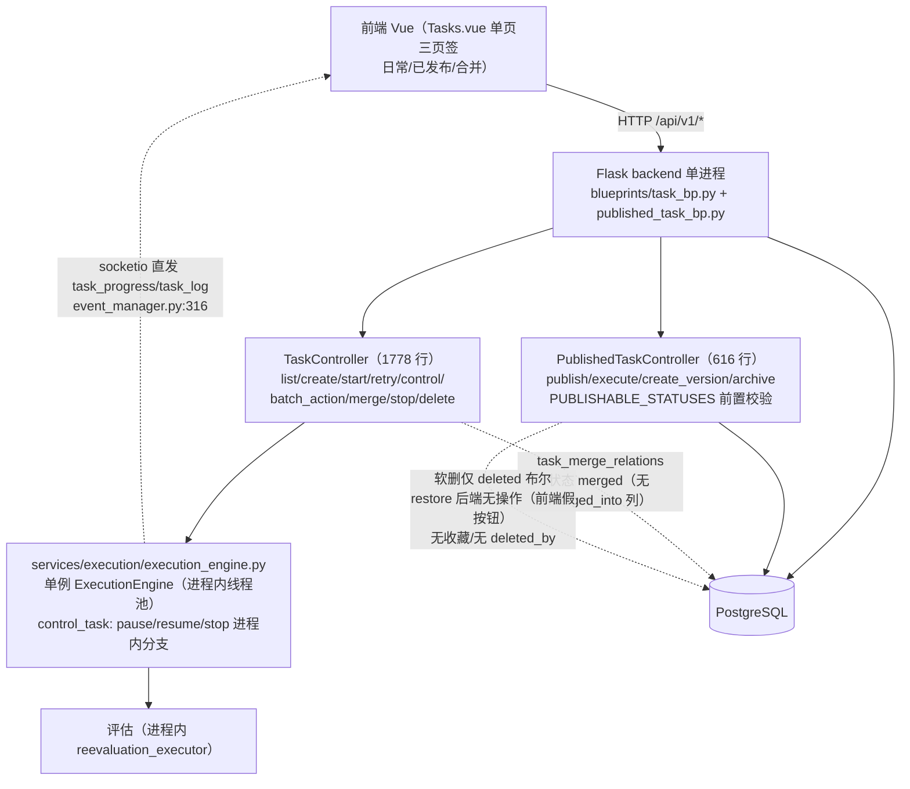
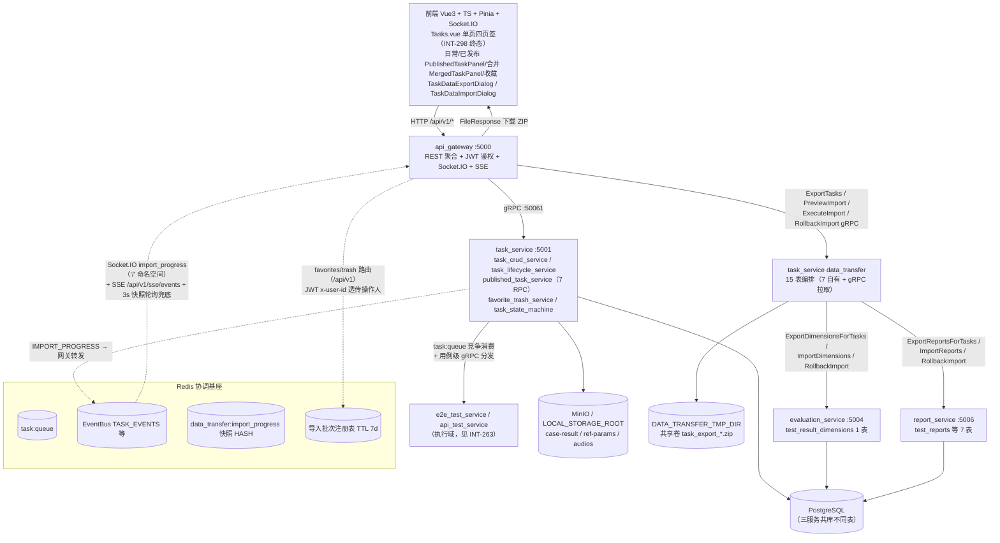
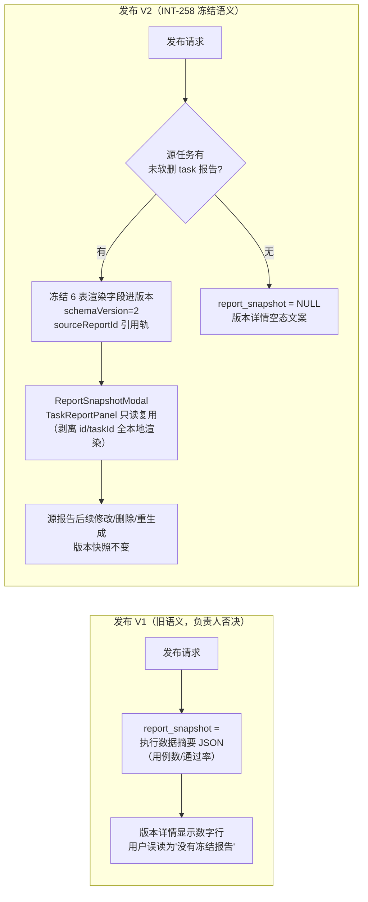

# INT-265 验收包 B. 任务管理

> 编制：方案一致性审计员，2026-10-13。方法：按设计文档（权威基线 doc/功能设计文档/02_任务管理/ 五份 + 00_新功能总览 §6.2）提取可验证契约，逐条到代码核验（网关路由 → 服务实现 → 数据模型三层，前端第四层），全部结论带 file:line 证据；4 个特性专项（发布/版本快照含 INT-258 冻结报告新语义、合并、导入导出 15 表、回收站/收藏/操作人）逐条给结论，平台证据（INT-25/26/34/65/141/148/200/201/202/208/212/215/216/239/237/244/258/259/262 等）交叉汇成。
>
> 代码基线：本地 HEAD `7bb84a45`（INT-262，未推送；origin/V9.7.31 @ `3c0cfc7c`，另有 `861c7f46` INT-246 / `dd8a4246` INT-258 / `2cf83a56` INT-259 共 4 个未推送提交）。文档基线：V9.7.31 树 doc/功能设计文档/；冻结报告语义以 V9.7.10 doc 仓工作区 INT-258 回写稿（未提交，不碰）+ INT-258 commit message 为准。核验为只读静态审计，未重跑实机链。
>
> **2026-10-14 终态复核增补**（基线推进至本地 HEAD `c59c1dfc`，13 commit 在 `7960e2a9` 交付之后落库）：① INT-298 三页签回迁落地（`c59c1dfc`）——§5-#12 承诺的本包更新已执行（§1.2 图、差异 #11、手册 A/B/C/D/E 页面路径、§6 判定均已按终态改写）；② INT-208 口径已拍板（成员裁定 A：跳转新日常任务详情页）并在交付基线内实现（`c3660722`，路由 `/tasks/:id` taskDetail + PublishedTaskPanel.vue:418-420）——§5-#3 拍板项关闭，手册 E7 期望更新；③ INT-257/299/258/310 均已 done。未逐条复验终态后端行为，仅核验前端接线与相关 commit 内容。

---

## 1. 改造前后流程图

### 1.1 V9.7.10（单体）流程

要点：任务 CRUD/执行/合并/发布同进程；发布功能 V9.7.10 已完整存在（模型 published_task_models 425-456、published_task_bp 7 路由、前端三页签 + ReportSnapshotModal），V9.7.31 是架构平移+增强而非从零新建；合并为「新任务 + task_merge_relations 映射」，test_results 不动；导入导出仅 batch_action 内的元数据级导出（JSON/Excel/PDF），**无 15 表迁移、无导入**；回收站/收藏/操作人/审计事件/benchmark 均无。

### 1.2 V9.7.31（微服务）流程

### 1.3 差异说明（架构演进点逐条）

| # | V9.7.10 单体 | V9.7.31 微服务 | 依据 |
|---|---|---|---|
| 1 | TaskController 进程内方法调用 | api_gateway REST + gRPC 七层转发（task_bp.py 全 18 路由，published_task_bp 7 路由，data_transfer_bp 4 路由，favorite_trash_bp 收藏/回收站/彻底删除） | 路由清单见 §4.1/4.2 |
| 2 | 合并/发布/回收站全部单事务同库 | 导入导出**跨三服务分段提交 + 逆序补偿回滚**（task 段→evaluation 段→report 段→文件段，任一失败按已提交段逆序 Rollback RPC；架构红线禁止 task_service 直写他服务表） | INT-25 规格；data_transfer_import_service.py:4-12,281-314 |
| 3 | 导出仅元数据（JSON/Excel/PDF in batch_action），无导入 | **15 表 + 磁盘文件 ZIP 全量迁移**（新增能力）：manifest.json + db/15 表 JSON + files/（case_results/ref_params/audios）+ meta/dimensions.json；ID 自动判断（无冲突保原 ID、冲突自增重映射 + 15 条 FK 转换规则配置化） | shared/constants/data_transfer.py:28-44,127-133；id_remapper.py |
| 4 | socketio 直发 | EventBus Redis PubSub → 网关转发 Socket.IO `import_progress` + SSE；另 Redis HASH 快照兜底（GET /import/progress 快照 + 前端 3s 轮询仅 socket 未推时生效） | import_progress_reporter.py:58-99；transferChannel.ts:12-21 |
| 5 | 软删仅 deleted 布尔、restore 后端无实现（前端假按钮）、无收藏 | **回收站三件套**：deleted+deleted_at+deleted_by_user_id、恢复（单个/批量/legacy batch-action 三通道）、purge 物理删除（admin/owner 校验 + 60 天 sweeper）、favorites 表 per-user（task/testcase 在 task_service，report 在 report_service report_favorites） | task_models.py:51-53；trash_repository.py:47-102；favorite_models.py:22-34 |
| 6 | created_by 列存在但控制器不填；无 updated_by/deleted_by | **CUD 操作人全链**：网关 JWT request.state.user_id → gRPC metadata x-user-id 透传，不信任客户端自报（0/None 保持 NULL）；created_by_user_id/updated_by_user_id/deleted_by_user_id 全覆盖单个+批量+恢复 | _task_crud_mixin.py:90-117,530；trash_repository.py:54-59 |
| 7 | 无审计事件、published_by 自由文本 | 审计事件四类落 logs 表（PUBLISHED_TASK_CREATED/VERSION_CREATED/EXECUTED/ARCHIVED + BENCHMARK_MARKED），published_by/archived_by 从 JWT 解析 | common_enums.py:243,277-280；published_task_service.py:140-156 |
| 8 | 无 benchmark 标记 | published_tasks 行级布尔列 benchmark + (benchmark,status) 复合索引（非快照 JSON 扩展，INT-26 审计回写裁定） | published_task_models.py:45,30-36 |
| 9 | report_snapshot V1（执行数据摘要语义，负责人裁定"不是我要的"） | **INT-258 冻结报告新语义**（§4.1 专项）：引用+冻结双轨 schemaVersion=2 | published_task_repository.py:560-686 |
| 10 | 暂停/恢复 control() 进程内分支 | 网关统一 `POST /tasks/{id}/control {action: pause/resume/stop/skip/retry}`（无独立 pause/resume 路由；task_service 内部 admin API 另有 pause/resume 端点仅供运维） | task_bp.py:73；admin.py:84-116 |
| 11 | 前端单页三页签 | ~~前端拆分 `/tasks` + `/published-tasks` 独立页~~ **INT-298 终态已回迁三页签**（`c59c1dfc`）：Tasks.vue 单页四视图（日常/已发布/合并/收藏，Tasks.vue:119-141 页签），已发布承载 PublishedTaskPanel（发布/版本链/冻结报告/冻结详情/benchmark/执行能力不降级）、合并承载 MergedTaskPanel（对齐 V9.7.10 交互）；`/published-tasks` 重定向 `/tasks?tab=published` 旧链兼容（router/index.ts:20） | Tasks.vue:119-141,338；router/index.ts:20；INT-298 |
| 12 | — | 任务状态机显式化：`task_state_machine.py:25-37` 11 态转移表 + guard/applier；重新评估 reevaluate_queued→reevaluating 独立链（evaluation_service 承接） | §4.5 |
| 13 | 大任务导出可能内存溢出 | ZIP 临时文件落盘共享卷（>1h 自动清理）+ 网关 FileResponse；上传 cap 2048MB + zipfile.is_zipfile 校验 + zip-slip 防护（前缀白名单 db/files//meta/） | data_transfer_export_service.py:40-54；zip_io.py:20-22 |

---

## 2. 能力验收手册（负责人可执行，每条：页面路径→操作→期望结果）

环境准备：`run_all.py` 起 11 服务 + 前端 5173（隔离验收 `--test-db`，INT-246 口径）；入口 `http://localhost:5173`，hash 路由；`admin/admin123` 登录。执行域主链七步（上传→用例→建任务→执行→评估→报告→发布列表）见 INT-263 手册 B 组，本手册不重复，聚焦任务管理域本体。

### A. 任务列表与统计（任务管理功能设计文档 §3.2/§5.2.1）

| # | 页面路径 → 操作 | 期望结果 |
|---|---|---|
| A1 | `/#/tasks`（默认「日常任务」页签）→ 观察 | 统计卡 7 张（总任务/待处理/排队中/进行中/已完成/执行失败/已删除）+ 类型分布/趋势/状态图表；数据来自 `GET /api/v1/tasks/stats?granularity=` **全量聚合**，不受分页影响（INT-200 修复；单测 useTaskList.domainStats.spec 5 例 + chartUtils.domainStats.spec 7 例） |
| A2 | 列表筛选/搜索/分页 | status/algorithm_type/search/时间范围筛选生效（tasksApi.ts:40-51 透传 page/per_page/status/algorithm_type/search/start_date/end_date/favorite/deleted）；⚠️ 任务类型（端到端/API）筛选**静默丢失**（INT-273 backlog） |
| A3 | 任务卡「查看详情」 | 打开 TaskDetailModal 模态窗（useTaskControl.ts:100-106 `view-details` → MODAL_TYPES.TASK_DETAIL；任务列表无详情路由，模态窗承载；信息面板「创建者」恒显"系统管理员"兜底——任务域前端无 created_by 展示，见 §5-#7。注：发布执行跳转走独立详情路由页，见 E7） |
| A4 | 异常流：执行中任务 → control | `POST /tasks/{id}/control {action:'pause'/'resume'/'stop'}`：状态机合法转换生效（task_state_machine.py:25-37），非法动作被拒（如 pending 不允许 pause） |

### B. 任务合并（任务合并功能设计文档 全文）

| # | 页面路径 → 操作 | 期望结果 |
|---|---|---|
| B1 | 「日常任务」页签选中 ≥2 个 completed 任务 → 批量栏「合并任务」可点 | 按钮启用（tasks.ts:264-269 canMerge，completed 与 merged 均放行——INT-298 对齐 V9.7.10 重合并语义；⚠️ batchMerge 仍按 `status !== COMPLETED` 拦截 useTaskBatchOps.ts:129-134——前端内部不一致保留，见 §5-#8） |
| B2 | 仅选 1 个任务 | 按钮禁用，title 提示"请至少选择两个任务" |
| B3 | 选中有未完成任务 | 按钮禁用，title 列出未完成任务名 |
| B4 | 确认合并 | `POST /api/v1/tasks/merge {task_ids:[...]}` → 新任务出现在列表：type=merged、status=completed、名称为提交名或自动名；原任务状态变 merged；响应 snake_case `merged_task_name` 正确回显（INT-201 已修：后端 task_crud_service.py:255-256 改 snake；单测 test_int201_merge_response_name 4 例） |
| B5 | 验证合并产物 | 新任务详情含源任务设备/API/用例/标签并集（_task_crud_mixin.py:316-363）；「合并任务」页签容器卡可展开源任务列表（MergedTaskPanel.vue，useMergedTasks `GET /tasks?merged=true`，TaskMergeRelation 存在性判定；源行保留完整操作）；源任务 status=merged 仍可从日常/合并视图查看（task_read_model.py:177-198；test_int298_merged_tasks_filter 3 例） |
| B6 | 合并已有 merged 任务 | 支持重合并：容器自动展开到原始源任务（_task_crud_mixin.py:246-268），不丢历史 |
| B7 | ⚠️ 已知口径差 | 文档 §4.2「test_results 迁移新任务 + merged_from/merged_at 列」**两代均未实现**：结果保留在源任务 ID 下，追溯靠 task_merge_relations + 查询侧展开（§4.2 专项）；验收按实现口径核对（对齐 V9.7.10 实态） |

### C. 数据导入导出（任务数据导入导出功能设计文档 + INT-25 微服务规格）

| # | 页面路径 → 操作 | 期望结果 |
|---|---|---|
| C1 | 选中 1..N 个任务 → 批量栏「导出数据」 | 导出选项弹窗：任务清单 + ☑包含参考参数文件（默认勾）/ ☐包含音频文件（默认不勾，提示体积较大）；多选**全部导出**（INT-202 修复；回归 spec useTaskBatchOps.batchExport 5 例断言 ids 全量） |
| C2 | 确认导出 | 浏览器下载 `task_export_<timestamp>.zip`；ZIP 结构齐：manifest.json + db/ 15 表 JSON + files/case_results/... + meta/dimensions.json；manifest.stats 与实际行数一致 |
| C3 | 「日常任务」页签工具栏「导入数据」→ 选 ZIP | 预检弹窗：版本/导出时间/源服务器/任务清单（含 resultCount）/统计（任务/结果/维度评分/报告/文件）/冲突横幅"N 条 ID 冲突，导入时将自动重映射"/缺失引用 warnings |
| C4 | 确认导入 | 进度条实时推进（Socket.IO `import_progress` 事件，步骤 parsing→writing_db→extracting_files→updating_paths→done；断流时 3s 快照轮询兜底 `GET /data-transfer/import/progress`）；完成后显示统计 + 重映射摘要（任务ID 12→25 样式） |
| C5 | 同库重导（无 ID 冲突） | 原 ID 全部保留；有冲突任务自动重映射新自增 ID，15 条 FK 转换后引用一致（test_data_transfer_remap 22 例覆盖 plan/mapping/FK/storage-key remap） |
| C6 | 导入产物验证 | 导入任务 status=completed；详情/报告可看；**重新评估**（维度/评估 API 用目标服务器配置）与**重新执行**（新结果追加，旧结果保留）均可发起 |
| C7 | 异常流：导入中途失败 | 分段回滚 + 补偿：DB 与文件无残留（test_data_transfer_roundtrip 6 例含段失败补偿）；补偿后仍失败显式报错列人工介入清单，不静默 |
| C8 | 异常流：恶意 ZIP | 非 ZIP 拒绝；manifest version≠1.0 拒绝；zip-slip 路径逃逸条目拒绝（test_data_transfer_zip_safety 12 例） |

### D. 回收站 / 收藏 / 操作人（INT-141 + 交互规范设计文档）

| # | 页面路径 → 操作 | 期望结果 |
|---|---|---|
| D1 | 任务卡星标 | 收藏/取消收藏切换（`POST/DELETE /tasks/{id}/favorite`），收藏是 per-user：A 用户收藏对 B 用户不可见（favorites 表 user_id 维度） |
| D2 | 「收藏」页签（或日常视图 FavoriteTrashBar「仅看收藏」） | 列表 `favorite=true` 过滤（useMergedTasks/INT-298 收藏页签进出联动 favoriteOnly，Tasks.vue:772-777；tasksApi.ts:47-49）；与其他筛选共存 |
| D3 | 日常视图 FavoriteTrashBar「回收站」 | 列表切 `deleted=true`；回收站卡显示删除人（用户 #N / AUTH_MODE=off 显示 —）与删除时间 `YYYY-MM-DD HH:mm:ss`（INT-239 修复走卡片内 formatDate；TaskCard.trashDeletedAt.spec 4 例） |
| D4 | 回收站内单卡「恢复」 | 软删任务恢复可见（`POST /tasks/{id}/restore`）；恢复回填 updated_by（trash_repository.py:54-59） |
| D5 | 回收站内批量恢复 / 批量彻底删除 | 恢复按实际成功数提示；purge 二次确认危险弹窗"该操作不可恢复（仅管理员/所有者可执行）"，非属主 403（favorite_trash_service.py:99-119） |
| D6 | purge 后 | 物理删除：任务+关联+结果+logs+悬空收藏全清（trash_repository.py:62-102），不可恢复 |
| D7 | 操作人链 | 登录态创建任务 → `created_by_user_id` 落库（x-user-id 透传）；更新/批量删/恢复各步 updated_by/deleted_by 正确；AUTH_MODE=off 时 NULL 不报错（test_int65_published_task_audit 9 例 + INT-141 验收） |
| D8 | 异常流：删除执行中任务 | 先 stop 再软删（task_crud_service.py:110-135），不悬挂 |

### E. 任务发布与版本快照（任务发布功能设计文档，含 INT-258 新语义）

| # | 页面路径 → 操作 | 期望结果 |
|---|---|---|
| E1 | 「已发布任务」页签 → 页头「发布任务」按钮 | 发布弹窗：来源任务下拉（仅 completed/failed/stopped/pending 可选，PublishTaskModal.vue:114-119 与后端 published_task_repository.py:44-46 双侧一致）+ 名称（必填）/说明/发布说明 + ☑参与基准排行（INT-34：勾选展开 测试集标识 + 被测类别 asr/voice_llm/tts/translation）；批量栏「发布」亦可批量发布（BASIC_CONFIRM 确认 + 名称沿用源任务，Tasks.vue:700-729） |
| E2 | 异常流：选 queued/running 任务 | 后端拒绝"仅 completed/failed/stopped/pending 可发布"（published_task_service.py:70-81） |
| E3 | 确认发布 | `POST /api/v1/published-tasks` → 列表出现 v1 卡片（版本徽章/isCurrent/benchmark 徽章）；审计事件 PUBLISHED_TASK_CREATED 落 logs 表；published_by=当前登录人 |
| E4 | 源任务生成报告后再发布 | 版本详情「冻结报告」区显示与报告页一致的完整报告渲染（ReportSnapshotModal 复用 TaskReportPanel 只读渲染，INT-258 schemaVersion=2：元数据+summary 23 字段+逐用例 cases 行）；显示「查看源报告 #N」跳转入口 |
| E5 | 冻结不可变验证 | 发布后修改/删除/重新生成源报告 → 版本冻结报告**不变**（发布事务内冻结，published_task_service.py:200,216）；无报告任务发布 → 空态文案"该版本发布时未冻结执行数据（无报告）"，**不回退显示执行详情冒充**（INT-257 要求的空态语义） |
| E6 | 「新版本」 | `POST /{id}/versions`：v2 生成，旧版本 is_current=false 且保留可查；指定新来源任务时冻结该任务当前报告，未指定时**沿用当前版本冻结报告**（版本链语义，published_task_service.py:426-434） |
| E7 | 「执行」 | `POST /{id}/execute` → 新日常任务创建（name 含 (vN) 后缀），published_task_id/published_task_version/execution_source='published_task' 追溯三列落 test_tasks（task_models.py:58-60）；执行成功后**跳转新日常任务详情页**（INT-208 成员裁定 A 落地：PublishedTaskPanel.vue:418-420 `router.push({name:'taskDetail'})` → 路由 `/tasks/:id` TaskDetailView 复用 TaskDetailModal，router/index.ts:18；toast 提示新任务 ID） |
| E8 | 「归档」 | 确认弹窗"归档后不可直接执行"→ 状态 archived、执行按钮禁用；**重复归档幂等**（直接返回成功，无重复审计，test_int65_published_task_audit.py:249） |
| E9 | 归档后执行 | 拒绝（code 203，published_task_service.py:362-363），提示选择可用版本 |
| E10 | 筛选 | status/keyword/type/algorithm_type/benchmark 三态/时间范围过滤生效（published_task_service.py:89-116）；⚠️ 文档 §7.2 承诺的 tags、source_task_id 筛选**未实现**（§5-#4） || E11 | 重命名 | `PUT /{id}` 作用整个版本链（publishedTasksApi.ts:219-222） |

---

## 3. 自动化证据

### 3.1 pytest 覆盖清单（任务管理域相关，`def test_` 静态统计，2026-10-13）

| 面 | 文件 | 用例数 |
|---|---|---|
| 发布/benchmark | tests/unit/test_published_task_benchmark.py；tests/integration/test_published_task_benchmark_real_chain.py | 24 + 9 |
| 冻结报告（INT-258） | tests/unit/test_int258_report_snapshot_freeze.py | 7 |
| 发布审计/操作人 | tests/unit/test_int65_published_task_audit.py | 9 |
| 合并 | tests/unit/test_int201_merge_response_name.py；test_int79_round4_fixes.py（合并展开 2 例） | 4 + 2 |
| 导入导出·单测 | test_data_transfer_remap.py / test_data_transfer_zip_safety.py / test_data_transfer_compensation.py | 22 + 12 + 6 |
| 导入导出·集成 | test_data_transfer_acceptance.py / test_data_transfer_real_chain.py / test_data_transfer_roundtrip.py | 10 + 3 + 6 |
| 导入导出·API | tests/api/test_data_transfer.py | 4 |
| 回收站/收藏 | test_int65_task_testcase_restore.py / test_int215_tag_view_trash_filters.py / tests/api/test_soft_delete_recreate.py | 8 + 6 + 9 |
| 状态机/状态 | test_task_state_machine.py / test_task_status.py / test_task_aggregate.py | 29 + 7 + 33 |
| 重新评估 | test_int115_reevaluate_id_and_skip.py / test_int174_reeval_failed_dims_and_finalize.py | 25 + 50 |
| 域统计（INT-200） | test_int200_task_domain_stats.py | 14 |
| **后端小计** | 16 文件 | **约 266** |

前端 vitest（任务域直接相关 14 文件 89 例）：tasks.favoriteTrashWiring 13、TaskCard.trashDeletedAt 4、useTaskBatchOps.batchExport 5（INT-202）、useTaskList.domainStats 5（INT-200）、chartUtils.domainStats 7、useTaskProgress.fallbackPoll 8、useFavorites 8、tasksApi.trashView 5（INT-216）、trashFieldsMapping 7、statusUtils 19、publishedTasksApi.benchmark 4（INT-34）、PublishTaskModal 3、frozenReportView 4（INT-258）、taskChannel.connection 4。

**缺口**：合并核心 `_task_crud_mixin.merge_tasks`（关联表重建/MERGED 标记/TaskMergeRelation 写入）**无端到端专项测试**（仅响应信封与展开查询有测）；任务域 TaskDataExportDialog/TaskDataImportDialog 组件无 spec；INT-208 跳转无 spec。

### 3.2 审计/测试卡引用（INT 卡号）

- **一致性审计**（本域）：INT-214（INT-175）、INT-221（INT-161 收敛链）、INT-237（INT-141 三视图↔交互规范，回写先例 6c27e372）、INT-244（INT-239）、INT-207（INT-157 抽查→产出 INT-208 口径卡）。
- **UX 审计**：INT-212（三视图，done）→ INT-215（7 项缺陷修复，done）、INT-239（回收站时间格式化，done）、INT-259（模态窗专项 in_review：导入/导出确认链 emit 递归 + 算法编辑假成功）、INT-261（全站 in_progress）。
- **对齐缺陷包**：INT-148（发布域对齐：start API 在线预检/重启结果残留/发布列表筛选，done）、INT-65（发布审计回填/restore 补齐，done）、INT-104/129（device_type 派生路由，done）、INT-161（任务级失败收敛，done）、INT-120（忙等退避，done）、INT-87（导入导出信封契约，done）。
- **语义裁定链**：INT-257（空快照回退冒充）→ INT-258（冻结报告新语义，in_review，代码已落 dd8a4246）→ INT-303（snapshot_config 仅存引用，待冻结任务详情，todo）——发布快照语义三连卡，当前处于第 2/3 步之间。
- **测试基建**：INT-246（库隔离 in_progress）、INT-96/163（xdist）、INT-32（台账）。

### 3.3 集成批次推送记录（台账 INT-32，任务域相关提交）

| 批次/提交 | 内容 | 状态 |
|---|---|---|
| 32ad987a | INT-25 审计问题 1-5 修复（补偿静默窗口/内存回滚/序列只上调/清理显式化/前端转换收敛） | 已推送 |
| INT-141 系列提交 | 收藏+回收站+操作人全链 | 已推送 |
| f0a4c599 | INT-239 回收站时间 formatDate | 已推送 |
| 3c0cfc7c | INT-250 PublishedTasks 布局 | 已推送（origin 基线） |
| 861c7f46 | INT-246 库隔离 | **未推送** |
| dd8a4246 | INT-258 冻结报告语义 | **未推送** |
| 2cf83a56 | INT-259 模态窗专项 | **未推送** |
| 7bb84a45 | INT-262 按任务查报告 | **未推送** |

全量回归基线：2917 passed / 103 skip / 1 flake 复跑绿（INT-252 批次口径）；任务域新增用例（§3.1 约 266 例）含于后续批次。

---

## 4. 特性专项

### 4.1 任务发布版本快照（含冻结报告新语义，INT-258 后）

**发布链路**（文档 §2/§4/§5 ↔ 代码）：

| 文档条款 | 代码位置 | 结论 |
|---|---|---|
| 可发布状态 completed/failed/stopped/pending | published_task_repository.py:40-42 PUBLISHABLE_STATUSES；服务层校验 :70-81 | ✅ |
| 禁止发布 queued/running/paused/evaluating/reevaluate_queued/reevaluating | 同上（枚举取反；另禁 merged/skipped/软删） | ✅ |
| 发布不改源任务状态、不删源任务 | published_task_service.py:181-244 无源任务写路径 | ✅ |
| 快照与正式任务同事务提交 | published_task_repository.py:116-141（首版 task_group_id 锚定自身） | ✅ |
| 版本不可变递增 v1→v2 | create_version :326-356 同事务降 is_current + 插新版；service :453-468 version+1 | ✅ |
| 归档幂等、归档禁执行 | service :498-502 幂等短路；:362-363 archived 拒执行 | ✅ |
| test_tasks 追溯三列 published_task_id/published_task_version/execution_source | task_models.py:58-60；execute 回填 service :376-381 | ✅ |
| 执行=快照重建新日常 Task（含 TaskCase/Device/API/Tag 关联重建） | repository :690-762 create_daily_task | ✅ |
| 审计四事件 + benchmark 事件 | common_enums.py:277-280,243；service :222-228,382-388,471-478,504-510 | ✅（INT-65 落地） |
| benchmark 行级布尔列 + 复合索引（INT-26/34 回写） | published_task_models.py:45 + 索引 :30-36 | ✅ |
| 权限编码 task.publish 等 | 网关路由级 permission（published_task_bp.py 各路由；前端 meta.published_task:read router/index.ts:18） | ✅（粒度见 §5-#9） |
| **7.4 执行返回新日常任务 ID** | execute 返回 task_id/task_name（publishedTasksApi.ts:188-201） | ✅ |
| **§6.2.1 report_snapshot 冻结语义（INT-258 新）** | freeze_report_snapshot repository :560-686：取源任务最新未软删 type='task' 报告；schemaVersion=2 = sourceReportId 引用 + 元数据冻结 + summary 23 字段 + cases 逐用例冻结（含逐轮/评估/音频/算法结果/日志）；create_version 沿用链语义 :426-434；存量补冻结脚本 backfill_report_snapshot_freeze.py（dry-run 默认，--apply） | ✅（6/7 表，见下行 ⚠️） |
| — | ⚠️ docstring 声称冻结 7 表，实际未查 report_comparison_matrix（无对应冻结字段） | ⚠️ 文档滞后（§5-#1） |

**前后流程图（冻结报告语义演进）**：

### 4.2 任务合并

| 文档条款 | 代码位置 | 结论 |
|---|---|---|
| ≥2 个任务校验 | task_crud_service.py:235-236 "合并需要至少两个任务" | ✅ |
| 所有任务必须 completed | _task_crud_mixin.py:233-236（**completed 或 merged**，回滚 500；比文档宽松——对齐 V9.7.10 重合并语义） | ⚠️ 实现演进（文档滞后，§5-#1） |
| 新任务 type=merged / status=completed | _task_crud_mixin.py:298-314 | ✅ |
| 计数字段 SUM 汇总 | total_cases 按合并后 TaskCase 数重算 :388；completed/failed 按 TaskCase 状态计数 :389-392；started_at=min/completed_at=max :306-311 | ✅（口径：以 TaskCase 实态计，非文档字面 SUM 原值） |
| **test_results.task_id 迁移 + merged_from/merged_at** | **未实现**：merge_tasks 全程不触 TestResult；两列全仓不存在（仅设计文档/流程图出现）；追溯靠 task_merge_relations + 查询侧展开（报告统计 _query_cases_for_averages、列表 source_tasks） | ❌ 文档条款两代未实现（§5-#2 拍板项） |
| 原任务状态 merged | _task_crud_mixin.py:371-375 | ✅ |
| **merged_into 列** | 不存在，以 TaskMergeRelation(merged_task_id, source_task_id, source_result_count) 映射替代（task_models.py:133-147；写入 :377-384） | ⚠️ 文档滞后 |
| 关联表重建（device/api/case/tags） | :316-363（TaskCase 继承源 case 状态/设备类型/时间/错误信息） | ✅ |
| 重合并展开容器 | :246-268 | ✅（超出文档 §8 建议范围，已实现） |
| 事务整体回滚 | service :262-264 ValueError→回滚 | ✅ |

### 4.3 导入导出 15 表

| 文档条款 | 代码位置 | 结论 |
|---|---|---|
| 15 表清单与依赖顺序 | shared/constants/data_transfer.py:28-44（task_service 7 / evaluation 1 / report 7，归属注记 :55-71） | ✅（微服务适配：文档单库 15 表 → 三服务分段，INT-25 规格裁定） |
| manifest.json 结构 | constants :127-133；manifest version=1.0 校验（zip_safety 测试覆盖） | ✅ |
| ID 自动判断（无冲突保原 ID/冲突自增重映射） | id_remapper.py:61-89 纯函数；两段式插入防自撞 transfer_repository.py:246-290；序列只上调同步 :333-358 | ✅ |
| 15 条 FK 转换规则 | constants :92-108 配置化（禁止散落硬编码，INT-25 规格红线）；rewrite_fk_rows :92-100 `mapping.get(old, old)` | ✅ |
| 单事务包裹（NFR-003） | **演进为分段提交+逆序补偿**：task 段单事务→evaluation 段→report 段→文件段；失败逆序 RollbackImport；批次注册表 Redis TTL 7 天；补偿后仍失败显式人工介入清单 | ⚠️ 文档滞后（跨服务单事务不可行，INT-25 规格已裁定，正文未回写） |
| 磁盘文件收集/路径重写 | file_transfer.py:25-96 读存储抽象；导出存 task-id 相对键，重映射任务 result_data_path 重写（id_remapper.py:138-159 + update_result_data_paths :292-310） | ✅ |
| 预检（manifest 摘要+冲突+warnings） | gateway data_transfer_bp.py:31-38 → PreviewImport；缺失外部引用给 warning 不阻断（INT-25 规格 6） | ✅ |
| 进度推送 SocketIO | import_progress_reporter.py:58-63 EventBus → 网关 event_bus_forwarder.py:25-31 → Socket.IO `'/' import_progress`；**另加 SSE 通道 + Redis HASH 快照 + GET /import/progress 兜底 + 前端 3s 轮询仅断流时生效** | ✅+演进（文档只写 SocketIO 单通道） |
| 导入后可重新评估/重新执行 | 导入任务 completed；重评估/重执行复用既有链（手册 C6） | ✅ |
| zip-slip/安全 | zip_io.py:20-22 前缀白名单；上传 cap 2048MB + is_zipfile 校验（gateway :34-67） | ✅ |
| 大任务导出 ≤30s/流式 | ZIP 临时文件落共享卷、>1h 清理（export_service :40-54）；docker 共享卷挂载 docker-compose.yml:96,151 | ✅（静态证据；耗时指标未实测，标"未验"） |
| TaskMergeRelation 防悬空 | id_remapper.py:103-110 仅导出两端都在导出集的记录 | ✅ |

### 4.4 回收站、收藏、操作人

| 文档条款（INT-141 + 交互规范） | 代码位置 | 结论 |
|---|---|---|
| favorites 表 (user_id,entity_type,entity_id) 唯一 | favorite_models.py:22-34；未认证 NULL 禁止写入 | ✅ |
| POST/DELETE /{entity}/{id}/favorite + 列表 favorite 筛选 | favorite_trash_bp.py:34-137（task/testcase/report 三实体统一 BFF，report 走 report_service RPC）；task_read_model.py:209-219 is_favorite | ✅ |
| 回收站列表（含删除人/时间） | GET /tasks?deleted=true（无独立端点，代理 list_deleted_tasks 已实现但无路由消费——设计如此，favorite_trash_service.py:129 注记） | ✅（口径注意） |
| 恢复（单个+批量+legacy batch-action） | favorite_trash_bp.py:55-63 + task_bp.py:94-99 双通道；trash_repository.py:47-60 | ✅（INT-65 补齐后端） |
| purge 权限收敛 admin/owner + 二次确认 | favorite_trash_service.py:99-119（403）；前端危险弹窗 tasks.ts:121-149 | ✅ |
| 保留期策略配置化 | deleted_at"60天后硬删除"注释 task_models.py:52 + soft_delete_cleaner sweeper | ⚠️ 定时调度接入明确不做（INT-141 卡面"不做"清单），配置项+sweeper 在 |
| created_by/updated_by/deleted_by 三列 + JWT 透传 | task_models.py:42-44；网关 request.state.user_id→x-user-id（不信任客户端自报，0/None NULL 兜底） | ✅ |
| 所有 CUD 路径覆盖 | 单个/批量/恢复/发布操作人（published_by/archived_by :218,503） | ✅；⚠️ 例外：TaskCase/TaskTag 关联行 created_by_user_id 列存在但**不填充**（_task_crud_mixin.py:171-189）；TaskMergeRelation 新行不带 created_by_user_id（:379-384）——列入 §5-#7 |

### 4.5 任务状态机与 published_tasks/test_tasks 解耦验证步骤

**解耦断言**（文档 §2.2"不向 Task.status 增加 published"）：

1. `published_tasks.status` 仅 published/archived 两值，与 test_tasks.status 值域完全无交集（published_task_models.py:44 vs status_constants.py:8-21）——✅ 无 `Task.status='published'` 任何写点。
2. 发布不触碰源任务：对源任务执行发布前后，test_tasks 该行 status/updated_at 不变（service :181-244 无源任务写路径；手册 E3 验证）。
3. 执行创建的日常任务三列追溯可查：`GET /tasks?search=<pt.name>` → 该任务 execution_source='published_task'、published_task_id/version 对应版本（手册 E7）。
4. 归档不影响已创建日常任务：归档后执行历史任务可继续执行/查报告（文档 §5.3，repository :690-762 建任务后无反向联动）。
5. 版本链不可变：v2 发布后 diff v1/v2 snapshot_config——v1 恒不变；改源任务配置后 v1 快照仍为发布时点值（文档 §12.3-3）。

**状态机**（status_fields_relationship.md ↔ 代码）：

| 文档条款 | 代码位置 | 结论 |
|---|---|---|
| Task.status 11 值（含 evaluating/reevaluate_queued/reevaluating/skipped） | status_constants.py:8-21 与 PO 注释 task_models.py:35 一致 | ✅ |
| TaskCase 三字段值域（status/execution_status/evaluation_status） | task_models.py:96-98 + status_constants.py:32-60 frozensets | ✅ |
| 执行/评估并行（v1.8）：执行完成即提交评估不等待；统计由 _post_evaluate_updates 统一收口 | 微服务下执行与评估跨服务（task_service 引擎提交 evaluation_service；INT-103/161/120 修复收敛链）；refresh_task_counts_atomic 原子聚合（progress.py:37-64，仅 completed/failed 两计数，不含 total_cases） | ✅（演进：进程内方法 → gRPC 跨服务；状态修复阶段逻辑由引擎 Mixin 承接） |
| 前端 transformTestCaseStatus（执行失败优先/completed 需评估完成才完成） | statusUtils.ts:47-94 映射表与文档 §8.5.1 一致（19 例单测）；⚠️ 文档 :449 写 `in_progress`，实现为 `IN_PROGRESS`→'in-progress' 连字符形态（§5-#1 文档小滞后） | ✅ |
| 重新评估 completed/failed → reevaluate_queued → reevaluating → completed/failed | evaluation_service/reevaluation_executor.py:72-73,142-143；入口网关 evaluation_bp.py:10-15 + task 内部 admin.py:119-127 | ✅（INT-174：维度级过滤，文档 1.11 已含） |
| 停止 → execution_status=stopped / status=skipped | 状态机 stopped 转移 + TaskCase 恒 skipped 语义 | ✅（INT-308 卡"停止不立即生效"在途，行为增强中） |

---

## 5. 已知缺口与风险（诚实清单，引用 INT 卡号）

| # | 缺口/风险 | 等级 | 依据 | 状态 |
|---|---|---|---|---|
| 1 | **文档回写清单（代码正确、文档滞后）**：①合并文档 §2.2/§4.2「test_results 迁移+merged_from/merged_at+merged_into」两代未实现，实态为 task_merge_relations+查询侧展开；§2.1 应补 merged 可再合并；②导入导出 NFR-003「单事务」→ 实际分段提交+补偿回滚；进度通道 SocketIO→+SSE+快照兜底；后端结构 4.4 节单体文件树→三服务编排；③发布文档 §7.2 列表筛选 tags/source_task_id 未实现（benchmark/algorithm_type/type 已实现）；freeze docstring 7 表实为 6 表（report_comparison_matrix 未冻结）；④status_fields_relationship §8.5.1 `in_progress` vs 实现 `in-progress` 连字符；⑤published_tasks 文档 §8.2 建议路由 /published-tasks/:id 与 /versions 独立页——实现为单列表页内联展开；**INT-298 已回迁三页签（终态），回写按其终态：发布入口在任务页「已发布任务」页签头，不再有独立 /published-tasks 页（仅保留重定向）** | 低-中（文档） | 本审计 §4.1-4.4 | 待回写专项（写 V9.7.31 仓库 doc/，注明"实现演进裁定"） |
| 2 | **合并语义拍板项**：文档承诺的 test_results 迁移语义（合并任务下直接看全部结果）vs 实现（查询侧展开，部分消费方如 report 统计已适配展开，但逐结果视图仍挂源任务）——若负责人预期"合并任务详情页看到全部结果行"需补查询适配；两代实现一致（V9.7.10 同口径），建议按实现回写文档而非补实现 | 中 | 本审计 §4.2 | 拍板项（回写 or 补实现） |
| 3 | ~~INT-208 口径拍板在途~~ **已关闭（2026-10-14 复核）**：成员已裁定 A（跳转新日常任务详情页）且已在交付基线内实现（`c3660722`：新增 taskDetail 路由 `/tasks/:id` + TaskDetailView 复用 TaskDetailModal；PublishedTaskPanel 执行成功后 router.push 详情页）——手册 E7 已按裁定更新；INT-257（版本详情空快照空态）同步 done；INT-303（taskSnapshot 内联冻结任务详情，schemaVersion=2）已落地 `06f1b6c6` in_review | ~~中~~ 关闭 | INT-208/257/303 | **已关闭** |
| 4 | 发布列表筛选 tags、source_task_id 端到端缺失（文档 §7.2 承诺）；INT-148-3 曾修 type/algorithm_type，tags 未修 | 低 | INT-148 + 本审计 §2E10 | 缺口如实入档 |
| 5 | **任务页「创建新任务」静默失效（双层断点）**：TaskTypeModal emit `testTestType` vs 处理器读 `data.testType`（TaskTypeModal.vue:37 / tasks.ts:228-234）→ 点击无反应；即使修通，/create-e2e-task、/create-api-task 路由未注册落 404。可用替代路径：/#/APITest、/#/E2ETest 五步向导。**2026-10-14 复核：INT-298 落地后断点原样存在（逐字节核验 emit 键与路由表未变）** | 中 | **缺陷卡 INT-309**（todo；开发运行 2026-10-13 因平台 403 认证故障未能启动，需重新派发） | 建卡待派 |
| 6 | 合并核心逻辑（关联表重建/MERGED/TaskMergeRelation）无端到端专项测试（仅响应信封 4 例 + 展开查询 2 例）；任务域导出/导入弹窗组件无 spec；INT-208 跳转无 spec | 中 | 本审计 §3.1 缺口 | 如实入档 |
| 7 | 操作人记录盲区：任务域前端无 created_by/updated_by 展示列（详情「创建者」恒兜底"系统管理员"，TaskDetailModal.vue:243——字段不存在恒走兜底）；TaskCase/TaskTag/TaskMergeRelation 关联行不填 created_by_user_id。~~另 INT-299：收藏/回收站/操作人三件套遗留端点 404/7 表缺列/视图未挂~~ **INT-299 已 done**（`b13e45b8` 四域 CUD 操作人列补齐） | 中 | 前端核验 §2.7 + INT-299 | 前端展示缺口保留；INT-299 关闭 |
| 8 | canMerge 与 batchMerge 对 merged 任务口径不一致（canMerge 放行 tasks.ts:264-269，INT-298 起含 merged；batchMerge 仍仅 COMPLETED 拦截 useTaskBatchOps.ts:129-134）——选中含 merged 集合按钮可点但点击被拦 | 低 | 前端核验 §2.1 | 小修随 INT-309 批次 |
| 9 | 权限粒度：文档 §9 预留 task.publish/published_task.execute/version.create/archive 五编码，实现为网关路由级粗粒度（published_task:read 等），未到动作级 | 低 | published_task_bp.py 路由 permission | 与 G 域 RBAC 演进对齐 |
| 10 | ~~本地 4 提交未推送；npm build 失败~~ **已过时（2026-10-14 复核）**：INT-304 构建修复已落库（`b3bf2546`，in_review）；基线已推进至 `c59c1dfc`（12 commit），推送由 INT-311【集成】统一承接（in_progress） | ~~中~~ 已过时 | git log + INT-304/311 | 由 INT-311 承接 |
| 11 | 导入导出耗时 NFR（100+ 结果 ≤30s）与真实多服务器迁移场景未实测（静态+集成测试证据，无实机大包 roundtrip 记录） | 低 | 本审计 §4.3 | 标"未验" |
| 12 | ~~INT-298 三页签回迁落地后需按终态更新本包~~ **已完成（2026-10-14 复核）**：INT-298 `c59c1dfc` 落地，本包 §1.2 图、差异 #11、手册 A/B1/B5/C3/D2/D3/E1/E7、§5-#3/5/7/8/10、§6 判定均已按终态改写并 commit | ~~低~~ 已完成 | INT-298 | **已关闭** |

---

## 6. 验收判定

- **卡面签收标准：负责人按 §2 手册亲手操作，手册全过 + 无未处置 P1 缺陷 → 本卡 done。**
- 材料齐备度：流程图/差异 13 条（§1）；手册 5 组 38 条含正向+异常流（§2）；自动化证据 pytest 约 266 例 + vitest 89 例 + 审计/缺陷卡引用（§3）；特性专项 5 组逐条带 file:line（§4）。
- 未处置 P1：**无在档**。最高为 medium：INT-309（创建入口死链，todo——2026-10-14 复核确认 INT-298 落地后断点原样存在，开发运行因平台 403 故障未启动，需重新派发）。
- ~~INT-258/299/208/303 语义链在途~~ **复核更新（2026-10-14）**：INT-258/299/208/257 均已 done，INT-303 已落地 in_review；INT-208 口径已裁定（A：跳详情页）并实现。
- 审计员判定建议：**有条件通过（维持）**——①§2 手册实机走查（页面路径已按 INT-298 终态改写：全部入口收敛到 `/#/tasks` 四页签；B7/E5/E7 按 §4 专项口径核对；A2 类型筛选、E10 tags 筛选按缺口记录）；②§5-#1 文档回写清单安排一次回写专项（回写口径已按 INT-298 终态更新，可执行）；③§5-#2 合并语义仍待负责人拍板（回写 or 补实现；INT-208 已关闭不再需要）；④INT-309 修复不阻塞本卡 done，但应在验收签收评论中明确处置责任。
