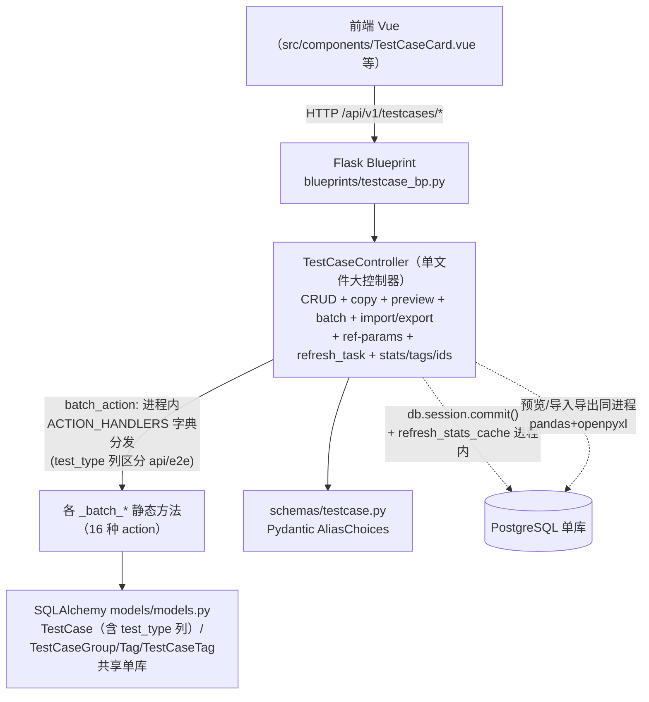
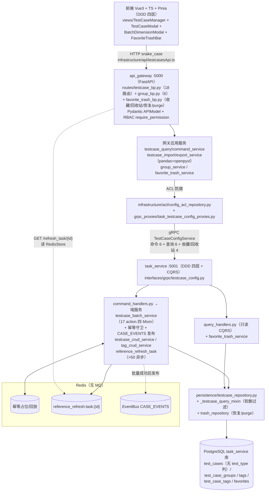

# INT-266 验收包 C. 用例管理

> 编制：方案一致性审计员，2026-10-13。方法：按设计文档（权威基线 doc/功能设计文档/07_用例管理/ 四篇 + 02_任务管理 发布规范引用）提取可验证契约，逐条到代码核验（网关路由 → gRPC → task_service 域服务 → 数据模型三层 + 前端 DDD 四层），全部结论带 file:line 证据；核验基线 = V9.7.31 本地 HEAD `7bb84a45`（含 INT-259/INT-262 两笔未推送提交，前端；origin/V9.7.31 为 `3c0cfc7c`）。核验为只读静态审计 + 平台证据（INT-32 台账、INT-249/259/141/237 等卡）交叉；**本机服务与 PostgreSQL 当前全停**，数据库实时对账未能本机重跑，按台账/卡内已记录证据引用并如实标注。
>
> 文档落盘：本文件（V9.7.10 仓库 doc/验收/INT-266.md，对齐 INT-263 先例）。

---

## 1. 改造前后流程图

### 1.1 V9.7.10（单体）流程

依据 V9.7.10 `backend/controllers/testcase_controller.py`（batch_action 入口 :1152，ACTION_HANDLERS 16 个注册项 :1159-1176）与 `backend/models/models.py`（TestCase 含 `test_type` 列 :153）：

要点：无分组独立 CRUD 端点（分组随用例自动建）；无收藏/回收站路由（仅软删 `deleted` 列）；无幂等键；无领域事件；14+2 种批量 action（`delete`/`copy` 在列、无 `restore`，见 §4.1 对账）；`test_type` 硬列。

### 1.2 V9.7.31（微服务）流程

依据 doc/功能设计文档/07_用例管理/用例管理功能设计文档.md §2.1–2.3，经代码核验修正：

### 1.3 差异说明（架构演进点逐条）

| # | V9.7.10 单体 | V9.7.31 微服务 | 依据 |
|---|---|---|---|
| 1 | Flask Blueprint → 单文件 Controller（testcase_controller.py 全部逻辑） | FastAPI 路由（testcase_bp/group_bp/favorite_trash_bp）→ 网关应用服务 → ACL 防腐 → gRPC → task_service CQRS 四层 | 用例管理设计文档 §2.1、附录 A#1/2 |
| 2 | `test_cases.test_type` 硬列（models.py:153） | 列已删除（迁移 202610/drop_task_type_and_testcase_test_type.py），用例纯数据化；执行路由由任务侧 TaskCase.device_type 决定；评估/报告口径经 `derive_case_test_type`（shared/utils/testcase_helpers.py:185）按配置形态派生 | 用例共用机制文档 §2.1；共用机制 §4.2 |
| 3 | 批量操作进程内字典分发 16 种 action，无幂等无事件 | gRPC `BatchActionTestCases`（proto:326）→ `TestCaseBatchService.batch_action`（testcase_batch_service.py:187-206 handler 表 **17 种**）+ 幂等守卫（客户端键/请求指纹，回放/冲突）+ 成功后 `CASE_EVENTS`/`CASE_BATCH_ACTION_COMPLETED` 发布（INT-75） | 设计文档 §2.1 事件通道、§3.2.2 |
| 4 | 无独立分组 CRUD（仅随用例自动建组） | `/api/v1/groups` 独立 CRUD（group_bp.py，RBAC group:*）+ `POST /move-cases`（经 batch `move_to_group` 复用实现，group_service.py:183-213）；自动建组语义保留（testcase_crud_service.py:140-153 get-or-create） | 设计文档 §3.1.2 适配说明 |
| 5 | 无收藏/回收站（仅 deleted 软删列） | favorites 表（per-user，(user_id,entity_type,entity_id) 唯一，迁移 202610/add_trash_operator_and_favorites.py）+ favorite_trash_bp 收藏/恢复/purge 全套 + 回收站 `only_deleted` 列表过滤 + 操作人三列（created/updated/deleted_by_user_id）（INT-141/215/216） | 用例模型 testcase_models.py:91-93；proto:339-343 |
| 6 | 参考参数刷新阈值硬编码、异步任务无恢复 | `REFERENCE_REFRESH_ASYNC_THRESHOLD`（默认 50，config.py:22）配置化 + 进度 Redis 键 + 孤儿收养（INT-76：启动时收养下线实例 pending/running 任务同 id 重放，`recovered_count` 可追溯） | 设计文档 §3.4 |
| 7 | 导入导出与业务同进程 | 网关应用服务（testcase_import/export_service，pandas+openpyxl），导入写库经 ACL→gRPC；模板下载 Response 内存字节流（INT-154 修复：mimetype→media_type） | 设计文档附录 A#8；import_service.py:607-620 |
| 8 | 预览同进程 | 预览保留网关侧（跨服务编排 audio_service，经 Playback/Audio ACL；query_service.py:195 / command_service.py:186） | 设计文档 §3.6.1 适配说明 |
| 9 | 前端单文件大组件 + `utils/api.ts` | 前端 DDD 四层：testcasesApi/groupsApi/favoritesApi（Infrastructure 唯知 snake_case）→ Port 层 → composables 拆分（useTestCaseBatchActions/BatchOps 等 11 个）→ Pinia ReadModel；camelCase Domain | 设计文档 §6.1.2 |
| 10 | 分组搜索无效（INT-155，并入 INT-146 关闭） | 分组筛选端到端贯通：`GroupListQuery` 补 keyword/type/dimension_id → GroupService → GetTestCaseStats group_by 聚合（INT-146 实机核验 3 组逐组一致） | INT-146 交付评论 2026-10-12 |
| 11 | 用例列表排序无次级键（同事务批插跨页重复风险） | `created_at+id` 次级排序键 + 网关 page>=1 校验（INT-228）；testcases 列表 type/dimension_id 过滤参数贯通（INT-193，proto ListTestCasesRequest type=7/dimension_id 补接线） | testcase 列表 proxy :569-605 注释 |

---

## 2. 能力验收手册（负责人可执行，每条：页面路径 → 操作 → 期望结果）

环境准备：`run_all.py` 起 11 服务 + 前端 5173；健康口径同 INT-263（health_smoke 25/25）。登录 `admin/admin123`。用例页入口 `http://localhost:5173/#/TestCaseManager`；E2E/API 测试页用例选择面板同源（INT-249 修复范围）。

### A. 用例列表与三套组织方式

| # | 页面路径 → 操作 | 期望结果 |
|---|---|---|
| A1 | /#/TestCaseManager 打开 | 卡片网格 + 顶部工具栏（搜索/筛选/新建/批量/导入导出）+ FavoriteTrashBar（收藏/回收站） |
| A2 | 视图切换：分组 ↔ 标签 | TestCaseManager 页显式分组视图；切换即时生效、刷新回默认（INT-249 口径：测试页默认标签视图，本页显式传 GROUP 不受影响） |
| A3 | 分组视图 → 展开各分组 | 分组计数正确；**无分组用例进「未分组」虚拟分组**（前端 `__ungrouped__` 过滤，INT-249；锁定 testCaseStore.ungroupedView.spec.ts） |
| A4 | 标签视图 | 后端 `view=tag` 返回 `{items:[{tag,testCases}]}`（proto ListTestCasesRequest view=8；query_service.py:118-121,233-236）；标签分组与计数正确（INT-215 修复断链） |
| A5 | 收藏：卡片星标 → 「仅看收藏」 | `POST /testcases/{id}/favorite` 200；重复收藏 `already_favorited` 幂等；筛选列表 `favorite=true` 下推 task_service（proxy :148-171 x-user-id per-user 隔离）（INT-141/237） |
| A6 | 回收站：删 2 条用例 → 切回收站态 | 列表走 `only_deleted=true`；卡片显示删除时间/删除人 meta（formatDate，INT-239 口径）；进出回收站清空选中集 + 分页重置（testcasesApi QUERY_PARAM_MAP only_deleted :23） |
| A7 | 回收站 → 恢复（单个/批量/全部恢复） | `POST /testcases/restore`（favoritesApi.restore :33）→ gRPC RestoreTestCases → trash_repository 清空 deleted 三字段并回填 updated_by；restored_count 判真（testcase:delete 权限） |
| A8 | 回收站 → 彻底删除（purge） | 二次确认；admin/owner 服务端校验（shared/infrastructure/purge_permission.py:31-53）；悬挂收藏引用清理（INT-237 §4） |
| A9 | 异常流：A4 标签视图切换到无用例标签 / A3 空分组 | 空态文案、无报错；分页计数稳定（INT-228 次级排序键，跨页无重复/漏行） |

### B. 用例创建与编辑（模态窗）

| # | 页面路径 → 操作 | 期望结果 |
|---|---|---|
| B1 | 新建用例 → CaseForm 填名称/分组/标签 | 分组下拉含既有分组 + 输入新名动态建组（get-or-create，testcase_crud_service.py:140-153）；`POST /api/v1/testcases` 201 |
| B2 | 分步编辑：算法参数步（AlgoParamsStep）→ 音频轮次步（AudioListStep）→ 噪声干扰步（NoiseInterferenceStep）→ 参考路径步（ReferencePathStep） | 按轮配置落 `algorithm_params`（独立列）/`config.rounds`/`reference_params`；**第 2+ 轮算法参数保存不丢**（INT-194；int194.multiRoundSave.acceptance.spec.ts） |
| B3 | 编辑既有用例 → 改分组 → 保存 | 分组修改生效（INT-195；int195.groupChange.spec.ts）；`PUT /testcases/{id}` 后列表刷新反映新分组 |
| B4 | E2E/API 表单形态 | testType 按后端派生 type 映射（api/e2e 二值），非法/缺省**不**兜底锁 E2E（INT-196；testCaseAdapter.ts:17-26 toTestType + testCaseAdapter.testType.spec.ts） |
| B5 | 轮次操作：复制轮次 / 删除轮次 | 复制轮**带源轮 algorithm_params 独立列条目**；删除轮按「旧轮号→新轮号」映射重编号不串写（INT-259 缺陷 3 修复；int259.roundParamsSync.spec.ts）。⚠️ 已知边界：删除轮后 `reference_params` 独立列仍按旧轮号存（未随轮前移纠偏，INT-259 记录需后端支持按轮重排，待另卡） |
| B6 | 单轮/整体评估维度编辑器（RoundEvaluationEditor / OverallEvaluationEditor，CaseForm.vue 挂载） | 单轮写 `rounds[n].evaluation.dimensions`、整体写 `config.dimensions`，两层互不合并；weight 默认 50 / threshold 默认 60 |
| B7 | 算法参数编辑模态窗（AlgorithmConfigModal+DynamicForm） | 字段类型渲染（text/number/slider/switch/audio_select/device_select/json，case_algorithm_params param_type）、默认值回填、提交落库；**启用/禁用 toggle 不再清空算法名称**（INT-259 缺陷 2 修复：UpdateAlgorithmDefinitionCommand PATCH 语义） |
| B8 | 试听预览：卡片「预览」→ 选模式（frontend/backend）→ 播放 / 停止 | `POST /testcases/{id}/preview` 返回音频流 URL 或后端扬声器播放；`POST .../stop_preview`（+旧连字符别名 stop-preview :62）停止；未配音频报校验错 |
| B9 | 异常流：B2 保存时断网 / 后端停 | 提交失败有通知（useTestCaseCard 失败路径），本地不假刷新 |

### C. 批量操作（17 action 全量）

统一入口：多选用例 → 工具栏批量操作 → `POST /api/v1/testcases/batch`。全选走 `POST /ids`（FetchCaseIds，含 algorithm_type/dimension_id 透传 INT-215-P2R1）。

| # | 操作（action） | 期望结果 |
|---|---|---|
| C1 | `delete` | 软删除（deleted=true+deleted_at+deleted_by）；列表消失、回收站可见 |
| C2 | `restore` | 批量恢复软删用例（testcase_batch_copy_move_mixin.py:30 起实现） |
| C3 | `copy` / 单条卡片「复制」 `POST /{id}/copy` | 生成新 id 新记录，config/algorithm_params/reference_params/标签完整复制 |
| C4 | `copy_by_group` / `copy_by_tag` | 整组/同标签用例批量复制（可指定新分组） |
| C5 | `move_to_group` / `copy_to_group` | 移动/复制到目标分组；`POST /groups/move-cases` 同效（经 ACL 复用 batch 实现） |
| C6 | `update_algorithm_params` | 按轮参数批量更新 |
| C7 | `update_playback_devices` | 播放设备映射批量更新（E2E 执行用） |
| C8 | `update_spl` | 声压级批量更新 |
| C9 | `update_dimensions`（批量维度模态窗，见 D） | 三种轮次模式 + 整体维度，行为矩阵见 §4.2 |
| C10 | `update_noise` | 噪声干扰配置批量更新 |
| C11 | `auto_generate_name` | 按命名规则批量重命名 |
| C12 | `add_tags` / `remove_tags` | 批量增删标签；`GET /testcases/tags` 列表同步 |
| C13 | `rename_tag` | 标签重命名同步所有关联用例 |
| C14 | `refresh_reference` ≤50 条 | 同步处理，返回汇总 |
| C15 | `refresh_reference` >50 条 | 返回 `task_id`，前端 `GET /testcases/refresh_task/{task_id}` 轮询（progress/failed_cases/recovered_count 字段，testcase_bp.py:98-127） |
| C16 | 异常流：同 payload 重复提交 | 命中已完成批次**回放上次响应**（`idempotent_replay` 标记）；处理中批次返回冲突提示（幂等守卫，testcase_batch_service.py:208-217；INT-75 19 例单测） |
| C17 | 异常流：未知 action | 400 `不支持的操作类型: {action}`（:204-206） |
| C18 | 批量后事件 | Redis 可用时 `CASE_EVENTS` 发布（action/case_ids/幂等键/status）；Redis 不可用降级仅记日志不影响结果 |

### D. 批量设置评价维度（BatchDimensionModal）

| # | 操作 | 期望结果 |
|---|---|---|
| D1 | 选 2+ 用例 → 打开批量维度模态窗 → 「所有轮次（统一）」选维度 A、B → 确定 | 所有轮次 `evaluation.dimensions`=[A,B]；整体维度区独立设置则写 `config.dimensions` |
| D2 | 「指定轮次（统一）」勾第 1 轮 + `-1`（最后一轮）→ 统一维度 | 选中轮次写入；**未选轮次不动**；`-1` 按各用例实际轮次动态解析 |
| D3 | 「逐轮设置」：第 1 轮选 A；第 2 轮选 B；「最后一轮」Tab 选 C（2 轮用例） | 第 2 轮 = B∪C **按维度 id 去重叠加合并**（已有保留，缺的补入，权重取基础轮）；第 3 轮数据超出的自动丢弃 |
| D4 | 逐轮某轮不选 | 该轮清空（提示文字明示「未选维度的轮次将被清空」） |
| D5 | 整体维度区不选 → 确定 | `config.dimensions`=[]（空数组=清空整体评估，等同关闭整体评估） |
| D6 | 异常流：统一模式 dimensions 与 multi_dimensions 全 None | 网关/服务端报错（校验规则：非 per_round 双 None 报错；per_round 双空报错） |
| D7 | 批量后单查任一用例 | JSON 列更新生效（`flag_modified(tc,'config')` 强制，config_update_mixin.py:87） |

### E. 导入导出与模板

| # | 操作 | 期望结果 |
|---|---|---|
| E1 | 工具栏「导入」 | **跳转 /#/AudioImport**（query autoOpen=1&createTestCase=true，对齐 V9.7.10 上传生成主路径；useTestCaseCard.ts:197-204）——⚠️ INT-259 记录 AudioImport 跨页 autoOpen 断链缺陷已开 **INT-275（backlog）**，验收本条按 INT-275 修复后复验 |
| E2 | （模态复用路径）ExportForm / ImportForm 确认 | footer 校验 → emit('save') → handleExportConfirm/handleImportConfirm 执行下载/导入，**无递归死循环、导出载荷含 ids**（INT-259 缺陷 1 修复；int259.importExportConfirm.spec.ts） |
| E3 | 导出：选 JSON / Excel + 筛选条件 | `POST /testcases/export` 下载文件；`include_deleted` 可选；Excel 经 pandas+openpyxl |
| E4 | 导入预览：上传 Excel → 预览 | `POST /testcases/import/preview` 返回校验结果（错误行标出），确认后才写库 |
| E5 | 模板下载 | `GET /testcases/template/download` 200 返回 xlsx（5 Sheet：TestCases/AudioConfigs/Dimensions/Tags/Groups；INT-154 修复后 media_type 正确） |
| E6 | 异常流：导入非法列/重复名 | 预览阶段报错不入库；导入按分组名自动建组 |

### F. 分组管理

| # | 操作 | 期望结果 |
|---|---|---|
| F1 | /#/TestCaseManager → 创建分组（GroupForm） | `POST /api/v1/groups` 201；重名拒绝（name 唯一） |
| F2 | 编辑分组 → 保存 | 生效（INT-167 修复假成功：创建/更新真实落库并有 9 例回归单测） |
| F3 | 删除分组（无用例 / 有用例 cascade=false） | 无用例删除成功；有用例且未 cascade 拒绝（group_service.py:170 active_cases>0 && !cascade → 报错）；cascade=true 级联（INT-152 修复假成功 + 10 例单测） |
| F4 | 分组面板搜索框输入关键词 | keyword 下推：分组列表按「分组下匹配用例数」过滤（INT-146 实机核验：keyword=打断 → 3 组逐组一致）；名称搜索（search 参数到 repo，_testcase_group_mixin.py:41） |
| F5 | 批量移动用例到分组 | `POST /groups/move-cases`：目标组不存在 404；空 ids 提示无需移动；成功文案含计数 |

---

## 3. 自动化证据

### 3.1 pytest 覆盖清单（本域相关，静态统计 `def test_`，2026-10-13）

| 层 | 文件（用例数） | 覆盖点 |
|---|---|---|
| 后端·批量/事件 | test_int75_batch_events_idempotency.py（19）+ test_int75_acceptance_auditor.py | 17 action 分发、CASE_EVENTS 全量发布、幂等回放/冲突、TTL 自愈、Redis 降级 |
| 后端·收藏/回收站 | test_int141_favorites_trash_operator.py（**49**）+ test_int65_task_testcase_restore.py | per-user 收藏、恢复清字段回填 updated_by、purge 权限/悬挂清理、操作人记录 |
| 后端·标签/筛选/分页 | test_int215_tag_view_trash_filters.py（6）+ test_int215_fetch_case_ids_filters.py（7）+ test_int193_testcase_type_filter.py（6）+ test_int228_testcase_tie_pagination.py（7） | view=tag 形态、only_deleted/favorite 过滤、type/dimension_id 贯通、created_at+id 次级排序 |
| 后端·分组 | test_int152_group_cascade_delete.py（10）+ test_int167_group_create_update_fake_success.py（9）+ test_int146_audio_group_alignment.py | 级联删、假成功回归、分组筛选统计 |
| 后端·参考参数 | test_int76_reference_refresh_config_recovery.py（19）+ test_int143_reference_param_single_query.py（11） | 阈值配置化、孤儿收养 recovered_count、单轮读写契约 |
| 后端·维度 | test_int64_evaluation_dimension_isolation.py + test_int145_dimension_batch_cascade.py + test_int126_overall_entry_round_dims_fanout.py + test_int169/173 系列 | 单轮/整体隔离、批量维度级联、-1 解析、报告取值 |
| 后端·派生口径 | test_int129_upload_variant_routing.py（含）+ shared helpers | derive_case_test_type 后缀优先/配置形态回落 |
| 后端·实机 API | tests/api/test_core_api.py（26）+ test_crud_comprehensive.py（27） | 用例 CRUD/软删重建/批量/导入导出信封（RUN_LIVE_STACK=1 门禁 + 唯一前缀 teardown 零残留，INT-229） |
| UI | tests/ui/test_ui_03_case_views.py（3）+ pages/test_case_page.py | 标签/分组视图切换一致性、视图切换计数稳定、标签过滤精确（selenium，INT-260 在途扩面） |
| 前端 vitest | 48 spec 中本域约 20 文件：int194.multiRoundSave.acceptance、int195.groupChange、int259.importExportConfirm、int259.roundParamsSync、testCaseStore.ungroupedView、testcasesApi.refParams / trashView、testCaseAdapter.testType、trashModePaginationReset、trashFieldsMapping（8）、testCaseManager.trashViewWiring、useTestCaseCard.editTestType、useFavorites 等 | 模态窗保存/分组/回收站参数接线/派生映射/幂等收藏 |

### 3.2 审计/测试卡引用（INT 卡号）

- **一致性审计**（本域直接相关，均 done）：INT-237（收藏/回收站/操作人三视图 全量核验，一致，4 处文档精度修正回写 V9.7.10 `1bb14a16`）、INT-244（INT-239 删除时间格式化回写核验）、INT-214/235（维度移植核验）。关联域：INT-71（dispatch 契约）、INT-193/228 审计链（列表排序/过滤）。
- **UX 审计**：INT-212→INT-215（三视图 7 项修复，done）；INT-253（布局补审）；INT-259（模态窗专项走查修复，**in_review**，commit `2cf83a56`）；INT-261（全站全量审计，in_progress）。
- **UI 自动化**：INT-260 in_progress（selenium 模态窗/表单/导航接门禁）；现状 tests/ui 3 文件 11 例（login 4/navigation 4/case_views 3）。
- **测试基建**：INT-96/163（xdist 隔离）、INT-229/234/238（残留清理与日志根隔离）、INT-246（库隔离，未推送）。

### 3.3 集成批次推送记录（台账 INT-32）

- 本域历史批次：INT-75（批量事件+幂等）、INT-77（用例管理设计文档微服务化修订）、INT-79（test_type 废弃收尾）、INT-105/113/129（用例数据链修复）、INT-141/215/216（收藏/回收站/操作人 + UX 修复 + 补测）、INT-146/152/154/155→167（分组域修复）、INT-193/194/195/196（列表过滤 + 模态窗三缺陷）、INT-228（排序硬化）、INT-249（默认标签视图+未分组虚拟分组，`97568c11`）、INT-259（模态窗专项，`2cf83a56`）。
- 最近全量回归（INT-252 批次口径）：**2917 passed / 103 skipped / 1 flake（复跑绿）**，vitest 45 文件 **326/326**（vitest_int252.txt、regression_int252.txt；该批次后新增 INT-258/259/262 三笔提交未重跑全量，INT-259 自测含前端 vitest 通过）。
- 用户数据恢复（本域数据基线）：台账 2026-10-13 01:35——负责人业务用例 10-10 换库丢失，从 10-10 17:27 data 备份恢复：**test_cases 579 条 + test_case_tags 1599 + test_case_groups 6 + case_algorithm_params 10**（按公共列迁移、冲突跳过；恢复库留存 D:\00_env\pg_recover，实例已停）。

---

## 4. 特性专项（结论 + 证据）

### 4.1 批量 action 种数对账（14 vs 17）

| 侧 | 实数 | 证据 |
|---|---|---|
| V9.7.10 单体 Controller | **16**（delete、move_to_group、copy_to_group、copy、copy_by_group、copy_by_tag、update_algorithm_params、update_playback_devices、update_spl、update_dimensions、update_noise、auto_generate_name、add_tags、remove_tags、rename_tag、refresh_reference——无 restore） | backend/controllers/testcase_controller.py:1159-1176 |
| V9.7.10 设计文档（源） | 14 | 用例管理功能设计文档 §3.2.2 适配说明引述 |
| V9.7.31 | **17**（上 16 + restore；缺省回 400） | testcase_batch_service.py:187-206 handler 表逐项核对 |

**结论**：卡面「14 种」为源文档口径；文档「31 版 17 种（增 delete/copy/restore）」中 delete/copy 在 10 版 Controller 已实际存在，**净增实为 1（restore）**——文档差异表述按代码事实修正理解，不影响行为；31 版 handler 表与文档 §3.2.2 列表逐项一致 ✅。17 种全部有 handler 落位、未知 action 400、幂等守卫与事件发布在分发层统一生效（:204-247）。

### 4.2 标签 / 分组 / 收藏三套组织方式

| 方式 | 存储 | 核验点 | 结论 |
|---|---|---|---|
| 分组 | TestCaseGroup（name 唯一）+ TestCase.group_id | 独立 CRUD+级联删+move-cases+自动建组+keyword 筛选统计 | ✅（group_bp.py:10-33；group_service.py:30-213；testcase_crud_service.py:140-153；INT-146/152/167 修复回归） |
| 标签 | Tag + TestCaseTag 多对多 + TagCategory | add/remove/rename 批量 + view=tag 视图 + 按标签复制 | ✅（testcase_batch_tag_mixin；proto view=8；testcase_query_service.py:233-236；INT-215 断链修复） |
| 收藏 | favorites 表 per-user（(user_id,entity_type,entity_id) 唯一） | 网关 favorite_trash_bp 三实体全覆盖 + ListTestCases favorite= 过滤（x-user-id 透传）+ 幂等 already_favorited | ✅（favorite_trash_bp.py:34-86；proxy :148-171,610-640；test_int141 49 例；INT-237 审计一致） |

三套并行、互不冲突，与 V9.7.10「标签为主、分组少用」的真实数据形态（579 条用例：标签绑定 1599 vs 分组绑定 6）匹配——INT-249 据此把测试页默认视图改回标签视图，分组视图保留可切换，**未分组虚拟分组兜底吞用例缺陷已修**（`97568c11`，前端 7 文件后端零改动，测试/UX/代码三审计通过）。

### 4.3 用例编辑模态窗 / 算法参数模态窗 / 参考参数

- **用例编辑模态窗**（TestCaseModal/index.vue + sections/ 5 步 + CaseForm）：分步组件落位与设计文档 §5.2.2 一致；历史三缺陷（INT-194 多轮参数清空/INT-195 分组不生效/INT-196 testType 恒回填）均有修复 + 回归 spec；INT-259 复查补修轮次复制/删除与独立列失步（复制带参、删除按映射重编号）。**遗留边界**：删除轮次后 reference_params 独立列不随轮号前移（INT-259 明示未改，需后端按轮重排支持，建议另卡）。
- **算法参数模态窗**（AlgorithmConfigModal + DynamicForm）：param_type 8 种（text/number/textarea/slider/switch/audio_select/device_select/json）+ scope(common/api/e2e)（algorithm_models.py:356-375）；INT-259 修复「编辑假成功（分组/状态/图标/排序静默丢弃）+ toggle 清空算法名」PATCH 语义（后端 algorithm_service 7 文件）。
- **参考参数**：单轮读写端点（testcase_bp.py:131-137 + gRPC UpdateTestCaseRefParams/GetTestCaseRefParams）+ 内容存文件库内仅存路径（models 注释）+ 批量刷新 >50 异步（阈值配置化 config.py:22）+ Redis 进度 + 孤儿收养（INT-76 19 例）。前端封装 getRefParams/updateRefParams 已补（testcasesApi.ts:206-218，INT-73 关闭；含 testcasesApi.refParams.spec.ts）。⚠️ `GET /stats` 网关有（testcase_bp.py:17）但前端 testcasesApi 无对应封装——文档已如实标注 gap（§6.1.3 适配说明），实际消费走 /home/stats/*（statsApi），无功能缺失。
- ⚠️ **INT-259 当前 in_review**：修复 commit `2cf83a56` 已在本地 HEAD，三项缺陷修复代码核验到位（importExportConfirm/roundParamsSync spec 在库），但测试验收/审计轮未走完——验收本域以「修复已交付、待轮转确认」口径入档。

### 4.4 与 V9.7.10 用例数据的对账（579 条恢复用例可用性）

| 对账项 | 结果 | 证据 |
|---|---|---|
| 数据量 | test_cases **579** 条恢复（现库未删 585 含新写测试数据）+ test_case_tags **1599** + test_case_groups **6** + case_algorithm_params **10** | INT-32 台账 2026-10-13 01:35（临时 PG 5433 挂载按公共列迁移，冲突跳过；防复发归 INT-163 隔离整改） |
| 列差异 | V9.7.10 `test_type` 列（api/e2e 必填）→ 31 版已删列：恢复数据不受影响——执行路由改读任务侧 TaskCase.device_type；评估/报告口径经 derive_case_test_type(config,name) 派生（后缀 _api/_e2e 优先于配置形态） | drop_task_type_and_testcase_test_type.py；testcase_helpers.py:185-204；INT-129 双变体口径 |
| 新增列兼容 | created_by/updated_by（202608）、deleted_by_user_id/deleted_at（INT-141）对旧行 NULL 宽松——三视图显示「—」空态（INT-237 §6 验证） | testcase_models.py:91-93；收/回规范文档 §6 |
| JSON 列结构 | config/algorithm_params/reference_params 结构两版一致（rounds/dimensions/按轮分组），无重排迁移需求 | 两版模型注释与共用机制文档 §3.2 逐字段对照 |
| 可用性实证 | 恢复后 E2E/API 测试页「恢复的 579 条 HJ 系列用例不可见」缺陷（INT-249）三审计闭环：机制修复后标签视图/未分组分组均可达；**HJ 系列实机可见性待负责人终验**（本机库无 HJ 数据，测试验收以机制验证 + 负责人终验为口径） | INT-249 测试结论评论 2026-10-13 04:44 |
| ⚠️ 实时对账 | 本机 PostgreSQL 当前未运行（服务全停），本审计无法重跑 579 条逐条可用性查询（如 count/JSON 反序列化/标签关联完整性）——按台账+卡内证据引用，**建议负责人实机验收时以 A3/A4 手册项在真实库上复验一遍** | 本审计核验记录 |

---

## 5. 已知缺口与风险（诚实清单，引用 INT 卡号）

| # | 缺口/风险 | 等级 | 依据 | 状态 |
|---|---|---|---|---|
| 1 | **【新发现·权限点缺口】用例写端点 RBAC 声明不全**：`POST /testcases`（创建）、`DELETE /testcases/{id}`、`GET /{tc_id}` 无 `require_permission` 声明（testcase_bp.py:32-45），`POST /batch` 声明为 `testcase:read`（:68）——与 seed_rbac 权限点集（testcase:create/delete/copy 等 7 个，seed_rbac.py:65-71）和任务域路由逐点声明（task_bp.py:12-67）不一致。当前全局 AuthMiddleware 兜底登录态（白名单外全要求认证），故非未鉴权暴露，但**细粒度 RBAC 对这批端点不生效**（低权限角色可写） | medium | 本审计静态核验 | **建议开【缺陷·对齐】卡补声明**（batch 应为 testcase:update 或专设批量权限；create/delete 补各自权限点） |
| 2 | INT-259 模态窗专项 **in_review**：三缺陷修复已交付（`2cf83a56`）但验收轮未走完；且其记录的已知边界（删除轮次后 reference_params 独立列轮号错位）未修，需后端支持按轮重排 | medium | INT-259 | in_review / 建议另卡 |
| 3 | AudioImport 跨页 autoOpen 上传弹窗断链——用例管理「导入」跳转 AudioImport 后自动打开上传模态失效（E2E/用例导入主入口） | medium | INT-275（backlog） | 待修；手册 E1 按 INT-275 修复后复验 |
| 4 | INT-261 全站 UX 审计 in_progress、INT-260 UI 自动化扩面 in_progress：可能新增本域问题；现状 selenium 仅 3 文件 11 例未入门禁 | low-medium | INT-260/261 | 在途 |
| 5 | backlog 前端缺陷与用例域相邻：INT-282（APITest 未勾选全量回退丢失+建任务缺 type 字段）、INT-274（LogView 确认空操作）、INT-284（Tasks 批量恢复丢确认弹窗，与回收站交互范式相关） | low | INT-274/275/281/282/284 | backlog 待派 |
| 6 | 579 条恢复数据实时对账未能在本机重跑（服务与 PG 全停）；恢复库备份留存 pg_recover 但未做逐条 JSON 可读性校验记录 | low | 本审计 §4.4 | 负责人实机终验覆盖 |
| 7 | 文档回写清单（代码正确、文档滞后，按先例回写）：①源文档「14 种」与单体实际 16 种、31 版「增 3 种」与净增 1 种（restore）的口径澄清（本审计 §4.1）②`BatchDimensionModal` 文档称「复用 TestCaseModal/useDimensionConfig.ts」（§5.2.3/§2.2）——实际模态内联维度配置块 + useDimensions composable，useDimensionConfig 消费方为 TestCaseModal 侧（DimensionConfigPanel/TestCaseModal/index.ts），复用关系表述需修正 ③文档 §2.2 组件表 `TestCaseCard.vue` 路径写 `src/components/TestCaseCard.vue`（卡片方案文档 §2.1 同）——实际在 `components/common/test-case/TestCaseCard.vue` ④接口清单称「getStats/getRefParams 当前不存在」——ref-params 封装已补（INT-73），stats 缺口维持 | low（文档） | 本审计 §4.3/组件核验 | 待回写（可并入回写专项 run） |
| 8 | 测试/业务库隔离 INT-246 未推送（`861c7f46`）；INT-252 后三笔提交（INT-258/259/262）未跑全量回归（本域相关仅 INT-259，其 vitest 通过） | low | INT-246/台账 | 随下批 |

---

## 6. 验收判定

- **卡面签收标准：手册全过 + 无未处置 P1 缺陷 → 本卡 done。**
- 材料齐备度：§1 流程图/差异 11 条、§2 手册 6 组 34 项、§3 自动化证据（本域 pytest 单测约 200 例 + 前端约 20 spec + UI 3 例 + 实机 API 53 例）、§4 特性专项四项均给结论+证据。
- 实机覆盖：本域大部分能力有近期实机/审计证据链（INT-146 分组筛选实机、INT-249 三审计、INT-259 专项走查、INT-237 全量核验、tests/api 53 例实机门禁）；**本机当前服务全停，本轮未重跑实机**。
- 未处置 P1：无在档（缺口#1 权限点为 medium，有全局认证兜底非暴露级）。
- 审计员判定建议：**有条件通过**——①负责人按 §2 手册在真实库实机走查（重点 A3/A4 未分组与标签视图对 579 条 HJ 数据的可见性终验、C15 异步刷新轮询、D 组维度矩阵抽 3 行、E1 按 INT-275 修复后复验）；②缺口#1 权限点缺口开卡补齐（不阻塞本卡 done，应与 INT-259 转审同批处置）；③INT-259 完成验收轮转 done 后，本域前端模态窗项收口。
