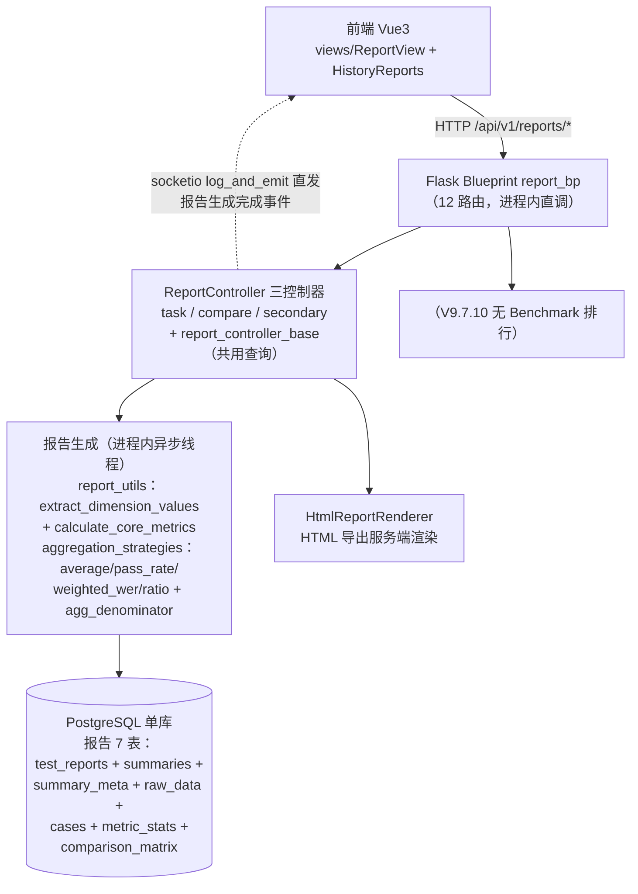
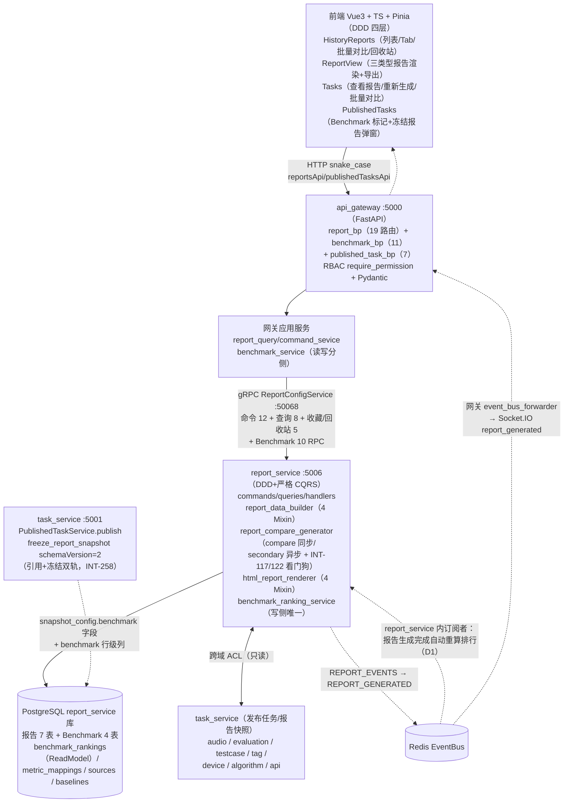

# INT-267 验收包 D. 报告+Benchmark

> 编制：方案一致性审计员，2026-10-13。方法：按设计文档（权威基线 doc/功能设计文档/05_报告管理/ 八篇 + 04_评估/维度隔离一篇 + 02_任务管理/任务发布 快照规范引用）提取可验证契约，逐条到代码核验（网关路由 → gRPC → report_service/task_service 域实现 → 数据模型三层 + 前端 DDD 四层），全部结论带 file:line 证据；核验基线 = V9.7.31 本地 HEAD `f7f815f4`（ahead 295，含 INT-258/259/262/257/276/277 未推送）/ origin `3c0cfc7c`。**本机 11 服务 + 前端 5173 运行中，本次除静态审计外另做了只读 API 实测探针（RSA 登录 → 报告列表/按任务查/Benchmark 排行/映射/发布列表），实测结论已在文中标注。**
>
> 文档落盘：本文件（V9.7.10 仓库 doc/验收/INT-267.md，对齐 INT-263/266 先例）。

---

## 1. 改造前后流程图

### 1.1 V9.7.10（单体）流程

依据 V9.7.10 `backend/blueprints/report_bp.py`（报告 12 路由）与 `backend/controllers/report_controller_task.py` / `report_controller_compare.py` / `report_controller_secondary.py`（进程内生成链）、`backend/utils/report/`（report_utils + aggregation_strategies + html_report_renderer）：

要点：生成/聚合/渲染/导出全部同进程；报告 7 表直连；进度经 `/reports/{id}/progress`（进程内生成锁）；对比=taskIds、二次对比=reportIds 双链同进程；无 Benchmark、无冻结报告、无跨服务事件。

### 1.2 V9.7.31（微服务）流程

依据 doc/功能设计文档/05_报告管理/各篇 §接口设计 + 04_评估/多轮评估维度隔离与报告聚合设计文档，经代码核验修正（含本机探针实测）：

要点：报告读侧（列表/详情/用例检索/导出）与写侧（生成/对比/状态）严格 CQRS；Benchmark 排行为 ReadModel 整体刷新（写侧唯一 `compute_ranking`，读侧无写副作用）；排行自动重算经 Redis REPORT_EVENTS 订阅（report_service 进程内，app.py:92-100）；冻结报告语义在 task_service 发布链（INT-258）。

### 1.3 差异说明（架构演进点逐条）

| # | V9.7.10 单体 | V9.7.31 微服务 | 依据 |
|---|---|---|---|
| 1 | Flask Blueprint 进程内直调 Controller | FastAPI report_bp（19 路由）→ 网关应用服务 → gRPC ReportConfigService（proto 30+ RPC）→ report_service CQRS 四层 | report_service.proto:8-64 |
| 2 | 报告 7 表共享单库直连 | report_service 独立库 7 表（PO 下沉 P5，移除 Report.task 跨域 relationship，跨域查 gRPC ACL） | report_models.py:16-21 |
| 3 | 进程内生成锁 + socketio 直发进度 | Redis 分布式锁（`report:gen:` TTL 兜底 30min）+ 生成阶段埋点/看门狗（INT-117/122）+ REPORT_EVENTS 事件（report_task_generator.py:40-52） | 同左 |
| 4 | 进度查询读进程内锁 | `/reports/{report_id}/progress`：报告锁（is_generation_locked）→ generating + 按任务完成用例数推导；否则 completed=100（report_handlers.py:329-359）；**网关侧 `{report_id}/progress` 路由存在但被 `/{report_id}` 路径参数遮蔽（见 §5-#7）** | report_handlers.py:329 |
| 5 | 无 Benchmark | Benchmark 双轨排行全链：发布标记（task_service 行级 `benchmark` 列+快照 suite/category）→ 排行计算（双轨合并→映射→6 算法→ReadModel）→ 手动触发 + REPORT_EVENTS 自动重算 + 审计（INT-27/130） | benchmark_routes.py 全部 |
| 6 | 无冻结报告 | 发布冻结 `report_snapshot` schemaVersion=2（引用+7 表渲染字段冻结双轨，前端 ReportSnapshotModal 复用 TaskReportPanel 只读渲染）+ 补冻结迁移（INT-258） | published_task_service.py:199 |
| 7 | 对比/二次对比进程内同步+异步混合 | compare 同步链 + secondary 异步线程，看门狗可观察化（_CompareStageSpan 埋点 + 轨迹注册表）| report_compare_generator.py:98-128 |
| 8 | 导出：CSV 摘要 + HTML 单报告（进程内 send_file） | 导出经 gRPC base64 传递：excel/pdf/csv（ReportAggregationService.build_export_payload）+ html（HtmlReportRenderer 单报告约束）；前端 ReportView 另有 JSON 导出与 DOM 捕获 ZIP 打包 | export_mixin.py:63-75 |
| 9 | 无事件总线 | REPORT_EVENTS 频道：REPORT_GENERATED/SECONDARY_COMPARE_GENERATED → 网关转发前端 + report_service 内 Benchmark 排行订阅者 | redis_pubsub + app.py:92 |
| 10 | 魔法字符串 | AuditEvent 枚举（BENCHMARK_* 5 事件）+ 权限点 require_permission 全路由声明 | common_enums.py:243-247 |
| 11 | 前端单文件 api.ts | 前端 DDD 四层：reportsApi/publishedTasksApi（snake_case 唯知层）→ reportAdapter → composables → Pinia；camelCase Domain | reportsApi.ts 全文 |

---

## 2. 能力验收手册（负责人可执行，每条：页面路径 → 操作 → 期望结果）

环境准备：`run_all.py` 起 11 服务 + 前端 5173；登录 `admin/admin123`。报告入口 `http://localhost:5173/#/history-reports`（列表）、`/#/report/{id}`（详情）、`/#/published-tasks`（冻结报告+Benchmark 标记）。**本卡探针实测项标注 ✅（2026-10-13 实测通过）**。

### A. 报告列表与详情（正向流）

| # | 页面路径 → 操作 | 期望结果 |
|---|---|---|
| A1 | /#/history-reports 打开 | 报告列表 + 四 Tab（全部/草稿/已发布/对比）+ 筛选（类型/状态/时间/算法/关键词）+ FavoriteTrashBar（INT-141 收藏/回收站） |
| A2 | 列表分页 | ⚠️ 已知缺口 INT-297：列表响应信封仅 `{items,page,page_size}` 缺 `total/pages`（探针实测确认），前端 totalItems 落空、分页器无总数——**本条按 INT-297 修复后复验**；筛选/排序本身可用（type/status/keyword/时间/algorithmType 均服务端下推，historyReports.ts:112-127） |
| A3 | Tab 切换（草稿/已发布） | ⚠️ 已知缺陷 INT-280（backlog）：Tab 为当前页客户端过滤（publishedReports/draftReports computed，historyReports.ts:341-357），分页 total 是全量数、Tab 计数只算当前页——可能「页码多页但当前 Tab 空列表」；Tab=对比 为客户端按 type 归类（comparison 家族 4 值兼容，domain/model/report.ts:21-22） |
| A4 | 点报告卡 → /#/report/{id} | 任务报告（type=task）渲染 TaskReportPanel：概览卡/设备 API 信息/分析结论/按用例分组/按用例标签/具体用例对比 + 时间轴对比（TimelineComparison 组件，参考↔结果说话人自动匹配） |
| A5 | 对比报告详情 | ComparisonReportPanel 分支（comparison/secondary_comparison 及历史遗留值 4 形态兼容，ReportView.vue:39） |
| A6 | 报告用例搜索/筛选 | `POST /reports/{id}/cases/search`：keyword/category/tags/include_untagged 客户端过滤链（_report_case_filters.py:59-66）；⚠️ 评估维度层级筛选（V9.7.10 有设计文档《报告标签分类筛选与评估维度层级筛选功能设计文档》）该篇未同步进 V9.7.31 doc/，31 版筛选能力按 07 域标签体系现状——口径待拍板（§5-#9） |
| A7 | 发布报告 | `POST /reports/{id}/publish`（report:publish 权限）；状态 draft→published |
| A8 | 编辑分析结论 | `PUT /reports/{id}`（report:update）；AnalysisEditorComponent 保存 |
| A9 | 收藏/回收站 | 星标收藏 per-user（x-user-id）；删除→回收站（显示删除时间/删除人）；恢复/彻底删除（admin/owner 服务端校验）——INT-141/219/237 口径 |
| A10 | 按任务查报告（INT-262） | `GET /reports/by_task/{task_id}` 200（**探针实测 ✅ by_task/601 → id=444**）；列表 `?task_id=` 精确过滤（routes.py:229 task_id 参数）；⚠️ 前端 reportsApi 尚未封装 by_task 调用（消费侧待接，非阻塞） |

### B. 报告生成（三入口）

| # | 页面路径 → 操作 | 期望结果 |
|---|---|---|
| B1 | /#/tasks → 任务行「查看报告」 | viewTaskReport：`POST /reports/generate-task`（task_id+name）→ 生成（有缓存则返回既有）→ Socket.IO `report_generated` → 跳 `/#/report/{id}`（useTaskControl.ts:108-126） |
| B2 | 任务行「重新生成」 | 先 generate-task 探测既有报告 → 确认弹窗 → `POST /reports/{id}/regenerate`（useTaskControl.ts:128-190） |
| B3 | TestFlow 步骤 4（报告） | TaskReportPanel 内嵌渲染 + 保存报告/导出报告按钮（TestFlow.vue:200-225；注意此处「保存/发布」为本地状态，真正发布在报告页） |
| B4 | 生成进度 | `GET /reports/{id}/progress`：generating（进度按任务完成用例数推导）/ completed=100（report_handlers.py:329-359）；⚠️ 网关路由顺序问题见 §5-#7（探针实测 /reports/trend 被 `/{report_id}` 捕获返 422，progress 同理需实测确认——手册执行时如 404/422 记入问题清单） |
| B5 | 异常流：任务无已完成用例生成报告 | 校验拒绝/空态明确（INT-257 相关口径：空快照空态已修） |
| B6 | 异常流：生成挂起 | 看门狗超时栈转储 + 失败路径 ERROR 上报（INT-117，20 例单测），不再静默挂起 |

### C. 对比与二次对比

| # | 页面路径 → 操作 | 期望结果 |
|---|---|---|
| C1 | /#/tasks 多选任务 → 批量对比 | `POST /reports/compare` `{task_ids, name}`（reportsApi.ts:60-68 显式 task_ids）→ 同步生成对比报告 → 跳详情（useReportComparison.ts:270-275） |
| C2 | /#/history-reports 勾选 ≥2 报告 → 批量对比 | `POST /reports/secondary-compare` `{report_ids}` → `{status:'generating'}` + Socket.IO 等待 → 跳新报告（historyReports.ts:484-510） |
| C3 | 二次对比重复触发 | 同 reportKey 生成中 → 幂等返回 generating 不重复排队（report_compare_generator.py:359-367 `_generating_secondary` 锁） |
| C4 | 对比报告内容 | 矩阵数据落 report_comparison_matrix（secondary/compare persist mixin :98/:183）；audios_list 去重（INT-134） |
| C5 | 异常流：对比生成挂起 | INT-122 看门狗（21 例单测）：阶段埋点 + 超时 CRITICAL 事件一次 |
| C6 | 异常流：report_ids<2 / task_ids 空 | 400「二次对比至少需要两个报告 ID」/「taskIds 不能为空」（report_compare_generator.py:351-355；网关 schema 校验） |

### D. 报告导出

| # | 页面路径 → 操作 | 期望结果 |
|---|---|---|
| D1 | /#/report/{id} → 导出菜单 →「导出 HTML」 | 前端 DOM 捕获 + CSS 提取 + 字体打包生成 ZIP（reportExport.ts generateExportZip，所见即所得；导出模式注入展开折叠区，ReportView.vue:312-330） |
| D2 | 导出菜单 →「导出 JSON」 | 前端直接序列化报告 Domain JSON 下载（ReportView.vue:290-302，本地生成不走后端） |
| D3 | 后端导出 API（接口层验收） | `POST /reports/export` `{ids, format}`：excel（pandas.to_excel）/pdf/csv（export_mixin.py:63-75）多报告批量；html 仅单报告（`HTML 导出仅支持单个报告` 校验 _report_cases_query_mixin.py:149-150，HtmlReportRenderer 服务端渲染）；响应 `{filename,format,content_base64,mime_type}` |
| D4 | ⚠️ 口径注意 | 设计文档《报告管理》§3.4.1 称导出格式「CSV 摘要 + HTML 完整」——实际后端另支持 excel/pdf（文档滞后，§5-#10 回写）；前端批量导出入口（HistoryReports 页）未接 `reportsApi.export`（仅详情页 HTML/JSON 两入口 + useReportComparison.exportReport(reportId, format) 封装存在，comparison 场景消费）——UI 覆盖面按现状验收 |

### E. Benchmark 双轨排行

| # | 页面路径 → 操作 | 期望结果 |
|---|---|---|
| E1 | /#/published-tasks → 任务行「发布新版本」→ 勾选「参与 Benchmark 排行」 | PublishTaskModal 出现测试集标识输入 + 被测类别下拉（ASR/Voice LLM/TTS/翻译 四值 BenchmarkCategoryLabels，PublishTaskModal.vue:44-80）；提交后行级 benchmark=true + 快照 benchmarkSuite/benchmarkCategory（**探针实测 ✅ PT-2~6 全部 benchmark=true**） |
| E2 | 发布成功后排行自动更新 | report_service 订阅 REPORT_GENERATED 触发重算（app.py:92-100 + benchmark_ranking_event_subscriber.py）；**探针实测 ✅ /benchmarks/ranking 返回 2 行 platform_test（TURN_EVAL @0.85 / AVG_RESPONSE_LATENCY @850，PT-6 来源）** |
| E3 | 已发布任务列表 Benchmark 徽标 | 行卡+详情区「Benchmark」标记 + 测试集/类别显示（PublishedTasks.vue:81/123-133）；`GET /published-tasks?benchmark=true` 三态过滤（探针实测 ✅ 返回 5 条） |
| E4 | 排行查询 API（接口层验收） | `GET /api/v1/benchmarks/ranking?suite=&category=&metricCode=&source=&publishedTaskId=&subjectName=`（benchmark_service.py:130-149 参数透传+source 白名单校验 400）；**⚠️ 前端无任何 /benchmarks 消费（无 benchmarkApi.ts、无排行页/报告内嵌排行区块，全目录 grep 零命中）——排行仅 API 层可用，UI 呈现缺席（§5-#1 高优缺口）** |
| E5 | 外部基线导入（接口层验收） | `POST /benchmarks/sources` 建源 → `POST /benchmarks/baselines` 批量导入（逐行校验 `{row,field,message}` 错误明细、合法行入库、内容重复幂等返回已有版本）→ `POST /benchmarks/baselines/version` 发布新版本（同导入语义兼容路由，benchmark_service.py:92-94）；版本行只插不改（benchmark_models.py 头注「导入即不可变快照」） |
| E6 | 指标映射管理 | `GET/POST/PUT /benchmarks/metric-mappings`；POST dimension_name 唯一，重复 409（benchmark_baseline_service.py:288-291 + 网关 409 映射 benchmark_service.py:99-103）；**探针实测 ✅ 16 条映射（设计文档 §5.1 的 13 种子 + INT-130 主链 2 种子 + 运行期补充）** |
| E7 | 双轨并存语义 | 同主体 platform_test+external_import 两行并存（subjects dict setdefault 双 key，benchmark_ranking_service.py:246-252）；delta_external = 实测−导入（calculate_ranking_metrics external_values）；**单测覆盖 test_benchmark_ranking_algorithms 34 例（含 delta/并列/双向归一化）+ test_benchmark_acceptance_t27 12 例（SQLite 真库）** |
| E8 | 排行幂等与失败保留 | 同输入重复计算行集一致（test_compute_idempotent）；ACL 拉取失败整体失败保留旧榜、不伪装 no_report（published_task_acl_repository.py:13-16 + test_acl_impl_retries_once_then_raises / test_list_failure_fails_compute_keeps_old_ranking） |
| E9 | 异常流：未标记 benchmark 的发布 | 不参与排行、无审计事件（test_publish_without_benchmark_no_audit）；发布接口不传 benchmark 字段行为不变（向后兼容） |
| E10 | 审计 | 排行计算/基线导入/映射增改/发布标记均落 logs（category=benchmark，AuditEvent 枚举 5 事件，benchmark_audit.py:32-40 旁路失败告警不阻断） |

### F. 冻结报告与报告管理衔接（INT-258）

| # | 页面路径 → 操作 | 期望结果 |
|---|---|---|
| F1 | 发布前确认源任务有已完成报告 → 发布 | `freeze_report_snapshot` 产 schemaVersion=2：sourceReportId 引用轨 + summary（7 表渲染字段：metricData/tagMetricData 保留数组原类型）+ cases 逐用例冻结（published_task_service.py:199；**探针实测 ✅ PT-6 schemaVersion=2 / sourceReportId=444 / summary 含 dimensionValues 等 12+ 字段**） |
| F2 | /#/published-tasks → 版本详情 →「查看冻结报告」 | ReportSnapshotModal 复用 TaskReportPanel readonly 渲染（对齐 ReportView 报告样），只读不可编辑；有 sourceReportId 时「查看源报告 #444」跳转报告页（ReportSnapshotModal.vue:12-17/55-67） |
| F3 | 源报告后续修改/删除 | 冻结视图不受影响（快照独立存储）；已软删除报告不参与冻结（test_int258 _seed_report_with_full_tables deleted=True 分支） |
| F4 | 创建新版本 | 指定新来源任务 → 冻结该任务当前报告；无新来源 → 沿用当前版本冻结报告（published_task_service.py:427-434 版本链语义延续） |
| F5 | 存量数据兼容 | v1 快照（执行数据摘要）兼容渲染 + backfill_report_snapshot_freeze.py 迁移（默认 dry-run，本环境已执行 3 行补冻结） |
| F6 | 异常流：发布时源任务无报告 | `has_report_snapshot=false`，详情空态明确「该版本无冻结报告」（PublishedTasks.vue:152 + INT-257 空态修复） |

### G. 轮次口径与维度隔离（报告侧，承 04_评估设计文档）

| # | 操作 | 期望结果 |
|---|---|---|
| G1 | 多轮用例（每轮评估）生成报告 | 维度取值优先级：有 overall 取 overall，无 overall 各轮算术平均（metrics_mixin.py:73；round_caliber.py 共用口径源——查询链与主生成链同一模块） |
| G2 | pass_rate/ratio/weighted_wer 维度 | 每轮独立 item（不预平均），分母按 agg_denominator case/round 双口径（aggregation_strategies.py:119-313 四策略 + denominator_mode）；报告 unit 强制 %（ratio） |
| G3 | exclude_rounds 排除轮次 | `-1`（最后一轮哨兵）逐用例解析为该维度最大轮次（round_caliber.py:19-42）；被排除轮次不进分子分母；ratio 有整体时分子=整体−Σ被排除轮次（下限 0） |
| G4 | 用例卡轮次标记 | metrics/algorithm_results 带 `@round:N`/`@overall` 后缀（report_data_builder_case_mixin.py:115-217；快照路径动态注入补标——报告轮次数据修复文档口径） |
| G5 | 重新评估后报告 | 重评逐轮+整体提交与正常执行一致（INT-64 链，test_int64_reevaluation_e2e_rounds 9 例）；报告链一致性 test_int64_report_chain_consistency 7 例（case/round 口径 × average/ratio/pass_rate/exclude_rounds 矩阵） |

---

## 3. 自动化证据

### 3.1 pytest 覆盖清单（本域相关，静态统计 `def test_`，2026-10-13）

| 组 | 文件（用例数） | 覆盖点 |
|---|---|---|
| 报告取值/轮次口径 | test_int64_report_chain_consistency(7) + test_int64_evaluation_dimension_isolation(15) + test_int64_reevaluation_e2e_rounds(9) + test_ratio_strategy(15) + test_int126_overall_entry_round_dims_fanout(14) + test_dimension_score(24) | overall 优先/各轮平均、4 策略×双分母口径、exclude_rounds/-1 哨兵、重评逐轮、维度得分 |
| 报告生成/看门狗/进度 | test_int107_evaluation_report_quality(30) + test_int117_report_generation_watchdog(20) + test_int117_acceptance_hang_repro + test_int65_report_progress(7) + test_int79_report_audios_derivation(7) + test_int79_round4_fixes | 质量修复、挂起可观察化、进度推导、音频口径 |
| 对比/二次对比 | test_int122_compare_generation_watchdog(21) + test_int134_compare_audios_no_dup(3) | 阶段埋点、超时事件一次、audios 去重 |
| 报告收藏/回收站/过滤 | test_int219_report_trash_fields(7) + test_int145_report_update_batch + test_int145_gateway_eval_report + test_int262_report_task_filter(7) | 回收站字段、批量更新、task_id 过滤三层贯通（repo/gRPC/HTTP）+ 网关 by_task 路由 |
| Benchmark | test_benchmark_ranking_algorithms(34) + test_benchmark_ranking_service(17) + test_benchmark_baseline_import(22) + test_benchmark_mapping_create(18) + test_benchmark_gateway_operator(3) + test_benchmark_acceptance_t27(12) + **integration** test_benchmark_ranking_real_chain(2)+test_published_task_benchmark_real_chain(9) | 6 算法逐项、双轨合并、幂等、失败保留旧榜、409 冲突、审计操作人、**网关→report_service 真链集成** |
| 发布/冻结报告 | test_published_task_benchmark(24) + test_int258_report_snapshot_freeze(7) | benchmark 三态/继承/覆盖/归档保留、快照 schemaVersion=2 七表冻结、软删排除、版本链 |
| **后端合计** | **~29 文件 ≈ 364 例**（另有 INT-141 收藏/回收站 49 例等跨域共享文件未全计） | |
| 前端 vitest | 本域 8 spec：publishedTasksApi.benchmark(4) + frozenReportView(4) + PublishTaskModal(3) + int157.filterAlignment(13) + useReportComparison.conclusion(4) + historyReports.trashBatchOps(9) + historyReports.trashViewParams(10) + report 域相邻若干 | 发布 benchmark 透传、冻结渲染、Tab 参数、对比结论 |

### 3.2 审计/测试卡引用（INT 卡号）

- **一致性审计**：INT-27（Benchmark 双轨排行主卡，done，含 P1-P4 打回修复 85305700）、INT-130（指标映射创建 API + 种子，done）、INT-258（冻结报告语义，in_review）、INT-262（按任务查报告，in_review）、INT-237（收藏/回收站跨域核验，done）、INT-244（删除时间回写核验，done）。
- **UX 审计**：INT-261（全站 19 页走查，**不通过转 23 卡**）——本域相关：INT-278（ReportView CSS 泄漏，todo）、INT-280（HistoryReports Tab 客户端过滤，backlog）、INT-287（TestReports 占位半成品，backlog）、INT-290（列表加载/错误态 C 批含 HistoryReports，backlog）、INT-294（C 域视觉卫生含 ReportView/HistoryReports，backlog）、INT-297（分页信封统一，**in_progress**）。
- **UI 自动化**：INT-260（selenium 首批 11 例，in_review）——登录/导航/视图切换可覆盖报告入口冒烟。
- **实机主链**：INT-95（任务 601 → 报告 444 → 发布 PT-6 → 排行 2 行，一次连续证据链）。

### 3.3 集成批次推送记录（台账 INT-32）

- 本域历史批次：INT-25（任务数据导入导出含报告 7 表只读行）、INT-27（Benchmark 四表迁移 add_benchmark_tables.py + 15 条映射种子）、INT-30（审计落库）、INT-64（维度隔离闭环+报告轮次口径）、INT-79（报告音频口径三轮）、INT-107/117/122（质量+双看门狗）、INT-130、INT-141/219（收藏回收站）、INT-258（冻结双轨 + backfill 迁移）、INT-262（by_task 贯通）。
- 最近全量回归（INT-252 批次口径）：**2917 passed / 103 skipped / 1 flake 复跑绿**，vitest 326/326；其后 INT-258/259/262/257/276/277/260 五+笔未跑全量（本域 INT-258 自带 7 例 + frozenReportView spec 通过）。
- **本卡新增实时探针证据（2026-10-13）**：RSA 降级登录 → `/reports`（信封缺 total，INT-297 实证）→ `/reports/by_task/601`=444 ✅ → `/benchmarks/ranking` 2 行 platform_test ✅ → subjects=1 / sources=0 / mappings=16 ✅ → `/published-tasks?benchmark=true` 5 条 ✅ → PT-6 冻结快照 schemaVersion=2/sourceReportId=444 ✅ → `/reports/trend` 网关 422（路由遮蔽实证）。

---

## 4. 特性专项（结论 + 证据）

### 4.1 报告生成/对比/导出链路

| 文档条款 | 代码位置 | 结论 |
|---|---|---|
| 报告 7 表结构（report_documentation §3.1） | report_models.py 7 个 `__tablename__`（test_reports/summaries/summary_meta/raw_data/cases/metric_stats/comparison_matrix）逐表一致；metrics 数组 `[{id,metric,value}]`（report_metrics_format_change.md）| ✅ |
| 三类型报告（task/comparison/secondary）+ 统一区块结构 | type 列 String(30)（report_models.py:29）；前端 ReportType 4 值含 'standard' 宽容（domain/model/report.ts:18）；TaskReportPanel 5 区块 + ComparisonReportPanel | ✅ |
| 生成触发「执行完成自动触发」（报告管理 §3.1.1） | 实际为**前端手动触发**（任务行查看报告/重新生成 → POST generate-task）；任务完成仅发 Socket.IO 通知，无服务端自动生成链 | ⚠️ 文档「自动生成」与实现「手动+缓存」语义不一致（两版一致），文档滞后待回写（§5-#10） |
| 进度查询（异步生成+轮询） | report_handlers.py:329-359（锁→generating 推导进度） | ✅ 服务端；网关路由遮蔽疑点见 §5-#7 |
| 对比=taskIds / 二次对比=reportIds | 网关 schema 分别校验（report_command_sevice.py:119-149）+ 前端显式 task_ids/report_ids（reportsApi.ts:60-74）| ✅ |
| 导出 CSV 摘要 + HTML 单报告 | export_mixin.py:63-75（excel/pdf/csv 多报告 + html 单报告 HtmlReportRenderer）| ⚠️ 实现超文档（多 excel/pdf 两格式，文档未更新）；HTML 单报告约束与文档一致 |
| 权限点（RBAC 文档 §report:*） | report_bp.py 全路由 require_permission（read×8/create×2/delete×2/update/publish/compare）；⚠️ download_log 文档独立权限点，代码实际用 report:read（report_bp.py:115-117）——口径不一致（§5-#8） | ⚠️ |

### 4.2 维度隔离与轮次口径（承 04_评估设计文档，报告侧验证）

- **取值优先级**（§3.6）：`extract_dimension_values` overall 优先 → 各轮算术平均 → None（metrics_mixin.py:73 注释+实现；round_caliber.py 为查询链/主生成链**共用口径源**，双链不漂移）✅。
- **4 策略适配**（§4 表）：SimpleAverage/PassRate/WeightedSumRatio/Ratio 四类在位，`'ratio': RatioStrategy()` 注册（aggregation_strategies.py:315）；`denominator_mode` 参数全策略签名统一 ✅；item 携带 `round_count` 供按轮分母 ✅。
- **exclude_rounds**（§3.9）：-1 哨兵逐用例解析最大轮次（round_caliber.py:19-42）；ratio 有整体时分子=整体−Σ被排除轮次防低估——**test_int64_report_chain_consistency 7 例覆盖 case/round×策略矩阵** ✅。
- **快照轮次补标**（报告轮次数据修复文档）：`@round:N`/`@overall` 注入在 report_data_builder_case_mixin.py:115-151（V9.7.31 落位 report_service，文档写 backend/controllers 旧路径——路径滞后见 §5-#10）✅。
- 结论：维度隔离与轮次口径**全链落地且测试矩阵完整**，与设计文档 §3.6/3.7/3.9 逐条对齐。

### 4.3 Benchmark 双轨排行与指标映射

| 契约（Benchmark 设计文档 §） | 代码位置 | 结论 |
|---|---|---|
| 双轨数据源（§1.1/§4.3）：平台实测=benchmark=true 已发布任务冻结快照；外部基线=is_current 版本 | _collect_platform_entries（benchmark_ranking_service.py:120-174，从 report_snapshot.summary.dimensionValues 取值）/ _collect_external_entries | ✅ |
| 行级 benchmark 列（非快照 JSON，INT-26 审计回写） | published_tasks.benchmark 行级列 + (benchmark,status) 复合索引；快照仅存 suite/category 分组字段 | ✅（两文档口径统一） |
| 指标映射单一事实源（§5.1/§6.4） | benchmark_metric_mappings 表 + 15 条种子（add_benchmark_tables.py:35-53 含 INT-130 主链 2 条）+ 运行期创建（实测 16 条） | ✅ |
| 6 算法（§5.3）：方向/rank 并列/percentile/score100 单主体不归一/gap_best/gap_median/delta_external | benchmark_ranking_calculator.py:34-154 + 34 例单测逐项 | ✅ |
| 分组（§5.2）：suite+category+scenario_key；实测优先排序 | groups key=(category,metric_code,scenario_key)（:347-351）+ _scenario_of(tags)；primary=platform or external（:250） | ✅ |
| 幂等（§10）/失败保留旧榜（§10） | ReadModel 同事务删旧插新 + test_compute_idempotent + ACL 重试一次后上抛整体失败 | ✅ |
| no_report / no_mapping 标记（§10） | skipped 列表带 reason（:131-137/:155-158） | ✅ |
| 基线导入逐行校验+不可变版本（§4.2/§7.2） | benchmark_baseline_service.py:174-258（version=max+1、is_current 原子降级、内容重复幂等返回已有版本）+ 22 例单测 | ✅ |
| 审计 5 事件（§9） | AuditEvent.BENCHMARK_RANKING_COMPUTED/BASELINE_IMPORTED/MAPPING_CREATED/MAPPING_UPDATED + PUBLISHED_TASK_BENCHMARK_MARKED（task_service 侧）；⚠️ 文档还有 BENCHMARK_BASELINE_VERSION_PUBLISHED/BENCHMARK_REPORT_PUBLISHED 两枚举未见——版本发布审计并入 IMPORTED、报告发布未实现（§5-#2） | ⚠️ |
| 排行嵌入报告详情/独立排行页/Benchmark 报告发布（§8/§7.3/§4.5） | **前端零消费**（无 benchmarkApi/排行页/内嵌卡片，grep 零命中）；report_type='benchmark' 未实现（benchmark_reports 表/端点均无）| ❌ 见 §5-#1/#2 |
| 权限编码（§9 benchmark.ranking.read 等 8 个） | 网关路由 6 码全声明（benchmark_bp.py:28-86）+ admin '*' 通配；⚠️ seed_rbac.py 94 权限点**不含 benchmark:** 族、RBAC 文档亦未列——非 admin 角色无法获授（仅 dev '*' 可用）（§5-#3） | ⚠️ |

### 4.4 冻结报告与报告管理衔接（INT-258 语义）

- **冻结语义**：发布/新版本时 `freeze_report_snapshot(source_task_id)` 冻结报告管理生成的真实报告（非执行摘要 v1）——schemaVersion=2 双轨（sourceReportId 引用 + 7 表渲染字段全冻结），metric_data/tag_metric_data 保留数组原类型不被 _to_json_obj 丢弃；已软删除报告不参与冻结（published_task_repository.py INT-258 改造 + test_int258 7 例 + **探针实测 PT-6 schemaVersion=2**）✅。
- **衔接闭环**：版本链（create_version 指定新来源冻结新报告/无新来源沿用）+ 存量 v1 兼容渲染 + backfill 迁移（本环境已执行 3 行）+ 前端 ReportSnapshotModal 只读复用 TaskReportPanel + sourceReportId 跳转报告页 ✅。
- **与 Benchmark 衔接**：排行实测轨**直接消费冻结快照**（`report_snapshot.summary.dimensionValues` → RankingEntry，benchmark_ranking_service.py:130-133）——发布冻结与排行计算共用同一不可变数据源，版本不可变语义（§5.4 旧版本排行不漂移）由此保证 ✅。
- ⚠️ INT-258/257 均 in_review（验收轮未走完），设计文档 §6.2.1 回写已落 V9.7.10 工作区**未 commit**（见 §5-#6）。

---

## 5. 已知缺口与风险（诚实清单，引用 INT 卡号）

| # | 缺口/风险 | 等级 | 依据 | 状态 |
|---|---|---|---|---|
| 1 | **Benchmark 前端呈现缺席**：排行 ReadModel/API/计算/审计全链可用（探针实测 2 行数据），但前端无独立排行页、无报告详情内嵌排行区块、无 benchmarkApi 封装——设计文档 §8 全部 UI 交付未实施；负责人现阶段只能经 API 层验收排行 | 高 | 本审计 §4.3 + grep 零命中 | **建议开【缺陷·对齐】卡补 UI**（排行页+报告内嵌区块）或成员拍板降级为一期 API-only |
| 2 | **Benchmark 报告发布未实现**：设计文档 §4.5/§7.3（POST /benchmarks/reports、report_type='benchmark'、benchmark_reports 五表之五）无任何实现——五表实际只建四表（add_benchmark_tables.py） | 中 | 本审计 §4.3 | 缺席验收；建议另卡或拍板裁剪 |
| 3 | **benchmark:* 权限点未入 RBAC 种子**：seed_rbac.py 94 权限点与 docs/RBAC权限划分.md 均无 benchmark 族（网关 6 码仅 admin '*' 通配可达）；report:download_log 文档独立权限 vs 代码 report:read 口径不一 | 中 | 本审计 §4.3/4.1 | 建议并入 RBAC 收口（G 域验收包联动） |
| 4 | **INT-297 分页信封（/reports 缺 total/pages）**：列表页分页总数不可见（探针实测信封 `{items,page,page_size}`）——用户可见缺陷 | medium | INT-297 in_progress | 修复后复验 A2 |
| 5 | **INT-280 HistoryReports Tab 客户端过滤**：Tab 计数/分页失真 | medium | INT-280 backlog | 修复后复验 A3 |
| 6 | **INT-258 文档回写未 commit**：V9.7.10 工作区 4 篇 doc 修改未入库（含本域任务发布 §6.2.1 冻结语义 31 行）——工作区未提交改动按纪律不碰，需原卡收口时一并 commit | medium | V9.7.10 git status | INT-258 转审时处置 |
| 7 | **网关报告路由遮蔽疑点**：`/reports/{report_id}` 路径参数在 `/reports/trend`（report_service 直连路由）与 `/reports/{report_id}/progress` 之前匹配——探针实测 `/reports/trend` 返 422（被 `/{report_id}` int 解析捕获）；progress 疑似同型，**手册 B4 需实机确认**；且 `/reports/trend` 网关未透出（V9.7.10 有，31 网关 report_bp 无该路由，report_service 直连路由 :292 存在但经网关不可达）——前端 31 版已改用 /home/stats 趋势（useTaskCharts.ts:38），无功能回归但服务端能力缺口如实记录 | medium | 探针实测 + report_bp.py 路由序 | 建议开缺陷卡（路由序修正 + trend 透出与否拍板） |
| 8 | AI 增强报告/对话式报告工作台（Report Studio）**未实施**：AI 六能力（backend/ai/ 层）与 Studio（/report-studio、agent_bp）无代码落点；设计文档已自我修订为「Report First 路线图（agent化/05_报告优先实施路线图.md）」S0-S4 未启动——属 E 域（Agent化）整体裁剪范围，D 域验收按「标准模式」口径 | 高（范围外） | agent化/05 路线图「本文是实施计划、非已完成成果」 | **建议成员拍板**：E 域不实施裁定后本项正式出清（当前看板 E 域已标「不实施」） |
| 9 | **报告标签分类筛选与评估维度层级筛选设计文档未同步 V9.7.31**：V9.7.10 doc/ 有该篇（d1d85a3a），31 树 doc/功能设计文档/05_报告管理/ 缺失；报告用例搜索 category/tags 过滤实际可用（_report_case_filters.py）但层级化（分类→主维度→子维度）实现度未专项核验 | low-中 | 两树 doc diff | 建议补同步 + 专项核验后回写 |
| 10 | **文档回写清单（代码正确、文档滞后）**：①报告管理 §3.1.1「自动生成」→ 实为前端手动触发+服务端缓存（两版一致语义）②§3.4.1 导出格式补 excel/pdf③§2.2 组件/模块名照抄旧单体（report_controller_task.py 等 backend/ 路径），实际 report_service DDD 落位④进度路由遮蔽+趋势路由口径（随 #7 处置）⑤download_log 权限口径（随 #3）⑥报告轮次数据修复文档/维度隔离文档 backend/ 旧路径→report_service 新落位⑦Benchmark 文档 §7.3/§8 未实现部分标注「未实施」 | low（文档） | 本审计 §4 各表 | 待回写专项（与 INT-263 §5-#10 清单合并一次 run） |
| 11 | 测试基线：INT-252 后 5+ 笔提交未跑全量回归（本域 INT-258 有自带 7 例+spec）；导出链（excel/pdf/csv/html）无直接单测（grep 零命中，仅集成链间接覆盖）——导出格式正确性靠 D3 手册项 | low-中 | 本审计 §3 | 建议导出链补 3-4 例单测（另卡或随回写专项） |
| 12 | TestReports 页（/#/test-reports）占位半成品（INT-287 backlog）：报告入口实际以 /#/history-reports 为主——两页职责并存易混淆 | low | INT-287 | backlog 待派 |

---

## 6. 验收判定

- **卡面签收标准：手册全过 + 无未处置 P1 缺陷 → 本卡 done。**
- 材料齐备度：§1 流程图/差异 11 条、§2 手册 7 组 44 项（含 6 项探针实测 ✅）、§3 自动化证据（本域 pytest ≈364 例 + 前端 8 spec + 真链集成 11 例 + 本卡实时探针）、§4 特性专项四项均给结论+证据。
- 实机覆盖：报告列表/按任务查/Benchmark 排行/映射/发布冻结/三态过滤**本卡探针实测通过**；报告生成→发布→排行全链有 INT-95 任务 601→报告 444→PT-6 实机证据；对比/二次对比/导出/进度手册项待负责人按 §2 走查（B4 注意 #7 路由遮蔽疑点）。
- 未处置 P1：无在档（#1 Benchmark UI 缺席为 high 但属功能范围拍板项而非缺陷回归——排行数据/API 正确可用；#2 报告发布为范围裁剪项）。
- 审计员判定建议：**有条件通过**——①负责人按 §2 手册实机走查（A/B/C/D/F/G 预期可全过，A2/A3 按 INT-297/280 修复后复验，E 组 UI 项按 #1 拍板口径执行）；②#1（Benchmark UI）/ #2（Benchmark 报告发布）/ #8（Studio 归 E 域裁剪）三项**需成员拍板**：补齐、降级 API-only 或裁剪出清——拍板结果决定 E 组手册条目去留；③INT-297/258/262 三张 in_review 卡收口后本域闭环；④#10 文档回写清单并入回写专项 run（不阻塞本卡 done）。
