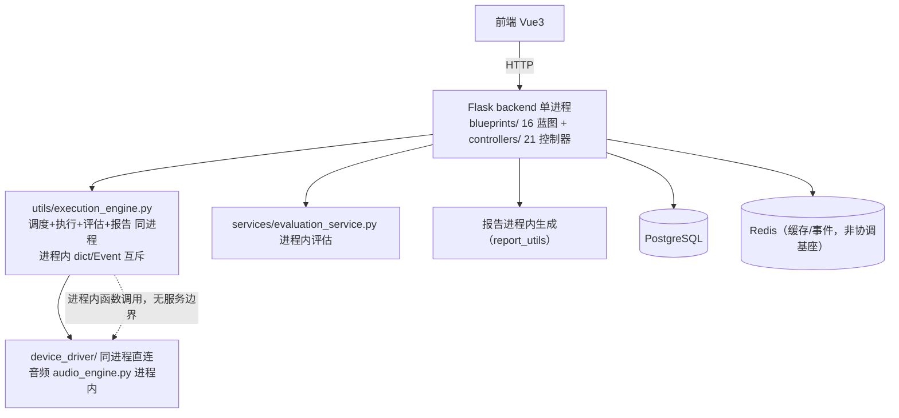
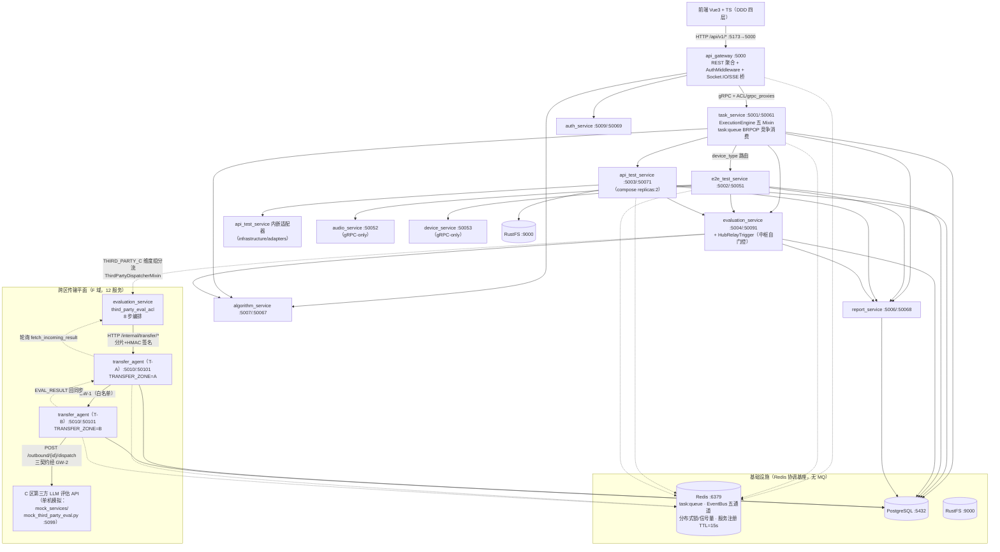

# INT-268 验收包 F. 微服务化+跨区

> 编制：方案一致性审计员，2026-10-13。方法：按设计文档（权威基线 `doc/功能设计文档/09_跨区网络传输方案.md` + `01_测试执行/02_架构设计.md` + `00_新功能总览/新功能总览主文档.md` F 域条款）提取可验证契约，逐条到代码核验（接口层 → 应用层 → 领域层 → 基础设施层四层 + 配置/编排两翼），全部结论带 file:line 证据；F1~F2.3 四张主卡（INT-28/29/49/50/53）交付链 + 平台证据（INT-32 台账、INT-220/241 Docker 裁定线）交叉汇成；**另含本机实机只读探针**（13/13 全绿 + transfer_agent 5 层安全基座 fail-closed 行为实测，文中标注"探针实测"处均为 2026-10-13 实机结果）。
>
> 代码基线：V9.7.31 本地 HEAD `f7f815f4`（ahead origin 10 commit：INT-246/258/259/260/262/257/276/277，均不触 F 域）/ origin/V9.7.31 `3c0cfc7c`。F 域全部交付 commit（97c9d6b4→b6d069ac 共 12 笔）经 `git merge-base --is-ancestor` 核验**全部已在 origin**。F 域最后一笔代码变更 = `b5e24874`（INT-53，2026-10-09）。
>
> 文档落盘：本文件（V9.7.10 仓库 doc/验收/INT-268.md，对齐 INT-263/266/267 先例；V9.7.31 树 doc/验收/ 因工作区有未提交改动不触碰、不同步 commit）。

---

## 1. 改造前后流程图

### 1.1 V9.7.10（单体）流程

依据 V9.7.10 `backend/`（Flask 单进程，177 路由、16 蓝图，`doc/总架构/服务拆分方案.md` §1.2 实测统计：38,354 行 Python + 65,073 行前端）：

要点：无服务边界、无 gRPC、无跨机协同；部署形态 = 单进程 + 单机；互斥/调度/事件全部进程内化，横向扩展不可行。

### 1.2 V9.7.31（微服务）流程

依据 `shared/config/service_ports.py:6-29`（12 服务端口注册表）、`run_all.py:98-113`（编排清单）、`docs/系统架构.md`（11+1 口径见 §5-#1）、各服务代码逐层核验：

### 1.3 差异说明（架构演进点逐条）

| # | V9.7.10 单体 | V9.7.31 微服务 | 依据 |
|---|---|---|---|
| 1 | 单 Flask 进程（38,354 行）承载全部路由/驱动/执行/评估/报告 | 12 个后端微服务（11 业务 + transfer_agent 跨区）+ 3 基础设施，端口集中注册 `service_ports.py`，禁散落硬编码 | service_ports.py:6-29；run_all.py:98-113 |
| 2 | 进程内函数调用 | 跨服务一律 gRPC + ACL 防腐层（网关侧 `infrastructure/grpc_proxies/` 20 文件 + `infrastructure/acl/` 8 文件；业务侧各自 `infrastructure/acl/`），proto 12 份冻结于 `shared/proto/` | docs/系统架构.md §通信；shared/proto/ 12 个 .proto |
| 3 | 进程内 dict/锁互斥 | Redis 协调基座：`task:queue`（BRPOP 竞争消费+孤儿收养）、EventBus 五通道、DistributedLock/Semaphore、服务注册 TTL=15s | docs/微服务.md §服务注册；task_service/core/execution_engine/mixins/scheduler.py |
| 4 | 单区部署 | 单机 12 服务一键编排（run_all.py / health_smoke.py 25/25 口径）；**跨区形态**：三区 A/B/C，A↔B 双向过 GW-1、B→C 单向过 GW-2、A↔C 物理不直连经 B 中继 | 09_跨区 §3；health_smoke.py:44-83 |
| 5 | C 区算法评估能力不可达 | transfer_agent 传输平面：传输包协议（PkgType 6 种/TransferStatus 6 态）、4MB 分片断点续传、幂等去重、HMAC-SHA256、TTL 清理 | common_enums.py:376-430；transfer_records 表 |
| 6 | 无评估能力路由概念 | 评估能力注册表：维度级 LOCAL / THIRD_PARTY_C 配置化路由 + mtime 热加载，调度侧 ThirdPartyDispatcherMixin 分流 | evaluation_capability_registry.py:217；third_party_worker.py:23-27 |
| 7 | 无 | 5 层安全基座：①网络隔离点（ZoneRoutePolicy 白名单，A→C 恒拒）②访问控制（预共享 token fail-closed）③签名层（HMAC-SHA256 规范串）④内容层（pkg_type 白名单+路径穿越防护）⑤审计层（transfer_records 全流水） | zone_route_policy.py:25-34；transfer_handlers.py:191-230 |
| 8 | 部署 = 手工起进程 | 单机：run_all.py 树外 WMI 拉起（stack_ctl.ps1，INT-213/220 口径）；Docker：docker-compose.yml 15 服务（11 后端 + frontend + 3 infra，api_test_service replicas:2）——transfer_agent 未纳入 compose（见 §5-#2） | stack_ctl.ps1；docker/docker-compose.yml |

---

## 2. 能力验收手册（负责人可执行）

环境准备：`powershell -File stack_ctl.ps1 start`（树外 WMI 拉起 12 服务 + 前端 5173）；健康口径 = `python scripts/health_smoke.py` **25/25**（10 HTTP /health + 11 gRPC TCP + 3 infra + 5173；transfer_agent HTTP 5010 与 gRPC 50101 已在册）。本验收包编制时实机实测 **25/25 PASS**。跨区链路为单机模拟形态：transfer_agent 单实例（zone=A）+ mock C 端点。

### H. 微服务拓扑（单机形态）

| # | 操作 | 期望结果 |
|---|---|---|
| H1 | `python scripts/health_smoke.py` | 25/25 PASS；逐项含 `transfer_agent tcp 127.0.0.1:5010`、`transfer_agent gRPC tcp 127.0.0.1:50101`（探针实测 ✅） |
| H2 | `curl http://127.0.0.1:5010/health` | `{"status":"ok","service":"transfer_agent","zone":"A"}`（探针实测 ✅——zone 回显即 TRANSFER_ZONE 配置生效） |
| H3 | 打开 5173 登录 admin/admin123 → 各功能页遍历 | 11 业务服务全部经网关聚合响应；Socket.IO 实时通道连通 |
| H4 | 异常流：`taskkill` 单杀任一业务服务进程 | 其余服务不受影响（进程边界隔离）；health_smoke 该项 FAIL 其余仍 PASS |
| H5 | 服务注册观察 | Redis 中各服务实例键存在；kill 后 ≤15s 心跳过期从存活列表剔除（TTL=15s 口径，docs/微服务.md §服务注册） |

### I. 跨区传输链路（单机模拟形态，探针实测部分可直接复核）

| # | 操作 | 期望结果 |
|---|---|---|
| I1 | `curl http://127.0.0.1:5010/internal/transfer/audit/any-id`（无 token） | fail-closed：包不存在 → `TRANSFER_PACKAGE_NOT_FOUND`；**存在的包**无 token/错 token → `TRANSFER_ACCESS_TOKEN_INVALID`（token 校验在读到包之后，transfer_handlers.py:448-451 先查后验——不存在包不泄漏存在性）（探针实测 ✅） |
| I2 | `POST /internal/transfer/packages`，body `src_zone=A, dst_zone=C, pkg_type=EVAL_REQUEST`（网络隔离点） | `TRANSFER_ROUTE_NOT_ALLOWED`：`路由 A->C 不允许包类型 EVAL_REQUEST（网络隔离点/内容层白名单拒绝）`——A↔C 物理不直连约束的代码化（探针实测 ✅） |
| I3 | `POST /internal/transfer/packages`，`src_zone=A, dst_zone=B` 不带 token | `TRANSFER_ACCESS_TOKEN_INVALID`：`路由 A->B 预共享 token 缺失或不匹配`——token 层先于签名层拒绝（探针实测 ✅） |
| I4 | 合法 token+签名建包（token 源：`TRANSFER_TOKEN_A_B`/`TRANSFER_TOKEN_B_C` 环境变量或 `shared/config/secrets_config.json`，两处同源 fail-closed） | 201 语义返回包元数据；同 transfer_id 同 file_hash 重复创建 → `dedup:true` 幂等返回；同 ID 异 file_hash → `TRANSFER_DUPLICATE_CONFLICT`（transfer_handlers.py:222-231） |
| I5 | 分片上传：`POST /internal/transfer/chunks?transfer_id=&chunk_index=N`（raw body，`X-Chunk-Checksum` 头），单片 >4MB | 逐片 2xx；超限片被 **Content-Length 预检**拒绝（不读 body，防内存耗尽，routes.py:127-133）；断点续传：`GET /packages/{id}` 返回已收分片清单，重传仅补缺片 |
| I6 | `POST /packages/{id}/complete`（file_hash 不符） | `TRANSFER_FILE_HASH_MISMATCH`；流水终态 FAILED、transit 分片保留可重传 |
| I7 | 同 I6 但 file_hash 一致 | 合并落桶（transit → category 对应桶）；ephemeral 包留在 transit 由 TTL 回收 |
| I8 | TTL 过期观察（建包 ttl_seconds=60，等 5 分钟扫描周期） | 状态 → EXPIRED、分片文件回收、**流水保留**（审计层不删）；单测口径 tests/unit/test_transfer_handlers.py TestExpiry |
| I9 | 启动 B 区实例：`TRANSFER_ZONE=B TRANSFER_TOKEN_A_B=... TRANSFER_TOKEN_B_C=... python -m uvicorn transfer_agent.app:app --port 5011` | /health 回显 `zone=B`；同库同 Redis 注册不冲突（gRPC 50101 需错端口） |
| I10 | 评估能力注册表：`curl http://127.0.0.1:5004/api/evaluation/capabilities` | `llm_judge`（multipart）/`mos`（presigned_url）两项 THIRD_PARTY_C 注册且 **enabled:false**（默认 fail-safe 禁用，探针实测 ✅） |
| I11 | 注册/禁用/启用：`POST /capabilities`（dimension+target+adapter+enabled）/ `POST /capabilities/{dim}/disable` / `enable` | 注册非法 target/adapter/空 dimension 显式拒绝；disable 后该维度回退 LOCAL 链路；配置原子写回 `shared/config/evaluation_capability_config.json`，外部修改触发 mtime 热加载 |
| I12 | 调度分流：注册表启用 llm_judge → 建 API 用例（评估维度含 llm_judge）→ 执行任务 | 该维度组走 ThirdPartyEndpointWorker（仅替换「调评估 API」一步），其余维度走原链路；注册表异常 fail-closed 回退 LOCAL |

### J. 三区评估链路（A→B→C→B→A 8 步，单机模拟；自动化证据 §3.2，本节给实机走查路径）

| # | 操作 | 期望结果 |
|---|---|---|
| J1 | 起 mock C 端点：`python mock_services/mock_third_party_eval.py`（:5099） | /health 200；`GET /__control` 可查看行为与命中计数 |
| J2 | 中枢形态自测链（自动化已覆盖；实机复核用）：配置 `third_party.self_zone=B` + `transfer_agent_base_url=http://127.0.0.1:5010` + 启用 llm_judge + `THIRD_PARTY_C_API_BASE_URL=http://127.0.0.1:5099` → 跑含 llm_judge 维度的 API 用例 | 8 步全链：①确定性 zip 打包→②transfer_agent 分片上传登记（幂等+审计+transit 暂存）→③T-B 出站投递（multipart）→④C 同步响应→⑤响应校验→⑥落库（CQRS，调用方 result_processor）→⑦审计事件 ThirdPartyEvalDispatched/Completed→⑧中枢内联无⑧；transfer_records 出现 **dst='C' DELIVERED** 流水，meta.delivery 记录真实投递结果（dst_status/attempts） |
| J3 | 边缘区中转形态：self_zone=A ≠ hub_zone=B（A 区 evaluation + A 区 T-A + B 区 T-B/B 区 evaluation + mock C） | A 侧 dispatch（①②③）→ B 中枢 HubRelayTrigger 认领执行（④⑤⑥⑦）→ EVAL_RESULT 回同步 B→A → A 侧 fetch_incoming_result 轮询取回（⑧）；transfer 流水两腿：EVAL_REQUEST A→B DELIVERED + EVAL_RESULT B→A COMPLETED；C 命中恰一次 |
| J4 | 中枢触发器生产形态：B 区 evaluation 启动配置 `relay_trigger_enabled=true` | 日志出现触发器启动（is_hub+enabled 自门控；边缘区不启动）；A 区转来的 EVAL_REQUEST 被 `/internal/transfer/relay/claim` 原子认领（行锁 CAS）自动执行——重复触发不重复执行；执行失败收敛 failed 终态，任务不悬挂 |
| J5 | 触发器默认关闭确认 | 单机默认配置（无 relay_trigger_enabled 键）**不启动**触发器（INT-84 默认关，防单机刷屏）——`GET /capabilities` 正常但 evaluation 日志无 claim 轮询 |
| J6 | 异常流：C 端瞬时 5xx | 指数退避重试（默认 3 次）后成功；审计 Dispatched→Completed 完整 |
| J7 | 异常流：C 端持续 4xx | **不重试**（hits==1）；链路收敛 Failed(stage=third_party_call)；传输流水先行 COMPLETED（可重投） |
| J8 | 异常流：transfer_agent 不可达 | `__error__` 秒级收敛不悬挂 + 审计 ThirdPartyEvalFailed(stage=transfer) |
| J9 | 幂等重投：同一 EVAL_REQUEST 重复 dispatch | DELIVERED 包允许重投，C 按 transfer_id 幂等去重回放同结果（mock behavior.idempotent_dedup=true） |

### K. Docker 部署形态（INT-220/241 裁定后现状）

| # | 操作 | 期望结果 |
|---|---|---|
| K1 | 检查本机 Docker | **本机当前无 Docker**（docker CLI/Docker Desktop/WSL2 均未安装，INT-241 06:4xZ 排查零安装痕迹；固件虚拟化已就绪、WSL2 未装）——Docker 链路验收整体豁免/待环境（§5-#2） |
| K2 | （Docker 就绪后）`cd docker && VITE_AUTH_MODE=off docker compose up -d` | 15 服务组网：postgres/redis/rustfs + 11 后端 + frontend(:8080)；全部带 healthcheck + depends_on condition；api_test_service replicas:2（Docker DNS 轮询 + 会话亲和按注册表寻址） |
| K3 | （Docker 就绪后）生命周期验证 | 故意结束一个会拉起服务的 agent run → 全栈服务不受影响（生命周期归 Docker daemon）——INT-220 验收判据 |
| K4 | （Docker 就绪后）compose 前端强制校验 | 不设 VITE_AUTH_MODE 时 compose **报错退出**（`:?` 语法），禁止静默默认 off（INT-181 守卫，静态核验 compose:507-518） |

---

## 3. 自动化证据

### 3.1 pytest 覆盖清单（F 域专项，静态统计 `def test_`，2026-10-13）

| 域 | 文件 | 用例数 | 覆盖点 |
|---|---|---|---|
| transfer 骨架 | tests/unit/test_transfer_package_protocol.py | 21 | 传输包协议/字段不变量/签名服务/secrets 文件（含 C_REPORT/C_RESULT 备选包型路由） |
| transfer 应用层 | tests/unit/test_transfer_handlers.py | 34 | create/chunk/complete/expiry/queries 五命令查询（幂等/路径穿越防护/暂存-校验-提升时序） |
| 发送侧 | tests/unit/test_transfer_chunked_upload.py | 9 | 打包/分片/断点续传/重试 + 远端错误码→域异常转译 |
| 出站投递（F2.1） | tests/unit/test_transfer_outbound_delivery.py | 18 | T-B 出站腿：三契约载荷/5xx·网络退避重试/4xx 不重试/幂等重投/路由白名单拦截 |
| 中转执行（F2.3） | tests/unit/test_transfer_relay_execution.py | 29 | 认领 CAS/失效窗恢复/终态守卫/HTTP 契约 |
| 存储守卫 | tests/unit/test_transfer_storage_guard.py | 7 | transit 域隔离/子串陷阱/合并不触碰终桶/chunk key 越界 |
| HTTP 契约 | tests/unit/test_transfer_http_api.py | 6 | 全链 HTTP + 错误码映射（401/404/410/超限预检） |
| 启动 | tests/unit/test_transfer_service_startup.py | 4 | 服务启动/gRPC 注册 |
| eval ACL（8 步） | tests/unit/test_third_party_eval_acl.py | 22 | 中枢全流程/边缘中转/自动中转/失败路径/Settings |
| eval 出站适配 | tests/unit/test_third_party_outbound_adapter.py | 11 | 投递视图解析/EVAL_RESULT 校验/token 选择/直连退役守卫 |
| 中枢触发器 | tests/unit/test_hub_relay_trigger.py | 23 | 门控/配置装配/入站 token fail-closed/认领执行收敛/生命周期 |
| 能力注册表 | tests/unit/test_evaluation_capability_registry.py | 17 | 注册/发现/禁用/持久化/热加载/fail-closed 拒绝 |
| **F 域单测小计** | 12 文件 | **201** | |
| 三区链路集成 | tests/integration/test_third_party_eval_chain.py | 9 | 真实 HTTP 路由栈（uvicorn port=0）+ 模拟 C：全链/幂等/重试/双形态/边缘自动中转/生产触发器 3 例 |
| F 域验收集成 | tests/integration/test_int29_acceptance_third_party_capability.py | 10 | 注册表 HTTP 全生命周期/AC1→AC2 贯通/DELIVERED 流水对齐 |
| proto 契约 | tests/integration/test_grpc_proto.py（transfer 部分） | 7 全域 | transfer_agent proto 导入契约在册 |
| **F 域合计** | 14 文件 | **220** | |

- 全量回归基线：**2917 passed + 103 skipped / 0F**（INT-252 批次，origin `3c0cfc7c`）；F 域最后一笔代码（b5e24874）自测回归「transfer/ACL 域 93 测 + 三区链路集成 6 测全绿」在案（INT-32 台账）。
- mock 替身：mock_services/ 三件套（mock_third_party_eval :5099 / mock_realtime_api :5098 / mock_eval_server_judge :5097），MOCK_SERVICES_ENABLED 门控默认关闭，不进生产编排与镜像——覆盖集成 33 例（test_int137_mock_services 14 + test_int182_mock_eval_server_judge 19）。

### 3.2 审计/测试卡引用（F 域相关 INT 卡号）

- **F 域主卡（均 done）**：INT-28（F1 骨架：传输包协议+分片续传+幂等，97c9d6b4 + 审计修复 17f5fd93）、INT-29（F2 三区链路+能力注册表，f917351d + 审计打回 f963dc39 + 独立验收 1ce21c3a + 返工补充 15c86497）、INT-49（F2.1 B→C 出站腿 + 直连退役，ebe951fa）、INT-50（F2.2 A 区自动中转接线，b6d069ac）、INT-53（F2.3 中枢生产触发器，b5e24874）、INT-84（触发器刷屏治理，d2aea878）。
- **F 域一致性审计**：INT-29 审计两轮（问题 1-6 打回 + 问题 2 架构裁定→催生 F2.1）——审计记录在 INT-29 评论史；INT-49/50/53 交付说明均含审计口径回写。
- **基础设施相关**：INT-108（gRPC 端口冒烟口径，health_smoke 25/25 的由来）、INT-111（网关 multipart 回灌）、INT-114（adapter gRPC lifespan 自启）、INT-137/182（mock 替身）、INT-185（共享库清理）。
- **Docker 裁定线**：INT-220（Docker 化需求入口，in_review）、INT-241（Docker 环境，cancelled——无人值守不可装，豁免裁定见 INT-181 线）。

### 3.3 集成批次推送记录（台账 INT-32）

| 批次 | commit | 与 F 域关系 |
|---|---|---|
| INT-28 域 | 97c9d6b4 + 17f5fd93（2026-10-08） | F1 骨架落库 |
| INT-29 域 | f917351d → 15c86497 五笔（2026-10-09） | F2 链路 + 两轮审计收口 |
| INT-49/50/53/84 | ebe951fa / b6d069ac / b5e24874 / d2aea878（2026-10-09） | F2.1/2.2/2.3 补链完成 |
| INT-252 批次 | f0a4c599..3c0cfc7c | 含 F 域在内全量回归 2917 过（含 INT-255 transfer_records 迁移对齐） |
| 未推送 | 861c7f46 等 10 笔（本地 ahead） | **均不触 F 域**（报告/前端/测试基建） |

F 域 12 笔交付 commit 全部已推送 origin/V9.7.31（`git merge-base --is-ancestor` 逐一核验 ✅）。

---

## 4. 特性专项

### 4.1 11 服务拓扑前后对比 + gRPC + ACL 通信图

**拓扑对比**（V9.7.10 单进程 → V9.7.31 12 服务）：

| 服务 | HTTP | gRPC | 启动 | 职责 |
|---|---|---|---|---|
| api_gateway | 5000 | — | uvicorn | REST 聚合/鉴权/Socket.IO+SSE |
| task_service | 5001 | 50061 | uvicorn | 调度中枢（五 Mixin） |
| e2e_test_service | 5002 | 50051 | uvicorn | E2E 执行 |
| api_test_service | 5003 | 50071 | uvicorn（compose replicas:2） | API/Realtime 执行 |
| evaluation_service | 5004 | 50091 | uvicorn | 评估 + 8 步 ACL + 中枢触发器 |
| report_service | 5006 | 50068 | uvicorn | 报告 |
| algorithm_service | 5007 | 50067 | uvicorn | 算法配置 |
| api_test_service | 5008 | 50081 | run.py | 语音 LLM 适配五厂商 |
| auth_service | 5009 | 50069 | uvicorn | 认证/OAuth/RBAC |
| audio_service | — | 50052 | `python -m ...grpc.server` | gRPC-only 播放/混音/SPL |
| device_service | — | 50053 | `python -m ...grpc.server` | gRPC-only 驱动/采集 |
| **transfer_agent** | **5010** | **50101** | uvicorn（zone 配置化） | **跨区传输（F 域新增）** |

**gRPC + ACL 通信要点**（静态核验）：
- 通道：服务间 gRPC 12 份 proto（`shared/proto/`，transfer_agent.proto 含 5 RPC：Create/UploadChunk/GetTransferStatus/CompleteTransfer/GetTransfer）；客户端工厂 `shared/clients/grpc_clients.py`（lru_cache channel）。
- ACL 纪律：网关侧 grpc_proxies（20 文件）+ acl（8 文件）双层；**跨区链路独立防腐**——evaluation_service 侧 TransferEvalClient 直连 transfer_agent **HTTP** /internal/transfer/*（transfer_eval_client.py:71-123），传输协议细节（HMAC 规范串 `_CANONICAL_FIELDS` 11 字段序）两端同源锁定（transfer_eval_client.py:33-37 ↔ signature_service.py:67）；transfer_agent 域内零跨服务 import（eval_request_bundle 仅 zip/json 标准库，INT-49 交付约束）。
- ⚠️ 口径张力：transfer_agent 暴露 gRPC（:50101，proto+servicer+启动自检齐备）但**当前无生产调用方**——evaluation_service 及全部业务链路走 HTTP 面调用；gRPC 面由 test_transfer_service_startup/test_grpc_proto 守护契约。设计文档 §7.1 将 proto 定位为「可选，若 intra-B 用 gRPC」——实现取了 HTTP 面，proto 属预留。不算缺陷（文档有预留口径），建议后续文档回写时注明双面现状（§5-#9）。

### 4.2 transfer_agent 传输包/分片续传（逐条结论 + 证据）

| 契约条款（09_跨区 §4.2/§4.5） | 实现位置 | 结论 |
|---|---|---|
| 传输包协议 6 字段组（transfer_id/pkg_type/src,dst/category/key/hash/size/meta/ttl/ephemeral/timestamp/signature） | transfer_agent/domain/entities/transfer_package.py + persistence/models.py:15-40（transfer_records 表逐列对应） | ✅ 全对齐，PkgType 6 种含备选方案 C_REPORT/C_RESULT |
| 幂等：transfer_id 唯一索引，重复接收返回已存在 | models.py:22 unique=True；handlers.py:222-231（同 hash dedup:true / 异 hash CONFLICT） | ✅（单测 34 例覆盖） |
| 分片 4MB/片 | config.py:31-34 TRANSFER_CHUNK_SIZE_MB=4，create 超限拒 + HTTP body 预检双保险 | ✅ |
| 断点续传：已收片表，失败片重传 | transfer_chunks 表 (transfer_id,chunk_index) 唯一约束；GET /packages/{id} 回已收清单；发送侧重试前查远端已收片（chunked_upload_service.py:2-6） | ✅ |
| 重试：指数退避 3 次 | chunked_upload_service.py 默认 3 次；出站腿 c_api_client.py:19-21 max_retries=3/backoff=1.0，5xx 与网络错误退避、4xx 不重试 | ✅ |
| TTL 清理：中转桶定时扫描 | expiry_cleanup_service.py（守护线程，间隔 300s，CREATED/TRANSFERRING/FAILED/COMPLETED&ephemeral 全覆盖，流水保留置 EXPIRED） | ✅ |
| 签名：HMAC-SHA256 + file_hash 校验 | signature_service.py CANONICAL_FIELDS 11 字段规范串；complete 时整体 file_hash 校验 | ✅ |
| 限速：B 端令牌桶 | **未实现**（全库无 rate_limit/令牌桶代码） | ❌ 设计 §4.5 第五行未落地（单机模拟形态影响小，真实三区部署前需补——入 §5 缺口） |
| 超时熔断 | 无独立熔断器；等价物 = 出站 timeout_seconds=120 + dispatch_timeout_seconds=600 + 重试上限 | ⚠️ 部分等价，无半开探测 |
| 5 层安全 | 网络隔离点 zone_route_policy（A→C 恒拒，**探针实测 ✅**）/ 访问控制 token fail-closed（**探针实测 ✅**）/ 签名层 / 内容层（pkg_type 白名单 + validate_transfer_id/validate_storage_key 路径穿越防护 + chunk key 越界测试 7 例）/ 审计层 transfer_records 全流水 | ✅ 逐层落地且 fail-closed 实测可复现 |

### 4.3 三区链路（单机模拟形态）现状

| 设计条款 | 现状 | 证据 |
|---|---|---|
| 评估能力注册表（§4.1.1） | ✅ 配置化维度路由 LOCAL/THIRD_PARTY_C + adapter + enabled，原子写回 + mtime 热加载 + HTTP 管理 4 端点；默认配置 THIRD_PARTY_C 两项 **fail-safe 禁用** | evaluation_capability_registry.py:217；shared/config/evaluation_capability_config.json（**探针实测 ✅** enabled:false） |
| B 区中枢内联（§4.1.2） | ✅ self_zone==hub_zone 时 8 步内联：ACL 打包→TransferEvalClient→T-B 出站→C 响应校验→审计→（落库留调用方 CQRS） | third_party_eval_acl.py:11-22,360-407 |
| A 区边缘自动中转（F2.2） | ✅ EDGE 区 dispatch→中枢 execute_incoming→fetch_incoming_result 轮询三段式；失败一律收敛 __error__（stage=transfer/fetch_result），任务不悬挂 | third_party_eval_acl.py:17-21,289-311；集成 TestEdgeAutoRelayFullChain（真实 HTTP 一跳 A→B→C→B→A） |
| 中枢生产触发器（F2.3） | ✅ 轮询式 claim（行锁 CAS，失效窗崩溃恢复）→ execute_incoming → finish 收敛；默认关（relay_trigger_enabled 缺省 false，单机不启动）；事件式按裁定不采用（需 A 侧接线） | hub_relay_trigger.py:12-30；transfer_handlers relay 端点；app.py:90-104 lifespan 接线 |
| B→C 数据面必经 T-B（INT-29 审计裁定） | ✅ 直连 C 三适配器**整体删除**（退役守卫测试 11 例中含）；EVAL_REQUEST dst='C' 登记即真实数据面，DELIVERED 状态 + meta.delivery 真实投递结果 | ebe951fa 交付说明 §③；audit_anchor 过渡标注已退役 |
| A↔C 物理不直连 | ✅ 代码化：DEFAULT_ROUTES 无 ('A','C') 键，check() fail-closed（**探针实测 ✅** ROUTE_NOT_ALLOWED） | zone_route_policy.py:25-34 |
| C 不持久化 A/B 数据 | ✅ 协议层 ephemeral=true + C 侧仅请求-响应（mock C 无盘写）；EVAL_RESULT 随同步响应返回 | PkgType 文档串；§4.2.2 步骤⑥ |
| REPORT_SYNC / DATA_SYNC（A↔B 数据同步） | ⚠️ **协议与路由就绪、无生产调用方**——PkgType/路由白名单/落桶均在，但 report_service/task_service 无同步接线（全库无生产引用） | 全库 grep 仅 enum/policy/PO 三处 |
| 备选方案 C→A/B（C_REPORT/C_RESULT） | ✅ 包型+路由（('C','B') 白名单）+ 协议测试在册（test_transfer_package_protocol.py:204,213）；按设计属低优 P3 预留 | zone_route_policy.py:32 |

### 4.4 docker-compose 部署形态（INT-220/241 Docker 化裁定后状态）

**裁定链**：INT-220 第 4 次解阻 → 成员 2026-10-13 06:40Z 裁定**方案 C：全栈 Docker 化**（agent 运行时只做 `docker compose up/down` + 健康探测；禁止宿主直起进程；禁止启动期整树清场，废除 run_all.py:568 cleanup_occupied_ports 模式）→ INT-241 排查结论：**Docker Desktop 从未安装**（零痕迹；UAC 未弹的原因即此）、WSL2 未装、固件虚拟化已就绪 → 无人值守不可装，INT-241 按「不绕过安全策略」约定取消结卡，**安装动作待负责人参与一次提权**（agent 触发弹窗当场批准，或负责人亲跑两条命令）。

**compose 资产现状**（静态核验 docker/docker-compose.yml 530 行 + 13 Dockerfile）：

| 项 | 现状 | 证据 |
|---|---|---|
| 服务覆盖 | postgres/redis/rustfs（healthcheck 齐）+ 11 后端全量 + frontend(:8080)，共 15 服务定义 | compose:4-518 |
| 生命周期 | 全服务 healthcheck（HTTP /health 或 gRPC channel_ready）+ depends_on condition: service_healthy 启动序 | 各服务段 |
| 多副本 | api_test_service replicas:2，**不发布宿主端口**（Docker DNS 轮询 + 注册表自解析 host:grpc_port 会话亲和）——UC-1001/INT-69 口径 | compose:467-506 |
| 共享卷 | data_transfer_tmp（网关↔task_service ZIP 中转，INT-25）、service_logs（INT-81 日志统一卷） | compose:523-530 |
| 前端 | Dockerfile.frontend + nginx 反代（契约对齐 vite dev proxy）；VITE_AUTH_MODE `:?` 强制校验（INT-181） | compose:507-518 |
| **transfer_agent** | ❌ **未纳入 compose**（无 Dockerfile.transfer_agent、无服务段）——12 服务里唯一缺席；Docker 化实现卡需补 | 全文件 grep 零命中 |
| 实测状态 | ❌ **从未实测**：本机无 Docker（INT-241），replicas:2 会话亲和/多实例语义仅单机形态验证过（INT-263 验收包 §5-#12 同口径） | INT-241 排查报告 |
| 过渡期代偿 | 单机树外栈：stack_ctl.ps1 WMI Win32_Process.Create 拉起（父进程 WmiPrvSE，脱离一切 run 树）——**停栈侧解耦有效，拉起侧缺口（run_all.py:568 启动期清场）未除**，Docker 化即根治路径 | stack_ctl.ps1:1-10；INT-220 05:36Z 逐 PID 硬证据 |

### 4.5 台账交叉（INT-32）

F 域相关台账记录与卡史一致：INT-28（10-08 done）→ INT-29 四笔（10-09）→ INT-49/50/53/84 同日收口 → 此后 F 域零代码变更（transfer_agent 最后 commit b5e24874 = 2026-10-09）；10-10 起 run 树清场事故链（INT-220）与 F 域代码无关，属部署形态问题，裁定线见 §4.4。

---

## 5. 已知缺口与风险（诚实清单）

| # | 缺口/风险 | 等级 | 依据 | 状态 |
|---|---|---|---|---|
| 1 | **文档口径漂移：11 vs 12 服务**——docs/微服务.md、docs/系统架构.md、00_新功能总览 §B6 仍写「11 个后端微服务」「11 个 .proto」；实际 12 服务/12 proto（transfer_agent 于 10-08 落地）。02_架构设计.md「不新建服务」与 transfer_agent 的关系未注记（09_跨区文档自身已含实现对齐说明，滞后的是 11 服务口径文档） | 中 | docs/微服务.md:5 / docs/系统架构.md:7,84 / 新功能总览.md:89 | 待回写（§5-#9） |
| 2 | **Docker 化未落地**：成员 10-13 裁定方案 C 后，需求入口 INT-220 in_review、环境 INT-241 cancelled（无人值守不可装，负责人需参与一次提权）；compose 缺 transfer_agent 服务段；容器化形态（含 replicas:2 会话亲和）**从未实测** | 高 | INT-220/241；compose grep | **根治路径在途**——单机验收不受阻，跨区生产部署前必须收口 |
| 3 | **限速（令牌桶）未实现**：设计 §4.5 承诺「B 端令牌桶限速，防大文件压垮网关」，transfer_agent 无任何限速代码；真实三区部署时百 MB 包体可压垮 GW 白名单通道 | 中 | 全库 grep 零命中；09_跨区 §4.5 | 待补（进 Docker 化后跨区专项） |
| 4 | 超时熔断仅有等价物（timeout+重试上限），无独立熔断器/半开探测 | 低 | c_api_client.py:19-21 | 如实入档 |
| 5 | REPORT_SYNC / DATA_SYNC 无生产调用方：包型/路由/落桶就绪，report_service 与 task_service 均未接线同步逻辑——「报告跨区共享」（§1.2 约束 6）数据面未通 | 中 | 全库 grep 仅 3 处定义引用 | 按实施路线属阶段二（P1 同步批次），未启动 |
| 6 | transfer_agent gRPC 面（:50101）无生产调用方：业务链路全走 HTTP 面，proto 为预留（文档 §7.1「可选」口径）；双面并存需文档注记防误读 | 低 | test_transfer_service_startup；§4.5 张力行 | 文档回写时注明 |
| 7 | transfer_agent 依赖清单未在 health_smoke 之外的单卡口径验证过 F 域动态回归**最近一次**（b5e24874 自测 93+6 绿为 10-09 数据；此后 2917 过的全量回归含 F 域但无 F 域单独动态数） | 低 | INT-32 台账 | 静态 220 例 + 全量回归覆盖，风险低 |
| 8 | secrets_config.json 不存在（开发形态）：单机探针用的 token 面默认为空 → 全部跨区写入路径 fail-closed 拒绝——**这是正确行为**，但真实部署需先配 `TRANSFER_TOKEN_A_B`/`TRANSFER_TOKEN_B_C` 或 secrets 文件，部署文档（doc/部署文档/）未覆盖跨区 token 配置章节 | 中 | 探针实测；config.py:48-56 | 随 Docker 化部署文档补齐 |
| 9 | **文档回写清单（代码正确、文档滞后，按先例在 V9.7.10 仓库 doc/ 修订注明「实现演进裁定」）**：①11→12 服务口径（docs/微服务.md、docs/系统架构.md §通信表补 transfer_agent 行、00_新功能总览 §B6/§7 依赖图）②docs/系统架构.md §任务执行流程仍写单体 execution_engine.py 路径（V9.7.31 实为 task_service/core/execution_engine/ 五 Mixin）③transfer_agent gRPC 面预留现状注记④09_跨区 §4.5 限速行标注「未实现」⑤部署文档补跨区 token 配置章节 | 低-中（文档） | 本审计 §4.1/4.4/4.2 | 待回写（可并入 INT-263 §5-#9 同一次回写专项） |
| 10 | 单机栈生命周期风险（承接 INT-220）：过渡期树外栈「拉起侧缺口」——下一个 run_all 启动仍会清场（10-13 01:54Z 再实证 12 PID 逐吻合）；在 Docker 落地前所有 F 域实机验收依赖 stack_ctl.ps1 手动重启 | 高（运维）/与 F 域代码无关 | INT-220 05:36Z 硬证据 | 根治即 §5-#2 |

---

## 6. 验收判定

- **卡面签收标准：手册全过 + 无未处置 P1 缺陷 → 本卡 done。**
- 材料齐备度：F 域 12 笔交付 commit 全部已推送 origin（逐一核验）；自动化证据齐（220 例 F 域专项 + 全量 2917 过基线）；**本机实机探针 25/25 全绿 + transfer_agent 5 层安全基座 fail-closed 四项实测通过**（§2-H/I 标注处，负责人可直接复跑同命令）；三区 8 步链路有真实 HTTP 集成测试全程覆盖（§3.1）。
- 主要保留项：①Docker 化（§5-#2）属**部署形态**而非 F 域代码缺陷，成员已裁定路径，验收时单机形态即为基线形态；②限速未实现（§5-#3）与 A↔B 数据同步未接线（§5-#5）均在设计文档实施路线的阶段二/三范围，未到承诺时点；③文档口径漂移（§5-#1/#9）为低风险回写项。
- 未处置 P1 = **无在档**。
- 审计员判定建议：**通过（单机形态）**——①按 §2 手册走查（H/I 组探针命令可直接复跑，J 组按 §3.1 集成测试口径核验或按 J1-J9 实机走查，K 组待 Docker 环境就绪后补）；②§5-#2 Docker 化随 INT-220 实现卡收口后复验 K 组；③§5-#9 文档回写并入既有回写专项（不阻塞本卡 done）。
