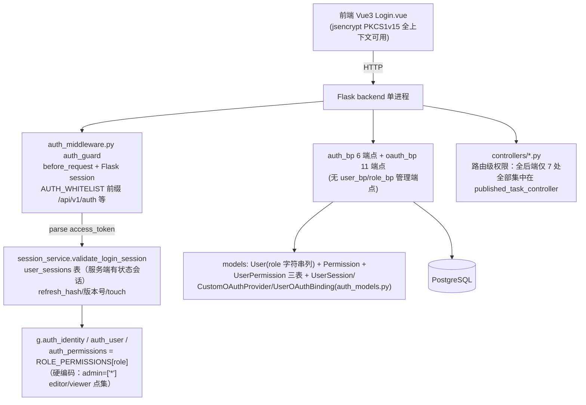
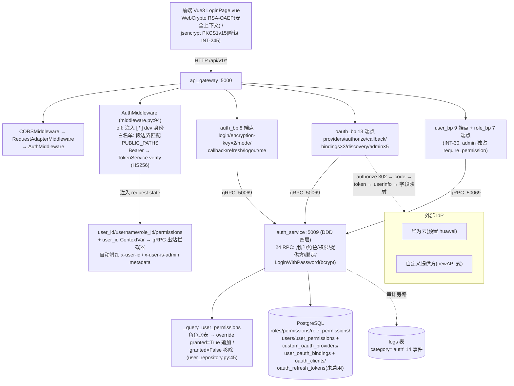

# INT-269 验收包 G. RBAC+登录

> 编制：方案一致性审计员，2026-10-13。方法：按设计文档（权威基线 V9.7.31 树 doc/功能设计文档/00_新功能总览 §6.7 + docs/RBAC权限划分.md + docs/oauth.md）提取可验证契约，逐条到代码核验（网关路由 → auth_service gRPC → 数据模型三层），全部结论带 file:line 证据；4 个专项（认证流程 / require_permission 覆盖 / 审计事件 / 非安全上下文降级）+ 平台证据（G1/G3/G 域 INT 卡 + 台账 INT-32）交叉汇成。
>
> 代码基线：origin/V9.7.31 @ `3c0cfc7c`（INT-252 批次）+ 本地 11 个未推送 commit 至 `857c7680`（含 G 域相关的 INT-262 报告检索修复、INT-285 注册口径落地）。文档基线：docs/RBAC权限划分.md（经 INT-189 白名单表对齐）、docs/oauth.md（经 INT-189/INT-245 补记）。核验为只读静态审计；UI 手册段引用 INT-260 selenium 证据，未重跑实机。

---

## 1. 改造前后流程图

### 1.1 V9.7.10（单体）流程

依据 V9.7.10 实树核验（backend/blueprints/ 16 个 bp 中 auth_bp 6 端点 + oauth_bp 11 端点；backend/services/auth/ crypto/password/session/token/oauth_service；backend/utils/web/auth_middleware.py）：

要点：RBAC 三表已在但 `role` 是字符串列（admin/editor/viewer）非外键角色表；权限点查表逻辑仅剩 published_task 一域接线（`backend/controllers/published_task_controller.py:250,295,375,474,504,564,589`）；会话为服务端有状态（user_sessions 表 + touch）；白名单整段 `/api/v1/auth` 前缀放行。

### 1.2 V9.7.31（微服务）流程

### 1.3 差异说明（架构演进点逐条）

| # | V9.7.10 单体 | V9.7.31 微服务 | 依据 |
|---|---|---|---|
| 1 | Flask before_request + Flask session | FastAPI BaseHTTPMiddleware `AuthMiddleware`，JWT 无状态（HS256，24h），无 user_sessions 表 | middleware.py:94；auth_service 模型仅 7 表，无会话表 |
| 2 | `role` 字符串列（admin/editor/viewer）硬编码映射 `ROLE_PERMISSIONS` | 5 角色 DB 表 + role_permissions 多对多 + `*` 通配（admin），种子 100 权限点 + `*` | seed_rbac.py:53-247 |
| 3 | 服务端有状态会话（user_sessions + refresh_hash + touch） | 无状态 JWT：`/auth/refresh` 路由自解析旧 token 重签；强失效需扩展 Redis 黑名单（未实现） | auth_bp.py:162-174；token_service.py:44-52 |
| 4 | 密码加密 jsencrypt PKCS1v15 单算法 | RSA 双密钥对 kid 即算法绑定：主 OAEP-SHA256（WebCrypto）/降级 PKCS1v15（jsencrypt），交叉/未知 kid 拒绝 | password_encryption.py:107-124 |
| 5 | 白名单整前缀 `/api/v1/auth` 放行 | 按路径段边界匹配（`_is_public_path`），防 `/auth/oauth` 误伤 `/auth/oauth-providers` 管理端；refresh 路由自解析 Bearer | middleware.py:126-130 |
| 6 | 无用户/角色管理 API | user_bp 9 + role_bp 7 端点 admin 独占（INT-30），差量 override（granted 方向）真实落库，JWT 时效 notice 注入 | user_bp.py、role_bp.py、management_common.py:47-50 |
| 7 | OAuth 提供方硬编码/单表 | 自定义 OAuth 提供方体系（newAPI 移植，INT-51）：CRUD + 启用禁用 + OIDC Discovery + 字段映射 + state 签名防伪 + intent=bind 绑定票据 | oauth_provider_models.py、oauth_bp.py:47-92 |
| 8 | 权限不跨服务（单体） | 方案 A 透传：`x-user-id`/`x-user-is-admin` gRPC metadata（INT-141），下游 CUD 操作人三列落库 + purge admin/owner 收敛 | user_context.py:1-95；purge_permission.py |
| 9 | 审计仅业务域 | auth 审计事件 14 种旁路落 logs（category='auth'），失败仅告警不阻断 | auth_audit.py；common_enums.py:249-263 |
| 10 | 注册口径 8 位密码/邮箱必填 | 成员裁定（INT-285）：6 位（`AUTH_PASSWORD_MIN_LENGTH` 配置化）+ 邮箱必填双端校验 + OAuth 本页跳转 | user_management_service.py:36-43 |

---

## 2. 能力验收手册（负责人可执行）

环境准备：`run_all.py` 起 11 服务 + 前端 5173（隔离验收可用 `--test-db`，INT-246）。当前 `.env` `AUTH_MODE=dev`、`frontend/.env.development` `VITE_AUTH_MODE=dev`（未提交改动，验收前确认两侧一致——INT-180 错位会在登录页顶部出 AuthModeMismatchBanner）。测试账号 `admin/admin123`（DB 引导建号）或 `dev_user/dev_password`（DEV_DEFAULT_* 引导，建号即 admin）。入口 `http://localhost:5173`（hash 路由）。

### A. 登录链路（dev 模式）

| # | 页面路径 → 操作 | 期望结果 |
|---|---|---|
| A1 | 打开 5173 → 跳 `/#/login` | 登录页渲染：登录/注册双 Tab + 已启用 OAuth 提供方动态按钮 |
| A2 | 输入 admin/admin123 → 登录 | 网络面板顺序：`GET /auth/login/encryption-key` 200（返回 `kid+public_key+fallback{kid,public_key}`，INT-245）→ `POST /auth/login`（表单编码，提交体含 `password_encrypted+encryption_key_id`，无明文 password）→ 200 `{access_token, user{id,role_id,role_name,permissions}}` → 跳首页，侧栏出现用户名 |
| A3 | 异常流：错误密码 | 401 `{detail:"用户名或密码错误", code:106 AUTH_CREDENTIALS_INVALID}`，提示不跳转、不发 token |
| A4 | 异常流：过期/伪造密文（公钥轮换后提交旧缓存包） | 401 `{code:105 AUTH_ENCRYPTION_INVALID}`，提示刷新页面（INT-188 语义：加密失败绝不静默回退明文） |
| A5 | 邮箱登录 | 用注册邮箱 + 密码登录成功（auth_service `verify_password` 单查询 OR 匹配 username/email，user_repository.py:318-340） |
| A6 | http+IP 非安全上下文访问（如 `http://<LAN-IP>:5173`） | 前端检测 `crypto.subtle` 缺失 → 动态 import jsencrypt → 用 fallback 公钥 PKCS1v15 加密提交 → 登录成功（INT-245）；登录面板无「加密初始化失败」 |
| A7 | 会话持久化/登出 | 刷新页面仍保持登录（localStorage token）；登出后清 token 回登录页（JWT 无状态，`POST /auth/logout` 仅语义应答） |
| A8 | 刷新 token | `POST /auth/refresh` 携旧 Bearer → 200 新 `access_token`；过期 token → 401「令牌刷新失败」（白名单化，路由自解析不被网关先行拦截） |
| A9 | 模式自检 | `GET /auth/mode` 200 返回 `{auth_mode:"dev"}`；人为把前端构建变量改为 prod（错位）→ 登录页顶部出 AuthModeMismatchBanner（INT-180） |

### B. 注册与自助引导

| # | 操作 | 期望结果 |
|---|---|---|
| B1 | 注册 Tab：用户名+邮箱+密码（≥6 位） | `POST /auth/register` 201（默认角色 guest；空库首个注册用户自动 admin，auth_handlers.py:137-142）→ 用新账号登录成功 |
| B2 | 异常流：邮箱缺省 | 400 `email 为必填项`（INT-285 口径②） |
| B3 | 异常流：密码 5 位 | 400 `密码长度不能少于 6 位`（INT-285 口径①；前端 minlength 同口径） |
| B4 | 异常流：重名 | 400/409 USERNAME_DUPLICATED 语义 |
| B5 | 注册开关关闭（`AUTH_REGISTRATION_ENABLED=false` 重启） | `POST /auth/register` 403「注册未开放」 |

### C. OAuth 提供方（自定义 + 预置华为云）

| # | 操作 | 期望结果 |
|---|---|---|
| C1 | admin 登录 → /#/OAuthProviders → 新建提供方（slug/authorize_url/token_url/userinfo_url/client_id/secret/字段映射） | 201；重复 slug 409（OAUTH_SLUG_DUPLICATED）；列表中 client_secret 掩码显示 |
| C2 | 登录页查看 OAuth 按钮 | 已启用提供方动态渲染；禁用的不出现（`GET /auth/oauth/providers` 仅回已启用项，INT-179 清理后语义） |
| C3 | 点击自定义提供方 → 授权 | 本页跳转 authorize URL（INT-285 口径③）→ mock/真实 IdP 授权 → 回调 302 `/#/login?oauth_token=...` → 前端落 token → `GET /auth/me` 补全用户信息 |
| C4 | OAuth 新身份首次登录 | 自动建独立账户：自定义提供方按 provider+subject 绑定、**绝不按用户名合并**既有账户（INT-51 P1-1）；用户名冲突降级 `{slug}_{username}` 建号 |
| C5 | 预置 huawei（DB 无行时回退环境配置） | `GET /auth/login` 302 → 授权 URL（DB 提供方优先；禁用/未配置回 `/#/login`，不走旧硬编码旁路） |
| C6 | 账号设置页绑定第三方 | intent=bind 授权 → 回调携绑定票据（5 分钟 TTL）→ `POST /auth/oauth/bindings` 落库 → 绑定列表可见 → 解绑幂等 |
| C7 | 异常流：state 篡改/过期 | 30x `oauth_error` 回前端，不签发 token（state 签名防伪，TTL 600s） |
| C8 | 异常流：guest 访问提供方管理 | `GET /auth/oauth-providers` 403「缺少权限: auth:manage_provider」 |

### D. RBAC 角色权限（矩阵抽查，配 seed_rbac.py 五角色）

| # | 操作 | 期望结果 |
|---|---|---|
| D1 | admin 登录 | 侧栏全量菜单（App.vue:105-109 按权限过滤）；`GET /auth/users`、`/auth/roles`、`/auth/permissions` 均 200 |
| D2 | guest 登录（admin 在用户管理分配 guest 角色） | 侧栏仅报告/首页；访问 `/#/tasks` 被路由守卫重定向首页（router/index.ts:81-83）；直接 `GET /api/v1/tasks` 403「缺少权限: task:read」 |
| D3 | tester 登录 | 可建用例/建任务/执行/看报告（task:testcase:audio:report 读写 + 执行）；设备管理/用户管理入口不可见；`GET /test-devices` 403 |
| D4 | algo_engineer 登录 | 可看报告/发报告（report:publish）/管算法定义；`POST /tasks` 403（task:create 无） |
| D5 | device_admin 登录 | 设备/播放设备/SPL/首页全权；`GET /testcases` 403 |
| D6 | 用户附加权限差量（admin 操作） | 用户详情 → 授予 `report:publish` → 该 tester 用户立即获得发布能力（override granted=True）；撤销角色内已有权限（granted=False）→ 生效权限列表即时移除；`'*'` 授予/撤销双向拒绝（WILDCARD_FORBIDDEN，validate_grant/revoke） |
| D7 | 角色管理约束 | 系统内置角色删除 403（ROLE_IS_SYSTEM）；被引用角色删除 409（ROLE_IN_USE）；admin 角色权限集合不可移除 `'*'` |
| D8 | 权限生效延迟提示 | 任一管理写接口响应带 `notice`（JWT 时效：已签发 token 内权限不变，重新登录/刷新后生效） |

### E. 审计与操作人

| # | 操作 | 期望结果 |
|---|---|---|
| E1 | admin 做任一管理写操作（建用户/分配角色/授予/建角色/提供方增删改） | logs 表新增对应事件（AUTH_USER_CREATED / AUTH_USER_ROLE_ASSIGNED / AUTH_USER_PERMISSION_GRANTED / AUTH_ROLE_* / AUTH_OAUTH_PROVIDER_* 等 14 种，category='auth'，含 operator_id/target_id/delta） |
| E2 | 注册 | AUTH_USER_REGISTERED 事件落库 |
| E3 | 登录用户建任务/删任务（AUTH_MODE=dev 或 prod） | 任务 CUD 后 `test_tasks.created_by_user_id/updated_by_user_id/deleted_by_user_id` 落当前用户 id（x-user-id metadata 透传，INT-141）；AUTH_MODE=off 时保持 NULL 不硬编码兜底 |
| E4 | 非admin 删除他人报告后彻底删除（purge） | 403「彻底删除仅限管理员或资源所有者」（x-user-is-admin metadata，purge_permission.py）；admin 或 owner 正常 purge |

---

## 3. 自动化证据

### 3.1 pytest 覆盖清单（静态统计 `def test_`，2026-10-13，基线 `857c7680`）

| 域 | 文件 | 用例数 |
|---|---|---|
| 认证/用户/角色 servicer + sqlite e2e | test_auth_servicer_sqlite_e2e / test_auth_user_role_management / test_auth_empty_email_users | 17+71+3 = 91 |
| G3 登录体系（注册/自定义 OAuth/安全加固/HTTP 层 e2e） | test_g3_auth_http_e2e / test_g3_oauth_callback_flow / test_g3_oauth_login_flow / test_g3_oauth_provider_management / test_g3_oauth_security_hardening | 18+14+10+16+12 = 70 |
| 登录链修复（RSA/双格式/白名单/mode） | test_int147_auth_alignment / test_int147_password_encryption / test_int179_login_chain_fix / test_int180_auth_mode_endpoint / test_int245_dual_padding | 30+8+11+11+15 = 75 |
| dev 引导 | test_local_oauth_dev_bootstrap | 5 |
| **G 域后端单测小计** | **14 文件** | **241** |
| 操作人/收藏/回收站（G 域延伸，INT-141 链） | test_int141_favorites_trash_operator 等 | 49（该文件） |
| UI 自动化（INT-260，登录/导航/视图切换，接 run_gate 门禁） | tests/ui/test_ui_01_login(4) / 02_navigation(4) / 03_case_views(3) | 11 |
| 前端 vitest（认证相关） | authApi.encryptionFallback(5) + passwordEncryption.dualPadding(5) + authModeCheck(8) + tasks.favoriteTrashWiring 等 | 18+ |

- G 域测试特征：test_g3_auth_http_e2e 走真实 FastAPI 路由 + 真实 AuthMiddleware 白名单 + 真实 gRPC servicer（SQLite）+ 本地 mock IdP 真实 TCP 服务（非 monkeypatch）；INT-51 加固后含同名不合并/降级建号/禁用三态回退矩阵 12 例（test_g3_oauth_security_hardening）。
- 全量回归口径同 INT-263：2917 passed + 103 skipped（INT-252 批次；G 域 241 例含于其中）。

### 3.2 审计/测试卡引用（INT 卡号，均 done 除注明外）

- **G 域一致性审计**：INT-187（INT-179 登录链三连断↔文档）、INT-205（INT-147 认证域缺陷包）、INT-230（INT-180 auth_mode 自检）、INT-248（INT-245 双 padding 降级，安全敏感）、INT-251（INT-216 前端单测）、INT-254（INT-245 文档↔代码）。
- **G 域缺陷/改造卡**：INT-30（G1 用户角色权限 API）、INT-36（dev 首个 admin 引导）、INT-37（GRPC_PORT 污染）、INT-47（seed_rbac 全新库）、INT-51（G3 登录体系改造）、INT-84/149/156（users schema 漂移族）、INT-147（认证域 V9.7.10 对齐）、INT-179（登录三连断）、INT-180（mode 自检）、INT-181（VITE_AUTH_MODE 显式注入）、INT-185（共享库 RBAC 残留清理）、INT-186（register 文案）、INT-188（加密失败静默回退明文）、INT-189（认证文档对齐回写）、INT-245（双 padding 降级）、INT-285（注册口径三项，in_review→已按成员裁定落地于 `857c7680`）。
- **UX 审计**：INT-261（全站全量，发现 INT-285 三项口径）、INT-138（实机巡检，in_review）。
- **UI 自动化**：INT-260（selenium 登录 4 例 + 导航 + 视图切换，run_gate 并行隔离栈门禁，done）。
- **测试基建**：INT-185（验收残留防再污染：INT-84/30 teardown 修复）、INT-246（库隔离，in_progress）。

### 3.3 集成批次推送记录（台账 INT-32）

| 批次 | 范围 | G 域相关内容 |
|---|---|---|
| INT-136/144/168/224/226 | 早期→0422af95 | INT-51 登录体系改造、INT-147 认证对齐缺陷包等先后入库 |
| INT-232/236 | ..8f7bdbfd..783bfc45 | INT-180 mode 自检、INT-188 加密语义、INT-189 文档对齐 |
| INT-242/252 | ..f0a4c599..3c0cfc7c | INT-245 双 padding 降级（origin/V9.7.31 当前 tip），回归 2917 过/103 skip，UI 3/3（RSA 登录链） |
| 未推送 11 commit（3c0cfc7c..857c7680） | 861c7f46..857c7680 | **INT-285 注册口径落地**（G 域唯一未推送功能改动，随下批）；余为 A~F 域修复 |

---

## 4. 特性专项（逐条结论 + 证据）

### 4.1 认证流程图核验（RSA 登录 / 注册 / 自定义 OAuth / 角色权限）

**RSA 加密登录链——11 项契约全 ✅**：

| 文档条款（oauth.md §2.7 补记 / RBAC §6.3） | 代码位置 | 结论 |
|---|---|---|
| 公钥登录前下发，双路径 `/auth/login/encryption-key` + `/auth/encryption-key` 别名 | auth_bp.py:21-39；middleware.py:100-106 白名单 | ✅ |
| INT-245：响应含主/降级两套公钥 | auth_bp.py:55-66（payload['fallback']） | ✅ |
| 加密开启时仅接受 password_encrypted/encryption_key_id，明文被忽略 | auth_bp.py:117-127 | ✅ |
| kid 即算法绑定：主 OAEP-SHA256 / 降级 PKCS1v15，交叉拒绝 | password_encryption.py:107-124 | ✅ |
| 解密失败统一 PasswordEncryptionError → 401 AUTH_ENCRYPTION_INVALID；凭证错误 401 AUTH_CREDENTIALS_INVALID（防用户名枚举，401 统一状态码） | auth_bp.py:122-141；error_codes.py:13-14 | ✅ |
| 非安全上下文降级：前端 subtle 缺失 → jsencrypt + fallback kid | passwordEncryption.ts:116-138 | ✅ |
| 请求体双格式：表单（前端契约 URLSearchParams）+ JSON body 兜底 | auth_bp.py:88-112；authApi.ts:68-84 | ✅ |
| bcrypt 校验在 auth_service 内（LoginWithPassword），username/email OR 匹配 | servicers.py:525-543；user_repository.py:318-340 | ✅ |
| JWT payload：user_id/username/role_id/permissions/iat/exp，HS256，24h | token_service.py:21-35 | ✅ |
| 刷新无状态重签、路由自解析 Bearer（白名单化） | auth_bp.py:162-174；middleware.py:107-109 | ✅ |
| `dev_user/dev_password` 引导建号绑定 DEV_DEFAULT_ROLE，建号失败中断登录不放行 | local_oauth.py:39-62（INT-36 修复态） | ✅ |

**注册链——5 项全 ✅**：开关配置化（config.py:24-26，默认 true）→ 403；密码 RSA 密文必填（加密开启时缺密文 400 逐字段点名，INT-186 文案单一来源 user_management_service.py:30-34）→ 邮箱必填 + 最短 6 位（INT-285，user_management_service.py:36-43,98-106）→ 默认角色 guest（`_REGISTER_DEFAULT_ROLE`）→ 空库首用户自动 admin（auth_handlers.py:137-142，count_all 排除软删）。

**自定义 OAuth——8 项全 ✅**：提供方 CRUD admin 独占（oauth_bp.py:190-225 `auth:manage_provider`）；公开列表仅回已启用（oauth_bp.py:41-44）；authorize 302 + state 签名（TTL 600s，config.py:29-30）+ intent 归一（oauth_bp.py:47-63）；callback 换 token→userinfo→字段映射→查/建用户→302 前端携 token（oauth_bp.py:65-92）；绑定票据 intent=bind（5 分钟 TTL，oauth_bp.py:95-110）；同名不合并/降级建号（auth_service.py:152-171，INT-51 P1-1）；预置 huawei DB 优先环境回退、禁用必拒（auth_service.py:39-49）；OIDC Discovery admin 内校验（oauth_bp.py:152-175）。

**角色权限三步校验——与文档 6.7.3 一致 ✅**：登录时 `_query_user_permissions`（user_repository.py:45-81）角色底表 → override granted=True 追加/granted=False 移除 → 权限码数组随 JWT 下发；路由层 `require_permission`（dependencies.py:20-44）`'*'` 通配放行 + 多权限 OR；域内附加防线：`validate_grant/validate_revoke` 双向封禁 `'*'`（auth_service.py:101-120）、用户权限集合判断含通配（auth_service.py:42-50）。

**⚠️ 一项与旧库的语义差异（如实入档，非缺陷）**：`UpdateLastLogin` gRPC + 仓储方法已实现（servicers.py:359-374、user_repository.py:355），但**网关登录链无调用点**（全仓 grep 无 `stub.UpdateLastLogin`）——users.last_login_at/last_login_ip 实际不更新；V9.7.10 在 OAuth 回调与登录时更新（旧库 auth_service 语义）。属半成品接线，记入 §5-#5。

### 4.2 require_permission 覆盖

- **总数**：网关 26 个业务路由文件 324 个 route handler，**293 个已挂 `require_permission`/`require_auth`（90.4%）**，297 处 require_permission 调用（按文件分布：algorithm 41、device 34、audio 30、favorite_trash 18、evaluation 17、task 17、testcase 15、report 15、tag 13、spl 12、log 11、benchmark 11、playback 10、user 8、digital_spl 8、role 7、published_task 7、oauth 5、group 5、api 3、home 3、data_transfer 4、execution 2、sse 1）。
- **有意的 11 处白名单/路由内自校验**：auth_bp 11 个登录链端点（其中 /logout、/me 不在白名单，须 Bearer）；oauth_bp 公开前缀内 bindings 三端点 + discovery 均路由内自校验（oauth_bp.py:114-175）；user_bp /register 白名单 dev 自注册；favorite_trash GET /favorites 用 `require_auth`（per-user 数据无需权限点）。
- **文档对照**：RBAC §3.16 声称「user_bp/role_bp 待实现」已过时——INT-30 已交付并经审计（§5-#2 文档回写项）；overview §6.7.7「P3 铺开进行中：B 域试点」滞后——实际已全域铺开（§5-#2）。
- **guard 缺口 15 处**（详见 §5-#1）：api_bp 4（read/create/update/test）、testcase_bp 6（get_one/create/delete/stop_preview_/export）、task_bp 1（stop）、report_bp 3（secondary-compare/cases search/logs download）。均为「文档已定义权限点、路由未标注」的真缺口——非白名单语义（对比：/favorites 的 require_auth 是有意设计）。

### 4.3 审计事件

- **14 种 AUTH_* 事件全部落库**（auth_handlers.py 14 个调用点：USER_CREATED/REGISTERED/UPDATED/STATUS_CHANGED×2/ROLE_ASSIGNED/PERMISSION_GRANTED/PERMISSION_REVOKED/ROLE_CREATED/ROLE_UPDATED/ROLE_PERMISSIONS_SET/ROLE_DELETED/OAUTH_PROVIDER_CREATED/UPDATED/DELETED），旁路模式失败仅告警（auth_audit.py:44-46），category='auth'，免 TTL 去重（INT-30 P1 修复）。
- **发布域 4 种**：PUBLISHED_TASK_CREATED/VERSION_CREATED/EXECUTED/ARCHIVED（published_task_service.py:172,222,382,504），与任务发布设计文档 §9 预留编码一致（文档写 `task.publish` 点号风格，实现为 `task:publish` 冒号——RBAC 文档命名规范为准，文档笔误级）。
- **Benchmark**：BENCHMARK_RANKING_COMPUTED 落库（benchmark_ranking_service.py:368）。
- **缺口**：登录/登出/登录失败无审计事件（枚举无 AUTH_LOGIN/AUTH_LOGOUT 成员）——V9.7.10 亦无此事件，为共同缺口；「身份不可追溯」目标的登录面追溯目前只能靠 HTTP 访问日志（§5-#6）。

### 4.4 非安全上下文降级路径（INT-245 后状态）

| 层 | 实现 | 证据 |
|---|---|---|
| 后端密钥 | 成对独立 RSA-2048：`AUTH_RSA_KEY_PATH`（OAEP）+ `AUTH_RSA_FALLBACK_KEY_PATH`（PKCS1v15）；kid=SPKI DER SHA-256 前 32 hex；文件不存在 dev 自举生成 | password_encryption.py:126-180；实测 data/auth_key.pem + auth_key_fallback.pem 已生成 |
| 后端解密 | `_resolve_by_kid` 按 kid 归属分派算法；主 kid 优先（同钥误配置保主路径）；密文长度=密钥字节数；非 UTF-8 收敛 401（INT-147 P4） | password_encryption.py:66-103 |
| 公钥下发 | `/auth/login/encryption-key`（+别名）返回 `{enabled,kid,public_key,fallback{kid,public_key}}`；降级公钥加载失败仅缺降级能力不阻塞主路径 | auth_bp.py:42-66 |
| 前端选路 | `isSecureContext`（subtle 存在）→ WebCrypto OAEP 主路径**不回退**；非安全上下文 → 动态 import jsencrypt PKCS1v15 + 降级 kid；降级密钥未下发/加密失败 → PasswordEncryptionUnavailableError，**明文兜底禁止**（INT-188 语义） | passwordEncryption.ts:75-138 |
| 验收测试 | test_int245_dual_padding 15 例 + authApi.encryptionFallback 5 例 + passwordEncryption.dualPadding 5 例；INT-248 审计 done | tests/unit、frontend spec |

结论：**降级路径已闭环**，http+LAN-IP 部署形态可登录（INT-245 卡 done + 负责人实机场景修复验证）。

### 4.5 身份跨服务传播（G↔F 域衔接）

- 方案 A 透传全链就位：AuthMiddleware 注入 ContextVar（middleware.py:177-185）→ 出站拦截器附加 `x-user-id`/`x-user-is-admin`（grpc_interceptors.py:251-252，服务端拦截器按 handler 实际形态包装——INT-141 F1 修复）→ 下游 `user_id_from_context` 消费（report/task servicers + CUD 列填充，ORM 写入点 get_current_user_id）→ purge admin/owner 收敛（purge_permission.py，含批量逐行 owner 过滤防整批越权，INT-141 审计修复）。
- 方案 B（下游自验 ValidateToken）：auth_service 仅实现 GetUserPermissions 查询 RPC；`ValidateToken` 未实现（文档 oauth.md §3 提及为可选方案，未承诺交付——如实记录）。

---

## 5. 已知缺口与风险（诚实清单）

| # | 缺口/风险 | 等级 | 依据 | 状态 |
|---|---|---|---|---|
| 1 | **require_permission 缺口 15 处**（§4.2）：api_bp 4（api_config:read/create/update/test）、testcase_bp 6（testcase:read/create/delete/preview/import_export）、task stop 1（task:execute）、report 3（report:compare/read/download_log）——文档已定义权限点、路由未标注；**在 AUTH_MODE=off 之外的模式下构成实际越权面**（任何登录用户可写 API 配置/删用例/停任务/拉报告日志） | 中（dev 模式当前无实害；prod 上线前必须收口） | 本审计 §4.2 全量扫描 | 建议开【缺陷·对齐】补标注 |
| 2 | **文档滞后回写清单**（代码正确、文档滞后）：①RBAC §3.16「user_bp/role_bp 待实现」+ §6.4 P4 待实现——INT-30 已交付；②overview §6.7.7「P3 铺开 B 域试点」——实际 26 文件 90% 已挂；③overview §6.7.3「88 点/16 域」——seed 实际 100 点 + published_task/digital_spl/task:publish/export/import 域扩展（矩阵 §4.1 未含）；④任务发布文档权限编码点号风格 vs 实现冒号；⑤RBAC §3.16 user 域端点 `POST /auth/users/{id}/permissions` 之外实现多出 DELETE revoke 端点 | 低-中（文档） | 本审计 §3/§4 对照 | 待回写专项（V9.7.31 docs/，先例 INT-189） |
| 3 | **角色-权限矩阵数字口径漂移**：overview 文档矩阵 tester~55/algo~40/device_admin~25/guest~8 vs seed 实际 66/31/26/9——差异主要来自 seed 新增 published_task:*(4)/digital_spl:*(4)/task:publish/export/import(3) 域的归属与矩阵未更新；矩阵逐点抽查（device:read tester✓、home:refresh tester✓、guest 9 点、algo_engineer 8 个关键点）与 seed **方向一致**，仅点数与新增域未入表 | 低 | seed_rbac.py:53-247 vs 文档 §4.1/overview §6.7.3 | 并入 §5-#2 回写 |
| 4 | **登录/登出无审计事件**：AuditEvent 无 AUTH_LOGIN/AUTH_LOGOUT 成员，登录成败/登出不落 logs（V9.7.10 同样无）；「谁在何时登录」仅 HTTP 日志可查 | 低（合规增强项） | common_enums.py:249-263、§4.3 | 拍板是否补 |
| 5 | **last_login 半成品**：UpdateLastLogin RPC + 仓储方法 + PO 列俱在，网关登录链无调用点，last_login_at/last_login_ip 恒空 | 低 | §4.1 末项 | 建议并入缺口#1 补标卡或开独立小卡 |
| 6 | **强失效/会话管理缺席（相对 V9.7.10 回退）**：V9.7.10 有 user_sessions 服务端会话（版本号/撤销/touch），V9.7.31 无状态 JWT——改密/禁用后已签发 token 最长 24h 仍有效（管理写接口以 notice 提示缓解）；oauth_refresh_tokens/oauth_clients 两表建模未启用（自建 OAuth Server 未开工，`OAuthClient` 无运行时调用点）；文档已如实标注「如需强失效可扩展 Redis 黑名单」 | 中（安全演进拍板项） | §1.3-#3；user_models.py:110-161 | 拍板：是否恢复会话表/黑名单 |
| 7 | **INT-299 收藏/回收站/操作人半成品收尾**（todo，负责人实机复验在案）：卡面证据（favorite 404、7 表缺列、回收站未挂）与当前 HEAD 静态状态存在**部分过期**——favorite_trash_bp 19 端点已注册（app.py:156-157）、testcase/task/report 模型三列已在（task_models.py:42-53 等）、Tasks.vue 已挂 FavoriteTrashBar（:173）；但 **algorithm_service 9 表确认零操作人列**、audio upload 部分表/redis 侧仍待核——以该卡实机复验为准，不重复开卡 | 中 | INT-299 vs 本审计 HEAD 核验 | INT-299 todo 跟踪 |
| 8 | **INT-285 未推送**：注册口径（6 位/邮箱必填/OAuth 本页跳转）落地 commit `857c7680` 尚在本地 11 个未推送 commit 中，卡 in_review | 低 | git log 3c0cfc7c..HEAD | 随下批集成推送收口 |
| 9 | **INT-262 已修复未复验**：`/reports/by_task` 透出 + task_id 精确过滤已落（7bb84a45 + test_int262_report_task_filter 244 行），卡 in_review——INT-263 验收包 B9 复验点，G 域无连带 | 低 | git show 7bb84a45 | INT-262 in_review |
| 10 | **生产模式（prod/华为云）未联调**：HuaweiOAuthProvider 与预置提供方链路齐备（含 mock IdP 测试），但真实 HW_OAUTH_* 凭据/域名回调从未实测；JWT_SECRET 默认值 `dev-secret-change-in-production`（config.py:61）无强制校验；docker-compose auth_service 已编排（INT-31）但容器化形态未实测（本机无 Docker，INT-271 in_progress） | 中 | config.py:61；compose :402-430 | 上线前专项 |
| 11 | **AUTH_MODE=off 默认值风险**：网关 `AUTH_MODE` 默认 'off'（config.py:21）+.env.example 默认 off——全新部署若忘配即全开放；前端侧 INT-181 已强制显式注入，后端侧无对偶守卫（仅 .env.example 注释） | 低-中 | config.py:21 | 拍板：后端是否也对 off 加显式确认 |

---

## 6. 验收判定

- **卡面签收标准：手册全过 + 无未处置 P1 缺陷 → 本卡 done。**
- 材料齐备度：自动化证据齐（§3：G 域 241 后端单测 + 11 UI 用例 + 18 前端 spec，均含于 INT-252 全量回归 2917 通过批次）；登录链实机已多次走通（负责人实机 + INT-260 selenium 3/3 RSA 登录链）；审计卡全绿（INT-187/205/230/248/254）。
- 缺口面：无未处置 P1——§5 全部为 P2 及以下；最重为 #1 权限标注缺口 15 处（dev/off 模式下无实害，prod 前收口）。
- 审计员判定建议：**有条件通过**——①§2 手册 A~E 实机走查（预期全过，D6 差量授权与 A6 降级路径为关键项）；②缺口#1 开补标注卡（prod 上线前置门槛）；③§5-#2 文档回写专项安排一次 run（不阻塞本卡 done）；④INT-285 随下批推送后收口。
