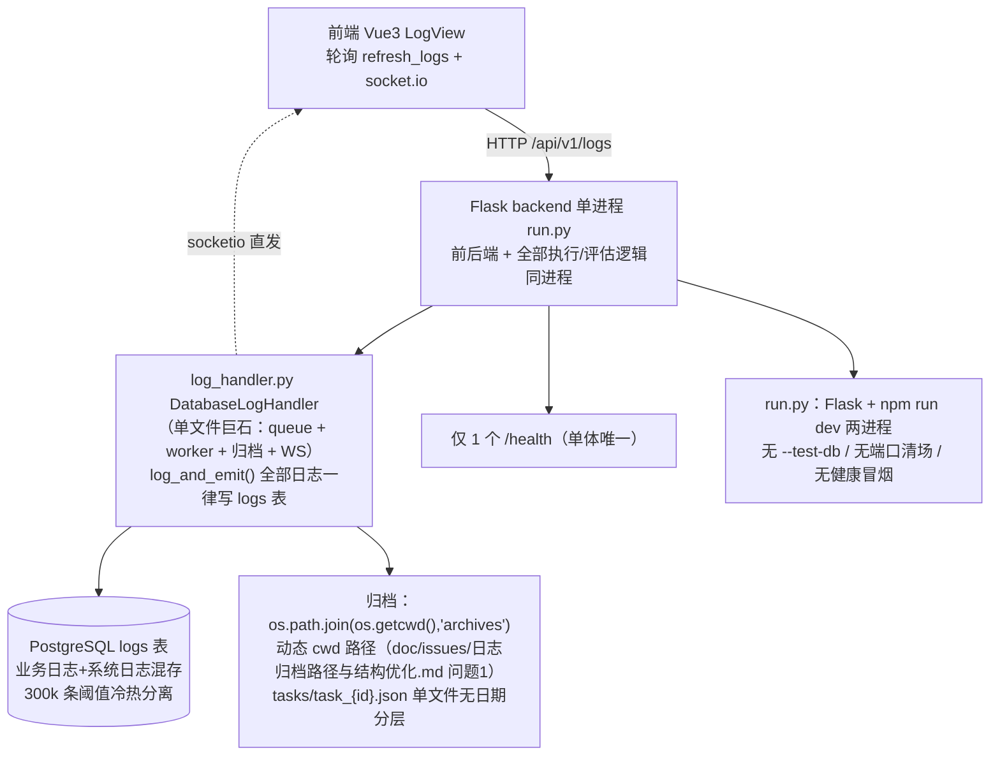
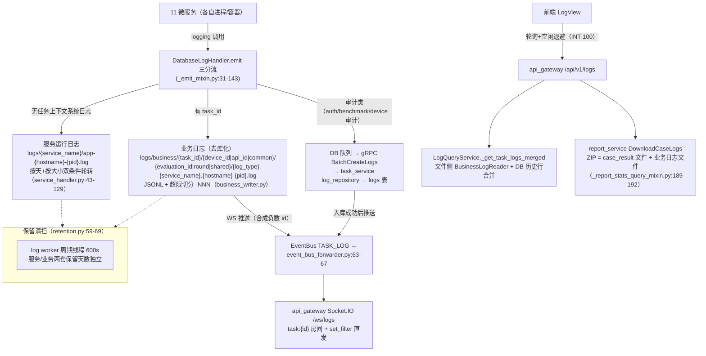

# INT-270 验收包 H. 横切·平台基建（LOG1 日志体系 / 资源巡检与服务健康 / 测试隔离 / 三形态部署）

> 编制：方案一致性审计员，2026-10-13。方法：按设计文档（权威基线 V9.7.31 树 doc/接口文档/日志接口文档.md + doc/issues/日志归档路径与结构优化.md + docs/微服务.md + INT-81 卡面规格）提取可验证契约，逐条到代码核验（shared/logging 基座 → log_handler 三分流 → 网关路由 → task_service gRPC 三层），全部结论带 file:line 证据；3 个专项（LOG1 日志体系 / 资源巡检·服务健康·测试隔离库 / run_all vs docker compose vs 生产部署三形态）+ 平台证据（INT-32 台账、INT-246/252/271/272 卡）交叉汇成。
>
> 代码基线：origin/V9.7.31 @ `3c0cfc7c`（INT-252 批次）+ 本地 12 个未推送 commit 至 `10e95cc6`（INT-246 隔离整改 `861c7f46` 未推送、in_progress）。文档基线：V9.7.31 树。核验为只读静态审计 + 磁盘实际日志产物核验 + INT-252 冒烟记录引用，未重跑实机栈（Docker 环境本轮刚由 INT-271 装好，容器形态仍未实测）。

---

## 1. 改造前后流程图

### 1.1 V9.7.10（单体）流程

依据 V9.7.10 实树核验（backend/utils/web/log_handler.py 单文件 900+ 行；backend/controllers/log_controller.py；backend/blueprints/log_bp.py 12 端点；run.py 单进程）：

要点：日志单表混存（业务+审计+系统），`log_and_emit` 是唯一入口；归档目录依赖 `os.getcwd()` 启动方式（修复前）；无服务级健康口径（单 /health）；无隔离库概念（单库直用）；启动无清场与冒烟。

### 1.2 V9.7.31（微服务）流程

依据 shared/logging/ 9 文件基座（INT-81）+ shared/utils/log_handler/ 10 文件（M 拆分）+ api_gateway 日志服务三层 + tests/conftest.py 守卫，经代码与磁盘产物核验：

### 1.3 差异说明（架构演进点逐条）

| # | V9.7.10 单体 | V9.7.31 微服务 | 依据 |
|---|---|---|---|
| 1 | 日志一律写 logs 表（log_and_emit 单入口，业务/审计/系统混存） | 三分流：业务日志按 task_id 路径去库化落文件；审计类落库；系统日志只写服务文件 | _emit_mixin.py:22-89；INT-81 卡规格 2 |
| 2 | 无轮转（靠 DB 冷热归档兜量） | 服务日志按天+按大小双条件轮转（`-{YYYYMMDD}-{NNN}.log`），业务文件超限切分 `-NNN` | service_handler.py:88-131；path_builder.py:106-120 |
| 3 | 归档路径 `os.getcwd()/archives` 动态 cwd | 本地文件路径统一 `LOG_ROOT_DIR`（静态配置）+ OSS 归档经 storage 抽象（不再落 cwd） | config.py:96；log_query_service.py:378-380 |
| 4 | 归档按单 ID 存 JSON 无日期分层（修复文档已裁定新结构） | DB 归档按 `task_case/{task}/{case}/{date}` 四级分组（archive 保留）；业务日志天然按 task/device/eval 层级 | log_repository.py `archive()`；INT-81 卡路径模板 |
| 5 | 多进程不安全（单进程单体无此问题；`{pid}` 后缀仅本进程） | 进程标识 `{hostname}-{pid}` 合取唯一：同宿主多进程靠 PID、容器多副本靠 Docker 短容器 ID（INT-81 三轮审计收口） | identity.py:20-26；INT-81 评论史 01a12549/01a12567 |
| 6 | 无服务级健康口径 | health_smoke 25/25：10 HTTP /health + 11 gRPC TCP + 3 infra + 前端（INT-108 把 gRPC-only 纳入口径） | scripts/health_smoke.py:47-81 |
| 7 | 无服务注册 | Redis 注册表 TTL=15s 心跳 + `get_alive_ids` 存活集 + 孤儿任务收养（task 调度器）+ Realtime 会话亲和 | service_registry.py:76-153；scheduler.py:255-264 |
| 8 | 单库无隔离 | 双库硬隔离：pytest 会话守卫 + tests/api 实机门禁 + `/health database` 字段 + `--test-db` 起栈 + 清库脚本硬拒共享库名 | conftest.py:60-76；database.py:18-22；INT-246 |
| 9 | run.py 两进程（backend+frontend） | run_all.py 15 进程编排（3 infra + 11 后端 + 前端）+ 端口就绪探测 + 可选 mock + `--test-db` | run_all.py:113-139,567-577 |
| 10 | 无日志脱敏 | `mask_text` 出口级统一脱敏（文件/WS/DB/控制台四出口全收口） | secret_mask.py:81；_emit_mixin.py:49-51；service_handler.py:141-145 |
| 11 | 启动无清场、无并发隔离 | `cleanup_occupied_ports` 启动清场（正在被 INT-272 裁定废除）+ xdist `-n 8 loadgroup` 文件级分组 + 并行隔离栈（端口+1000） | run_all.py:238-258,568；tests/README.md；parallel_stack.py:1-60 |
| 12 | 日志 WS 为 socketio 进程内直发 | 五通道 EventBus 收敛（log_and_emit 废弃裸 socketio），api_gateway 统一转发 Socket.IO /ws/logs | _websocket_mixin.py:4-44；INT-69 |

---

## 2. 能力验收手册（负责人可执行）

环境准备：`python run_all.py --test-db`（隔离库起栈，INT-246 口径；隔离库不存在自动创建）。冒烟后 `python scripts/reset_test_db.py` 清库。标准健康判据 = `python scripts/health_smoke.py` 25/25 PASS。入口 `http://localhost:5173`（hash 路由）。账号 `admin/admin123` 或 `dev_user/dev_password`（引导建号 admin）。本域页面：`/#/LogView`（日志查看，路由 meta.permission='log:read'）。

### A. 服务运行日志（LOG1 ①）

| # | 操作 → 期望结果 |
|---|---|
| A1 | 起栈后查 `logs/api_gateway/` → 存在 `app-{hostname}-{pid}.log`（hostname=DESKTOP-3SNNDSS），另服务各自目录 `logs/{service_name}/` 共 11+ 目录（磁盘已核验存在） |
| A2 | 人为把 `LOG_SERVICE_MAX_MB=1` 重启 → 日志超 1MB 触发轮转，产出 `app-{host}-{pid}-{YYYYMMDD}-001.log` 序号递增（磁盘先例：logs/audio_service/app-DESKTOP-3SNNDSS-7180-20261013-001.log） |
| A3 | 跨天持续运行 → 午夜后首条日志触发按天轮转，文件名日期段切换且不覆盖同日切分文件（单测 test_day_change_rotates_before_write / test_day_rollover_after_size_split_no_overwrite 钉死） |
| A4 | 查任一服务日志内容 → 密钥/敏感头（api_key/authorization/token 类键值）已掩码 `****`（出口级 mask_text 兜底） |
| A5 | 双进程并发写同服务目录（如网关 + 重启后旧进程残留）→ 各自持有独立活跃文件互不覆盖（test_simultaneous_rollover_no_cross_replace） |

### B. 业务日志去库化（LOG1 ②）

| # | 操作 → 期望结果 |
|---|---|
| B1 | 跑一个 E2E/API 任务 → `logs/business/{task_id}/{device_id 或 common}/{round 或 shared}/execution.task_service.{hostname}-{pid}.log` 出现 JSONL 行；评估期 `evaluation.*` 落评估目录；设备链路 `device.*`（category device/audio + task_id 走业务路径而非审计入库） |
| B2 | 打开 `/#/LogView` 按任务过滤 → 日志列表含文件侧业务日志（merged 视图：文件条目 + DB 历史行按时间倒序）；任务详情页日志随执行实时追加（task_log 房间推送，执行详情模态窗可见） |
| B3 | 核验去库化：任务执行期查 DB `logs` 表 → 无该 task_id 新增业务行（审计事件除外）；`LOG_BUSINESS_DB_ENABLED=true` 回滚开关重启 → 业务日志恢复双写（兼容性回退，test_business_db_enabled_rollback_double_writes） |
| B4 | 大文件任务 → 单文件超 `LOG_BUSINESS_MAX_MB`（默认 50MB）切分 `-001.log`（磁盘先例：business/493/common/shared/execution.task_service.DESKTOP-3SNNDSS-33980-001.log） |
| B5 | 报告页用例日志下载 `GET /reports/{id}/cases/{cid}/logs/download` → ZIP 内含 `business_logs/` 前缀的业务日志文件 + case_result 文件 + adjusted_reference_params.json |
| B6 | 日志页实时监控 → 开启后轮询（基础间隔 + 空闲 2^n 退避至上限，无新日志自动降频）；任务作用域时直接重查列表（INT-100 口径），延迟列显示 ms |

### C. 日志管理面（LOG1 ③）

| # | 操作 → 期望结果 |
|---|---|
| C1 | `/#/LogView` 多维筛选（级别多选/模块/分类/时间/关键字/标记）→ 服务端分页返回正确（INT-100 下推 task_service DB 过滤 + 文件侧 reader 过滤） |
| C2 | 异常流：guest 角色访问 `/#/LogView` → 路由守卫重定向；直接 `GET /api/v1/logs` → 403 缺 `log:read`；`PUT /logs/mark`、`POST /logs/clear`/`/refresh` → 403 缺 `log:manage`（log_bp.py:11-81 权限点全挂） |
| C3 | 标记/批量标记 → `PUT /logs/mark` 生效，标记色持久；清除（beforeDatetime + keepMarked=true）→ 旧日志删除且已标记保留，返回 deletedCount |
| C4 | 导出 excel/csv/json/txt 四格式 → 文件流下载正确 |
| C5 | 异常流（已知缺口 INT-274，backlog）：清除/批量标记/导出的确认弹窗点「确定」当前为空操作（onConfirm 未被模态容器消费）——验收时按现状记录，修复后复验 |
| C6 | 归档 API（`GET /logs/archive/status` 等 5 端点已挂权限且走 task_service gRPC/OSS）→ 接口 200；⚠️ 前端 LogView 未接线归档面板（adapter 有 toLogArchiveStatus 但无调用方）——按 §5-#5 口径缺席验收 |
| C7 | DB 归档触发（logs 总量超 30 万阈值时 worker 后台线程）→ 冷日志按 task_case/task/case/other 四级分组上传 OSS archives 桶并删除原行；过期归档（90 天）自动清理（_clean_expired_archives） |

### D. 资源巡检 / 服务健康

| # | 操作 → 期望结果 |
|---|---|
| D1 | `python scripts/health_smoke.py` → 25/25 PASS（10 HTTP /health 逐服务 + 11 gRPC TCP 探测含 audio 50052/device 50053 + redis/postgres/rustfs + 前端 5173）；`--json` 可机读；退出码 0/1 可作门禁 |
| D2 | 停掉任一后端服务再跑 → 该服务 FAIL、脚本退出码 1（INT-108 故障模式：audio_service gRPC 缺席不再被 HTTP 全绿掩盖） |
| D3 | Redis 起栈后 `redis-cli HGETALL service:instances` → 已启动服务各自实例行（name/host/port/last_heartbeat），心跳每 5s（TTL 15s ÷ 3）续期；kill 实例 → 15s 后 `get_alive_ids` 不再返回（孤儿收养/亲和重路由依据） |
| D4 | 归档巡检不阻塞日志批刷：task_service gRPC 慢时日志 worker 不挂（归档巡检已移后台线程、进行中不重叠——INT-55 缺陷二机器态根因修复态，_worker_mixin.py:63-77） |

### E. 测试隔离库（INT-246）

| # | 操作 → 期望结果 |
|---|---|
| E1 | `python run_all.py --test-db` → 控制台 `[TEST-DB]` 提示切库；`curl localhost:5000/health` → `"database":"intelligent_audio_test_test"`；共享业务库本栈不可见 |
| E2 | 裸跑 `python -m pytest tests -q -n 8 --dist loadgroup` → 会话守卫放行（DATABASE_URL 未预置时兜底进程级 sqlite）；shell 预置 `DATABASE_URL` 指向共享业务库再跑 → 整个 pytest 会话拒绝启动（RuntimeError，INT-246 守卫） |
| E3 | `RUN_LIVE_STACK=1 python -m pytest tests/api -q` 对共享库栈 → 门禁 FAIL（/health database 字段 == shared 库名即拒绝）；对隔离库栈 → 正常执行 |
| E4 | 冒烟后 `python scripts/reset_test_db.py` → 隔离库 TRUNCATE 全表 + RESTART IDENTITY；传 `--db-name intelligent_audio_test` → 拒绝退出（硬编码双保险） |
| E5 | xdist 并行回归 → 同文件用例固定同 worker（默认文件分组），跨文件并行；xdist worker 各得独立临时库 |
| E6 | `python tests/ui/run_gate.py` → 自动起端口+1000 并行隔离栈（网关 6000/前端 6273，隔离库），UI 用例 11 例执行，门禁 PASS/FAIL 结论明确；栈未隔离即拒绝误连 |

### F. 三形态部署（run_all / docker compose / 生产）

| # | 操作 → 期望结果 |
|---|---|
| F1 | 本地形态：`python run_all.py`（+.env）→ 15 进程就绪、health_smoke 25/25；Ctrl+C 全停；`--test-db` 见 E1；`MOCK_SERVICES_ENABLED=true` 额外拉起 3 个 mock 替身 |
| F2 | 容器形态：`cd docker && docker compose up -d --wait` → 15 容器（11 后端 + 3 infra + 前端）healthcheck 全绿（INT-271 已装好 Docker Desktop 4.95.0 + WSL2，判据达成 2026-10-13）；api_test_service 2 副本不发布宿主端口；日志卷 service_logs 12 处挂载共享 |
| F3 | 生产形态（compose 为底）：`VITE_AUTH_MODE` 未显式设置 → compose 报错退出（禁止静默默认 off，INT-181）；AUTH_MODE/JWT_SECRET 经环境变量覆盖 |
| F4 | ⚠️ 已知差异：run_all 启动期 `cleanup_occupied_ports` 会杀占用端口进程（568 行）；容器形态遇端口占用直接报错——两形态语义不同，本卡验收按现状记录（根治 = INT-272 裁定废除清场，backlog） |
| F5 | ⚠️ 生产部署文档（doc/部署文档/ 两篇）仍为 V9.7.10 单体口径（Flask backend/Dockerfile、ia-backend 容器、backend/ 目录结构）——与 V9.7.31 微服务 compose 编排不符（§5-#9 回写项）；V9.7.31 的权威部署参考 = docs/微服务.md「Docker 部署」节 + docker/docker-compose.yml 本体 |

---

## 3. 自动化证据

### 3.1 pytest 覆盖清单（静态统计 `def test_`，2026-10-13，基线 `10e95cc6`）

| 域 | 文件 | 用例数 |
|---|---|---|
| LOG1 主体系（路径模板/写入/读取/轮转/清扫） | test_int81_log_system(28) / test_int81_acceptance_rotation(4) / test_int81_audit_rework(20) | **52** |
| LOG1 读取侧优化（INT-100/128） | test_int100_log_query_pushdown(23) / test_int100_acceptance_independent(10) / test_int128_acceptance_independent(8) / test_int128_scan_cache_entry_cap(10) | **51** |
| 脱敏/控制台安全（INT-70/102） | test_int70_api_key_chain(40) / test_int102_console_safe_logging(11) | **51** |
| 审计分流/日志源 | test_log_handler_audit_emit(6) / test_int153_wakeup_log_source(7) | **13** |
| **本域后端单测小计** | **11 文件** | **167** |
| 服务注册/事件隔离/亲和（横切基建） | test_uc1001_event_isolation(17) / test_int61_realtime_session_registry(21，含 FakeRegistry 存活判定) / test_int76(收养正例) | 38+ |
| 测试基建自身（INT-234/238 链） | integration 域日志根按用例边界重定向（conftest.py:147-160 机制，test_log_handler_audit_emit 断言落点） | 含于上 |
| UI 自动化（INT-260，登录/导航/视图切换） | tests/ui/ 3 文件（run_gate 并行隔离栈门禁） | 11 |
| 前端 vitest（本域相关） | logView.realtimePoll(3) + taskChannel.connection 等 | 全仓 46 spec / 326+ 例 |
| 全量回归口径 | INT-252 批次 | **2917 passed / 103 skipped**（1 flake 单跑 9/9 绿） |

- INT-81 测试特征：轮转竞态用真实双进程并发验证（TestTwoProcessConcurrency / TestContainerPidCollision 同 PID 异容器模拟 / TestCrossLineageRotationIsolation），非 monkeypatch。
- 门禁：无 pytest.ini，靠 conftest——INT-246 会话守卫、xdist loadgroup、integration 日志根隔离三层。

### 3.2 审计/测试卡引用（INT 卡号，均 done 除注明外）

- **本域一致性审计**：INT-247（INT-234 日志根隔离修复核验）、INT-263 §3.2 21 张全量审计清单中的横切项（INT-178 MOCK 契约 / INT-221 收敛链 / INT-243 网关 422 等）。
- **本域改造/缺陷卡**：INT-81（LOG1 主卡，三轮审计收口）、INT-70（脱敏）、INT-100/128（读取侧）、INT-102（GBK 管道）、INT-108（gRPC 健康口径）、INT-114（adapter gRPC 纳管）、INT-55（归档巡检阻塞）、INT-84（teardown 污染）、INT-96/163（xdist 隔离）、INT-137/182（mock 替身）、INT-234/238（日志根隔离）、INT-246（库隔离，in_progress）、INT-252（隔离库重建）。
- **部署/环境**：INT-28/29（transfer_agent）、INT-31（G2 compose 补齐）、INT-241（cancelled）、INT-220（Docker 化需求入口，in_review）、INT-271（Docker 环境，done）、INT-272（compose 化根治，backlog）。
- **UI/UX**：INT-260（UI 门禁，done）、INT-274（LogView 确认弹窗缺陷，backlog）。

### 3.3 集成批次推送记录（台账 INT-32）

| 批次 | 范围 | 本域内容 |
|---|---|---|
| INT-52..136 早期 | 建基线 | log_handler M 拆分、P0-3 gRPC 化 |
| INT-224/226 | ..0422af95..4d86c4c4 | INT-81 相关族入库 |
| INT-232/236 | ..8f7bdbfd..9ab02955 | INT-234 日志根隔离、INT-238 修复、INT-102/108 族 |
| INT-242/252 | ..f0a4c599..3c0cfc7c | 回归 2917 过/103 skip；冒烟 25/25 + API 9/9 + UI 3/3；隔离库按规范整库重建 |
| 未推送 12 commit（3c0cfc7c..10e95cc6） | 861c7f46..10e95cc6 | **INT-246 隔离整改（本域核心未推送改动）**随下批；余为 A~F 域修复 |

---

## 4. 特性专项（逐条结论 + 证据）

### 4.1 LOG1 日志体系（轮转/路径去库化）——12 项契约核验

| 文档条款（INT-81 卡规格 + 日志接口文档 + doc/issues/日志归档路径与结构优化.md） | 代码位置 | 结论 |
|---|---|---|
| 服务运行日志落 logs/{service_name}/，按天+按大小双条件轮转，阈值配置化 | service_handler.py:43-131；config.py:100-101（LOG_SERVICE_MAX_MB=50 / RETENTION_DAYS=30） | ✅ |
| 轮转命名带同日序号不覆盖；Windows 占用重试后放弃不中断写入 | service_handler.py:99-129（`-{day}-{seq:03d}`；os.replace 重试一次） | ✅ |
| 多进程/多副本安全（QueueHandler 或进程独立文件名）→ 实现 `{hostname}-{pid}` 合取，容器多副本靠短容器 ID | identity.py:20-26；service_handler.py:34-40；单测 TestContainerPidCollision 族 | ✅（INT-81 三轮审计收口） |
| 保留 N 天由清扫器清理 | retention.py:19-69；log worker 600s 周期（_init_mixin.py `_sweep_check_interval`） | ✅ |
| 业务日志路径 `business/{task_id}/{device_id|api_id|common}/{evaluation_id|round|shared}/{log_type}.{service_name}...` 唯一权威实现 + sanitize 拒路径穿越 | path_builder.py:38-98（_SEGMENT_SAFE_RE 白名单）；test_sanitize_rejects_traversal | ✅ |
| 业务日志停止写 logs 表，log_type 四类（execution/evaluation/device + 映射） | enums.py:9-35；_emit_mixin.py:83-89（有 task_id 一律走文件，审计类别不抢道——INT-81 审计问题 4 固化） | ✅ |
| logs 表只保留审计事件与系统级日志（总控裁定：不存索引元数据） | AUDIT_LOG_CATEGORIES（auth/benchmark/device 审计）+ 无 task_id 系统日志入 DB 队列（_emit_mixin.py:91-138） | ✅ |
| 去库化回滚开关（兼容性双写） | config.py:105 LOG_BUSINESS_DB_ENABLED=False 默认；_emit_mixin.py:86-88,145-190 | ✅ |
| 读取侧兼容：log_bp 查询改文件+DB 合并视图，按 task/device/eval 检索 | log_query_service.py:62-70,133-203；business_reader.py（382 行）；历史 logs 表保留只读 | ✅ |
| 单文件超限切分 -001/-002 | business_writer.py:154-170 + path_builder.next_split_path（序号按进程隔离） | ✅（磁盘先例 business/493/...-001.log） |
| prod 下 DEBUG 级不落业务文件；时间格式统一固定 strftime | enums.py:42 LOG_TIME_FORMAT；_emit_mixin.py:202-204 is_prod 过滤 | ✅ |
| 报告用例日志下载走文件（ZIP 含 business_logs/） | _report_stats_query_mixin.py:69-192（_write_business_log_files + BusinessLogReader.load_file_bytes） | ✅ |

**磁盘产物实证**（本机 logs/）：11 服务目录齐备；轮转名两代并存（早期 `app-20261010-001.log` 与现行 `app-{host}-{pid}-{YYYYMMDD}-001.log`）；业务日志 `business/{task}/{target}/{scope}/*.log` 三层真实存在（含 task_id=1 的 evaluation.dev.{pid}.log 族）。

### 4.2 资源巡检 / 服务健康 / 服务注册

- **健康口径**：health_smoke 25 项（10 HTTP + 11 gRPC + 3 infra + 前端）为 INT-108 定义的权威口径，INT-252 批次冒烟 25/25 通过；网关 /health 额外携带 `version=V9.7.31`（跨版本误连防护）与 `database=`（INT-246 门禁字段）两枚举证锚点（app.py:163-171）。
- **服务注册**：Redis Hash + Set，TTL=15s，心跳线程 ttl//3=5s 续期（service_registry.py:76-153）；5 个 HTTP 服务 + transfer_agent 注册；消费方两处——任务创建时 `discover('task_service')` 选最闲实例归属（command_handlers.py:157-165）、调度器 `get_alive_ids` 做孤儿收养（scheduler.py:255-264）；Realtime 会话亲和复用同一注册表（realtime_session_registry.py，单测 21 例）。
- **⚠️ 半成品**：`update_load(running_tasks, cpu_load)` 方法存在但全仓无运行时调用点（grep 仅定义与测试桩）——注册表内 running_tasks 恒 0，`discover` 的「按负载排序」实际退化为注册序；cpu_load 字段恒 0.0。无 psutil 采集、无独立资源巡检端点。影响面小（当前均为单实例部署，排序退化无实害），多副本水平扩展前需接线。记入 §5-#7。
- **归档巡检**：DB 侧冷热分离（300k 阈值/7 天热数据/90 天归档保留，_constants.py）+ OSS 过期清理分页列举，已移出日志批刷关键路径（INT-55 修复，后台线程不重叠）。

### 4.3 测试隔离库（INT-246）——机制本体已验证，整改收尾在途

- **三层门禁齐备**：①pytest 会话守卫（conftest.py:60-76，指向共享业务库即拒启动）；②实机门禁（tests/api/conftest.py `_live_stack_gate`，/health database 字段校验 + PLATFORM_VERSION 版本标记）；③清库脚本硬编码双保险（reset_test_db.py 传共享库名即拒）。
- **起栈切换**：run_all.py `_apply_test_db_override`（:602-644）幂等切库 + 自动建隔离库；`/health` database 字段供所有 run 只读核验。
- **台账证据**：INT-246 验收轮发现「清库后 7 分钟被新 agent run 直起共享库栈击穿」打回（验收不通过评论 01a13418）；整改已停常驻共享库栈、登记结构性缺口（uvicorn 直启/gRPC 直连通道不受门禁约束，建议 run_all 启动守卫 + 流水线约定）——**该卡 in_progress，两项待负责人确认（R10 残留软删清单 + 栈处置 a/b/c）**。
- 结论：机制本体（守卫/门禁/清库/--test-db）全 ✅ 且经 INT-252 实栈验证；「任何通道都进不来」的终极保证未达成（in_progress 卡跟踪，非本验收可关闭项）。

### 4.4 run_all 本地启动 vs docker compose vs 生产部署三形态

| 维度 | run_all（本地开发） | docker compose（容器/生产基座） | 生产部署文档（doc/部署文档/） |
|---|---|---|---|
| 编排范围 | 3 infra + 11 后端 + 前端 vite + 可选 3 mock（15-18 进程） | 11 后端 + 3 infra + 前端 nginx 容器（15 容器，mock 不入编排） | 单体：Flask backend + frontend 两容器（**过时**） |
| 端口策略 | 宿主端口直绑（5000-5010/5173/50052/50053） | 同端口映射；api_test_service 2 副本不发布宿主（INT-69 会话亲和） | 5000/80 |
| 启动前清场 | `cleanup_occupied_ports` 杀占用端口进程（INT-272 已裁定废除方向） | 无清场，端口占用即报错（compose up --wait） | 无 |
| 隔离库 | `--test-db` 一键切换 | DATABASE_URL 环境变量注入（无专用开关，等价能力） | 无 |
| 健康探测 | 端口就绪逐服务等待 + 外部 health_smoke | compose healthcheck 12 处 + depends_on condition | 无 |
| 日志落点 | ./logs（LOG_ROOT_DIR 默认） | /app/logs 统一卷 service_logs（12 处挂载，INT-81） | 容器 stdout + logrotate 建议 |
| 认证变量 | .env AUTH_MODE=dev（当前） | AUTH_MODE 注入 api_gateway/auth_service；VITE_AUTH_MODE 强制显式 | Flask SECRET_KEY（过时） |
| 实测状态 | **多轮实机验证**（INT-252 冒烟 25/25、INT-246 隔离正例 /health 校验通过） | **未实测**（INT-241 cancelled→INT-271 刚装好 Docker，容器形态首次验证待 INT-272/下批集成） | 未随微服务化更新 |

- 差异风险如实记录：①文档形态（§5-#9）；②容器形态零实测（§5-#8）；③清场语义两形态不一致（§2-F4）。

---

## 5. 已知缺口与风险（诚实清单）

| # | 缺口/风险 | 等级 | 依据 | 状态 |
|---|---|---|---|---|
| 1 | **uvicorn 直启 / gRPC 直连通道绕过全部隔离门禁**：pytest 守卫与 tests/api 门禁只管 pytest 与实机门禁两入口；agent run 或人手直起 `uvicorn`（默认连共享库）或直连 gRPC 写行（INT-246 实证 probe_user_x1 事件）均无机器强制拦截 | 中 | INT-246 评论 01a13441（结构缺口新发现节） | INT-246 in_progress 跟踪；建议 run_all 启动守卫 + shared 配置层兜底（规划师拍板） |
| 2 | **INT-246 隔离整改未推送**：`861c7f46`（会话守卫/实机门禁/--test-db/清库脚本）在本地 12 个未推送 commit 中，卡 in_progress 且 R10 残留清单与栈处置待负责人确认 | 中 | git log 3c0cfc7c..HEAD；INT-246 07:54Z 评论 | 随下批集成收口 |
| 3 | **LogView 三危险操作确认弹窗空操作**（清除/批量标记/导出点确定无动作，onConfirm 未被 GlobalModalContainer 消费） | 中（用户可见功能缺陷） | INT-274 卡面（logView.ts:362,398,555 vs GlobalModalContainer.vue:35-43） | INT-274 backlog |
| 4 | **归档管理面前端未接线**：后端 5 个归档端点 + 前端 DTO/adapter 就绪，但 LogView 无任何归档面板调用（归档仅后台自动 + API 直调可达）；V9.7.10 亦无归档 UI（对齐无损，能力缺席口径） | 低 | grep 前端无 /logs/archive 调用方；logAdapter.ts:79-85 | 拍板是否补 UI |
| 5 | **log:websocket 权限点空挂**：seed 100 点含 `log:websocket`（seed_rbac.py:141,207），但 Socket.IO 挂 /socket.io 白名单（middleware.py:118）+ connect 处理器无 token 校验——日志 WS 推送实际免认证；V9.7.10 同样未挂（对齐无损）。dev/off 模式无实害，prod 前收口 | 低-中 | seed_rbac.py:141；middleware.py:118；socketio_server.py:219-234 | 建议并入 INT-269 缺口#1 同类补标卡 |
| 6 | **前端日志页无 set_filter 消费**：Socket.IO 服务端支持 set_filter 定向下发（socketio_server.py:48,115-135），前端无调用方——过滤型 WS 推送能力闲置（房间投递为主路径，功能不受损） | 低 | grep 前端无 set_filter | 记录在案 |
| 7 | **服务注册 update_load 无调用点**：running_tasks/cpu_load 恒 0，「按负载排序」退化为注册序；无 psutil 资源巡检采集（「资源巡检」诉求当前 = health_smoke 静态探测 + 归档巡检，无动态资源指标） | 低-中（多副本前须接） | service_registry.py:134 全仓无运行时调用；本审计 §4.2 | 多实例扩展前接线 |
| 8 | **docker compose 容器形态零实测**：compose 文件齐备（15 服务 healthcheck 全配、api_test 2 副本、日志卷共享），但本机 Docker 2026-10-13 才由 INT-271 装好（client/server 29.8.2 + compose v5.6.0 验证过），多副本会话亲和/共享日志卷/USB 设备透传（e2e/device `/dev/bus/usb`）均未在容器跑过 | 中 | INT-271 done 评论（10:58Z）；INT-241 cancelled | INT-272（backlog）+ 下批集成首验 |
| 9 | **生产部署文档过时**：doc/部署文档/ 两篇均为 V9.7.10 单体口径（Flask backend 容器、backend/ 目录、`PostgreSql:///data.db` 错误连接串、`apt install PostgreSql3` 笔误）；docs/微服务.md「Docker 部署」节为现行权威但称「11 个后端服务」未提 transfer_agent（compose 亦无 transfer_agent 服务定义——跨区传输在容器形态缺席） | 中（文档+compose 覆盖面） | 部署文档全文；docker-compose.yml 无 transfer_agent；docs/微服务.md:142 | 文档回写专项；transfer_agent 容器化并入 INT-272 范围核对 |
| 10 | **LOG_BUSINESS_MAX_SCAN_ENTRIES 下界语义**：超限查询 total 为下界（最新行优先保留），前端计数可能少于真实总量——INT-100 裁定的兜底语义，已文档化，验收按现状 | 低 | log_query_service.py:120-130 注释 | 已裁定语义 |
| 11 | **run_all 启动清场**：`cleanup_occupied_ports` 会杀占用端口的任意进程（含他人在跑栈）——INT-220 七起停机事故根因之一，成员已裁定 compose 化根治 + 废除清场 | 中（过渡期风险） | run_all.py:238-258,568；INT-220 卡面 | INT-272 backlog（Docker 就绪后推进） |
| 12 | **INT-304 HEAD 构建失败**（npm run build 因 device.ts 遗漏提交 5 处 TS 错，in_progress）——阻塞生产形态前端镜像构建 | 中 | INT-304 卡面 | in_progress |

---

## 6. 验收判定

- **卡面签收标准：手册全过 + 无未处置 P1 缺陷 → 本卡 done。**
- 材料齐备度：自动化证据齐（§3：本域 167 后端单测 + 38 注册/隔离族 + 11 UI 用例，均含于 INT-252 全量回归 2917 通过批次）；LOG1 全链（轮转/去库化/读取侧/下载/脱敏）实机多轮走通（INT-81 三轮审计 + INT-252 冒烟日志洪泛扫描通过 + 磁盘产物核验）；隔离机制三层门禁经 INT-252 实栈验证（25/25 + database 字段 + 整库重建）。
- 缺口面：无未处置 P1——§5 全部为 P2 及以下；最重为 #1 通道绕过（INT-246 在办跟踪）与 #8 容器形态零实测（INT-272 承接，Docker 环境今日刚就绪）。
- 审计员判定建议：**有条件通过**——①§2 手册 A~E 实机走查（预期全过，B2 合并视图与 E2 会话守卫为关键项）；②F2/F3 容器形态待 Docker 首跑后补验（不阻塞本卡，INT-272 承接）；③INT-246 两项确认请负责人回复收口；④§5-#9 部署文档回写 + transfer_agent 容器化核对并入下批专项（不阻塞本卡 done）。
